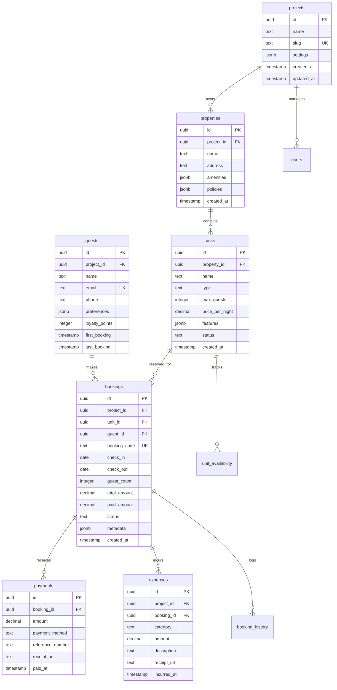

# 🗄️ Database Schema Documentation

## Overview

The Okaeri Resort System uses PostgreSQL (via Supabase) with a carefully designed schema optimized for multi-tenant resort management. The database implements Row Level Security (RLS) for data isolation and uses advanced PostgreSQL features for performance and data integrity.

## 📊 Entity Relationship Diagram



## 📋 Core Tables

### projects

Central table for multi-tenant isolation. Each resort operator has their own project.

```sql
CREATE TABLE projects (
    id UUID PRIMARY KEY DEFAULT uuid_generate_v4(),
    name VARCHAR(255) NOT NULL,
    slug VARCHAR(255) UNIQUE NOT NULL,
    owner_id UUID REFERENCES auth.users(id),
    settings JSONB DEFAULT '{}',
    subscription_tier VARCHAR(50) DEFAULT 'free',
    created_at TIMESTAMPTZ DEFAULT NOW(),
    updated_at TIMESTAMPTZ DEFAULT NOW()
);

-- Indexes
CREATE INDEX idx_projects_owner ON projects(owner_id);
CREATE INDEX idx_projects_slug ON projects(slug);
```

**Settings JSON Structure**:

```json
{
  "timezone": "Asia/Manila",
  "currency": "PHP",
  "language": "en",
  "notifications": {
    "email": true,
    "sms": false,
    "push": true
  },
  "booking": {
    "requireDeposit": true,
    "depositPercentage": 50,
    "cancellationDays": 7
  }
}
```

### properties

Physical resort properties managed within a project.

```sql
CREATE TABLE properties (
    id UUID PRIMARY KEY DEFAULT uuid_generate_v4(),
    project_id UUID NOT NULL REFERENCES projects(id) ON DELETE CASCADE,
    name VARCHAR(255) NOT NULL,
    address TEXT,
    city VARCHAR(100),
    province VARCHAR(100),
    zip_code VARCHAR(20),
    phone VARCHAR(50),
    email VARCHAR(255),
    amenities JSONB DEFAULT '[]',
    policies JSONB DEFAULT '{}',
    images JSONB DEFAULT '[]',
    is_active BOOLEAN DEFAULT true,
    created_at TIMESTAMPTZ DEFAULT NOW(),
    updated_at TIMESTAMPTZ DEFAULT NOW(),

    CONSTRAINT unique_property_name_per_project
        UNIQUE(project_id, name)
);

-- Indexes
CREATE INDEX idx_properties_project ON properties(project_id);
CREATE INDEX idx_properties_active ON properties(is_active);
```

### units

Individual bookable units (rooms, villas, etc.) within properties.

```sql
CREATE TABLE units (
    id UUID PRIMARY KEY DEFAULT uuid_generate_v4(),
    property_id UUID NOT NULL REFERENCES properties(id) ON DELETE CASCADE,
    name VARCHAR(255) NOT NULL,
    type VARCHAR(50) NOT NULL, -- 'room', 'villa', 'suite', 'dormitory'
    max_guests INTEGER NOT NULL CHECK (max_guests > 0),
    price_per_night DECIMAL(10,2) NOT NULL CHECK (price_per_night > 0),
    features JSONB DEFAULT '{}',
    images JSONB DEFAULT '[]',
    status VARCHAR(50) DEFAULT 'available', -- 'available', 'maintenance', 'blocked'
    sort_order INTEGER DEFAULT 0,
    created_at TIMESTAMPTZ DEFAULT NOW(),
    updated_at TIMESTAMPTZ DEFAULT NOW(),

    CONSTRAINT unique_unit_name_per_property
        UNIQUE(property_id, name)
);

-- Indexes
CREATE INDEX idx_units_property ON units(property_id);
CREATE INDEX idx_units_status ON units(status);
CREATE INDEX idx_units_type ON units(type);
CREATE INDEX idx_units_price ON units(price_per_night);
```

### guests

Guest profiles with booking history and preferences.

```sql
CREATE TABLE guests (
    id UUID PRIMARY KEY DEFAULT uuid_generate_v4(),
    project_id UUID NOT NULL REFERENCES projects(id) ON DELETE CASCADE,
    name VARCHAR(255) NOT NULL,
    email VARCHAR(255),
    phone VARCHAR(50),
    id_type VARCHAR(50), -- 'passport', 'drivers_license', 'national_id'
    id_number VARCHAR(100),
    date_of_birth DATE,
    nationality VARCHAR(100) DEFAULT 'Philippines',
    address TEXT,
    preferences JSONB DEFAULT '{}',
    loyalty_points INTEGER DEFAULT 0,
    total_bookings INTEGER DEFAULT 0,
    total_spent DECIMAL(12,2) DEFAULT 0,
    first_booking_date DATE,
    last_booking_date DATE,
    tags JSONB DEFAULT '[]', -- ['vip', 'regular', 'problematic']
    notes TEXT,
    created_at TIMESTAMPTZ DEFAULT NOW(),
    updated_at TIMESTAMPTZ DEFAULT NOW(),

    CONSTRAINT unique_guest_email_per_project
        UNIQUE(project_id, email)
);

-- Indexes
CREATE INDEX idx_guests_project ON guests(project_id);
CREATE INDEX idx_guests_email ON guests(email);
CREATE INDEX idx_guests_phone ON guests(phone);
CREATE INDEX idx_guests_name_search ON guests USING gin(name gin_trgm_ops);
```

### bookings

Core booking records with comprehensive status tracking.

```sql
CREATE TABLE bookings (
    id UUID PRIMARY KEY DEFAULT uuid_generate_v4(),
    project_id UUID NOT NULL REFERENCES projects(id) ON DELETE CASCADE,
    booking_code VARCHAR(20) UNIQUE NOT NULL,
    unit_id UUID NOT NULL REFERENCES units(id),
    guest_id UUID NOT NULL REFERENCES guests(id),
    check_in DATE NOT NULL,
    check_out DATE NOT NULL,
    guest_count INTEGER NOT NULL CHECK (guest_count > 0),
    adults INTEGER DEFAULT 1,
    children INTEGER DEFAULT 0,

    -- Pricing
    base_amount DECIMAL(10,2) NOT NULL,
    discount_amount DECIMAL(10,2) DEFAULT 0,
    tax_amount DECIMAL(10,2) DEFAULT 0,
    total_amount DECIMAL(10,2) NOT NULL,
    paid_amount DECIMAL(10,2) DEFAULT 0,
    balance_amount DECIMAL(10,2) GENERATED ALWAYS AS (total_amount - paid_amount) STORED,

    -- Status
    status VARCHAR(50) NOT NULL DEFAULT 'pending',
    payment_status VARCHAR(50) DEFAULT 'unpaid', -- 'unpaid', 'partial', 'paid', 'refunded'

    -- Metadata
    source VARCHAR(50) DEFAULT 'direct', -- 'direct', 'airbnb', 'booking.com', 'agoda'
    special_requests TEXT,
    internal_notes TEXT,
    metadata JSONB DEFAULT '{}',

    -- Timestamps
    confirmed_at TIMESTAMPTZ,
    checked_in_at TIMESTAMPTZ,
    checked_out_at TIMESTAMPTZ,
    cancelled_at TIMESTAMPTZ,
    created_at TIMESTAMPTZ DEFAULT NOW(),
    updated_at TIMESTAMPTZ DEFAULT NOW(),

    CONSTRAINT check_dates CHECK (check_out > check_in),
    CONSTRAINT check_valid_status CHECK (
        status IN ('pending', 'confirmed', 'checked_in', 'checked_out', 'completed', 'cancelled', 'no_show')
    )
);

-- Indexes
CREATE INDEX idx_bookings_project ON bookings(project_id);
CREATE INDEX idx_bookings_unit ON bookings(unit_id);
CREATE INDEX idx_bookings_guest ON bookings(guest_id);
CREATE INDEX idx_bookings_dates ON bookings(check_in, check_out);
CREATE INDEX idx_bookings_status ON bookings(status);
CREATE INDEX idx_bookings_code ON bookings(booking_code);
CREATE INDEX idx_bookings_created ON bookings(created_at DESC);
```

### payments

Payment records linked to bookings.

```sql
CREATE TABLE payments (
    id UUID PRIMARY KEY DEFAULT uuid_generate_v4(),
    booking_id UUID NOT NULL REFERENCES bookings(id) ON DELETE CASCADE,
    amount DECIMAL(10,2) NOT NULL CHECK (amount > 0),
    payment_method VARCHAR(50) NOT NULL, -- 'cash', 'gcash', 'bank_transfer', 'credit_card'
    reference_number VARCHAR(100),
    receipt_url TEXT,
    notes TEXT,
    status VARCHAR(50) DEFAULT 'completed', -- 'pending', 'completed', 'failed', 'refunded'
    paid_at TIMESTAMPTZ DEFAULT NOW(),
    created_at TIMESTAMPTZ DEFAULT NOW()
);

-- Indexes
CREATE INDEX idx_payments_booking ON payments(booking_id);
CREATE INDEX idx_payments_method ON payments(payment_method);
CREATE INDEX idx_payments_status ON payments(status);
CREATE INDEX idx_payments_date ON payments(paid_at DESC);
```

### expenses

Expense tracking for bookings and general operations.

```sql
CREATE TABLE expenses (
    id UUID PRIMARY KEY DEFAULT uuid_generate_v4(),
    project_id UUID NOT NULL REFERENCES projects(id) ON DELETE CASCADE,
    booking_id UUID REFERENCES bookings(id) ON DELETE SET NULL,
    category VARCHAR(50) NOT NULL, -- 'supplies', 'maintenance', 'utilities', 'salary', 'marketing'
    amount DECIMAL(10,2) NOT NULL CHECK (amount > 0),
    description TEXT NOT NULL,
    vendor VARCHAR(255),
    receipt_url TEXT,
    payment_method VARCHAR(50),
    is_recurring BOOLEAN DEFAULT false,
    incurred_at DATE DEFAULT CURRENT_DATE,
    created_at TIMESTAMPTZ DEFAULT NOW(),
    updated_at TIMESTAMPTZ DEFAULT NOW()
);

-- Indexes
CREATE INDEX idx_expenses_project ON expenses(project_id);
CREATE INDEX idx_expenses_booking ON expenses(booking_id);
CREATE INDEX idx_expenses_category ON expenses(category);
CREATE INDEX idx_expenses_date ON expenses(incurred_at DESC);
```

## 🔐 Row Level Security (RLS)

All tables implement RLS for multi-tenant data isolation:

```sql
-- Enable RLS on all tables
ALTER TABLE projects ENABLE ROW LEVEL SECURITY;
ALTER TABLE properties ENABLE ROW LEVEL SECURITY;
ALTER TABLE units ENABLE ROW LEVEL SECURITY;
ALTER TABLE guests ENABLE ROW LEVEL SECURITY;
ALTER TABLE bookings ENABLE ROW LEVEL SECURITY;
ALTER TABLE payments ENABLE ROW LEVEL SECURITY;
ALTER TABLE expenses ENABLE ROW LEVEL SECURITY;

-- Project access policy
CREATE POLICY project_access ON projects
    FOR ALL
    USING (
        owner_id = auth.uid() OR
        EXISTS (
            SELECT 1 FROM project_members
            WHERE project_id = projects.id
            AND user_id = auth.uid()
        )
    );

-- Cascade project access to related tables
CREATE POLICY property_access ON properties
    FOR ALL
    USING (
        EXISTS (
            SELECT 1 FROM projects
            WHERE projects.id = properties.project_id
            AND (
                projects.owner_id = auth.uid() OR
                EXISTS (
                    SELECT 1 FROM project_members
                    WHERE project_members.project_id = projects.id
                    AND project_members.user_id = auth.uid()
                )
            )
        )
    );
```

## 🎯 Advanced Features

### Triggers

```sql
-- Auto-update updated_at timestamp
CREATE OR REPLACE FUNCTION update_updated_at()
RETURNS TRIGGER AS $$
BEGIN
    NEW.updated_at = NOW();
    RETURN NEW;
END;
$$ LANGUAGE plpgsql;

-- Apply to all tables with updated_at
CREATE TRIGGER update_projects_updated_at
    BEFORE UPDATE ON projects
    FOR EACH ROW
    EXECUTE FUNCTION update_updated_at();

-- Generate unique booking codes
CREATE OR REPLACE FUNCTION generate_booking_code()
RETURNS TRIGGER AS $$
BEGIN
    NEW.booking_code = 'BK' || to_char(NOW(), 'YYMMDD') ||
                      lpad(nextval('booking_code_seq')::text, 4, '0');
    RETURN NEW;
END;
$$ LANGUAGE plpgsql;

CREATE TRIGGER set_booking_code
    BEFORE INSERT ON bookings
    FOR EACH ROW
    WHEN (NEW.booking_code IS NULL)
    EXECUTE FUNCTION generate_booking_code();
```

### Views

```sql
-- Booking summary view
CREATE VIEW booking_summary AS
SELECT
    b.id,
    b.booking_code,
    b.check_in,
    b.check_out,
    b.status,
    b.total_amount,
    b.balance_amount,
    g.name as guest_name,
    g.email as guest_email,
    u.name as unit_name,
    p.name as property_name,
    EXTRACT(DAY FROM b.check_out - b.check_in) as nights,
    CASE
        WHEN b.check_in = CURRENT_DATE THEN 'today'
        WHEN b.check_out = CURRENT_DATE THEN 'checkout'
        WHEN CURRENT_DATE BETWEEN b.check_in AND b.check_out THEN 'in_house'
        WHEN b.check_in > CURRENT_DATE THEN 'upcoming'
        ELSE 'past'
    END as booking_period
FROM bookings b
JOIN guests g ON b.guest_id = g.id
JOIN units u ON b.unit_id = u.id
JOIN properties p ON u.property_id = p.id;

-- Revenue analytics view
CREATE VIEW revenue_analytics AS
SELECT
    DATE_TRUNC('month', b.created_at) as month,
    p.name as property_name,
    COUNT(DISTINCT b.id) as total_bookings,
    SUM(b.total_amount) as gross_revenue,
    SUM(b.paid_amount) as collected_revenue,
    SUM(b.balance_amount) as pending_revenue,
    AVG(b.total_amount) as avg_booking_value,
    COUNT(DISTINCT b.guest_id) as unique_guests
FROM bookings b
JOIN units u ON b.unit_id = u.id
JOIN properties p ON u.property_id = p.id
WHERE b.status NOT IN ('cancelled', 'no_show')
GROUP BY DATE_TRUNC('month', b.created_at), p.name;
```

### Functions

```sql
-- Check unit availability
CREATE OR REPLACE FUNCTION check_unit_availability(
    p_unit_id UUID,
    p_check_in DATE,
    p_check_out DATE,
    p_exclude_booking_id UUID DEFAULT NULL
)
RETURNS BOOLEAN AS $$
DECLARE
    v_conflicts INTEGER;
BEGIN
    SELECT COUNT(*)
    INTO v_conflicts
    FROM bookings
    WHERE unit_id = p_unit_id
    AND status NOT IN ('cancelled', 'no_show')
    AND (p_exclude_booking_id IS NULL OR id != p_exclude_booking_id)
    AND (
        (check_in <= p_check_in AND check_out > p_check_in) OR
        (check_in < p_check_out AND check_out >= p_check_out) OR
        (check_in >= p_check_in AND check_out <= p_check_out)
    );

    RETURN v_conflicts = 0;
END;
$$ LANGUAGE plpgsql;

-- Calculate occupancy rate
CREATE OR REPLACE FUNCTION calculate_occupancy_rate(
    p_property_id UUID,
    p_start_date DATE,
    p_end_date DATE
)
RETURNS DECIMAL AS $$
DECLARE
    v_total_nights INTEGER;
    v_booked_nights INTEGER;
BEGIN
    -- Calculate total available nights
    SELECT COUNT(*) * (p_end_date - p_start_date + 1)
    INTO v_total_nights
    FROM units
    WHERE property_id = p_property_id
    AND status = 'available';

    -- Calculate booked nights
    SELECT COALESCE(SUM(
        LEAST(check_out, p_end_date) - GREATEST(check_in, p_start_date)
    ), 0)
    INTO v_booked_nights
    FROM bookings b
    JOIN units u ON b.unit_id = u.id
    WHERE u.property_id = p_property_id
    AND b.status IN ('confirmed', 'checked_in', 'checked_out', 'completed')
    AND b.check_in <= p_end_date
    AND b.check_out >= p_start_date;

    IF v_total_nights = 0 THEN
        RETURN 0;
    END IF;

    RETURN ROUND((v_booked_nights::DECIMAL / v_total_nights) * 100, 2);
END;
$$ LANGUAGE plpgsql;
```

## 🚀 Performance Optimization

### Indexes Strategy

1. **Primary Keys**: All tables use UUID primary keys with B-tree indexes
2. **Foreign Keys**: Indexed for efficient joins
3. **Query Patterns**: Indexes on commonly filtered columns (status, dates, project_id)
4. **Full-Text Search**: GIN indexes for text search on guest names
5. **Composite Indexes**: For multi-column queries

```sql
-- Composite indexes for common queries
CREATE INDEX idx_bookings_project_status_dates
    ON bookings(project_id, status, check_in, check_out);

CREATE INDEX idx_payments_booking_status_date
    ON payments(booking_id, status, paid_at DESC);

-- Partial indexes for active records
CREATE INDEX idx_units_available
    ON units(property_id, price_per_night)
    WHERE status = 'available';
```

### Query Optimization Tips

1. **Use Views**: For complex repeated queries
2. **Limit Results**: Always use pagination
3. **Select Specific Columns**: Avoid SELECT \*
4. **Use EXISTS**: Instead of COUNT for existence checks
5. **Batch Operations**: For bulk inserts/updates

## 🔄 Migration Strategy

### Version Control

All schema changes are tracked in numbered migration files:

```
database/migrations/
├── 001_initial_schema.sql
├── 002_add_rls_policies.sql
├── 003_add_booking_history.sql
├── 004_add_unit_availability.sql
└── 005_optimize_indexes.sql
```

### Migration Best Practices

1. **Always use transactions** for DDL operations
2. **Include rollback scripts** for each migration
3. **Test migrations** on staging first
4. **Backup before major migrations**
5. **Use IF NOT EXISTS** for idempotent migrations

## 📈 Monitoring & Maintenance

### Key Metrics to Monitor

```sql
-- Table sizes
SELECT
    schemaname,
    tablename,
    pg_size_pretty(pg_total_relation_size(schemaname||'.'||tablename)) AS size
FROM pg_tables
WHERE schemaname = 'public'
ORDER BY pg_total_relation_size(schemaname||'.'||tablename) DESC;

-- Slow queries
SELECT
    query,
    calls,
    mean_exec_time,
    max_exec_time
FROM pg_stat_statements
WHERE mean_exec_time > 100
ORDER BY mean_exec_time DESC
LIMIT 10;

-- Index usage
SELECT
    schemaname,
    tablename,
    indexname,
    idx_scan,
    idx_tup_read
FROM pg_stat_user_indexes
ORDER BY idx_scan;
```

### Maintenance Tasks

1. **Daily**: Check slow query logs
2. **Weekly**: Analyze table statistics (`ANALYZE`)
3. **Monthly**: Review and optimize indexes
4. **Quarterly**: Full database backup and restore test

## 📚 Additional Resources

- [PostgreSQL Documentation](https://www.postgresql.org/docs/)
- [Supabase Database Guide](https://supabase.com/docs/guides/database)
- [RLS Best Practices](./docs/database/rls-guide.md)
- [Migration Guide](./database/migrations/README.md)
