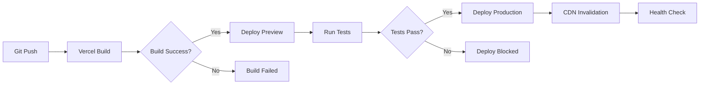

# System Architecture

## Okaeri Resort Management System

### 🎯 Architecture Philosophy

- **Serverless-First**: No server management, auto-scaling, pay-per-use
- **Cost-Optimized**: Stay under $3/month using free tiers
- **Mobile-First**: Optimized for Filipino mobile internet conditions
- **Family-Friendly**: Simple enough for non-technical family members

---

## 🏗️ High-Level Architecture

```
                    ┌─────────────────┐
                    │   Cloudflare    │
                    │   (CDN/Cache)   │
                    └─────────┬───────┘
                              │
                    ┌─────────▼───────┐
                    │     Vercel      │
                    │  (Edge Runtime) │
                    │                 │
                    │ ┌─────────────┐ │
                    │ │ Next.js App │ │
                    │ │   (React)   │ │
                    │ └─────────────┘ │
                    │                 │
                    │ ┌─────────────┐ │
                    │ │ API Routes  │ │
                    │ │ (Serverless)│ │
                    │ └─────────────┘ │
                    └─────────┬───────┘
                              │
                    ┌─────────▼───────┐
                    │ Neon PostgreSQL │
                    │   (Serverless)  │
                    └─────────────────┘
                              │
                    ┌─────────▼───────┐
                    │  Cloudflare R2  │
                    │  (File Storage) │
                    └─────────────────┘
```

---

## 🛠️ Technology Stack

### Core Technologies

| Component        | Technology              | Free Tier Limits            | Why Chosen                     |
| ---------------- | ----------------------- | --------------------------- | ------------------------------ |
| **Frontend**     | Next.js 14 + React 18   | Unlimited                   | Full-stack framework, great DX |
| **Backend**      | Next.js API Routes      | Unlimited requests          | Serverless, auto-scaling       |
| **Database**     | Neon PostgreSQL         | 0.5GB storage, 3GB transfer | Serverless, branching, backups |
| **File Storage** | Cloudflare R2           | 10GB storage, 1M operations | S3-compatible, cheap egress    |
| **Deployment**   | Vercel                  | 100GB bandwidth             | Zero-config, edge network      |
| **CDN**          | Cloudflare (via Vercel) | Included                    | Global edge caching            |

### Development Stack

| Category             | Technology            | Purpose                            |
| -------------------- | --------------------- | ---------------------------------- |
| **Language**         | TypeScript            | Type safety, better DX             |
| **Styling**          | Tailwind CSS          | Utility-first, small bundle        |
| **State Management** | Zustand + React Query | Simple client state + server state |
| **Forms**            | React Hook Form + Zod | Performance + validation           |
| **Database Client**  | @neon-tech/serverless | Edge-optimized PostgreSQL          |
| **Authentication**   | NextAuth.js (Phase 2) | OAuth + credentials                |

---

## 📊 Cost Analysis

### Monthly Cost Breakdown (Projected)

```
┌─────────────────────┬──────────────┬──────────────┐
│ Service             │ Usage        │ Cost         │
├─────────────────────┼──────────────┼──────────────┤
│ Neon PostgreSQL     │ 0.1GB storage│ $0.00        │
│                     │ 1GB transfer │              │
├─────────────────────┼──────────────┼──────────────┤
│ Vercel              │ 10GB bandwidth│ $0.00        │
├─────────────────────┼──────────────┼──────────────┤
│ Cloudflare R2       │ 1GB storage  │ $0.015       │
│                     │ 10K requests │              │
├─────────────────────┼──────────────┼──────────────┤
│ Domain (optional)   │ .com domain  │ $1.00        │
├─────────────────────┼──────────────┼──────────────┤
│ Total               │              │ $1.015/month │
└─────────────────────┴──────────────┴──────────────┘

🎯 Target: Under $3/month ✅
```

### Scaling Thresholds

```
Free Tier Limits:
• Neon: 0.5GB DB, 3GB transfer/month
• Vercel: 100GB bandwidth/month
• R2: 10GB storage, 1M operations/month

Break-even points:
• ~500 bookings/month before paid tiers needed
• ~10GB file uploads before R2 costs
• ~100K page views before Vercel costs
```

---

## 🚀 Deployment Strategy

### Environment Setup

```
┌─────────────────┬─────────────────────────────────┐
│ Environment     │ Configuration                   │
├─────────────────┼─────────────────────────────────┤
│ Development     │ • Local Next.js dev server     │
│                 │ • Neon development branch      │
│                 │ • Local file storage           │
├─────────────────┼─────────────────────────────────┤
│ Preview         │ • Vercel preview deployments   │
│                 │ • Neon preview branch          │
│                 │ • R2 staging bucket            │
├─────────────────┼─────────────────────────────────┤
│ Production      │ • Vercel production domain     │
│                 │ • Neon main branch             │
│                 │ • R2 production bucket         │
└─────────────────┴─────────────────────────────────┘
```

### Deployment Pipeline



### Zero-Downtime Deployments

```javascript
// next.config.js - Optimization for fast deployments
/** @type {import('next').NextConfig} */
const nextConfig = {
  // Enable static optimization
  output: "standalone",

  // Optimize images
  images: {
    domains: ["pub-xxx.r2.dev"], // Cloudflare R2 domain
    formats: ["image/webp", "image/avif"],
  },

  // Bundle analyzer for size monitoring
  bundleAnalyzer: {
    enabled: process.env.ANALYZE === "true",
  },

  // Performance optimizations
  experimental: {
    optimizePackageImports: ["lucide-react", "@/components"],
  },
};
```

---

## 🔄 Data Flow Architecture

### Request Processing Flow

```
┌─────────────┐    ┌──────────────┐    ┌─────────────┐
│   Browser   │───▶│  Cloudflare  │───▶│   Vercel    │
│  (Mobile)   │    │   (Edge)     │    │  (Runtime)  │
└─────────────┘    └──────────────┘    └─────────────┘
       ▲                   │                     │
       │                   ▼                     ▼
       │            ┌──────────────┐    ┌─────────────┐
       │            │    Cache     │    │ Next.js API │
       │            │  (Static)    │    │   Routes    │
       │            └──────────────┘    └─────────────┘
       │                                        │
       │                                        ▼
       │                               ┌─────────────┐
       └───────────────────────────────│    Neon     │
                                      │ PostgreSQL  │
                                      └─────────────┘
```

### State Management Pattern

```typescript
// Client-side state architecture
interface AppState {
  // Local UI state (Zustand)
  ui: {
    sidebarOpen: boolean;
    currentView: string;
    loading: boolean;
  };

  // Server state cache (React Query)
  server: {
    units: UseQueryResult<Unit[]>;
    bookings: UseQueryResult<Booking[]>;
    guests: UseQueryResult<Guest[]>;
  };

  // Form state (React Hook Form)
  forms: {
    newBooking: FormState;
    editUnit: FormState;
  };
}

// Data flow:
// UI Event → Form Handler → API Call → Server Response → Cache Update → UI Rerender
```

---

## 📱 PWA Architecture

### Progressive Web App Features

```json
// public/manifest.json
{
  "name": "Okaeri Resort Management",
  "short_name": "Okaeri",
  "description": "Resort booking and management system",
  "start_url": "/dashboard",
  "display": "standalone",
  "background_color": "#ffffff",
  "theme_color": "#2563eb",
  "icons": [
    {
      "src": "/icon-192.png",
      "sizes": "192x192",
      "type": "image/png"
    },
    {
      "src": "/icon-512.png",
      "sizes": "512x512",
      "type": "image/png"
    }
  ]
}
```

### Service Worker Strategy (Phase 2+)

```javascript
// public/sw.js - Cache strategy
const CACHE_NAME = "okaeri-v1";
const STATIC_ASSETS = [
  "/dashboard",
  "/bookings",
  "/units",
  "/_next/static/css/app.css",
  "/_next/static/js/app.js",
];

// Cache-first for static assets
// Network-first for API calls
// Offline fallback for critical pages
```

### Offline Capability

```typescript
// src/hooks/useOfflineSync.ts
export function useOfflineSync() {
  const [isOnline, setIsOnline] = useState(navigator.onLine);
  const [pendingSync, setPendingSync] = useState<PendingAction[]>([]);

  useEffect(() => {
    const handleOnline = () => {
      setIsOnline(true);
      syncPendingActions();
    };

    const handleOffline = () => {
      setIsOnline(false);
    };

    window.addEventListener("online", handleOnline);
    window.addEventListener("offline", handleOffline);

    return () => {
      window.removeEventListener("online", handleOnline);
      window.removeEventListener("offline", handleOffline);
    };
  }, []);

  return { isOnline, pendingSync };
}
```

---

## 🔐 Security Architecture

### Authentication Flow (Phase 2+)

```
┌─────────────┐    ┌──────────────┐    ┌─────────────┐
│   Login     │───▶│   NextAuth   │───▶│  Database   │
│   Form      │    │  (Session)   │    │  (Users)    │
└─────────────┘    └──────────────┘    └─────────────┘
       │                   │                     │
       ▼                   ▼                     ▼
┌─────────────┐    ┌──────────────┐    ┌─────────────┐
│   JWT       │    │   Cookies    │    │  User       │
│  Access     │    │  (HttpOnly)  │    │ Permissions │
│  Token      │    │   Secure     │    │   (RBAC)    │
└─────────────┘    └──────────────┘    └─────────────┘
```

### API Security Layers

```typescript
// Security middleware stack
export function securityMiddleware(request: NextRequest) {
  // 1. Rate limiting
  if (!checkRateLimit(request.ip)) {
    return new Response("Too Many Requests", { status: 429 });
  }

  // 2. CORS validation
  if (!validateCORS(request)) {
    return new Response("CORS Error", { status: 403 });
  }

  // 3. Authentication check (Phase 2+)
  if (!validateAuth(request)) {
    return new Response("Unauthorized", { status: 401 });
  }

  // 4. Input sanitization
  // Handled at API route level with Zod schemas

  return NextResponse.next();
}
```

### Data Protection

```sql
-- Row Level Security (Phase 3+)
ALTER TABLE bookings ENABLE ROW LEVEL SECURITY;

CREATE POLICY tenant_isolation ON bookings
FOR ALL TO authenticated
USING (tenant_id = current_setting('app.current_tenant_id'));

-- Sensitive data encryption
CREATE EXTENSION IF NOT EXISTS pgcrypto;

-- Example: Encrypt guest ID numbers
INSERT INTO guests (id_number_encrypted)
VALUES (pgp_sym_encrypt('12345678', 'encryption_key'));
```

---

## 📈 Performance Architecture

### Bundle Optimization

```javascript
// next.config.js - Bundle optimization
const nextConfig = {
  // Code splitting
  experimental: {
    optimizePackageImports: ["lucide-react", "@/components"],
  },

  // Minimize CSS
  compiler: {
    styledComponents: true,
  },

  // Webpack optimization
  webpack: (config, { isServer }) => {
    if (!isServer) {
      config.resolve.fallback = {
        fs: false,
        net: false,
        tls: false,
      };
    }
    return config;
  },
};
```

### Database Performance

```sql
-- Essential indexes for performance
CREATE INDEX CONCURRENTLY idx_bookings_unit_dates
ON bookings(unit_id, check_in, check_out);

CREATE INDEX CONCURRENTLY idx_bookings_status_created
ON bookings(booking_status, created_at DESC);

-- Explain query analysis
EXPLAIN (ANALYZE, BUFFERS)
SELECT * FROM bookings
WHERE unit_id = $1
AND check_in >= $2;
```

### Caching Strategy

```
┌─────────────────┬─────────────┬─────────────┐
│ Cache Layer     │ Duration    │ Use Case    │
├─────────────────┼─────────────┼─────────────┤
│ Browser Cache   │ 1 year      │ Static assets│
│ CDN Cache       │ 1 hour      │ API responses│
│ Database Cache  │ 15 minutes  │ Heavy queries│
│ Application     │ 5 minutes   │ User sessions│
└─────────────────┴─────────────┴─────────────┘
```

---

## 📊 Monitoring Architecture

### Application Monitoring

```typescript
// src/lib/monitoring.ts
export interface MetricEvent {
  name: string;
  value: number;
  timestamp: number;
  tags?: Record<string, string>;
}

export function trackEvent(event: MetricEvent) {
  // Development: Console logging
  if (process.env.NODE_ENV === "development") {
    console.log("📊 Metric:", event);
    return;
  }

  // Production: Send to monitoring service
  // Could be Vercel Analytics, PostHog, etc.
  fetch("/api/metrics", {
    method: "POST",
    body: JSON.stringify(event),
  });
}

// Usage throughout app:
trackEvent({
  name: "booking_created",
  value: 1,
  timestamp: Date.now(),
  tags: { unit_id: "uuid", source: "web" },
});
```

### Health Monitoring

```typescript
// src/app/api/health/route.ts - Comprehensive health check
export async function GET() {
  const checks = {
    database: await checkDatabase(),
    storage: await checkStorage(),
    external_apis: await checkExternalAPIs(),
    memory: process.memoryUsage(),
    uptime: process.uptime(),
  };

  const isHealthy = Object.values(checks).every((check) =>
    typeof check === "object" ? check.status === "ok" : true
  );

  return NextResponse.json(
    {
      success: isHealthy,
      timestamp: new Date().toISOString(),
      checks,
    },
    {
      status: isHealthy ? 200 : 503,
    }
  );
}
```

---

## 🔄 Backup & Recovery Strategy

### Database Backup

```sql
-- Neon automatic features:
-- • Point-in-time recovery (7 days)
-- • Daily automated backups
-- • Branch-based development
-- • Read replicas for scaling

-- Additional backup script (if needed):
pg_dump $DATABASE_URL > backup_$(date +%Y%m%d).sql
aws s3 cp backup_$(date +%Y%m%d).sql s3://backups/
```

### File Storage Backup

```typescript
// Cloudflare R2 versioning enabled
// src/lib/backup.ts
export async function syncCriticalFiles() {
  // Copy payment proofs to secondary bucket
  const r2 = new S3Client({
    region: "auto",
    endpoint: "https://account-id.r2.cloudflarestorage.com",
    credentials: {
      accessKeyId: process.env.R2_ACCESS_KEY!,
      secretAccessKey: process.env.R2_SECRET_KEY!,
    },
  });

  // Implement cross-region replication if needed
}
```

### Disaster Recovery Plan

```
Recovery Time Objectives (RTO):
• Database: < 1 hour (Neon restore)
• Application: < 15 minutes (Vercel redeploy)
• Files: < 30 minutes (R2 restore)

Recovery Point Objectives (RPO):
• Database: < 1 hour (transaction logs)
• Files: < 24 hours (daily sync)
```

---

_System Architecture v1.0 - Scalable, Cost-Effective, Reliable_
