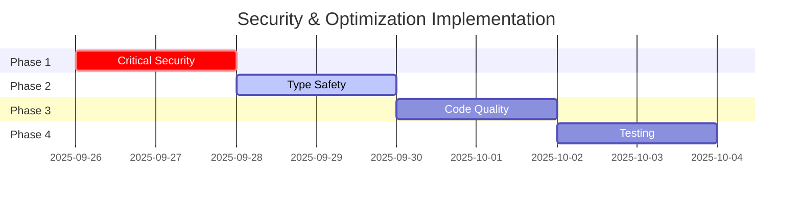

# Security & Optimization Master Plan

## Okaeri Resort System - Critical Issues Resolution

**Date:** September 25, 2025
**Status:** CRITICAL - Immediate Action Required
**Impact:** Production Readiness Blocker

---

## Executive Summary

A comprehensive security and performance audit of the Okaeri Resort System has identified **15 critical issues**, **23 high-priority issues**, and **31 medium-priority improvements** that must be addressed before production deployment. This master plan outlines a systematic approach to resolve all identified issues across four implementation phases.

### Risk Assessment Matrix

| Category          | Critical | High   | Medium | Total  |
| ----------------- | -------- | ------ | ------ | ------ |
| Security          | 3        | 5      | 4      | 12     |
| Memory Management | 2        | 3      | 2      | 7      |
| Type Safety       | 0        | 8      | 12     | 20     |
| Performance       | 1        | 4      | 8      | 13     |
| Architecture      | 0        | 3      | 5      | 8      |
| **Total**         | **6**    | **23** | **31** | **60** |

---

## Critical Findings

### 🔴 CRITICAL ISSUES (P0 - Fix Immediately)

#### 1. Memory Leak in Optimistic Updates

- **Location:** `/src/stores/useBookingStore.ts:56-98`
- **Impact:** Progressive memory degradation leading to application crash
- **Evidence:** Map grows indefinitely without cleanup mechanism
- **Resolution:** Phase 1 - Implement TTL and size limits

#### 2. Authentication Security Vulnerabilities

- **Location:** `/src/lib/auth.ts:108-126`
- **Issues:**
  - Predictable session refresh interval (exploitable)
  - Unvalidated redirects (line 119)
  - Information leakage in error messages (line 32)
- **Resolution:** Phase 1 - Randomize intervals, validate routes, sanitize errors

#### 3. XSS Vulnerabilities

- **Location:** Multiple form components
- **Impact:** User data compromise, session hijacking
- **Evidence:** No input sanitization layer
- **Resolution:** Phase 1 - Implement DOMPurify

#### 4. Type Safety Violations

- **Locations:**
  - `/src/stores/useBookingStore.ts:410, 426`
  - `/src/lib/supabase.ts:24`
  - `/src/lib/availability.ts:117, 162, 300`
- **Impact:** Runtime errors, unpredictable behavior
- **Resolution:** Phase 2 - Remove all `any` types

#### 5. Missing Error Boundaries

- **Impact:** Application crashes from component errors
- **Evidence:** No component-level error boundaries
- **Resolution:** Phase 3 - Wrap all high-risk components

#### 6. Performance Bottlenecks

- **Issues:**
  - No React.memo on list components
  - 800+ line components
  - No code splitting
- **Impact:** Poor user experience, high memory usage
- **Resolution:** Phase 2 & 3 - Optimize components and implement splitting

---

## Implementation Phases

### Phase 1: Critical Security & Memory (Days 1-2)

**Priority:** IMMEDIATE
**Document:** [phase-1-critical-security.md](./phase-1-critical-security.md)

Key Deliverables:

- Memory leak fixes
- Authentication security patches
- XSS prevention implementation
- Critical error handling

### Phase 2: Type Safety & Performance (Days 3-4)

**Priority:** HIGH
**Document:** [phase-2-type-safety-performance.md](./phase-2-type-safety-performance.md)

Key Deliverables:

- Complete type coverage
- Performance optimizations
- Bundle size reduction
- Query optimization

### Phase 3: Code Quality & Architecture (Days 5-6)

**Priority:** HIGH
**Document:** [phase-3-code-quality.md](./phase-3-code-quality.md)

Key Deliverables:

- Component refactoring
- Architecture improvements
- Error boundary implementation
- Code organization

### Phase 4: Testing & Validation (Days 7-8)

**Priority:** MEDIUM
**Document:** [phase-4-testing-validation.md](./phase-4-testing-validation.md)

Key Deliverables:

- Security testing suite
- Performance benchmarks
- Type coverage report
- Production readiness checklist

---

## Success Metrics

### Security Metrics

- [ ] 0 critical security vulnerabilities
- [ ] 100% input sanitization coverage
- [ ] Secure session management implemented
- [ ] All routes validated

### Performance Metrics

- [ ] Initial load time < 3s
- [ ] Time to Interactive < 5s
- [ ] Memory usage stable over 24h operation
- [ ] Bundle size < 500KB (gzipped)

### Code Quality Metrics

- [ ] 100% TypeScript coverage (no `any` types)
- [ ] No components > 300 lines
- [ ] 100% critical paths covered by error boundaries
- [ ] All useEffect hooks have cleanup

---

## Resource Requirements

### Team Allocation

- **Security Lead:** Phase 1 primary, Phase 4 validation
- **Performance Engineer:** Phase 2 primary, Phase 3 support
- **Frontend Architect:** Phase 3 primary, Phase 2 support
- **QA Engineer:** Phase 4 primary, all phases validation

### Tooling Requirements

- DOMPurify for XSS prevention
- Bundle analyzer for performance optimization
- TypeScript strict mode enforcement
- Security scanning tools (OWASP ZAP recommended)

---

## Risk Mitigation

### Rollback Strategy

1. Git branch protection for main branch
2. Feature flags for gradual rollout
3. Database backup before deployment
4. Canary deployment strategy

### Monitoring Requirements

1. Error tracking (Sentry recommended)
2. Performance monitoring (Web Vitals)
3. Security event logging
4. Memory usage tracking

---

## Timeline

---

## Approval & Sign-off

- [ ] Technical Lead Review
- [ ] Security Team Approval
- [ ] Product Owner Acknowledgment
- [ ] Deployment Team Ready

---

## References

- [OWASP Top 10 2024](https://owasp.org/www-project-top-ten/)
- [React Security Best Practices](https://react.dev/reference/react/security)
- [TypeScript Strict Mode Guide](https://www.typescriptlang.org/tsconfig#strict)
- [Web Vitals Performance Metrics](https://web.dev/vitals/)

---

**Document Version:** 1.0.0
**Last Updated:** September 25, 2025
**Next Review:** October 3, 2025
**Owner:** Development Team Lead
