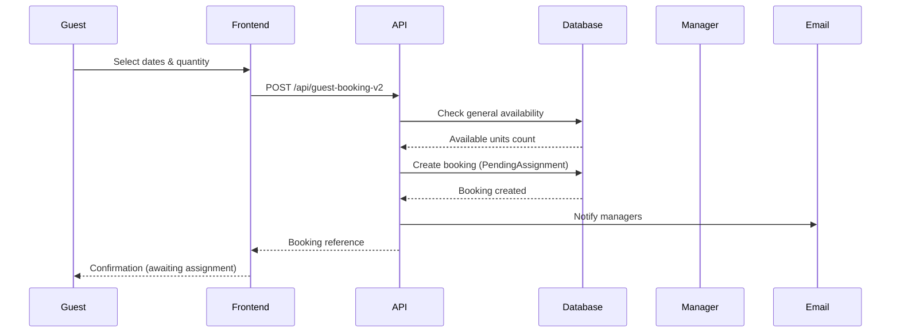
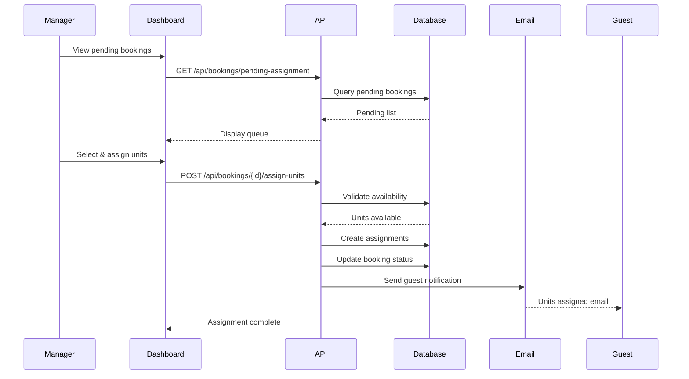

# Booking System Architecture

## Overview

The Okaeri Resort Booking System implements a **two-phase booking process** where guests request unit quantities without selecting specific units, and managers subsequently assign units based on availability and operational considerations.

## Core Design Principles

1. **Separation of Concerns**: Guest requests are separated from unit assignments
2. **Operational Flexibility**: Managers have full control over unit allocation
3. **Transparency**: Guests receive clear communication about the process
4. **Audit Trail**: All assignments are logged for accountability
5. **Scalability**: System can handle multiple concurrent bookings without conflicts

## System Architecture

```
┌─────────────────────────────────────────────────────────────────┐
│                         Guest Interface                          │
├─────────────────────────────────────────────────────────────────┤
│                                                                   │
│  ┌──────────────┐    ┌──────────────┐    ┌──────────────┐      │
│  │ Date         │ -> │ Unit Quantity│ -> │ Guest Info   │      │
│  │ Selection    │    │ Request      │    │ & Payment    │      │
│  └──────────────┘    └──────────────┘    └──────────────┘      │
│                                                                   │
└─────────────────────────────────────────────────────────────────┘
                                 │
                                 ▼
┌─────────────────────────────────────────────────────────────────┐
│                          API Gateway                             │
│                    (Cloudflare Workers)                          │
├─────────────────────────────────────────────────────────────────┤
│                                                                   │
│  ┌──────────────┐    ┌──────────────┐    ┌──────────────┐      │
│  │ Validation   │    │ Availability │    │ Booking      │      │
│  │ & Sanitize   │    │ Check        │    │ Creation     │      │
│  └──────────────┘    └──────────────┘    └──────────────┘      │
│                                                                   │
└─────────────────────────────────────────────────────────────────┘
                                 │
                                 ▼
┌─────────────────────────────────────────────────────────────────┐
│                         Database Layer                           │
│                         (Supabase/PostgreSQL)                    │
├─────────────────────────────────────────────────────────────────┤
│                                                                   │
│  ┌──────────────┐    ┌──────────────┐    ┌──────────────┐      │
│  │ Bookings     │    │ Booking      │    │ Assignment   │      │
│  │ (No Units)   │    │ Units        │    │ History      │      │
│  └──────────────┘    └──────────────┘    └──────────────┘      │
│                                                                   │
└─────────────────────────────────────────────────────────────────┘
                                 │
                                 ▼
┌─────────────────────────────────────────────────────────────────┐
│                       Manager Interface                          │
├─────────────────────────────────────────────────────────────────┤
│                                                                   │
│  ┌──────────────┐    ┌──────────────┐    ┌──────────────┐      │
│  │ Pending      │    │ Unit         │    │ Assignment   │      │
│  │ Queue        │    │ Selection    │    │ Confirmation │      │
│  └──────────────┘    └──────────────┘    └──────────────┘      │
│                                                                   │
└─────────────────────────────────────────────────────────────────┘
                                 │
                                 ▼
┌─────────────────────────────────────────────────────────────────┐
│                      Notification Service                        │
│                         (Email/SMS)                              │
└─────────────────────────────────────────────────────────────────┘
```

## Component Architecture

### 1. Frontend Components

#### Guest Booking Components

- `GuestBookingFormV2.tsx` - Main booking form (no unit selection)
- `UnitQuantitySelector.tsx` - Request unit quantities
- `GuestInfoForm.tsx` - Collect guest information
- `BookingConfirmation.tsx` - Show booking request confirmation
- `PaymentProofUpload.tsx` - Handle payment proof submission

#### Manager Components

- `BookingAssignmentDashboard.tsx` - Main assignment interface
- `PendingBookingsList.tsx` - Queue of bookings awaiting assignment
- `UnitAssignmentInterface.tsx` - Drag-and-drop unit assignment
- `AssignmentHistory.tsx` - View past assignments
- `AssignmentNotifier.tsx` - Real-time pending assignment alerts

### 2. Backend Services

#### API Endpoints

```typescript
// Guest Endpoints (Public)
POST / api / guest - booking - v2; // Create booking request
GET / api / check - booking; // Check booking status
POST / api / guest - booking / confirm; // Confirm payment upload

// Manager Endpoints (Protected)
GET / api / bookings / pending - assignment; // List bookings needing assignment
POST / api / bookings / { id } / assign - units; // Assign units to booking
PUT / api / bookings / { id } / reassign - units; // Modify unit assignments
GET / api / units / available; // Get available units for date range
GET / api / assignment - history; // View assignment audit log

// System Endpoints
POST / api / notifications / assignment - complete; // Trigger guest notification
GET / api / metrics / assignment - stats; // Assignment performance metrics
```

### 3. Database Architecture

#### Core Tables

```sql
bookings
├── booking_id (PK)
├── booking_reference
├── guest_info (name, email, phone)
├── dates (check_in, check_out)
├── requested_unit_count         // NEW: Number of units requested
├── guests_per_unit[]            // NEW: Array of guest counts
├── assignment_status            // NEW: pending/partial/complete
├── assigned_by                  // NEW: Staff member who assigned
├── assigned_at                  // NEW: Assignment timestamp
├── estimated_price_min          // NEW: Price estimate lower bound
├── estimated_price_max          // NEW: Price estimate upper bound
└── booking_status               // Updated: includes 'PendingAssignment'

booking_units (Junction Table)
├── booking_unit_id (PK)
├── booking_id (FK)
├── unit_id (FK)                // Assigned by manager
├── assigned_guests
├── unit_price
└── subtotal

booking_assignment_history       // NEW: Audit trail
├── history_id (PK)
├── booking_id (FK)
├── action (assigned/reassigned/unassigned)
├── unit_id (FK)
├── assigned_by (FK)
├── assigned_at
└── notes
```

## Data Flow

### 1. Guest Booking Flow



### 2. Manager Assignment Flow



## State Management

### Booking Status Transitions

```
┌──────────────────┐
│ PendingAssignment│ ─── Initial state after guest submission
└────────┬─────────┘
         │
         ▼
┌──────────────────┐
│     Pending      │ ─── Units assigned, awaiting payment
└────────┬─────────┘
         │
         ▼
┌──────────────────┐
│    Confirmed     │ ─── Payment received
└────────┬─────────┘
         │
         ▼
┌──────────────────┐
│    CheckedIn     │ ─── Guest arrived
└────────┬─────────┘
         │
         ▼
┌──────────────────┐
│   CheckedOut     │ ─── Guest departed
└──────────────────┘

        ╱ ╲
       ╱   ╲  Cancellation possible at any stage
      ╱     ╲
┌──────────────────┐
│    Cancelled     │
└──────────────────┘
```

### Assignment Status States

```
pending_assignment    → No units assigned yet
partially_assigned   → Some units assigned (future enhancement)
fully_assigned       → All requested units assigned
```

## Security Architecture

### Authentication Layers

1. **Public Endpoints**
   - Turnstile CAPTCHA verification
   - Rate limiting (5 requests/hour/IP)
   - Input sanitization (DOMPurify)
   - Idempotency key handling

2. **Protected Endpoints**
   - JWT authentication (Supabase Auth)
   - Role-based access control (RBAC)
   - Audit logging of all actions
   - Row Level Security (RLS)

### Data Protection

```typescript
// Input Sanitization Pipeline
Request → Turnstile → Rate Limit → Validation (Zod) → Sanitization → Database

// Output Protection
Database → Transform → Sanitize → Response
```

## Performance Considerations

### Optimization Strategies

1. **Database Indexing**

   ```sql
   CREATE INDEX idx_bookings_assignment_status ON bookings(assignment_status);
   CREATE INDEX idx_bookings_pending ON bookings(booking_status, assignment_status)
     WHERE assignment_status = 'pending_assignment';
   CREATE INDEX idx_availability_dates ON booking_unit_availability(check_in, check_out);
   ```

2. **Caching Strategy**
   - Available units: 1-minute cache
   - Pricing calculations: 5-minute cache
   - Assignment history: 10-minute cache

3. **Query Optimization**
   - Batch availability checks
   - Materialized views for reporting
   - Connection pooling with PgBouncer

### Scalability Metrics

- Target: Handle 100 concurrent bookings
- Assignment time: < 5 minutes average
- API response time: < 200ms p95
- Database queries: < 50ms p95

## Error Handling

### Error Categories

1. **Guest Errors (4xx)**
   - `INSUFFICIENT_AVAILABILITY` - Not enough units available
   - `INVALID_DATE_RANGE` - Check-out before check-in
   - `RATE_LIMIT_EXCEEDED` - Too many requests
   - `VALIDATION_ERROR` - Invalid input data

2. **System Errors (5xx)**
   - `DATABASE_ERROR` - Database connection/query failed
   - `ASSIGNMENT_FAILED` - Could not complete assignment
   - `NOTIFICATION_FAILED` - Email service error

3. **Business Logic Errors**
   - `ALREADY_ASSIGNED` - Booking already has units assigned
   - `COUNT_MISMATCH` - Assignment count doesn't match request
   - `UNIT_UNAVAILABLE` - Selected unit no longer available

## Monitoring & Analytics

### Key Metrics

```typescript
interface AssignmentMetrics {
  averageTimeToAssign: Duration; // Target: < 2 hours
  pendingBookingsCount: number; // Alert if > 10
  dailyAssignments: number; // Track throughput
  reassignmentRate: percentage; // Quality metric
  guestSatisfactionScore: number; // Post-assignment survey
}
```

### Monitoring Endpoints

```
GET /api/health                    // System health check
GET /api/metrics/assignments       // Assignment statistics
GET /api/metrics/availability      // Availability metrics
GET /api/metrics/performance       // Response time metrics
```

## Technology Stack

### Frontend

- React 19 + TypeScript
- TanStack Router (routing)
- TanStack Query (server state)
- Zustand (client state)
- React Hook Form + Zod (forms)
- Tailwind CSS v4 (styling)
- shadcn/ui (components)

### Backend

- Cloudflare Workers (edge functions)
- Supabase (PostgreSQL + Auth)
- Resend (email service)
- Cloudflare KV (caching/rate limiting)

### Infrastructure

- Cloudflare Pages (hosting)
- Cloudflare R2 (file storage)
- GitHub Actions (CI/CD)
- Sentry (error tracking)

## Deployment Architecture

```
┌─────────────────┐     ┌─────────────────┐     ┌─────────────────┐
│  GitHub Repo    │────▶│  GitHub Actions │────▶│ Cloudflare Pages│
└─────────────────┘     └─────────────────┘     └─────────────────┘
                                                           │
                                                           ▼
                                                  ┌─────────────────┐
                                                  │ Cloudflare CDN  │
                                                  │  (Global Edge)  │
                                                  └─────────────────┘
                                                           │
                              ┌────────────────────────────┼────────────────────────────┐
                              ▼                            ▼                            ▼
                    ┌─────────────────┐         ┌─────────────────┐         ┌─────────────────┐
                    │ Cloudflare      │         │   Supabase      │         │     Resend      │
                    │   Workers       │────────▶│   PostgreSQL    │         │  Email Service  │
                    └─────────────────┘         └─────────────────┘         └─────────────────┘
```

## Future Enhancements

### Phase 2 Features

1. **Auto-Assignment Algorithm**
   - ML-based unit selection
   - Guest preference matching
   - Load balancing across units

2. **Advanced Analytics**
   - Predictive availability forecasting
   - Demand-based pricing suggestions
   - Assignment efficiency scoring

3. **Integration Points**
   - Channel manager API
   - Revenue management system
   - Property management system (PMS)

### Phase 3 Features

1. **Mobile App Support**
   - Manager assignment app
   - Push notifications
   - Offline capability

2. **Advanced Workflows**
   - Waitlist management
   - Group bookings
   - Package deals
