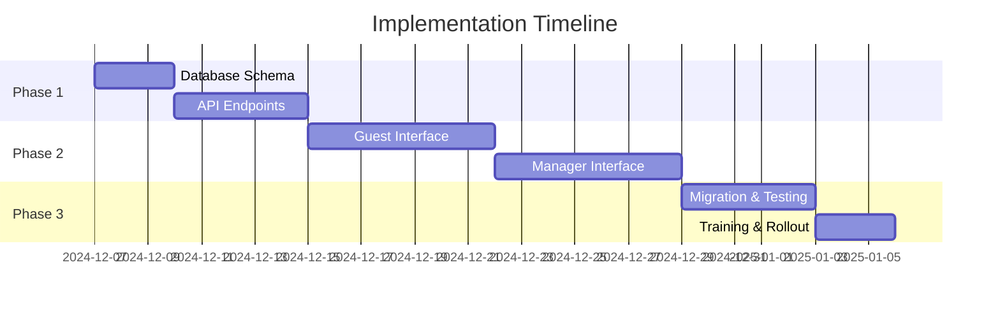

# Implementation Guide

## Overview

This guide provides a step-by-step implementation plan for transitioning to the two-phase booking system. The implementation is divided into phases to ensure minimal disruption to existing operations.

## Implementation Phases



## Phase 1: Backend Infrastructure (Week 1)

### Day 1-2: Database Schema Updates

#### Step 1.1: Create Migration Files

Create migration files in `supabase/migrations/`:

```sql
-- 001_add_assignment_fields.sql
ALTER TABLE bookings
ADD COLUMN requested_unit_count INTEGER,
ADD COLUMN guests_per_unit INTEGER[],
ADD COLUMN assignment_status VARCHAR(50) DEFAULT 'pending_assignment',
ADD COLUMN assigned_by UUID REFERENCES auth.users(id),
ADD COLUMN assigned_at TIMESTAMPTZ,
ADD COLUMN estimated_price_min DECIMAL(10,2),
ADD COLUMN estimated_price_max DECIMAL(10,2);

-- 002_create_assignment_tables.sql
CREATE TABLE booking_assignment_history (...);
CREATE TABLE booking_assignment_queue (...);

-- 003_create_functions.sql
CREATE OR REPLACE FUNCTION check_available_unit_count(...);
CREATE OR REPLACE FUNCTION calculate_assignment_priority(...);

-- 004_create_triggers.sql
CREATE TRIGGER booking_assignment_queue_trigger ...;
CREATE TRIGGER booking_units_assignment_trigger ...;
```

#### Step 1.2: Test Migrations Locally

```bash
# Reset local database
supabase db reset

# Apply migrations
supabase migration up

# Verify schema
supabase db diff

# Test with sample data
psql $DATABASE_URL < test/fixtures/sample_bookings.sql
```

#### Step 1.3: Create Database Types

```typescript
// src/types/database.types.ts - Update with new fields
export interface Database {
  public: {
    Tables: {
      bookings: {
        Row: {
          // ... existing fields
          requested_unit_count: number;
          guests_per_unit: number[];
          assignment_status: "pending_assignment" | "partially_assigned" | "fully_assigned";
          assigned_by: string | null;
          assigned_at: string | null;
          estimated_price_min: number | null;
          estimated_price_max: number | null;
        };
      };
      booking_assignment_history: {
        Row: {
          history_id: string;
          booking_id: string;
          action: "assigned" | "reassigned" | "unassigned";
          unit_id: string | null;
          performed_by: string;
          performed_at: string;
          // ... other fields
        };
      };
    };
  };
}
```

### Day 3-5: API Development

#### Step 1.4: Create API Helper Functions

```typescript
// functions/lib/booking-helpers.ts
import { createSupabaseAdmin } from "./supabase-admin";

export async function checkUnitAvailability(
  supabase: SupabaseClient,
  checkIn: string,
  checkOut: string
): Promise<number> {
  const { data, error } = await supabase.rpc("check_available_unit_count", {
    p_check_in: checkIn,
    p_check_out: checkOut,
  });

  if (error) throw error;
  return data || 0;
}

export async function createBookingRequest(
  supabase: SupabaseClient,
  bookingData: BookingRequest
): Promise<Booking> {
  // Implementation
}

export async function addToAssignmentQueue(
  supabase: SupabaseClient,
  bookingId: string
): Promise<void> {
  // Implementation
}
```

#### Step 1.5: Implement Guest Booking Endpoint

```typescript
// functions/api/guest-booking-v2.ts
export async function onRequestPost(context: EventContext<Env>) {
  const { request, env } = context;

  try {
    // 1. Validate Turnstile
    const data = await request.json();
    const isValid = await verifyTurnstile(data.turnstile_token, env);
    if (!isValid) {
      return Response.json({ error: "INVALID_TURNSTILE" }, { status: 400 });
    }

    // 2. Check rate limiting
    const rateLimit = await checkRateLimit(request, env);
    if (!rateLimit.allowed) {
      return Response.json({ error: "RATE_LIMIT_EXCEEDED" }, { status: 429 });
    }

    // 3. Validate input with Zod
    const validated = guestBookingSchemaV2.parse(data);

    // 4. Check availability (unit count only)
    const available = await checkUnitAvailability(
      supabase,
      validated.check_in,
      validated.check_out
    );

    if (available < validated.requested_units) {
      return Response.json(
        {
          error: "INSUFFICIENT_AVAILABILITY",
          available,
          requested: validated.requested_units,
        },
        { status: 400 }
      );
    }

    // 5. Create booking request
    const booking = await createBookingRequest(supabase, validated);

    // 6. Add to assignment queue
    await addToAssignmentQueue(supabase, booking.booking_id);

    // 7. Send notifications
    waitUntil(notifyManagersOfPendingAssignment(booking));

    return Response.json({ booking }, { status: 200 });
  } catch (error) {
    console.error("Guest booking error:", error);
    return Response.json({ error: "INTERNAL_ERROR" }, { status: 500 });
  }
}
```

#### Step 1.6: Implement Manager Assignment Endpoints

```typescript
// functions/api/bookings/[id]/assign-units.ts
export async function onRequestPost(context: EventContext<Env>) {
  const { request, env, params } = context;
  const bookingId = params.id;

  // Verify manager authentication
  const user = await verifyAuth(request, env);
  if (!user || user.role !== "manager") {
    return Response.json({ error: "FORBIDDEN" }, { status: 403 });
  }

  const data = await request.json();
  const validated = assignmentSchema.parse(data);

  // Begin transaction
  const supabase = createSupabaseAdmin(env);

  try {
    // 1. Verify units are available
    for (const assignment of validated.assignments) {
      const available = await checkSpecificUnitAvailability(
        supabase,
        assignment.unit_id,
        booking.check_in,
        booking.check_out
      );

      if (!available) {
        return Response.json(
          {
            error: "UNIT_CONFLICT",
            unit_id: assignment.unit_id,
          },
          { status: 409 }
        );
      }
    }

    // 2. Create unit assignments
    const assignments = await createUnitAssignments(
      supabase,
      bookingId,
      validated.assignments,
      user.id
    );

    // 3. Update booking status
    await updateBookingAssignmentStatus(supabase, bookingId);

    // 4. Log to history
    await logAssignmentHistory(supabase, {
      booking_id: bookingId,
      action: "assigned",
      performed_by: user.id,
      units: assignments,
    });

    // 5. Notify guest
    if (validated.send_notification) {
      waitUntil(sendAssignmentNotification(booking, assignments));
    }

    return Response.json({ assignments }, { status: 200 });
  } catch (error) {
    // Rollback handled by database transactions
    console.error("Assignment error:", error);
    return Response.json({ error: "ASSIGNMENT_FAILED" }, { status: 500 });
  }
}
```

## Phase 2: Frontend Implementation (Week 2)

### Day 6-8: Guest Interface Updates

#### Step 2.1: Update Guest Booking Form

```typescript
// src/components/guest-booking/GuestBookingFormV2.tsx
import { useForm } from 'react-hook-form';
import { zodResolver } from '@hookform/resolvers/zod';
import { guestBookingSchemaV2 } from '@/lib/validation/booking';

export function GuestBookingFormV2() {
  const form = useForm({
    resolver: zodResolver(guestBookingSchemaV2),
    defaultValues: {
      requested_units: 1,
      guests_per_unit: [2]
    }
  });

  const onSubmit = async (data: GuestBookingFormData) => {
    // Remove unit selection logic
    // Add unit quantity selection
    // Show estimated price range

    const response = await fetch('/api/guest-booking-v2', {
      method: 'POST',
      body: JSON.stringify({
        ...data,
        turnstile_token: await getTurnstileToken()
      })
    });

    if (response.ok) {
      const { booking } = await response.json();
      // Show success message with booking reference
      // Explain assignment process
      router.push(`/booking/status?ref=${booking.booking_reference}`);
    }
  };

  return (
    <form onSubmit={form.handleSubmit(onSubmit)}>
      {/* Date selection */}
      <DateRangePicker
        value={form.watch(['check_in', 'check_out'])}
        onChange={(dates) => {
          form.setValue('check_in', dates[0]);
          form.setValue('check_out', dates[1]);
        }}
      />

      {/* Unit quantity selection - NEW */}
      <div className="space-y-4">
        <Label>Number of Units Needed</Label>
        <Select
          value={form.watch('requested_units')}
          onValueChange={(value) => {
            const count = parseInt(value);
            form.setValue('requested_units', count);
            // Initialize guests array
            form.setValue('guests_per_unit', Array(count).fill(2));
          }}
        >
          {[1,2,3,4,5,6,7,8,9,10].map(n => (
            <SelectItem key={n} value={n.toString()}>
              {n} {n === 1 ? 'Unit' : 'Units'}
            </SelectItem>
          ))}
        </Select>
      </div>

      {/* Guest distribution - NEW */}
      {form.watch('requested_units') > 0 && (
        <div className="space-y-4">
          <Label>Guests per Unit</Label>
          {Array.from({ length: form.watch('requested_units') }).map((_, i) => (
            <div key={i} className="flex items-center gap-2">
              <span>Unit {i + 1}:</span>
              <Input
                type="number"
                min="1"
                max="6"
                value={form.watch(`guests_per_unit.${i}`)}
                onChange={(e) => {
                  const guests = [...form.watch('guests_per_unit')];
                  guests[i] = parseInt(e.target.value);
                  form.setValue('guests_per_unit', guests);
                }}
              />
              <span>guests</span>
            </div>
          ))}
        </div>
      )}

      {/* Price estimate - NEW */}
      <Alert>
        <Info className="h-4 w-4" />
        <AlertDescription>
          Estimated price: ₱{estimatedMin} - ₱{estimatedMax}
          <br />
          Final price depends on assigned units
        </AlertDescription>
      </Alert>

      {/* Guest information */}
      <GuestInfoFields form={form} />

      {/* Submit */}
      <Button type="submit">Submit Booking Request</Button>
    </form>
  );
}
```

#### Step 2.2: Create Booking Status Page

```typescript
// src/routes/booking/status.tsx
export function BookingStatusRoute() {
  const { ref } = useParams();
  const { data: booking, isLoading } = useQuery({
    queryKey: ['booking-status', ref],
    queryFn: () => fetch(`/api/check-booking?reference=${ref}`).then(r => r.json())
  });

  if (isLoading) return <LoadingSpinner />;

  return (
    <div className="max-w-2xl mx-auto p-6">
      <h1>Booking Status: {booking.booking_reference}</h1>

      <StatusTimeline status={booking.status} />

      {booking.assignment_status === 'pending_assignment' ? (
        <PendingAssignmentView booking={booking} />
      ) : booking.assignment_status === 'fully_assigned' ? (
        <AssignedUnitsView booking={booking} />
      ) : null}

      {booking.payment_status === 'pending' &&
       booking.assignment_status === 'fully_assigned' && (
        <PaymentSection booking={booking} />
      )}
    </div>
  );
}
```

### Day 9-12: Manager Interface

#### Step 2.3: Create Assignment Dashboard

```typescript
// src/components/manager/AssignmentDashboard.tsx
export function AssignmentDashboard() {
  const { data: pendingBookings } = useQuery({
    queryKey: ['pending-assignments'],
    queryFn: fetchPendingAssignments,
    refetchInterval: 30000 // Auto-refresh every 30 seconds
  });

  return (
    <div className="space-y-6">
      <div className="flex justify-between items-center">
        <h2 className="text-2xl font-bold">
          Pending Assignments ({pendingBookings?.length || 0})
        </h2>
        <Button onClick={() => refetch()}>
          <RefreshCw className="h-4 w-4 mr-2" />
          Refresh
        </Button>
      </div>

      <div className="space-y-4">
        {pendingBookings?.map(booking => (
          <PendingBookingCard
            key={booking.booking_id}
            booking={booking}
            onAssign={() => openAssignmentModal(booking)}
          />
        ))}
      </div>
    </div>
  );
}
```

#### Step 2.4: Implement Assignment Interface

```typescript
// src/components/manager/UnitAssignmentModal.tsx
export function UnitAssignmentModal({ booking, onComplete }) {
  const [assignments, setAssignments] = useState<Assignment[]>([]);
  const { data: availableUnits } = useQuery({
    queryKey: ['available-units', booking.check_in, booking.check_out],
    queryFn: () => fetchAvailableUnits(booking.check_in, booking.check_out)
  });

  const handleDrop = (unitId: string, assignmentIndex: number) => {
    const unit = availableUnits.find(u => u.unit_id === unitId);
    const newAssignments = [...assignments];
    newAssignments[assignmentIndex] = {
      unit_id: unitId,
      unit_code: unit.code,
      guest_count: booking.guests_per_unit[assignmentIndex],
      price: unit.price
    };
    setAssignments(newAssignments);
  };

  const handleSubmit = async () => {
    const response = await fetch(`/api/bookings/${booking.booking_id}/assign-units`, {
      method: 'POST',
      headers: {
        'Content-Type': 'application/json',
        'Authorization': `Bearer ${token}`
      },
      body: JSON.stringify({
        assignments,
        send_notification: true
      })
    });

    if (response.ok) {
      toast.success('Units assigned successfully');
      onComplete();
    }
  };

  return (
    <Dialog>
      <DialogContent className="max-w-4xl">
        <DialogHeader>
          <DialogTitle>Assign Units - {booking.booking_reference}</DialogTitle>
        </DialogHeader>

        <div className="grid grid-cols-2 gap-6">
          {/* Available Units */}
          <div>
            <h3>Available Units</h3>
            <div className="grid grid-cols-2 gap-2">
              {availableUnits?.map(unit => (
                <DraggableUnit key={unit.unit_id} unit={unit} />
              ))}
            </div>
          </div>

          {/* Assignment Slots */}
          <div>
            <h3>Unit Assignments</h3>
            {Array.from({ length: booking.requested_units }).map((_, i) => (
              <DroppableSlot
                key={i}
                index={i}
                guestCount={booking.guests_per_unit[i]}
                assignment={assignments[i]}
                onDrop={(unitId) => handleDrop(unitId, i)}
              />
            ))}
          </div>
        </div>

        <DialogFooter>
          <Button variant="outline" onClick={onClose}>Cancel</Button>
          <Button
            onClick={handleSubmit}
            disabled={assignments.length < booking.requested_units}
          >
            Assign Units
          </Button>
        </DialogFooter>
      </DialogContent>
    </Dialog>
  );
}
```

## Phase 3: Migration & Testing (Week 3)

### Day 13-15: Data Migration

#### Step 3.1: Create Migration Script

```typescript
// scripts/migrate-bookings.ts
async function migrateExistingBookings() {
  const supabase = createClient(SUPABASE_URL, SERVICE_ROLE_KEY);

  // Get all bookings that need migration
  const { data: bookings } = await supabase
    .from("bookings")
    .select("*, booking_units(*)")
    .is("requested_unit_count", null);

  for (const booking of bookings) {
    // Calculate requested units from existing data
    const requestedUnits = booking.booking_units?.length || 1;
    const guestsPerUnit = booking.booking_units?.map((bu) => bu.assigned_guests) || [2];

    // Update booking with new fields
    await supabase
      .from("bookings")
      .update({
        requested_unit_count: requestedUnits,
        guests_per_unit: guestsPerUnit,
        assignment_status:
          booking.booking_units?.length > 0 ? "fully_assigned" : "pending_assignment",
        assigned_at: booking.booking_units?.[0]?.created_at || booking.created_at,
      })
      .eq("booking_id", booking.booking_id);

    console.log(`Migrated booking ${booking.booking_reference}`);
  }
}
```

### Day 16-17: Testing

#### Step 3.2: Unit Tests

```typescript
// src/__tests__/booking-assignment.test.ts
describe("Booking Assignment System", () => {
  it("should create booking without unit selection", async () => {
    const booking = await createGuestBooking({
      check_in: "2024-12-20",
      check_out: "2024-12-22",
      requested_units: 2,
      guests_per_unit: [3, 3],
    });

    expect(booking.assignment_status).toBe("pending_assignment");
    expect(booking.booking_units).toHaveLength(0);
  });

  it("should assign units to booking", async () => {
    const booking = await createTestBooking();
    const units = await getAvailableUnits(booking.check_in, booking.check_out);

    const assignments = await assignUnits(booking.booking_id, [
      { unit_id: units[0].unit_id, guest_count: 3 },
      { unit_id: units[1].unit_id, guest_count: 3 },
    ]);

    expect(assignments).toHaveLength(2);
    expect(booking.assignment_status).toBe("fully_assigned");
  });

  it("should prevent double assignment", async () => {
    const booking1 = await createTestBooking();
    const booking2 = await createTestBooking();
    const unit = await getFirstAvailableUnit();

    await assignUnits(booking1.booking_id, [{ unit_id: unit.unit_id, guest_count: 2 }]);

    await expect(
      assignUnits(booking2.booking_id, [{ unit_id: unit.unit_id, guest_count: 2 }])
    ).rejects.toThrow("UNIT_CONFLICT");
  });
});
```

#### Step 3.3: Integration Tests

```typescript
// src/__tests__/e2e/guest-booking-flow.test.ts
test("Complete guest booking flow", async ({ page }) => {
  // 1. Submit booking request
  await page.goto("/booking");
  await page.fill('[name="guest_name"]', "Test Guest");
  await page.fill('[name="email"]', "test@example.com");
  await page.selectOption('[name="requested_units"]', "2");
  await page.click('button[type="submit"]');

  // 2. Check status page
  await expect(page).toHaveURL(/\/booking\/status/);
  await expect(page.locator("text=Pending Assignment")).toBeVisible();

  // 3. Manager assigns units
  await loginAsManager(page);
  await page.goto("/manager/assignments");
  await page.click("text=Assign Units");
  // ... assignment steps

  // 4. Guest sees assigned units
  await page.goto(bookingStatusUrl);
  await expect(page.locator("text=Units Assigned")).toBeVisible();
  await expect(page.locator(".unit-card")).toHaveCount(2);
});
```

## Rollout Strategy

### Soft Launch (Day 18-19)

1. **Enable for Staff Testing**

   ```typescript
   // Enable feature flag
   if (user.role === 'admin' || featureFlags.twoPhaseBooking) {
     return <GuestBookingFormV2 />;
   }
   return <GuestBookingForm />; // Old form
   ```

2. **Monitor Metrics**
   - Assignment completion time
   - Error rates
   - User feedback

### Training (Day 20)

1. **Manager Training Session**
   - 2-hour virtual workshop
   - Hands-on practice with test bookings
   - Q&A session

2. **Documentation**
   - Manager guide PDF
   - Video tutorials
   - Quick reference cards

### Full Rollout (Day 21)

1. **Switch to New System**

   ```typescript
   // Remove feature flag
   export const GuestBookingForm = GuestBookingFormV2;
   ```

2. **Communication**
   - Email to all past guests
   - Website banner explaining new process
   - Support team briefing

## Monitoring & Success Metrics

### Key Performance Indicators

```typescript
// src/lib/monitoring/assignment-metrics.ts
export async function trackAssignmentMetrics() {
  return {
    // Efficiency metrics
    averageAssignmentTime: await getAverageAssignmentTime(),
    pendingBookingsCount: await getPendingCount(),

    // Quality metrics
    reassignmentRate: await getReassignmentRate(),
    guestSatisfaction: await getSatisfactionScore(),

    // System metrics
    apiResponseTime: await getApiResponseTime(),
    errorRate: await getErrorRate(),
  };
}
```

### Alert Thresholds

```yaml
alerts:
  - name: high_pending_assignments
    condition: pending_count > 10
    action: notify_managers

  - name: slow_assignment_time
    condition: avg_assignment_time > 4_hours
    action: escalate_to_admin

  - name: high_error_rate
    condition: error_rate > 0.05
    action: page_on_call
```

## Rollback Plan

If critical issues arise:

1. **Immediate Rollback**

   ```bash
   # Revert to previous version
   git revert --no-commit HEAD~5..HEAD
   git commit -m "Emergency rollback to v1 booking system"
   git push origin main

   # Deploy immediately
   vercel deploy --prod
   ```

2. **Database Rollback**

   ```sql
   -- Keep new columns but ignore them
   UPDATE bookings SET booking_status =
     CASE
       WHEN booking_status = 'PendingAssignment' THEN 'Pending'
       ELSE booking_status
     END;
   ```

3. **Communication**
   - Notify team immediately
   - Update status page
   - Inform affected guests

## Post-Implementation Review

### Week 4: Review & Optimize

1. **Performance Analysis**
   - Database query optimization
   - API response time improvement
   - Frontend bundle size reduction

2. **User Feedback**
   - Guest satisfaction survey
   - Manager usability feedback
   - Support ticket analysis

3. **Feature Enhancements**
   - Auto-assignment algorithm
   - Waitlist functionality
   - Mobile app development

## Appendix: Checklists

### Pre-Launch Checklist

- [ ] Database migrations tested and applied
- [ ] All API endpoints implemented and tested
- [ ] Frontend components completed
- [ ] Manager interface functional
- [ ] Email templates created
- [ ] Documentation updated
- [ ] Training materials prepared
- [ ] Monitoring dashboards configured
- [ ] Rollback plan tested
- [ ] Support team briefed

### Go-Live Checklist

- [ ] Feature flags configured
- [ ] Monitoring alerts active
- [ ] Support channels ready
- [ ] Rollback procedure documented
- [ ] Key stakeholders notified
- [ ] Backup created
- [ ] Load testing completed
- [ ] Security review passed
- [ ] Legal/compliance approved
- [ ] Communication sent to users
