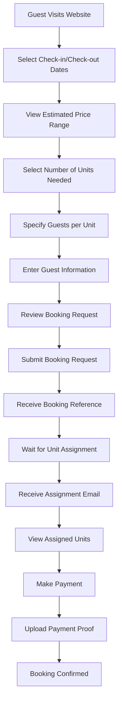
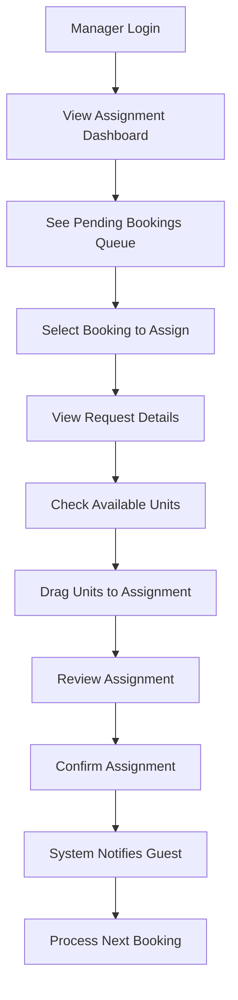

# User Flows Documentation

## Overview

This document describes the detailed user workflows for the two-phase booking system, covering both guest and manager perspectives, as well as edge cases and error handling scenarios.

## Guest User Flow

### Primary Booking Flow



### Detailed Steps

#### 1. Initial Booking Request

**Entry Point**: Public booking page (`/booking`)

**Actions**:

1. Select travel dates using date picker
   - Minimum: Today + 1 day
   - Maximum: 365 days in advance
   - Check-out must be after check-in

2. View availability summary
   - "X units available for your dates"
   - Estimated price range displayed

3. Select quantity of units needed
   - Dropdown: 1-10 units
   - Warning if requesting more than available

4. Specify guest distribution
   - For each unit: "Number of guests"
   - Maximum based on unit capacity (typically 4-6)

5. Enter contact information
   - Full name (required)
   - Email address (required, validated)
   - Phone number (required, Philippine format)
   - Special requests (optional, sanitized)

6. Complete CAPTCHA verification
   - Cloudflare Turnstile widget
   - Required for submission

7. Review and submit
   - Summary of request shown
   - Estimated price range
   - Terms acceptance checkbox
   - Submit button

**Success Response**:

```
Thank you for your booking request!

Your booking reference is: BKG-2024-001

What happens next:
1. Our team will review your request within 2-4 hours
2. We'll assign specific units based on availability
3. You'll receive an email with your unit assignments
4. Complete payment within 48 hours to confirm

Check your email for updates!
```

#### 2. Awaiting Assignment Phase

**Status Page**: `/booking/status?ref=BKG-2024-001`

**Display**:

```
Booking Status: Pending Assignment

Your Request:
- Check-in: December 20, 2024
- Check-out: December 22, 2024
- Units Requested: 2
- Total Guests: 6 (3 per unit)

Current Status: ⏳ Awaiting unit assignment

Estimated assignment time: Within 2-4 hours
(Business hours: 8 AM - 8 PM Philippine Time)

You will receive an email once units are assigned.
```

#### 3. Post-Assignment Phase

**Email Notification**:

```
Subject: Units Assigned - Action Required [BKG-2024-001]

Dear [Guest Name],

Great news! We've assigned units for your booking:

Assigned Units:
• Unit A3 - Garden View Cottage (₱2,500/night)
• Unit B2 - Poolside Villa (₱3,000/night)

Total Amount: ₱11,000

Next Steps:
1. Review your assigned units
2. Make payment within 48 hours
3. Upload payment proof

View Full Details: [Link to status page]

Thank you for choosing Okaeri Resort!
```

**Updated Status Page**:

```
Booking Status: Units Assigned - Awaiting Payment

Assigned Units:
┌─────────────────────────────────────────┐
│ Unit A3 - Garden View Cottage           │
│ • 3 guests                              │
│ • ₱2,500 per night                      │
│ • Subtotal: ₱5,000                      │
└─────────────────────────────────────────┘

┌─────────────────────────────────────────┐
│ Unit B2 - Poolside Villa                │
│ • 3 guests                              │
│ • ₱3,000 per night                      │
│ • Subtotal: ₱6,000                      │
└─────────────────────────────────────────┘

Total Amount Due: ₱11,000

Payment Instructions:
[Bank transfer details]
[GCash QR code]
[Payment deadline timer: 47:32:15]
```

#### 4. Payment and Confirmation

**Payment Upload Form**:

```
Upload Payment Proof

Amount Paid: [₱11,000 - prefilled]
Payment Method: [Dropdown: Bank Transfer/GCash/Cash]
Reference Number: [Input field]
Upload Screenshot: [File picker - images only, max 5MB]

[Upload Button]
```

**Final Confirmation**:

```
✅ Booking Confirmed!

Reference: BKG-2024-001

Your reservation is confirmed for:
• December 20-22, 2024
• Units: A3, B2
• Total Guests: 6

Check-in Time: 2:00 PM
Check-out Time: 11:00 AM

See you soon at Okaeri Resort!

[Download Confirmation PDF] [Add to Calendar]
```

## Manager User Flow

### Assignment Dashboard



### Detailed Manager Interface

#### 1. Assignment Dashboard

**URL**: `/manager/assignments`

**Main View**:

```
┌─────────────────────────────────────────────────────────────────┐
│ Assignment Dashboard                           [3] Pending      │
├─────────────────────────────────────────────────────────────────┤
│                                                                   │
│ Pending Assignments                              Auto-refresh ⟳  │
│                                                                   │
│ ┌─────────────────────────────────────────────────────────────┐ │
│ │ 🔴 URGENT                                                    │ │
│ │ BKG-2024-001 | John Doe                                      │ │
│ │ Dec 20-22 | 2 units | 6 guests            [Assign Units]    │ │
│ │ Requested: 2 hours ago                                       │ │
│ └─────────────────────────────────────────────────────────────┘ │
│                                                                   │
│ ┌─────────────────────────────────────────────────────────────┐ │
│ │ BKG-2024-002 | Jane Smith                                    │ │
│ │ Dec 24-26 | 1 unit | 2 guests             [Assign Units]    │ │
│ │ Requested: 30 minutes ago                                    │ │
│ └─────────────────────────────────────────────────────────────┘ │
│                                                                   │
│ ┌─────────────────────────────────────────────────────────────┐ │
│ │ BKG-2024-003 | Mike Johnson                                  │ │
│ │ Dec 28-30 | 3 units | 12 guests           [Assign Units]    │ │
│ │ Requested: 5 minutes ago                                     │ │
│ └─────────────────────────────────────────────────────────────┘ │
└─────────────────────────────────────────────────────────────────┘
```

#### 2. Assignment Interface

**Assignment Modal**:

```
┌─────────────────────────────────────────────────────────────────┐
│ Assign Units - BKG-2024-001                               [X]  │
├─────────────────────────────────────────────────────────────────┤
│                                                                  │
│ Guest Request:                                                  │
│ • Name: John Doe                                               │
│ • Dates: Dec 20-22, 2024 (2 nights)                           │
│ • Units Needed: 2                                              │
│ • Guest Distribution: [3 guests] [3 guests]                    │
│ • Special Requests: "Adjoining units if possible"              │
│                                                                  │
│ ─────────────────────────────────────────────────────────────  │
│                                                                  │
│ Available Units (Drag to assign):                              │
│                                                                  │
│ ┌──────────┐ ┌──────────┐ ┌──────────┐ ┌──────────┐          │
│ │   A1     │ │   A2     │ │   A3     │ │   B1     │          │
│ │ Standard │ │ Standard │ │ Garden   │ │ Poolside │          │
│ │ ₱2,000   │ │ ₱2,000   │ │ ₱2,500   │ │ ₱3,000   │          │
│ └──────────┘ └──────────┘ └──────────┘ └──────────┘          │
│                                                                  │
│ ┌──────────┐ ┌──────────┐                                      │
│ │   B2     │ │   C1     │                                      │
│ │ Poolside │ │ Premium  │                                      │
│ │ ₱3,000   │ │ ₱4,000   │                                      │
│ └──────────┘ └──────────┘                                      │
│                                                                  │
│ ─────────────────────────────────────────────────────────────  │
│                                                                  │
│ Unit Assignments:                                              │
│                                                                  │
│ Assignment 1: [Drop unit here] - 3 guests                      │
│ Assignment 2: [Drop unit here] - 3 guests                      │
│                                                                  │
│ Total Price: ₱0                                                │
│                                                                  │
│ [Cancel]                                      [Assign Units]    │
└─────────────────────────────────────────────────────────────────┘
```

#### 3. After Assignment

**Completed Assignment View**:

```
┌─────────────────────────────────────────────────────────────────┐
│ ✅ Units Successfully Assigned                                   │
├─────────────────────────────────────────────────────────────────┤
│                                                                   │
│ Booking: BKG-2024-001                                           │
│ Guest: John Doe                                                 │
│                                                                   │
│ Assigned Units:                                                 │
│ • A3 - Garden View (3 guests) - ₱5,000                         │
│ • B2 - Poolside Villa (3 guests) - ₱6,000                      │
│                                                                   │
│ Total: ₱11,000                                                  │
│                                                                   │
│ ✉️ Guest has been notified via email                            │
│ ⏰ Payment deadline: 48 hours                                    │
│                                                                   │
│ [View Assignment Details]            [Assign Next Booking]      │
└─────────────────────────────────────────────────────────────────┘
```

### Manager Actions Menu

#### Quick Actions per Booking

1. **Assign Units** - Primary action
2. **View Guest History** - Previous bookings
3. **Send Message** - Direct communication
4. **Flag for Review** - Mark problematic requests
5. **Reassign Units** - Modify assignments
6. **Cancel Booking** - With reason tracking

#### Bulk Operations

1. **Auto-Assign All** - Algorithm-based assignment (future)
2. **Export Pending List** - CSV download
3. **Print Assignment Sheet** - Daily operations
4. **Email Reminders** - Bulk notifications

## Error Scenarios

### Guest-Facing Errors

#### 1. No Availability

```
Sorry, no units are available for your selected dates.

Suggestions:
• Try different dates
• Reduce number of units needed
• Join our waitlist for cancellations

[Modify Dates] [Join Waitlist]
```

#### 2. Partial Availability

```
Limited Availability

You requested 3 units, but only 2 are available.

Options:
• Proceed with 2 units
• Choose different dates
• Join waitlist for 3 units

[Book 2 Units] [Change Dates] [Join Waitlist]
```

#### 3. Payment Timeout

```
⚠️ Payment Deadline Expired

Your booking has been cancelled due to non-payment.

The units have been released for other guests.

To make a new booking: [Start New Booking]
```

### Manager-Facing Errors

#### 1. Unit Already Assigned

```
❌ Assignment Failed

Unit B2 was assigned to another booking while you were working.

Please select a different unit.

[Refresh Available Units]
```

#### 2. Guest Capacity Exceeded

```
⚠️ Capacity Warning

Unit A1 has maximum capacity of 4 guests.
You're trying to assign 6 guests.

Options:
• Select a larger unit
• Split guests across multiple units

[Choose Different Unit]
```

#### 3. System Conflict

```
⚠️ Booking Conflict Detected

This booking overlaps with:
• BKG-2024-050 (Dec 21-23)

This may be a duplicate booking.

[View Details] [Mark as Duplicate] [Continue Anyway]
```

## Mobile Experience

### Guest Mobile Flow

1. **Responsive Booking Form**
   - Single column layout
   - Large touch targets (min 44px)
   - Native date pickers
   - Simplified navigation

2. **Mobile-Optimized Status Page**
   - Card-based layout
   - Swipeable unit cards
   - One-tap actions
   - QR code for payment

3. **Mobile Payment Upload**
   - Camera integration for receipts
   - Auto-resize images
   - Progress indicator
   - Offline queue support

### Manager Mobile Interface

1. **Assignment Queue**
   - Vertical card stack
   - Swipe actions (assign/skip)
   - Quick filters
   - Pull-to-refresh

2. **Unit Selection**
   - Grid view (2 columns)
   - Tap to select
   - Batch actions
   - Visual availability calendar

## Accessibility Features

### WCAG 2.1 AA Compliance

1. **Keyboard Navigation**
   - All actions keyboard accessible
   - Tab order logical
   - Skip links provided
   - Focus indicators visible

2. **Screen Reader Support**
   - ARIA labels complete
   - Status announcements
   - Form error descriptions
   - Progress indicators

3. **Visual Accessibility**
   - High contrast mode
   - Text scalable to 200%
   - No color-only indicators
   - Clear error messages

## Notifications & Communications

### Guest Notifications

| Event             | Channel     | Timing               | Content                                   |
| ----------------- | ----------- | -------------------- | ----------------------------------------- |
| Booking Received  | Email       | Immediate            | Confirmation of request                   |
| Units Assigned    | Email + SMS | Within 5 min         | Assignment details + payment instructions |
| Payment Reminder  | Email       | 24hr before deadline | Urgent payment reminder                   |
| Payment Received  | Email       | Within 1 hour        | Payment confirmation                      |
| Check-in Reminder | Email + SMS | 1 day before         | Check-in instructions                     |
| Post-Stay Survey  | Email       | 1 day after          | Feedback request                          |

### Manager Alerts

| Event             | Channel           | Priority | Action Required       |
| ----------------- | ----------------- | -------- | --------------------- |
| New Booking       | Dashboard + Email | Normal   | Assign within 4 hours |
| Urgent Booking    | Push + SMS        | High     | Assign within 1 hour  |
| Payment Received  | Dashboard         | Low      | Verify if needed      |
| Cancellation      | Email             | Normal   | Release units         |
| Conflict Detected | Dashboard + Email | High     | Resolve conflict      |

## Performance Expectations

### Response Times

- Form submission: < 2 seconds
- Status check: < 1 second
- Assignment action: < 3 seconds
- Payment upload: < 5 seconds
- Email delivery: < 5 minutes

### Availability

- System uptime: 99.9%
- Assignment hours: 8 AM - 8 PM PHT
- After-hours: Queue for next day
- Emergency bookings: Manager on-call

## Success Metrics

### Guest Metrics

- Booking completion rate: > 80%
- Assignment satisfaction: > 90%
- Payment completion: > 95%
- Support tickets: < 5%

### Manager Metrics

- Average assignment time: < 30 minutes
- Units utilization: > 85%
- Assignment accuracy: > 98%
- Reassignment rate: < 5%

## Training Requirements

### Guest Education

- Video tutorial on booking process
- FAQ section
- Live chat support
- Email templates for common questions

### Manager Training

- 2-hour initial training session
- Assignment best practices guide
- Monthly performance reviews
- Escalation procedures
