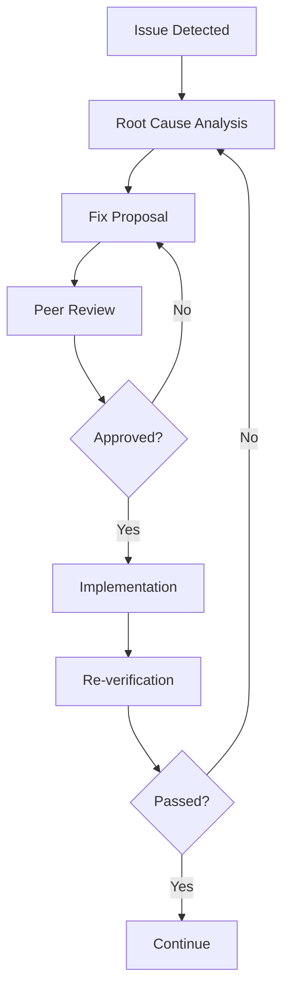

# Agent Delegation Matrix

## Overview

This document defines the specialized agent assignments, capabilities, and
handoff protocols for the TDD-first rewrite of the Okaeri Resort Management
System. Each agent has specific expertise and responsibilities throughout the
development lifecycle.

## Agent Capabilities Matrix

### Core Development Agents

| Agent                                 | Expertise                                 | Primary Tasks                                                                                                                       | Tools Access |
| ------------------------------------- | ----------------------------------------- | ----------------------------------------------------------------------------------------------------------------------------------- | ------------ |
| **context-manager**                   | Workflow coordination, state preservation | • Context preservation between sessions<br>• Multi-agent workflow management<br>• Handoff documentation<br>• Project state tracking | All tools    |
| **typescript-react-quality-expert**   | TypeScript, React, code quality           | • Write comprehensive tests<br>• Type safety validation<br>• Code quality reviews<br>• Pattern establishment                        | All tools    |
| **modern-form-validation-expert**     | React Hook Form, Zod, validation          | • Form implementation<br>• Validation schemas<br>• Error handling<br>• User input management                                        | All tools    |
| **resort-ui-designer**                | UI/UX, shadcn/ui, Tailwind CSS            | • Component design<br>• Mobile optimization<br>• Accessibility<br>• Visual consistency                                              | All tools    |
| **zustand-tanstack-resort-architect** | State management, TanStack Query          | • Store implementation<br>• Query optimization<br>• Optimistic updates<br>• Cache management                                        | All tools    |

### Infrastructure Agents

| Agent                             | Expertise                         | Primary Tasks                                                                                 | Tools Access |
| --------------------------------- | --------------------------------- | --------------------------------------------------------------------------------------------- | ------------ |
| **postgres-serverless-architect** | Neon PostgreSQL, database design  | • Schema design<br>• Migration strategies<br>• Query optimization<br>• Multi-tenant isolation | All tools    |
| **vercel-resort-api-architect**   | Vercel functions, serverless      | • API route design<br>• Mock service creation<br>• File handling<br>• Cost optimization       | All tools    |
| **pwa-performance-optimizer**     | Performance, PWA, service workers | • Bundle optimization<br>• Caching strategies<br>• Offline functionality<br>• Core Web Vitals | All tools    |
| **vercel-deployment-optimizer**   | Deployment, monitoring, DevOps    | • Production configuration<br>• Environment setup<br>• Monitoring<br>• Cost management        | All tools    |

### Specialized Domain Agents

| Agent                           | Expertise                                | Primary Tasks                                                                                 | Tools Access |
| ------------------------------- | ---------------------------------------- | --------------------------------------------------------------------------------------------- | ------------ |
| **resort-finance-architect**    | Financial systems, Philippine compliance | • Financial feature design<br>• Tax compliance<br>• Report generation<br>• Payment processing | All tools    |
| **security-compliance-auditor** | Security, compliance, auditing           | • Security reviews<br>• Vulnerability assessment<br>• Compliance checking<br>• Audit logging  | All tools    |
| **tanstack-router-expert**      | TanStack Router, routing patterns        | • Route configuration<br>• Guards implementation<br>• Data loading<br>• Navigation flows      | All tools    |
| **tailwind-v4-design-expert**   | Tailwind CSS v4, design systems          | • Design token creation<br>• Theme configuration<br>• Responsive design<br>• CSS optimization | All tools    |

## Phase-Specific Agent Assignments

### Phase 0: Foundation & Cleanup

**Lead**: `context-manager`

| Task                  | Primary Agent                     | Support Agents                    | Deliverables                 |
| --------------------- | --------------------------------- | --------------------------------- | ---------------------------- |
| Repository assessment | `context-manager`                 | -                                 | Infrastructure inventory     |
| Archive creation      | `context-manager`                 | -                                 | Organized archive structure  |
| Test infrastructure   | `typescript-react-quality-expert` | -                                 | Test utilities and templates |
| Mock API setup        | `vercel-resort-api-architect`     | `typescript-react-quality-expert` | Mock service layer           |
| Security baseline     | `security-compliance-auditor`     | -                                 | Security checklist           |

### Phase 1: Login System TDD

**Lead**: `typescript-react-quality-expert`

| Task                | Primary Agent                     | Support Agents              | Deliverables              |
| ------------------- | --------------------------------- | --------------------------- | ------------------------- |
| Test specification  | `typescript-react-quality-expert` | -                           | Comprehensive test suite  |
| Form implementation | `modern-form-validation-expert`   | -                           | Login/Register forms      |
| UI polish           | `resort-ui-designer`              | `tailwind-v4-design-expert` | Responsive, accessible UI |
| Security review     | `security-compliance-auditor`     | -                           | Security audit report     |
| Route setup         | `tanstack-router-expert`          | -                           | Auth route configuration  |

### Phase 2: Dashboard TDD

**Lead**: `zustand-tanstack-resort-architect`

| Task               | Primary Agent                       | Support Agents                | Deliverables            |
| ------------------ | ----------------------------------- | ----------------------------- | ----------------------- |
| Test specification | `typescript-react-quality-expert`   | -                             | Dashboard test suite    |
| State management   | `zustand-tanstack-resort-architect` | -                             | Dashboard stores        |
| UI implementation  | `resort-ui-designer`                | -                             | Dashboard components    |
| Real-time features | `zustand-tanstack-resort-architect` | `vercel-resort-api-architect` | WebSocket/polling setup |
| Performance        | `pwa-performance-optimizer`         | -                             | Optimized dashboard     |

### Phase 3: Booking System TDD

**Lead**: `postgres-serverless-architect`

| Task               | Primary Agent                     | Support Agents                      | Deliverables          |
| ------------------ | --------------------------------- | ----------------------------------- | --------------------- |
| Test specification | `typescript-react-quality-expert` | -                                   | Booking test suite    |
| Database design    | `postgres-serverless-architect`   | -                                   | Booking schema        |
| Calendar UI        | `resort-ui-designer`              | -                                   | Calendar component    |
| CRUD operations    | `vercel-resort-api-architect`     | `zustand-tanstack-resort-architect` | Booking API/stores    |
| Availability logic | `postgres-serverless-architect`   | -                                   | Availability checking |

### Phase 4: Financial Features TDD

**Lead**: `resort-finance-architect`

| Task               | Primary Agent                     | Support Agents             | Deliverables         |
| ------------------ | --------------------------------- | -------------------------- | -------------------- |
| Test specification | `typescript-react-quality-expert` | -                          | Financial test suite |
| Feature design     | `resort-finance-architect`        | -                          | Financial modules    |
| Database schema    | `postgres-serverless-architect`   | -                          | Financial tables     |
| Compliance         | `security-compliance-auditor`     | `resort-finance-architect` | Compliance report    |
| Reports UI         | `resort-ui-designer`              | -                          | Report components    |

### Phase 5: Production Deployment

**Lead**: `vercel-deployment-optimizer`

| Task               | Primary Agent                 | Support Agents | Deliverables          |
| ------------------ | ----------------------------- | -------------- | --------------------- |
| Security hardening | `security-compliance-auditor` | -              | Security audit        |
| Performance tuning | `pwa-performance-optimizer`   | -              | Performance report    |
| PWA features       | `pwa-performance-optimizer`   | -              | Offline functionality |
| Deployment setup   | `vercel-deployment-optimizer` | -              | Production config     |
| Monitoring         | `vercel-deployment-optimizer` | -              | Monitoring dashboard  |

## Collaboration Protocols

### Collaboration Matrix

| Agent A                             | Agent B                         | Collaboration Type    | Trigger               |
| ----------------------------------- | ------------------------------- | --------------------- | --------------------- |
| `typescript-react-quality-expert`   | `modern-form-validation-expert` | Test → Implementation | Tests written         |
| `modern-form-validation-expert`     | `resort-ui-designer`            | Implementation → UI   | Forms functional      |
| `resort-ui-designer`                | `pwa-performance-optimizer`     | UI → Performance      | UI complete           |
| `zustand-tanstack-resort-architect` | `vercel-resort-api-architect`   | State → API           | Store defined         |
| `postgres-serverless-architect`     | `vercel-resort-api-architect`   | Database → API        | Schema ready          |
| `resort-finance-architect`          | `security-compliance-auditor`   | Features → Compliance | Finance features done |
| `security-compliance-auditor`       | `vercel-deployment-optimizer`   | Security → Deploy     | Security approved     |

### Communication Protocols

1. **Handoff Initiation**

   ```markdown
   ## Handoff from [Agent A] to [Agent B]

   Date: [ISO Date] Phase: [Current Phase]

   ### Completed Work

   - [List of completed items]

   ### Test Results

   - Coverage: X%
   - Passing: X/X tests

   ### Known Issues

   - [Any issues or technical debt]

   ### Next Steps

   - [Specific tasks for receiving agent]

   ### Resources

   - [Relevant files and documentation]
   ```

2. **Issue Escalation**
   - Blocker identified → Context manager notified
   - Context manager coordinates resolution
   - Multiple agents engaged if needed

3. **Quality Gates**
   - Each handoff requires verification
   - Receiving agent must acknowledge
   - Issues trigger iteration cycle

## Handoff Requirements

### Mandatory Deliverables

Each agent must provide upon task completion:

1. **Code Deliverables**
   - [ ] All tests passing
   - [ ] Type safety verified
   - [ ] Linting clean
   - [ ] Documentation updated

2. **Quality Metrics**
   - [ ] Test coverage report
   - [ ] Performance metrics
   - [ ] Security scan results
   - [ ] Accessibility audit

3. **Documentation**
   - [ ] Implementation notes
   - [ ] API documentation
   - [ ] Known limitations
   - [ ] Future recommendations

### Acceptance Criteria

For handoff to be accepted:

1. **Technical Requirements**
   - All automated tests passing
   - No TypeScript errors
   - No console errors/warnings
   - Performance budgets met

2. **Documentation Requirements**
   - README updated
   - Inline comments for complex logic
   - API documentation complete
   - Handoff report submitted

3. **Quality Requirements**
   - Code review completed
   - Security review passed
   - Accessibility validated
   - Performance verified

## Iteration Triggers

### Automatic Iteration Required

These conditions trigger mandatory iteration:

1. **Test Failures**
   - Any failing test after implementation
   - Coverage below 90%
   - Type errors introduced

2. **Performance Issues**
   - Lighthouse score < 90
   - Bundle size exceeded
   - Memory leaks detected

3. **Security Vulnerabilities**
   - Critical or high severity findings
   - Authentication bypasses
   - Data exposure risks

4. **Accessibility Violations**
   - WCAG 2.1 AA failures
   - Keyboard navigation broken
   - Screen reader issues

### Iteration Process



## Performance Metrics

### Agent Performance KPIs

| Metric               | Target             | Measurement                          |
| -------------------- | ------------------ | ------------------------------------ |
| Handoff Success Rate | >80% first attempt | Successful handoffs / Total handoffs |
| Iteration Count      | <3 per component   | Average iterations before acceptance |
| Test Coverage        | >90%               | Lines covered / Total lines          |
| Defect Escape Rate   | <5%                | Post-handoff defects / Total defects |
| Time to Completion   | Within estimate    | Actual time / Estimated time         |

### Quality Metrics

| Metric              | Target | Owner                             |
| ------------------- | ------ | --------------------------------- |
| Type Coverage       | 100%   | `typescript-react-quality-expert` |
| Security Score      | A+     | `security-compliance-auditor`     |
| Performance Score   | >90    | `pwa-performance-optimizer`       |
| Accessibility Score | 100%   | `resort-ui-designer`              |
| Bundle Size         | <200KB | `pwa-performance-optimizer`       |

## Escalation Paths

### Issue Severity Levels

1. **Critical** (Immediate escalation)
   - Production down
   - Security breach
   - Data loss risk
   - Owner: `context-manager` + `security-compliance-auditor`

2. **High** (Same day resolution)
   - Blocking other agents
   - Performance degradation
   - Failed deployments
   - Owner: Lead agent + `context-manager`

3. **Medium** (48 hour resolution)
   - Non-blocking issues
   - Minor bugs
   - Documentation gaps
   - Owner: Assigned agent

4. **Low** (Next sprint)
   - Enhancements
   - Tech debt
   - Nice-to-haves
   - Owner: Backlog

### Escalation Chain

```
Developer Issue
    ↓
Lead Agent
    ↓
Context Manager
    ↓
Security Auditor (if security-related)
    ↓
Full Team Review
```

## Conclusion

This delegation matrix ensures clear ownership, accountability, and quality
throughout the TDD-first development process. Each agent's specialized expertise
contributes to building a robust, secure, and performant resort management
system.

The structured handoff protocols and iteration triggers guarantee that quality
is maintained at every stage, while the collaboration matrix ensures smooth
coordination between agents. Regular performance metrics tracking enables
continuous improvement of both the process and the product.
