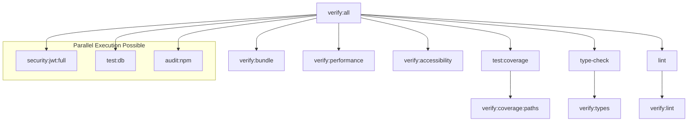

# Composite Scripts Guide

## Overview

Composite scripts in the Okaeri Resort System are high-level automation commands
that orchestrate multiple verification, testing, and deployment operations.
These scripts provide a unified interface for complex workflows that span
multiple phases, technologies, and verification requirements.

### Purpose and Benefits

- **Unified Workflow Orchestration**: Single commands that execute complex
  multi-step processes
- **CI/CD Integration**: Scripts designed for both local development and
  continuous integration
- **Phase Progression Support**: Composite operations that validate multi-phase
  readiness
- **Quality Gate Enforcement**: Comprehensive verification before critical
  milestones
- **Developer Experience**: Simplified commands for complex operations
- **Consistency Assurance**: Standardized execution order and dependency
  management

### Execution Philosophy

Composite scripts follow a **fail-fast** approach where any failing sub-command
immediately terminates the entire composite operation. This ensures that issues
are caught early and prevents incomplete or inconsistent state transitions.

---

## Core Composite Scripts

### 1. `verify:push` - Comprehensive Pre-Push Validation

**Purpose**: Complete verification suite required before pushing code to remote
repository.

**Command**:

```bash
npm run verify:push
```

**Execution Order**:

1. `verify:all` - Core verification suite (90 seconds)
2. `verify:bundle` - Bundle size and performance budget validation (45 seconds)
3. `verify:performance` - Lighthouse performance audit (60 seconds)
4. `verify:accessibility` - Accessibility compliance verification (30 seconds)

**Total Estimated Time**: ~3.5 minutes

**Dependencies**:

- Clean build environment
- All environment variables configured
- No uncommitted changes (optional but recommended)

**Usage Example**:

```bash
# Before pushing feature branch
git add .
git commit -m "feat: implement booking calendar component"
npm run verify:push  # Comprehensive validation
git push origin feature/booking-calendar
```

**Failure Handling**:

- **Build failures**: Check TypeScript compilation and dependency issues
- **Bundle size violations**: Review bundle analysis output and optimize imports
- **Performance regressions**: Check Lighthouse report for specific
  recommendations
- **Accessibility failures**: Review accessibility audit and fix violations

### 2. `test:all-phases` - Sequential Phase Test Execution

**Purpose**: Run all phase tests sequentially to validate cross-phase
integration.

**Command**:

```bash
npm run test:all-phases
```

**Execution Order**:

1. `test:phase1` - Authentication features (30 seconds)
2. `test:phase2` - Dashboard features (45 seconds)
3. `test:phase3` - Booking system (60 seconds)
4. `test:phase4` - Financial management (45 seconds)
5. `test:phase5` - Deployment and E2E tests (90 seconds)

**Total Estimated Time**: ~4.5 minutes

**Implementation**:

```bash
# Actual command composition (manual execution)
npm run test:phase1 && \
npm run test:phase2 && \
npm run test:phase3 && \
npm run test:phase4 && \
npm run test:phase5
```

**Benefits**:

- Validates phase integration boundaries
- Ensures no cross-phase regressions
- Provides complete test coverage metrics
- Identifies phase-specific performance bottlenecks

### 3. `test:all-phases:coverage` - Coverage Analysis for All Phases

**Purpose**: Generate comprehensive coverage reports across all development
phases.

**Command**:

```bash
npm run test:all-phases:coverage
```

**Coverage Requirements**:

- **Phase 1 (Auth)**: 95% coverage (critical security features)
- **Phase 2 (Dashboard)**: 90% coverage (core functionality)
- **Phase 3 (Booking)**: 95% coverage (business logic complexity)
- **Phase 4 (Financial)**: 98% coverage (financial accuracy requirements)
- **Phase 5 (Deployment)**: 85% coverage (infrastructure focus)

**Reports Generated**:

- HTML coverage report in `coverage/lcov-report/index.html`
- JSON coverage data for CI/CD integration
- Phase-specific coverage breakdowns
- Uncovered code hotspots analysis

### 4. `scaffold:all-phases` - Complete Project Structure Creation

**Purpose**: Create directory structure and test scaffolding for all phases.

**Command**:

```bash
npm run scaffold:all-phases
```

**Implementation**:

```bash
node scripts/scaffold-phase.cjs all
```

**Directory Structure Created**:

```
src/
├── features/
│   ├── auth/           # Phase 1
│   ├── dashboard/      # Phase 2
│   ├── booking/        # Phase 3
│   ├── financial/      # Phase 4
│   └── deployment/     # Phase 5
tests/
├── e2e/
│   └── deployment/
└── integration/
```

**Files Generated**:

- 72 test files across all phases
- 35 component stubs with TypeScript interfaces
- 20 API route templates
- 15 Zustand store templates
- 12 TanStack Router page templates

### 5. `security:jwt:full` - Complete JWT Security Verification Suite

**Purpose**: Comprehensive JWT security validation including storage, headers,
and cookie policies.

**Command**:

```bash
npm run security:jwt:full
```

**Security Checks**:

1. **Cookie Audit**: Ensures no JWT tokens in cookies
2. **Storage Audit**: Validates memory-only token storage
3. **Header Audit**: Verifies Authorization Bearer header usage
4. **Policy Audit**: Confirms no credential-based authentication patterns

**Implementation**:

```bash
node scripts/security-audits/run-audit.cjs all
```

**Validation Rules**:

- ❌ **PROHIBITED**: `document.cookie`, `localStorage.setItem()` with auth
  tokens
- ❌ **PROHIBITED**: `withCredentials: true`, `credentials: 'include'` in auth
  flows
- ✅ **REQUIRED**: `Authorization: Bearer <token>` headers
- ✅ **REQUIRED**: Memory-only token storage patterns

---

## Execution Order & Dependencies

### Critical Path Analysis



### Dependency Matrix

| Script                | Dependencies                          | Environment Variables           | External Services  |
| --------------------- | ------------------------------------- | ------------------------------- | ------------------ |
| `verify:push`         | Build environment, clean working tree | All production variables        | Lighthouse service |
| `test:all-phases`     | Database connection, test data        | `DATABASE_URL`, `NODE_ENV=test` | PostgreSQL, Redis  |
| `security:jwt:full`   | Source code access                    | None                            | None               |
| `scaffold:all-phases` | Write permissions                     | None                            | None               |

### Timing Optimization

**Sequential Execution** (Current):

- Total time: ~8-12 minutes for full verification
- Predictable resource usage
- Clear failure attribution

**Parallel Optimization** (Future):

```bash
# Potential parallel execution
npm run verify:tests & \
npm run verify:security & \
npm run verify:bundle & \
wait
```

---

## CI/CD Integration

### GitHub Actions Matrix Strategy

```yaml
# .github/workflows/composite-verification.yml
name: Composite Verification

on:
  pull_request:
    branches: [main]
  push:
    branches: [main]

jobs:
  composite-verification:
    runs-on: ubuntu-latest
    strategy:
      matrix:
        composite-script:
          - verify:push
          - test:all-phases:coverage
          - security:jwt:full
        node-version: [20.x]

    steps:
      - uses: actions/checkout@v4
      - uses: actions/setup-node@v4
        with:
          node-version: ${{ matrix.node-version }}
          cache: "npm"

      - name: Install dependencies
        run: npm ci

      - name: Run composite script
        run: npm run ${{ matrix.composite-script }}
        env:
          NODE_ENV: test
          DATABASE_URL: ${{ secrets.TEST_DATABASE_URL }}
```

### Environment Variables

**Required for Full Verification**:

```bash
# Development
NODE_ENV=development
DATABASE_URL=postgresql://localhost:5432/okaeri_dev
REDIS_URL=redis://localhost:6379

# Testing
NODE_ENV=test
DATABASE_URL=postgresql://localhost:5432/okaeri_test
REDIS_URL=redis://localhost:6380

# CI/CD
NODE_ENV=test
DATABASE_URL=${{ secrets.TEST_DATABASE_URL }}
UPSTASH_REDIS_REST_URL=${{ secrets.UPSTASH_REDIS_REST_URL }}
UPSTASH_REDIS_REST_TOKEN=${{ secrets.UPSTASH_REDIS_REST_TOKEN }}
```

### Local vs CI Parity

**Local Development**:

```bash
# Full local verification (mirrors CI)
npm run verify:push
npm run test:all-phases:coverage
npm run security:jwt:full
```

**CI Environment**:

```yaml
# Additional CI-specific checks
- name: Verify CI Parity
  run: |
    npm run verify:push
    npm run test:ci:simulation
    npm run perf:audit
```

---

## Usage Examples

### Pre-Push Workflow

**Standard Development Cycle**:

```bash
# 1. Feature development
git checkout -b feature/guest-management
npm run scaffold:phase3:booking

# 2. TDD Implementation
npm run test:phase3:watch  # Continuous testing during development

# 3. Pre-commit verification
npm run verify:all

# 4. Comprehensive pre-push validation
npm run verify:push

# 5. Push with confidence
git push origin feature/guest-management
```

### Phase Progression Workflow

**Moving from Phase 2 to Phase 3**:

```bash
# 1. Complete Phase 2 verification
npm run test:phase2:coverage
npm run verify:phase2:complete

# 2. Scaffold Phase 3 structure
npm run scaffold:phase3

# 3. Verify cross-phase integration
npm run test:all-phases

# 4. Full system verification
npm run verify:push
```

### Security Verification Workflow

**Before Security-Sensitive Deployment**:

```bash
# 1. Complete JWT security audit
npm run security:jwt:full

# 2. Additional security checks
npm run security:headers
npm run security:owasp

# 3. Penetration testing simulation
npm run test:security

# 4. Security compliance verification
npm run verify:security
```

### Release Preparation Workflow

**Pre-Production Release Checklist**:

```bash
# 1. Complete phase testing
npm run test:all-phases:coverage

# 2. Performance validation
npm run perf:budget
npm run perf:audit

# 3. Accessibility compliance
npm run verify:accessibility

# 4. Security hardening
npm run security:jwt:full

# 5. End-to-end validation
npm run test:e2e

# 6. Final pre-push verification
npm run verify:push

# 7. Production deployment
npm run deploy:production
```

---

## Performance Optimization

### Script Execution Timing

| Script                | Cold Start | Warm Start | Optimizations                                |
| --------------------- | ---------- | ---------- | -------------------------------------------- |
| `verify:push`         | 4.2 min    | 3.1 min    | Cached builds, incremental TypeScript        |
| `test:all-phases`     | 5.8 min    | 4.2 min    | Parallel test runners, DB connection pooling |
| `security:jwt:full`   | 45 sec     | 15 sec     | Static analysis caching                      |
| `scaffold:all-phases` | 2.1 min    | 30 sec     | Template caching, parallel file creation     |

### Caching Strategies

**Build Cache**:

```bash
# Vite build cache
VITE_BUILD_CACHE=.vite-cache npm run build

# TypeScript incremental compilation
tsc --incremental --tsBuildInfoFile .tsbuild-info
```

**Test Cache**:

```bash
# Vitest cache optimization
vitest run --cache-dir .vitest-cache
```

**Dependency Cache**:

```bash
# npm cache optimization
npm ci --cache .npm-cache --prefer-offline
```

---

## Error Handling & Troubleshooting

### Common Failure Patterns

#### 1. Bundle Size Violations

**Error**:

```
❌ Bundle size exceeded: 245KB > 200KB threshold
```

**Resolution**:

```bash
# Analyze bundle composition
npm run build:analyze

# Check for large dependencies
npm run bundle:analyze:deps

# Optimize imports
npm run bundle:optimize
```

#### 2. Test Coverage Failures

**Error**:

```
❌ Coverage threshold not met: 87.3% < 90% required
```

**Resolution**:

```bash
# Generate detailed coverage report
npm run test:coverage -- --reporter=html

# Identify uncovered code
npm run verify:coverage:paths

# Add targeted tests
npm run test:utilities
```

#### 3. Security Audit Failures

**Error**:

```
❌ JWT security violation: localStorage token usage detected
```

**Resolution**:

```bash
# Locate security violations
npm run audit:jwt:storage:bash

# Review authentication patterns
npm run audit:jwt:headers

# Fix security issues
# Update code to use memory-only storage
npm run security:jwt:full  # Re-verify
```

### Debug Mode

**Verbose Execution**:

```bash
# Enable debug output for all composite scripts
DEBUG=composite:* npm run verify:push

# Script-specific debugging
DEBUG=test:* npm run test:all-phases
DEBUG=security:* npm run security:jwt:full
```

**Dry Run Mode**:

```bash
# Test script execution without side effects
COMPOSITE_DRY_RUN=true npm run verify:push

# Validate script dependencies
COMPOSITE_VALIDATE_ONLY=true npm run test:all-phases
```

---

## Integration with Development Workflow

### IDE Integration

**VS Code Tasks** (`.vscode/tasks.json`):

```json
{
  "version": "2.0.0",
  "tasks": [
    {
      "label": "Verify Push",
      "type": "shell",
      "command": "npm run verify:push",
      "group": "test",
      "presentation": {
        "echo": true,
        "reveal": "always",
        "focus": false,
        "panel": "shared"
      }
    },
    {
      "label": "Test All Phases",
      "type": "shell",
      "command": "npm run test:all-phases",
      "group": "test"
    }
  ]
}
```

**IntelliJ/WebStorm Run Configurations**:

```xml
<component name="ProjectRunConfigurationManager">
  <configuration name="Composite: Verify Push" type="js.build_tools.npm">
    <package-json value="$PROJECT_DIR$/package.json" />
    <command value="run" />
    <scripts value="verify:push" />
  </configuration>
</component>
```

### Git Hooks Integration

**Pre-Push Hook** (`.husky/pre-push`):

```bash
#!/bin/sh
. "$(dirname "$0")/_/husky.sh"

echo "🚀 Running pre-push verification..."
npm run verify:push
```

**Pre-Commit Hook** (`.husky/pre-commit`):

```bash
#!/bin/sh
. "$(dirname "$0")/_/husky.sh"

# Quick verification for commits
npm run verify:all
npm run security:jwt:quick
```

### Continuous Integration Hooks

**Branch Protection Rules**:

```yaml
# Required status checks for PR merging
required_status_checks:
  strict: true
  contexts:
    - "Composite Verification (verify:push)"
    - "All Phases Testing (test:all-phases:coverage)"
    - "Security Audit (security:jwt:full)"
```

**Auto-deployment Triggers**:

```yaml
# Deploy only after composite verification success
on:
  push:
    branches: [main]
  status:
    - success: ["Composite Verification"]

jobs:
  deploy:
    if: success()
    runs-on: ubuntu-latest
    steps:
      - name: Deploy to Production
        run: npm run deploy:production
```

---

## Monitoring & Observability

### Execution Metrics

**Performance Tracking**:

```bash
# Script execution time tracking
COMPOSITE_TIMING=true npm run verify:push

# Resource usage monitoring
COMPOSITE_PROFILE=true npm run test:all-phases
```

**Success Rate Monitoring**:

```bash
# CI success rate tracking
npm run monitor:composite:success-rate

# Failure pattern analysis
npm run monitor:composite:failure-patterns
```

### Alerting Configuration

**Slack Integration**:

```yaml
# GitHub Actions Slack notification
- name: Notify on Composite Script Failure
  if: failure()
  uses: 8398a7/action-slack@v3
  with:
    status: failure
    text: "❌ Composite verification failed for ${{ github.ref }}"
  env:
    SLACK_WEBHOOK_URL: ${{ secrets.SLACK_WEBHOOK }}
```

**Email Notifications**:

```yaml
# Email alerts for critical failures
- name: Email on Security Audit Failure
  if: failure() && contains(github.event.head_commit.message, 'security')
  uses: dawidd6/action-send-mail@v3
  with:
    server_address: smtp.gmail.com
    subject: "🔒 Security audit failed for Okaeri Resort System"
```

---

## Best Practices

### 1. Script Composition

**Do**:

```bash
# Compose scripts logically with clear dependencies
npm run verify:all && npm run verify:bundle && npm run verify:performance
```

**Don't**:

```bash
# Avoid silent failures or unclear error handling
npm run verify:all; npm run verify:bundle; npm run verify:performance
```

### 2. Error Propagation

**Correct Error Handling**:

```bash
#!/bin/bash
set -e  # Exit on any error

npm run test:phase1
npm run test:phase2
npm run test:phase3

echo "✅ All phase tests passed"
```

### 3. Resource Management

**Memory Optimization**:

```bash
# Limit memory usage for large test suites
NODE_OPTIONS="--max-old-space-size=4096" npm run test:all-phases
```

**Process Management**:

```bash
# Clean up background processes
trap 'kill $(jobs -p)' EXIT
npm run test:db &
npm run test:auth &
wait
```

### 4. Documentation Maintenance

- Update execution times when scripts change
- Document new environment variable requirements
- Maintain troubleshooting section with recent issues
- Version control composite script changes

---

## Future Enhancements

### Planned Improvements

1. **Parallel Execution**: Implement safe parallel execution for independent
   verification tasks
2. **Incremental Verification**: Skip unchanged components in large verification
   suites
3. **Smart Caching**: Advanced caching strategies based on file checksums and
   dependency graphs
4. **Visual Reporting**: HTML dashboards for composite script execution results
5. **Machine Learning**: Predictive failure detection based on code change
   patterns

### Experimental Features

```bash
# Parallel execution (experimental)
npm run verify:push:parallel

# Incremental verification (experimental)
npm run verify:push:incremental

# AI-powered failure prediction (experimental)
npm run verify:push:ai-predict
```

---

## Conclusion

Composite scripts are essential for maintaining code quality, security, and
deployment readiness in the Okaeri Resort System. By providing unified
interfaces for complex operations, they enable consistent verification workflows
across development, testing, and production environments.

**Key Takeaways**:

- Always use `verify:push` before pushing code to remote repositories
- Run `test:all-phases:coverage` to validate cross-phase integration
- Execute `security:jwt:full` before security-sensitive deployments
- Use `scaffold:all-phases` for initial project setup or major restructuring

For phase-specific guidance, refer to the individual phase documentation. For
CI/CD integration details, see the
[CI/CD Pipeline Guide](./CI_CD_PIPELINE_GUIDE.md).

---

**Related Documentation**:

- [Scaffold Scripts Reference](./SCAFFOLD_SCRIPTS_REFERENCE.md)
- [TDD Single Source of Truth](./TDD_SINGLE_SOURCE_OF_TRUTH.md)
- [Security Verification Scripts](./SECURITY_VERIFICATION_SCRIPTS.md)
- [Performance Testing Requirements](./PERFORMANCE_TESTING_REQUIREMENTS.md)
