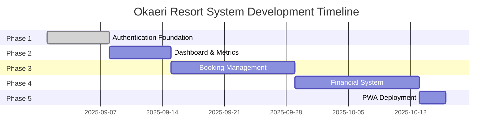

# Phase Progression Strategy

## Overview

This document defines the comprehensive progression strategy for Phases 1-5 of
the Okaeri Resort Management System, with specific focus on state management
evolution, resort-specific business logic, and progressive feature rollout using
React 19, Zustand, and TanStack Query.

**Owner**: zustand-tanstack-resort-architect  
**Parent Document**:
[PHASE_SCAFFOLDING_REQUIREMENTS.md](./PHASE_SCAFFOLDING_REQUIREMENTS.md)  
**Status**: Authoritative Phase Progression Guide  
**Last Updated**: August 31, 2025

## Phase Dependencies and Timeline

### Development Timeline with Dependencies



### Phase Dependency Chain

| Phase | Name                          | Duration  | Dependencies   | Blocks      | Business Value                               |
| ----- | ----------------------------- | --------- | -------------- | ----------- | -------------------------------------------- |
| **1** | Authentication & Security     | Week 1    | None           | All phases  | Staff access control, multi-tenant isolation |
| **2** | Dashboard & Real-time Metrics | Week 2    | Phase 1        | Phases 3, 4 | Occupancy tracking, revenue overview         |
| **3** | Booking & Reservations        | Weeks 3-4 | Phases 1, 2    | Phase 4     | Guest management, room allocation            |
| **4** | Financial & Compliance        | Weeks 5-6 | Phases 1, 2, 3 | Phase 5     | BIR compliance, receipt generation           |
| **5** | PWA & Offline Sync            | Week 7    | All phases     | None        | Mobile access, offline capability            |

### Critical Path Analysis

```typescript
// Critical dependencies that cannot be parallelized
const criticalPath = {
  phase1: {
    blockers: [],
    provides: ["authentication", "jwt", "userContext", "roleBasedAccess"],
    critical: true, // Security foundation
  },
  phase2: {
    blockers: ["authentication"],
    provides: ["metrics", "dashboardWidgets", "realTimeUpdates"],
    critical: true, // Business visibility
  },
  phase3: {
    blockers: ["authentication", "dashboardWidgets"],
    provides: ["bookingData", "guestManagement", "availability"],
    critical: true, // Core business function
  },
  phase4: {
    blockers: ["authentication", "bookingData"],
    provides: ["financialRecords", "taxCompliance", "receipts"],
    critical: true, // Legal compliance
  },
  phase5: {
    blockers: ["all"],
    provides: ["offlineSync", "pwaFeatures", "performance"],
    critical: false, // Enhancement layer
  },
};
```

## State Management Evolution

### Phase 1: Authentication Foundation

#### Zustand Stores

```typescript
// authStore.ts - Foundation for all phases
interface AuthStore {
  // Core authentication
  user: User | null;
  token: string | null;
  refreshToken: string | null;

  // Multi-tenant context
  currentProject: Project | null;
  permissions: Permission[];

  // Actions
  login: (credentials: LoginCredentials) => Promise<void>;
  logout: () => void;
  refreshSession: () => Promise<void>;
  switchProject: (projectId: string) => Promise<void>;

  // React 19 optimistic updates
  optimisticUser: User | null;
  setOptimisticUser: (user: User) => void;
}

// Initial TanStack Query setup
const useAuthQuery = () => {
  return useQuery({
    queryKey: ["auth", "session"],
    queryFn: validateSession,
    staleTime: 5 * 60 * 1000, // 5 minutes
    retry: false,
  });
};
```

### Phase 2: Dashboard State Layer

#### Building on Phase 1

```typescript
// dashboardStore.ts - Depends on authStore
interface DashboardStore {
  // Metrics state
  occupancyRate: number;
  dailyRevenue: number;
  checkInsToday: number;
  checkOutsToday: number;

  // Real-time updates via TanStack Query
  isRealTimeEnabled: boolean;
  lastUpdate: Date;

  // Computed values using Zustand selectors
  getOccupancyTrend: () => OccupancyTrend;
  getRevenueComparison: () => RevenueComparison;

  // React 19 useOptimistic integration
  optimisticMetrics: Partial<Metrics>;
  applyOptimisticUpdate: (metrics: Partial<Metrics>) => void;
}

// TanStack Query real-time polling
const useDashboardMetrics = () => {
  const { currentProject } = useAuthStore();

  return useQuery({
    queryKey: ["dashboard", currentProject?.id],
    queryFn: () => fetchMetrics(currentProject?.id),
    refetchInterval: 30000, // 30 seconds
    enabled: !!currentProject,
  });
};

// Zustand + TanStack Query integration
const useDashboardSync = () => {
  const updateMetrics = useDashboardStore((state) => state.updateMetrics);
  const { data } = useDashboardMetrics();

  useEffect(() => {
    if (data) updateMetrics(data);
  }, [data, updateMetrics]);
};
```

### Phase 3: Booking System Integration

#### Complex State Interactions

```typescript
// bookingStore.ts - Integrates auth, dashboard
interface BookingStore {
  // Booking state
  bookings: Booking[];
  availability: RoomAvailability[];
  selectedDates: DateRange;

  // Optimistic booking with React 19
  pendingBookings: OptimisticBooking[];
  addOptimisticBooking: (booking: BookingInput) => string; // returns optimistic ID
  confirmBooking: (optimisticId: string, realId: string) => void;
  revertBooking: (optimisticId: string) => void;

  // Philippine payment methods
  paymentMethods: PhilippinePaymentMethod[];
  selectedPayment: PaymentMethod | null;

  // Computed state
  getAvailableRooms: (dates: DateRange) => Room[];
  getTotalPrice: (booking: BookingInput) => Money;
}

// TanStack Query mutations with optimistic updates
const useCreateBooking = () => {
  const queryClient = useQueryClient();
  const { addOptimisticBooking, confirmBooking, revertBooking } =
    useBookingStore();

  return useMutation({
    mutationFn: createBookingAPI,
    onMutate: async (newBooking) => {
      // Cancel in-flight queries
      await queryClient.cancelQueries(["bookings"]);

      // Optimistic update
      const optimisticId = addOptimisticBooking(newBooking);

      return { optimisticId };
    },
    onSuccess: (data, variables, context) => {
      confirmBooking(context.optimisticId, data.id);
      queryClient.invalidateQueries(["bookings"]);
      queryClient.invalidateQueries(["dashboard"]); // Update dashboard metrics
    },
    onError: (error, variables, context) => {
      revertBooking(context?.optimisticId);
      toast.error("Booking failed. Please try again.");
    },
  });
};

// React 19 useOptimistic for instant UI feedback
const BookingForm = () => {
  const [optimisticBookings, addOptimisticBooking] = useOptimistic(
    bookings,
    (state, newBooking) => [...state, newBooking]
  );

  const createBooking = useCreateBooking();

  const handleSubmit = async (data: BookingInput) => {
    addOptimisticBooking({ ...data, status: "pending" });
    await createBooking.mutateAsync(data);
  };
};
```

### Phase 4: Financial State Architecture

#### Complex Financial Workflows

```typescript
// financialStore.ts - Builds on all previous phases
interface FinancialStore {
  // Financial records
  expenses: Expense[];
  revenues: Revenue[];
  receipts: Receipt[];

  // Approval workflow state
  pendingApprovals: Approval[];
  approvalQueue: QueuedApproval[];

  // BIR compliance
  taxCalculations: TaxCalculation[];
  birReports: BIRReport[];

  // Optimistic financial updates
  optimisticTransactions: OptimisticTransaction[];
  addOptimisticExpense: (expense: ExpenseInput) => string;

  // Computed financial metrics
  getMonthlyProfit: (month: Date) => Money;
  getTaxLiability: (period: TaxPeriod) => Money;
  getReceiptSequence: () => number;
}

// Multi-step approval workflow with Zustand
const useApprovalWorkflow = () => {
  const { pendingApprovals, approveExpense, rejectExpense } =
    useFinancialStore();
  const { user } = useAuthStore();

  const canApprove = (expense: Expense) => {
    return (
      user?.role === "admin" ||
      (user?.role === "manager" && expense.amount < 50000)
    );
  };

  return useMutation({
    mutationFn: async ({ expenseId, action }: ApprovalAction) => {
      // Optimistic state update
      if (action === "approve") {
        approveExpense(expenseId);
      } else {
        rejectExpense(expenseId);
      }

      // Server sync
      return processApproval(expenseId, action);
    },
    onError: (error, variables) => {
      // Revert optimistic update
      queryClient.invalidateQueries(["approvals"]);
    },
  });
};

// Offline-capable expense tracking
const useOfflineExpenses = () => {
  const { expenses, queuedExpenses, syncExpenses } = useFinancialStore();
  const isOnline = useOnlineStatus();

  // Queue expenses when offline
  const addExpense = useCallback(
    async (expense: ExpenseInput) => {
      if (!isOnline) {
        queueExpense(expense);
        return;
      }

      await createExpenseAPI(expense);
    },
    [isOnline]
  );

  // Sync when coming back online
  useEffect(() => {
    if (isOnline && queuedExpenses.length > 0) {
      syncExpenses();
    }
  }, [isOnline, queuedExpenses]);
};
```

### Phase 5: PWA & Deployment State

#### Offline-First Architecture

```typescript
// deploymentStore.ts - Orchestrates all stores for offline
interface DeploymentStore {
  // PWA state
  isOffline: boolean;
  syncStatus: SyncStatus;
  queuedActions: QueuedAction[];

  // Update management
  updateAvailable: boolean;
  updateVersion: string | null;

  // Performance monitoring
  metrics: PerformanceMetrics;
  lighthouse: LighthouseScore;

  // Sync orchestration
  syncAllStores: () => Promise<void>;
  clearOfflineQueue: () => void;
  forceUpdate: () => Promise<void>;
}

// Service Worker integration
const useServiceWorkerSync = () => {
  const { queuedActions, processQueue } = useDeploymentStore();

  useEffect(() => {
    if ("serviceWorker" in navigator) {
      navigator.serviceWorker.ready.then((registration) => {
        registration.sync.register("sync-queue");
      });

      navigator.serviceWorker.addEventListener("message", (event) => {
        if (event.data.type === "SYNC_COMPLETE") {
          processQueue();
        }
      });
    }
  }, [processQueue]);
};

// Offline queue persistence with Zustand persist
const deploymentStore = create(
  persist(
    (set, get) => ({
      queuedActions: [],
      addToQueue: (action) =>
        set((state) => ({
          queuedActions: [...state.queuedActions, action],
        })),
      processQueue: async () => {
        const queue = get().queuedActions;
        for (const action of queue) {
          await processAction(action);
        }
        set({ queuedActions: [] });
      },
    }),
    {
      name: "deployment-storage",
      storage: createJSONStorage(() => localStorage),
      partialize: (state) => ({ queuedActions: state.queuedActions }),
    }
  )
);
```

## Resort Management Context Per Phase

### Phase 1: Staff Authentication & Roles

**Business Requirements:**

- Multi-level staff hierarchy (Owner, Manager, Staff, Housekeeping)
- Project-based access control (multiple properties)
- Audit logging for compliance
- Session management for shared devices

**Implementation Focus:**

```typescript
// Resort-specific roles and permissions
enum ResortRole {
  OWNER = "owner", // Full access, financial reports
  MANAGER = "manager", // Operational access, limited financial
  FRONT_DESK = "front_desk", // Bookings, check-in/out
  HOUSEKEEPING = "housekeeping", // Room status only
  MAINTENANCE = "maintenance", // Facility issues
}

// Permission matrix for resort operations
const resortPermissions = {
  [ResortRole.OWNER]: ["*"],
  [ResortRole.MANAGER]: ["bookings.*", "expenses.create", "reports.view"],
  [ResortRole.FRONT_DESK]: ["bookings.*", "guests.*"],
  [ResortRole.HOUSEKEEPING]: ["rooms.status", "rooms.clean"],
  [ResortRole.MAINTENANCE]: ["facilities.*", "expenses.maintenance"],
};
```

### Phase 2: Occupancy & Availability Dashboard

**Business Requirements:**

- Real-time room availability display
- Seasonal rate management
- Occupancy forecasting
- Revenue per available room (RevPAR)
- Peak season indicators

**Resort-Specific Metrics:**

```typescript
interface ResortDashboard {
  // Occupancy metrics
  currentOccupancy: number; // Percentage
  todayArrivals: GuestArrival[];
  todayDepartures: GuestDeparture[];

  // Room status
  availableRooms: Room[];
  dirtyRooms: Room[];
  maintenanceRooms: Room[];

  // Financial snapshot
  todayRevenue: Money;
  monthToDateRevenue: Money;
  averageDailyRate: Money;
  revPAR: Money;

  // La Union specific
  surfSeasonIndicator: boolean;
  localHolidayAlert: string | null;
  weatherWarning: WeatherAlert | null;
}
```

### Phase 3: Booking with Philippine Payment Methods

**Business Requirements:**

- Support for GCash, Maya, PayPal
- Bank transfer management
- Walk-in booking support
- Group booking handling
- Long-stay discounts

**Payment Integration:**

```typescript
interface PhilippinePaymentMethods {
  gcash: {
    enabled: boolean;
    accountNumber: string;
    qrCode: string;
  };
  maya: {
    enabled: boolean;
    accountNumber: string;
    qrCode: string;
  };
  bankTransfer: {
    enabled: boolean;
    banks: BankAccount[];
  };
  cash: {
    enabled: boolean;
    requiresDeposit: boolean;
    depositAmount: Money;
  };
}

// Booking with local payment context
interface ResortBooking extends Booking {
  paymentMethod: PhilippinePaymentMethod;
  depositStatus: "pending" | "partial" | "full";
  birRequired: boolean; // Bureau of Internal Revenue receipt
  specialRequests: string[];
  localGuest: boolean; // La Union resident discount
}
```

### Phase 4: Financial Tracking with BIR Compliance

**Business Requirements:**

- BIR-compliant receipt generation
- VAT calculation and reporting
- Expense categorization for tax
- Multi-currency support (USD for foreign guests)
- Approval workflows for large expenses

**BIR Compliance Features:**

```typescript
interface BIRCompliance {
  // Receipt generation
  generateOfficialReceipt: (transaction: Transaction) => Receipt;
  receiptNumberSequence: ReceiptSequence;

  // Tax calculations
  calculateVAT: (amount: Money) => Money;
  calculateWithholdingTax: (expense: Expense) => Money;

  // Reporting
  generateMonthlyBIRReport: (month: Date) => BIRReport;
  exportBIRFormat: (report: BIRReport) => File;

  // Audit trail
  transactionLog: AuditLog[];
  approvalChain: ApprovalRecord[];
}

// Expense categories for Philippine tax
enum PhilippineExpenseCategory {
  UTILITIES = "utilities", // Electricity, water, internet
  SUPPLIES = "supplies", // Consumables, amenities
  MAINTENANCE = "maintenance", // Repairs, upkeep
  SALARIES = "salaries", // Staff compensation
  MARKETING = "marketing", // Advertising, promotions
  FOOD_BEVERAGE = "food_beverage", // Restaurant supplies
  TAXES_LICENSES = "taxes_licenses", // Government fees
  PROFESSIONAL_FEES = "professional_fees", // Legal, accounting
}
```

### Phase 5: PWA Deployment & Offline Sync

**Business Requirements:**

- Offline booking capability
- Sync when internet returns
- Mobile-first for staff devices
- Low bandwidth optimization
- Automatic updates

**Offline Capabilities:**

```typescript
interface OfflineCapabilities {
  // Cached data for offline access
  cachedRooms: Room[];
  cachedRates: RateTable[];
  cachedGuests: Guest[];

  // Offline operations
  queuedBookings: OfflineBooking[];
  queuedCheckIns: OfflineCheckIn[];
  queuedExpenses: OfflineExpense[];

  // Sync management
  lastSyncTime: Date;
  syncConflicts: SyncConflict[];
  syncStrategy: "automatic" | "manual" | "wifi-only";

  // Resort-specific offline features
  emergencyContacts: Contact[]; // Available offline
  facilityMap: OfflineMap; // Resort layout
  houseRules: Document; // Cached documents
}
```

## Feature Flags and Progressive Rollout

### Feature Flag Implementation

```typescript
// featureFlags.ts - Progressive feature enablement
interface FeatureFlags {
  // Phase-based flags
  phase2Dashboard: boolean;
  phase3Booking: boolean;
  phase4Financial: boolean;
  phase5PWA: boolean;

  // Feature-specific flags
  realTimeSync: boolean;
  offlineMode: boolean;
  advancedReporting: boolean;
  multiCurrency: boolean;

  // Experimental features
  aiPricingOptimization: boolean;
  predictiveOccupancy: boolean;
  automatedMarketing: boolean;
}

// Feature flag management with Zustand
const useFeatureStore = create<FeatureStore>((set, get) => ({
  flags: defaultFeatureFlags,

  isEnabled: (feature: keyof FeatureFlags) => {
    return get().flags[feature] ?? false;
  },

  enableFeature: (feature: keyof FeatureFlags) => {
    set(state => ({
      flags: { ...state.flags, [feature]: true }
    }));
  },

  // Progressive rollout based on phase completion
  enablePhase: (phase: number) => {
    const updates: Partial<FeatureFlags> = {};

    switch(phase) {
      case 2:
        updates.phase2Dashboard = true;
        updates.realTimeSync = true;
        break;
      case 3:
        updates.phase3Booking = true;
        break;
      case 4:
        updates.phase4Financial = true;
        updates.advancedReporting = true;
        break;
      case 5:
        updates.phase5PWA = true;
        updates.offlineMode = true;
        break;
    }

    set(state => ({
      flags: { ...state.flags, ...updates }
    }));
  }
}));

// Conditional rendering based on feature flags
const ConditionalFeature: React.FC<{ flag: keyof FeatureFlags }> = ({ flag, children }) => {
  const isEnabled = useFeatureStore(state => state.isEnabled(flag));

  if (!isEnabled) return null;
  return <>{children}</>;
};
```

### Testing Phase Interactions

```typescript
// Integration tests for phase interactions
describe("Phase Integration Tests", () => {
  describe("Phase 2-3 Integration", () => {
    it("should update dashboard when booking is created", async () => {
      // Create booking (Phase 3)
      const booking = await createBooking(mockBookingData);

      // Verify dashboard updates (Phase 2)
      const metrics = await getDashboardMetrics();
      expect(metrics.occupancyRate).toBeGreaterThan(0);
      expect(metrics.todayArrivals).toContainEqual(booking);
    });
  });

  describe("Phase 3-4 Integration", () => {
    it("should generate receipt when booking is paid", async () => {
      // Complete payment (Phase 3)
      const payment = await processPayment(bookingId, paymentData);

      // Verify financial record (Phase 4)
      const receipt = await getReceipt(payment.receiptId);
      expect(receipt.birCompliant).toBe(true);
      expect(receipt.vatAmount).toBeGreaterThan(0);
    });
  });
});
```

### Rollback Strategies

```typescript
// Rollback mechanism for failed phase deployments
interface RollbackStrategy {
  phase: number;
  trigger: "manual" | "automatic";
  conditions: RollbackCondition[];
  actions: RollbackAction[];
}

const rollbackStrategies: RollbackStrategy[] = [
  {
    phase: 3,
    trigger: "automatic",
    conditions: [
      { type: "error_rate", threshold: 0.05 }, // 5% error rate
      { type: "response_time", threshold: 3000 }, // 3 seconds
    ],
    actions: [
      { type: "disable_feature", feature: "phase3Booking" },
      { type: "notify_admin", channel: "email" },
      { type: "revert_to_version", version: "phase2-stable" },
    ],
  },
];

// Automatic rollback monitoring
const useRollbackMonitor = () => {
  const { currentPhase, metrics } = useDeploymentStore();
  const strategy = rollbackStrategies.find((s) => s.phase === currentPhase);

  useEffect(() => {
    if (!strategy || strategy.trigger !== "automatic") return;

    const checkConditions = () => {
      for (const condition of strategy.conditions) {
        if (evaluateCondition(condition, metrics)) {
          executeRollback(strategy);
          break;
        }
      }
    };

    const interval = setInterval(checkConditions, 10000); // Check every 10 seconds
    return () => clearInterval(interval);
  }, [strategy, metrics]);
};
```

### Production Deployment Sequence

```typescript
// Deployment sequence for production rollout
const deploymentSequence = {
  phase1: {
    preDeployment: [
      "Run security audit",
      "Verify JWT implementation",
      "Test rate limiting",
      "Validate RBAC",
    ],
    deployment: [
      "Deploy auth endpoints",
      "Enable monitoring",
      "Verify error tracking",
    ],
    postDeployment: [
      "Monitor login success rate",
      "Check session management",
      "Verify audit logs",
    ],
  },
  phase2: {
    preDeployment: [
      "Verify Phase 1 stability",
      "Test dashboard queries",
      "Load test real-time updates",
    ],
    deployment: [
      "Enable dashboard feature flag",
      "Deploy metric endpoints",
      "Start background jobs",
    ],
    postDeployment: [
      "Monitor query performance",
      "Verify metric accuracy",
      "Check WebSocket connections",
    ],
  },
  // ... continue for all phases
};
```

## Testing Strategy Per Phase

### Phase 1: Authentication Testing (95% Coverage Required)

```typescript
// Critical auth test scenarios
describe("Phase 1: Authentication", () => {
  describe("Security Tests", () => {
    test("JWT token rotation", async () => {});
    test("Session timeout handling", async () => {});
    test("Multi-tenant isolation", async () => {});
    test("Rate limiting enforcement", async () => {});
    test("RBAC permission checks", async () => {});
  });

  describe("Integration Tests", () => {
    test("Login flow with 2FA", async () => {});
    test("Password reset workflow", async () => {});
    test("Project switching", async () => {});
  });
});
```

### Phase 2: Dashboard Testing (90% Coverage Required)

```typescript
describe("Phase 2: Dashboard", () => {
  describe("Real-time Updates", () => {
    test("Metrics refresh on interval", async () => {});
    test("Optimistic UI updates", async () => {});
    test("WebSocket reconnection", async () => {});
  });

  describe("Performance Tests", () => {
    test("Dashboard loads under 2 seconds", async () => {});
    test("Handles 1000+ bookings efficiently", async () => {});
  });
});
```

### Phase 3: Booking Testing (93% Coverage Required)

```typescript
describe("Phase 3: Booking System", () => {
  describe("Business Logic Tests", () => {
    test("Availability calculation", async () => {});
    test("Price computation with discounts", async () => {});
    test("Payment method validation", async () => {});
    test("Overbooking prevention", async () => {});
  });

  describe("Philippine Payment Integration", () => {
    test("GCash payment flow", async () => {});
    test("Bank transfer verification", async () => {});
    test("Receipt generation", async () => {});
  });
});
```

### Phase 4: Financial Testing (95% Coverage Required)

```typescript
describe("Phase 4: Financial System", () => {
  describe("BIR Compliance Tests", () => {
    test("VAT calculation accuracy", async () => {});
    test("Receipt number sequencing", async () => {});
    test("Tax report generation", async () => {});
  });

  describe("Approval Workflow Tests", () => {
    test("Multi-level approval chain", async () => {});
    test("Expense categorization", async () => {});
    test("Budget threshold alerts", async () => {});
  });
});
```

### Phase 5: PWA Testing (85% Coverage Required)

```typescript
describe("Phase 5: PWA Deployment", () => {
  describe("Offline Capability Tests", () => {
    test("Offline booking queue", async () => {});
    test("Sync conflict resolution", async () => {});
    test("Service worker caching", async () => {});
  });

  describe("Performance Tests", () => {
    test("Lighthouse score > 90", async () => {});
    test("First contentful paint < 1.5s", async () => {});
    test("Bundle size < 200KB", async () => {});
  });
});
```

## Performance Benchmarks

### Per-Phase Performance Requirements

| Phase       | Metric             | Target  | Critical |
| ----------- | ------------------ | ------- | -------- |
| **Phase 1** | Login Time         | < 2s    | Yes      |
|             | Session Validation | < 100ms | Yes      |
|             | Token Refresh      | < 500ms | Yes      |
| **Phase 2** | Dashboard Load     | < 2s    | Yes      |
|             | Metric Update      | < 1s    | No       |
|             | Real-time Lag      | < 500ms | No       |
| **Phase 3** | Booking Search     | < 1s    | Yes      |
|             | Availability Check | < 500ms | Yes      |
|             | Payment Processing | < 3s    | Yes      |
| **Phase 4** | Report Generation  | < 5s    | No       |
|             | Receipt Creation   | < 1s    | Yes      |
|             | Tax Calculation    | < 200ms | Yes      |
| **Phase 5** | Offline Sync       | < 10s   | No       |
|             | PWA Install        | < 5s    | No       |
|             | Cache Update       | < 2s    | No       |

### Bundle Size Targets

```typescript
// Bundle size monitoring per phase
const bundleSizeTargets = {
  phase1: {
    main: 50, // KB
    vendor: 100,
    total: 150,
  },
  phase2: {
    main: 75,
    vendor: 125,
    total: 200,
  },
  phase3: {
    main: 100,
    vendor: 150,
    total: 250,
  },
  phase4: {
    main: 125,
    vendor: 175,
    total: 300,
  },
  phase5: {
    main: 150,
    vendor: 200,
    total: 350,
  },
};
```

## Implementation Commands

### Quick Start Commands

```bash
# Initial setup for all phases
npm run scaffold:all-phases

# Phase-specific development
npm run test:phase1:watch     # TDD for current phase
npm run test:phase2:watch     # When starting Phase 2

# Verification before moving to next phase
npm run test:phase1:coverage  # Must meet 95%
npm run verify:phase1         # Complete phase validation

# Progressive deployment
npm run build:phase1         # Build with Phase 1 only
npm run preview:phase1       # Test production build
```

### Phase Transition Checklist

```bash
# Before starting a new phase
✓ Previous phase tests passing
✓ Coverage requirements met
✓ Performance benchmarks achieved
✓ Security audit passed
✓ Documentation updated
✓ Feature flags configured
✓ Rollback strategy defined
✓ Integration tests written
```

## Monitoring and Observability

### Key Metrics Per Phase

```typescript
// Monitoring configuration for each phase
const phaseMonitoring = {
  phase1: {
    metrics: ["login_success_rate", "session_duration", "token_refresh_rate"],
    alerts: ["failed_login_spike", "session_timeout_increase"],
    dashboards: ["auth_overview", "security_audit"],
  },
  phase2: {
    metrics: ["dashboard_load_time", "metric_accuracy", "websocket_stability"],
    alerts: ["slow_queries", "data_inconsistency"],
    dashboards: ["performance_overview", "real_time_status"],
  },
  phase3: {
    metrics: [
      "booking_conversion",
      "payment_success_rate",
      "availability_accuracy",
    ],
    alerts: ["booking_failures", "payment_timeout", "overbooking"],
    dashboards: ["booking_funnel", "payment_analytics"],
  },
  phase4: {
    metrics: [
      "receipt_generation_time",
      "tax_calculation_accuracy",
      "approval_time",
    ],
    alerts: ["receipt_sequence_gap", "tax_miscalculation", "approval_delay"],
    dashboards: ["financial_overview", "compliance_status"],
  },
  phase5: {
    metrics: ["offline_queue_size", "sync_success_rate", "pwa_install_rate"],
    alerts: ["sync_failures", "cache_overflow", "update_failures"],
    dashboards: ["pwa_analytics", "offline_usage"],
  },
};
```

## Related Documentation

- [PHASE_SCAFFOLDING_REQUIREMENTS.md](./PHASE_SCAFFOLDING_REQUIREMENTS.md) -
  Technical scaffolding details
- [TDD_Master_Plan.md](./TDD_Master_Plan.md) - Overall TDD strategy
- [Agent_Delegation_Matrix.md](./Agent_Delegation_Matrix.md) - Agent
  responsibilities
- [Mock_API_Architecture.md](./Mock_API_Architecture.md) - API mocking strategy
- [Performance_Budgets.md](./Performance_Budgets.md) - Performance requirements

---

_Document Owner: zustand-tanstack-resort-architect_  
_Review Status: Complete_  
_Priority: CRITICAL - Guides all phase implementation_
