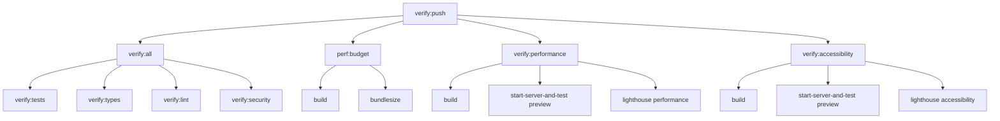

# TDD Single Source of Truth

> **Status**: Authoritative Source - All Other Documents Must Reference This  
> **Last Updated**: August 2025  
> **Owner**: typescript-react-quality-expert agent

---

## Overview

This document is the **ONLY** authoritative source for all TDD-related
decisions, metrics, and standards for the Okaeri Resort Management System. All
other documentation must reference this document for testing standards to ensure
consistency.

---

## 1. Test Coverage Standards

### Global Coverage Requirements

| Category              | Minimum Coverage    | Notes                              |
| --------------------- | ------------------- | ---------------------------------- |
| **Unit Tests**        | 90%                 | All components, stores, utilities  |
| **Integration Tests** | 85%                 | User flows and API interactions    |
| **E2E Tests**         | Critical paths only | Login, booking, payment flows      |
| **Overall Project**   | 90%                 | Combined coverage across all tests |

### Critical Path Coverage (95% Required)

The following areas require **95% minimum coverage** due to their critical
nature:

| Area                       | Justification       | Test Categories             | Enforcement Method        |
| -------------------------- | ------------------- | --------------------------- | ------------------------- |
| **Authentication**         | Security critical   | Unit, Integration, Security | scripts/check-coverage.js |
| **Financial Calculations** | Business critical   | Unit, Integration, E2E      | scripts/check-coverage.js |
| **Payment Processing**     | Revenue critical    | Unit, Integration, Security | scripts/check-coverage.js |
| **Booking Management**     | Core business logic | Unit, Integration, E2E      | scripts/check-coverage.js |
| **Data Validation**        | Data integrity      | Unit, Integration           | scripts/check-coverage.js |

**Coverage Enforcement Implementation**:

- **Global thresholds**: Enforced via vitest.config.ts (90% minimum for all
  code)
- **Path-specific thresholds**: Enforced via `scripts/check-coverage.js` (95%
  for auth, financial, etc.)
- **Verification command**: `npm run verify:coverage:paths`
- **CI Integration**: Automatic execution via `verify:all` script

### Phase-Specific Coverage

| Phase                   | Unit | Integration | E2E  | Security | Notes             |
| ----------------------- | ---- | ----------- | ---- | -------- | ----------------- |
| **Phase 1: Login**      | 95%  | 90%         | 100% | 100%     | Auth is critical  |
| **Phase 2: Dashboard**  | 90%  | 85%         | 80%  | 85%      | Standard coverage |
| **Phase 3: Booking**    | 95%  | 90%         | 100% | 90%      | Core business     |
| **Phase 4: Financial**  | 95%  | 90%         | 100% | 95%      | Money critical    |
| **Phase 5: Deployment** | 90%  | 85%         | 100% | 100%     | Production ready  |

---

## 2. Quality Gates

### RED Phase Entry Criteria

- [ ] Test specifications documented
- [ ] Test skeletons created (compile but fail)
- [ ] Mock data prepared
- [ ] Test utilities available
- [ ] Agent assigned

### RED Phase Exit Criteria

- [ ] All test files compile
- [ ] All tests fail with clear messages
- [ ] Coverage targets achievable
- [ ] No implementation code exists

### GREEN Phase Entry Criteria

- [ ] RED phase complete
- [ ] Implementation approach documented
- [ ] Performance budgets confirmed
- [ ] Security requirements clear

### GREEN Phase Exit Criteria

- [ ] All tests pass
- [ ] Coverage targets met
- [ ] No lint errors
- [ ] Type checking passes
- [ ] Performance budgets met

### REFACTOR Phase Entry Criteria

- [ ] GREEN phase complete
- [ ] Code review completed
- [ ] Refactoring opportunities identified
- [ ] Performance baseline established

### REFACTOR Phase Exit Criteria

- [ ] Tests still pass
- [ ] Coverage maintained or improved
- [ ] Performance improved or maintained
- [ ] Code quality metrics improved
- [ ] Documentation updated

---

## 3. Testing Categories

### Unit Tests

**Purpose**: Test individual components, functions, stores in isolation

**Requirements**:

- Fast execution (<100ms per test)
- No external dependencies
- Deterministic results
- Clear test names
- Single responsibility

**Tools**: Vitest, React Testing Library, MSW

### Integration Tests

**Purpose**: Test component interactions, API calls, state management

**Requirements**:

- Test user flows
- Mock external services
- Test error scenarios
- Validate data flow
- <500ms per test

**Tools**: Vitest, React Testing Library, MSW, Testing Utilities

### E2E Tests

**Purpose**: Test complete user journeys

**Requirements**:

- Critical paths only
- Real browser environment
- Production-like data
- Performance validation
- <30s per test

**Tools**: Playwright, Lighthouse CI

### Security Tests

**Purpose**: Validate security controls

**Requirements**:

- Authentication flows
- Authorization checks
- Input validation
- XSS prevention
- CSRF protection (where applicable)

**Tools**: Custom security test utilities, OWASP ZAP (optional)

### Accessibility Tests

**Purpose**: Ensure WCAG 2.1 AA compliance

**Requirements**:

- Automated axe checks
- Keyboard navigation
- Screen reader testing
- Color contrast validation
- Focus management

**Tools**: axe-core, Pa11y, Manual testing

### Performance Tests

**Purpose**: Validate performance budgets

**Requirements**:

- Bundle size limits
- Load time targets
- Runtime performance
- Memory usage
- Network efficiency

**Tools**: Lighthouse CI, Bundlesize, Custom metrics

---

## 4. Phase Status Tracking

### Single Source of Truth

**MASTER_VERIFICATION_INDEX.md** is the **ONLY** source for phase status
tracking.

All other documents must reference:
`[Status tracked in Master Verification Index](./phases/MASTER_VERIFICATION_INDEX.md)`

### Status States

| State           | Description   | Next Action           |
| --------------- | ------------- | --------------------- |
| **⏳ Pending**  | Not started   | Begin RED phase       |
| **🔴 RED**      | Writing tests | Complete test suite   |
| **🟢 GREEN**    | Implementing  | Pass all tests        |
| **🔵 REFACTOR** | Optimizing    | Improve quality       |
| **✅ Complete** | Done          | Handoff to next phase |
| **⚠️ Blocked**  | Issue found   | Resolve blocker       |

---

## 5. Mock Service Readiness

### Service Maturity Levels

| Level              | Description     | Capabilities                    |
| ------------------ | --------------- | ------------------------------- |
| **L1: Basic**      | CRUD operations | Create, Read, Update, Delete    |
| **L2: Advanced**   | Business logic  | Validation, calculations, rules |
| **L3: Production** | Full simulation | Errors, delays, edge cases      |

### Phase Requirements

| Phase       | Required Services       | Maturity Level |
| ----------- | ----------------------- | -------------- |
| **Phase 1** | Auth                    | L3             |
| **Phase 2** | Auth, Property, Metrics | L2, L1, L1     |
| **Phase 3** | Booking, Payment        | L3, L2         |
| **Phase 4** | Financial, Reports      | L3, L2         |
| **Phase 5** | All services            | L3             |

---

## 6. Deterministic Testing Standards

### Canonical Test Configuration

The following configuration represents the Single Source of Truth for all test
environments:

```typescript
// Always applied in test environment - CANONICAL VALUES
const TEST_CONFIG = {
  scenario: "STABLE",
  seed: "test-seed-2024",
  timestamp: "2024-01-01T00:00:00Z", // CANONICAL TEST DATE
  timezone: "Asia/Manila",
  locale: "en-PH",
  currency: "PHP",
};
```

### Environment Variable Override Support

While the canonical values above are the default, implementations should support
environment variable overrides for flexibility:

```typescript
// Recommended implementation in src/test/setup.ts
const FIXED_TIME = process.env.FIXED_TIME ?? "2024-01-01T00:00:00Z";
const RANDOM_SEED = process.env.RANDOM_SEED ?? "test-seed-2024";
const TEST_SCENARIO = process.env.TEST_SCENARIO ?? "STABLE";
const MOCK_DELAY = process.env.MOCK_DELAY ?? "0";

vi.setSystemTime(new Date(FIXED_TIME));
```

### Environment Variables

| Variable        | Canonical Value          | Purpose                 | Override Support |
| --------------- | ------------------------ | ----------------------- | ---------------- |
| `NODE_ENV`      | `"test"`                 | Enable test mode        | No               |
| `TEST_SCENARIO` | `"STABLE"`               | Deterministic responses | Yes              |
| `MOCK_DELAY`    | `"0"`                    | No artificial delays    | Yes              |
| `RANDOM_SEED`   | `"test-seed-2024"`       | Predictable random      | Yes              |
| `FIXED_TIME`    | `"2024-01-01T00:00:00Z"` | Consistent timestamps   | Yes              |
| `TZ`            | `"Asia/Manila"`          | Philippine timezone     | No               |

### Fallback Mechanism Examples

**CI Override Example**:

```yaml
# .github/workflows/ci.yml
env:
  FIXED_TIME: "2024-01-01T00:00:00Z" # Explicit override to canonical
```

**Local Development Override**:

```bash
# Run tests with custom time for debugging specific scenarios
FIXED_TIME="2023-12-25T00:00:00Z" npm run test:coverage
```

**Default Behavior** (when no environment variables set):

```bash
# Uses canonical values from SSoT
npm run test:coverage
```

### Mock Data Standards

- User IDs: Sequential from 1000
- Booking IDs: Sequential from 2000
- Transaction IDs: Sequential from 3000
- Timestamps: Fixed to FIXED_TIME environment variable (defaults to canonical
  2024-01-01T00:00:00Z)
- Random values: Seeded with RANDOM_SEED environment variable (defaults to
  canonical test-seed-2024)

---

## 7. TDD Enforcement Rules

### NPM Scripts for TDD Workflow

Required NPM scripts for phase-based testing:

```json
{
  "scripts": {
    // Phase-specific test commands
    "scaffold:phase1": "echo 'See docs/implementation/phases/phase-1-login-tdd/PHASE_1_RED_TEST_SKELETONS.md for test scaffolding'",
    "test:phase1": "vitest run src/features/auth/**/__tests__/*.test.{ts,tsx}",
    "test:phase1:coverage": "vitest run --coverage src/features/auth/**/__tests__/*.test.{ts,tsx}",

    // General testing commands
    "test": "vitest",
    "test:coverage": "vitest run --coverage",
    "test:ui": "vitest --ui",
    "preview": "vite preview --port 4173",

    // Verification commands
    "verify": "npm run verify:all",
    "verify:all": "npm run verify:tests && npm run verify:types && npm run verify:lint && npm run verify:security",
    "verify:push": "npm run verify:all && npm run perf:budget && npm run verify:performance && npm run verify:accessibility",
    "verify:tests": "vitest run --coverage",
    "verify:types": "tsc --noEmit",
    "verify:lint": "eslint . --max-warnings 0",
    "verify:security": "npm audit --audit-level=high",
    "verify:accessibility": "npm run build && start-server-and-test preview http://localhost:4173 'lighthouse http://localhost:4173 --only-categories=accessibility --output=json --output-path=./reports/lighthouse-accessibility.json'",
    "verify:performance": "npm run build && start-server-and-test preview http://localhost:4173 'lighthouse http://localhost:4173 --preset=desktop --output=json --output-path=./reports/lighthouse-performance.json'",
    "verify:bundle": "npm run perf:budget",
    "perf:budget": "npm run build && bundlesize",
    "build:analyze": "ANALYZE=true npm run build"
  }
}
```

**Note**: If scaffold:phase1 script needs actual implementation, create a script
at `scripts/scaffold-phase1.js` that materializes test files from the RED test
skeletons.

**Version Pinning Policy**:

To ensure deterministic builds and local-CI parity, critical testing
dependencies MUST use exact versions (no caret ranges). The following versions
align with the current package.json:

**Required Dependencies with Exact Versions**:

```bash
npm install --save-dev --save-exact bundlesize@0.18.2
npm install --save-dev --save-exact start-server-and-test@2.0.13
npm install --save-dev --save-exact lighthouse@12.8.2
npm install --save-dev --save-exact jest-axe@10.0.0
npm install --save-dev --save-exact @types/jest-axe@3.5.9
```

**Package.json devDependencies (Authoritative Versions)**:

```json
{
  "devDependencies": {
    "bundlesize": "0.18.2",
    "start-server-and-test": "2.0.13",
    "lighthouse": "12.8.2",
    "jest-axe": "10.0.0",
    "@types/jest-axe": "3.5.9"
  }
}
```

**Version Pinning Policy**:

- **Testing Tools**: Use exact versions (no ^ or ~) to prevent version drift
  between local and CI
- **Build Tools**: Use exact versions for bundlesize, lighthouse, and
  accessibility tools
- **Type Definitions**: Pin @types/\* packages to prevent TypeScript
  compatibility issues
- **Server Tools**: Pin start-server-and-test to ensure consistent server
  lifecycle management
- **Runtime Dependencies**: Allow caret ranges for application dependencies
  where appropriate

**CI/Local Parity Check**:

```bash
# Verify exact versions match between local and CI
npm list bundlesize lighthouse jest-axe start-server-and-test --depth=0
```

**Critical Requirements**:

- **preview script**: `"preview": "vite preview --port 4173"` is REQUIRED for
  performance testing scripts
- **verify:push script**:
  `"verify:push": "npm run verify:all && npm run perf:budget && npm run verify:performance && npm run verify:accessibility"`
  is the authoritative definition for pre-push verification

### Pre-commit Requirements

1. **Test file exists** for modified source files
2. **Tests pass** for modified files
3. **Coverage maintained** (no regression)
4. **Lint passes** (ESLint, Prettier)
5. **Type check passes** (TypeScript strict)

### CI/CD Gates

| Check         | Threshold                                   | Action on Failure |
| ------------- | ------------------------------------------- | ----------------- |
| Unit Tests    | Pass 100%                                   | Block merge       |
| Coverage      | 90% minimum                                 | Block merge       |
| Lint          | No errors                                   | Block merge       |
| Type Check    | No errors                                   | Block merge       |
| Bundle Size   | Per Performance_Budgets.md (via bundlesize) | Block merge       |
| Security Scan | No high/critical                            | Block merge       |
| Lighthouse    | ≥90 score                                   | Warning only      |

---

## 8. Required npm Scripts - Single Source of Truth

### Core Verification Scripts (Authoritative Definitions)

All projects MUST include these exact script definitions in package.json:

```json
{
  "scripts": {
    // Build and preview (required for testing)
    "build": "tsc -b && vite build",
    "preview": "vite preview --port 4173",

    // Core testing
    "test": "vitest",
    "test:coverage": "vitest run --coverage",
    "test:ui": "vitest --ui",

    // Verification pipeline
    "verify": "npm run verify:all",
    "verify:all": "npm run verify:tests && npm run verify:types && npm run verify:lint && npm run verify:security",
    "verify:push": "npm run verify:all && npm run perf:budget && npm run verify:performance && npm run verify:accessibility",
    "verify:tests": "vitest run --coverage",
    "verify:types": "tsc --noEmit",
    "verify:lint": "eslint . --max-warnings 0",
    "verify:security": "npm audit --audit-level=high",

    // Performance verification
    "verify:bundle": "npm run perf:budget",
    "verify:performance": "npm run build && start-server-and-test preview http://localhost:4173 'lighthouse http://localhost:4173 --preset=desktop --output=json --output-path=./reports/lighthouse-performance.json'",
    "verify:accessibility": "npm run build && start-server-and-test preview http://localhost:4173 'lighthouse http://localhost:4173 --only-categories=accessibility --output=json --output-path=./reports/lighthouse-accessibility.json'",
    "perf:budget": "npm run build && bundlesize",

    // Analysis (visualization only)
    "build:analyze": "ANALYZE=true npm run build"
  }
}
```

### Phase-Specific Testing Scripts

```json
{
  "scripts": {
    // Phase 1: Authentication & Login
    "scaffold:phase1": "echo 'See docs/implementation/phases/phase-1-login-tdd/PHASE_1_RED_TEST_SKELETONS.md'",
    "test:phase1": "vitest run src/features/auth/**/__tests__/*.test.{ts,tsx}",
    "test:phase1:coverage": "vitest run --coverage src/features/auth/**/__tests__/*.test.{ts,tsx}",
    "test:phase1:watch": "vitest watch src/features/auth/**/__tests__/*.test.{ts,tsx}",

    // Phase 2: Dashboard & Navigation
    "scaffold:phase2": "echo 'See docs/implementation/phases/phase-2-dashboard-tdd/README.md'",
    "test:phase2": "vitest run src/features/dashboard/**/__tests__/*.test.{ts,tsx}",
    "test:phase2:coverage": "vitest run --coverage src/features/dashboard/**/__tests__/*.test.{ts,tsx}",
    "test:phase2:watch": "vitest watch src/features/dashboard/**/__tests__/*.test.{ts,tsx}",

    // Phase 3: Booking Management
    "scaffold:phase3": "echo 'See docs/implementation/phases/phase-3-booking-tdd/README.md'",
    "test:phase3": "vitest run src/features/booking/**/__tests__/*.test.{ts,tsx}",
    "test:phase3:coverage": "vitest run --coverage src/features/booking/**/__tests__/*.test.{ts,tsx}",
    "test:phase3:watch": "vitest watch src/features/booking/**/__tests__/*.test.{ts,tsx}",

    // Phase 4: Financial & Reporting
    "scaffold:phase4": "echo 'See docs/implementation/phases/phase-4-financial-tdd/README.md'",
    "test:phase4": "vitest run src/features/financial/**/__tests__/*.test.{ts,tsx}",
    "test:phase4:coverage": "vitest run --coverage src/features/financial/**/__tests__/*.test.{ts,tsx}",
    "test:phase4:watch": "vitest watch src/features/financial/**/__tests__/*.test.{ts,tsx}",

    // Phase 5: Deployment & E2E
    "scaffold:phase5": "echo 'See docs/implementation/phases/phase-5-deployment/README.md'",
    "test:phase5": "vitest run src/features/deployment/**/__tests__/*.test.{ts,tsx} && playwright test tests/e2e/deployment",
    "test:phase5:coverage": "vitest run --coverage src/features/deployment/**/__tests__/*.test.{ts,tsx}",
    "test:phase5:watch": "vitest watch src/features/deployment/**/__tests__/*.test.{ts,tsx}",

    // Combined phase testing
    "test:all-phases": "npm run test:phase1 && npm run test:phase2 && npm run test:phase3 && npm run test:phase4 && npm run test:phase5",
    "test:all-phases:coverage": "npm run test:phase1:coverage && npm run test:phase2:coverage && npm run test:phase3:coverage && npm run test:phase4:coverage && npm run test:phase5:coverage"
  }
}
```

### Git Hook Setup with Husky

**Required Husky Configuration**:

1. **Install Husky**:

```bash
npm install --save-dev husky
npx husky init
```

2. **Pre-commit Hook** (`.husky/pre-commit`):

```bash
#!/usr/bin/env sh
. "$(dirname -- "$0")/_/husky.sh"

npm run verify:all
```

3. **Pre-push Hook** (`.husky/pre-push`):

```bash
#!/usr/bin/env sh
. "$(dirname -- "$0")/_/husky.sh"

npm run verify:push
```

4. **Commit Message Hook** (`.husky/commit-msg`):

```bash
#!/usr/bin/env sh
. "$(dirname -- "$0")/_/husky.sh"

npx --no -- commitlint --edit $1
```

### Script Execution Flow



### Script Purpose and Usage

| Script Category          | Purpose                        | When to Use                   |
| ------------------------ | ------------------------------ | ----------------------------- |
| **verify:push**          | Complete pre-push verification | Before pushing to remote      |
| **verify:all**           | Core quality checks            | Daily development, pre-commit |
| **verify:bundle**        | Bundle size enforcement        | Performance regression checks |
| **verify:performance**   | Lighthouse performance audit   | Performance optimization      |
| **verify:accessibility** | WCAG compliance check          | Accessibility verification    |
| **test:phase{N}**        | Phase-specific testing         | TDD development workflow      |
| **preview**              | Production preview server      | Required for Lighthouse tests |

---

## 9. Bundle Verification - Critical Configuration Fix

**CRITICAL CONFIGURATION ISSUE**: Any `verify:bundle` script that uses
visualization (`build:analyze`) instead of enforcement (`perf:budget`) allows
performance regressions and must be fixed immediately.

**Current (Incorrect) Configuration**:

```json
{
  "scripts": {
    "verify:bundle": "npm run build:analyze" // ❌ Visualization only - NO ENFORCEMENT
  }
}
```

**Required (Correct) Configuration**:

```json
{
  "scripts": {
    "verify:bundle": "npm run perf:budget" // ✅ Actual enforcement with bundlesize
  }
}
```

**Verification Command**:

```bash
# Check if bundle enforcement is properly configured
npm run verify:bundle-config 2>/dev/null || echo "⚠️ Bundle verification script needs manual check"

# Manual verification
grep '"verify:bundle"' package.json
# Should show: "verify:bundle": "npm run perf:budget"
# NOT: "verify:bundle": "npm run build:analyze"
```

---

## 10. Phase-Specific Script Requirements

### Complete Phase Script Set

Each phase MUST include all four script variants:

| Phase   | Scaffold Script   | Test Script   | Coverage Script        | Watch Script        |
| ------- | ----------------- | ------------- | ---------------------- | ------------------- |
| Phase 1 | `scaffold:phase1` | `test:phase1` | `test:phase1:coverage` | `test:phase1:watch` |
| Phase 2 | `scaffold:phase2` | `test:phase2` | `test:phase2:coverage` | `test:phase2:watch` |
| Phase 3 | `scaffold:phase3` | `test:phase3` | `test:phase3:coverage` | `test:phase3:watch` |
| Phase 4 | `scaffold:phase4` | `test:phase4` | `test:phase4:coverage` | `test:phase4:watch` |
| Phase 5 | `scaffold:phase5` | `test:phase5` | `test:phase5:coverage` | `test:phase5:watch` |

### Phase Script Naming Convention

All phase scripts follow a consistent naming pattern:

- `scaffold:phase{N}` - Display scaffolding instructions for phase N
- `test:phase{N}` - Run all tests for phase N
- `test:phase{N}:coverage` - Run tests with coverage report for phase N
- `test:phase{N}:watch` - Run tests in watch mode for phase N development

### Coverage Requirements per Phase

| Phase       | Feature Area           | Minimum Coverage | Critical Paths                               |
| ----------- | ---------------------- | ---------------- | -------------------------------------------- |
| **Phase 1** | Authentication & Login | 95%              | Login flow, JWT handling, session management |
| **Phase 2** | Dashboard & Navigation | 90%              | Role-based routing, metrics display          |
| **Phase 3** | Booking Management     | 95%              | CRUD operations, availability check, payment |
| **Phase 4** | Financial & Reporting  | 95%              | Calculations, receipts, reporting accuracy   |
| **Phase 5** | Deployment & E2E       | 90%              | Full user journeys, production scenarios     |

### Phase-Specific Test Directories

| Phase       | Test Location                          | Implementation Location   |
| ----------- | -------------------------------------- | ------------------------- |
| **Phase 1** | `src/features/auth/**/__tests__/`      | `src/features/auth/`      |
| **Phase 2** | `src/features/dashboard/**/__tests__/` | `src/features/dashboard/` |
| **Phase 3** | `src/features/booking/**/__tests__/`   | `src/features/booking/`   |
| **Phase 4** | `src/features/financial/**/__tests__/` | `src/features/financial/` |
| **Phase 5** | `tests/e2e/deployment/`                | Full application          |

### TDD Workflow Usage Examples

```bash
# Phase 1 TDD Workflow (RED-GREEN-REFACTOR)
# RED: Write failing tests
npm run scaffold:phase1     # Get test specifications
npm run test:phase1         # Run tests (should fail initially)

# GREEN: Implement until tests pass
npm run test:phase1:watch   # Watch mode for rapid development
npm run test:phase1         # Verify all tests pass

# REFACTOR: Improve while maintaining green
npm run test:phase1:coverage # Check coverage meets 95% requirement

# Full phase progression
npm run test:phase1 && npm run test:phase2 && npm run test:phase3

# Verify all phases before deployment
npm run test:all-phases:coverage
```

### Common Issues and Troubleshooting

| Issue                             | Solution                                          |
| --------------------------------- | ------------------------------------------------- |
| Tests not found                   | Verify test files match pattern `*.test.{ts,tsx}` |
| Coverage below threshold          | Add tests for uncovered branches/statements       |
| Watch mode not updating           | Check file patterns and Vitest configuration      |
| Scaffold command shows wrong path | Update echo command to correct documentation      |
| Phase tests running other phases  | Check glob patterns are specific enough           |

### TypeScript/Vitest Alias Configuration

For proper test file imports and path resolution:

**tsconfig.app.json paths configuration:**

```typescript
{
  "compilerOptions": {
    "baseUrl": ".",
    "paths": {
      "@/*": ["src/*"],
      "@/test/*": ["src/test/*"],
      "@/components/*": ["src/components/*"],
      "@/hooks/*": ["src/hooks/*"],
      "@/lib/*": ["src/lib/*"],
      "@/stores/*": ["src/stores/*"],
      "@/types/*": ["src/types/*"],
      "@/utils/*": ["src/utils/*"],
      "@/features/*": ["src/features/*"]
    }
  }
}
```

**vitest.config.ts alias configuration:**

```typescript
import { defineConfig } from "vitest/config";
import { resolve } from "path";

export default defineConfig({
  resolve: {
    alias: {
      "@": resolve(__dirname, "./src"),
      "@/test": resolve(__dirname, "./src/test"),
      "@/components": resolve(__dirname, "./src/components"),
      "@/hooks": resolve(__dirname, "./src/hooks"),
      "@/lib": resolve(__dirname, "./src/lib"),
      "@/stores": resolve(__dirname, "./src/stores"),
      "@/types": resolve(__dirname, "./src/types"),
      "@/utils": resolve(__dirname, "./src/utils"),
      "@/features": resolve(__dirname, "./src/features"),
    },
  },
  test: {
    setupFiles: ["./src/test/setup.ts"],
    environment: "jsdom",
    globals: true,
  },
});
```

### Bundle Verification Scripts

**CRITICAL CONFIGURATION ISSUE**: The current `verify:bundle` script uses
visualization (`build:analyze`) instead of enforcement (`perf:budget`). This
means bundle size limits are not being enforced, allowing performance
regressions.

**Current (Incorrect) Configuration**:

```json
{
  "scripts": {
    "verify:bundle": "npm run build:analyze" // ❌ Visualization only
  }
}
```

**Required (Correct) Configuration**:

```json
{
  "scripts": {
    "verify:bundle": "npm run perf:budget" // ✅ Actual enforcement
  }
}
```

### Test Infrastructure Verification Scripts

Scripts to verify test infrastructure readiness:

```json
{
  "scripts": {
    "verify:test-config": "node -e \"console.log('TypeScript paths:', require('./tsconfig.app.json').compilerOptions.paths); console.log('Test setup exists:', require('fs').existsSync('./src/test/setup.ts'))\"",
    "verify:bundle-config": "node -e \"const pkg = require('./package.json'); const bundleScript = pkg.scripts['verify:bundle']; console.log('Bundle verification:', bundleScript); if (bundleScript.includes('perf:budget')) { console.log('✅ Bundle enforcement enabled'); } else { console.log('❌ Bundle enforcement disabled - using visualization only'); }\"",
    "verify:mock-services": "ls src/services/mock/*.ts || echo '❌ Mock services missing'",
    "verify:test-factories": "ls src/test/factories/*.ts || echo '❌ Test factories missing'",
    "verify:aliases": "npm run type-check && echo '✅ TypeScript paths working' || echo '❌ TypeScript paths broken'"
  }
}
```

### PR Template Requirements

Required sections:

- [ ] TDD Phase (RED/GREEN/REFACTOR)
- [ ] Tests Written First (Yes/No)
- [ ] Coverage Report
- [ ] Performance Impact
- [ ] Security Considerations
- [ ] Breaking Changes
- [ ] Agent Handoff (if applicable)

### Code Review Checklist

Reviewers must verify:

- [ ] Tests exist and are comprehensive
- [ ] Tests were written first (check commit history)
- [ ] Coverage meets requirements
- [ ] Tests are deterministic
- [ ] Error scenarios covered
- [ ] Documentation updated

---

## 11. Standards References

### Performance Standards

All performance metrics reference:
**[Performance_Budgets.md](./Performance_Budgets.md)**

Key metrics:

- Bundle sizes
- Load times
- Core Web Vitals
- Lighthouse scores

### Security Standards

Security requirements reference:
**[SECURITY_TEST_REQUIREMENTS.md](../security/SECURITY_TEST_REQUIREMENTS.md)**

Key areas:

- Authentication
- Authorization
- Input validation
- Data protection

### Security Testing Standards

- JWT must use Authorization header (never cookies)
- No CSRF tokens needed for JWT authentication
- All inputs must be sanitized (XSS prevention)
- Tokens must be cleared on logout
- Protected routes must validate tokens

### Accessibility Standards

Accessibility requirements: **WCAG 2.1 Level AA**

Key requirements:

- Keyboard navigable
- Screen reader compatible
- Sufficient color contrast
- Focus indicators

---

## 12. Conflict Resolution

### Previously Conflicting Standards (Now Resolved)

| Conflict         | Previous Values        | Resolution                 | Authority                    |
| ---------------- | ---------------------- | -------------------------- | ---------------------------- |
| Coverage Target  | 90% vs 95%             | 90% global, 95% critical   | This document                |
| Bundle Size      | 50KB vs 120KB vs 200KB | Per Performance_Budgets.md | Performance_Budgets.md       |
| Lighthouse Score | 90 vs 95               | ≥90 production             | Performance_Budgets.md       |
| Phase Status     | Multiple sources       | Single source              | MASTER_VERIFICATION_INDEX.md |
| Mock Services    | Unclear requirements   | L1-L3 maturity levels      | This document                |

---

## 13. Change Management

### Update Process

1. Changes to this document require:
   - Technical Design Review
   - Impact Assessment
   - Agent Consensus
   - Documentation Update PR

2. Notification required to:
   - All active agents
   - CI/CD configuration owners
   - Team leads

### Version History

| Version | Date       | Changes                                                                                                                                                                                       | Author                          |
| ------- | ---------- | --------------------------------------------------------------------------------------------------------------------------------------------------------------------------------------------- | ------------------------------- |
| 1.2.0   | 2025-09-01 | Updated to align with current package.json versions, added Version Pinning Policy, fixed coverage enforcement documentation to reference scripts/check-coverage.js, updated Phase 5 E2E paths | typescript-react-quality-expert |
| 1.1.0   | 2025-08-31 | Added authoritative script definitions, locked devDependency versions, and Husky git hook setup                                                                                               | vercel-deployment-optimizer     |
| 1.0.0   | 2025-08-29 | Initial consolidated standards                                                                                                                                                                | typescript-react-quality-expert |

---

## 14. Enforcement and Monitoring

### Automated Enforcement

- **Pre-commit hooks**: Validate before commit
- **CI/CD pipeline**: Enforce on every push
- **PR checks**: Block non-compliant merges
- **Monitoring**: Track metrics over time

### Manual Enforcement

- **Code reviews**: Human verification
- **Pair programming**: Real-time compliance
- **Team ceremonies**: Regular reviews
- **Retrospectives**: Process improvement

### Compliance Tracking

Weekly metrics:

- Test coverage trends
- TDD compliance rate
- Quality gate pass rate
- Violation frequency
- Time to resolution

---

## 15. Success Metrics

### Quality Indicators

- Coverage consistently >90%
- Defect rate <1 per 1000 LOC
- Test execution time <5 minutes
- Build success rate >95%

### Process Indicators

- Tests written first >95% of time
- PR first-time pass rate >80%
- Coverage regression incidents <1/month
- TDD adoption rate 100%

### Business Indicators

- Production incidents reduced 50%
- Development velocity stable/improved
- Technical debt reduced
- Maintenance cost reduced

---

## 16. Quick Start - Do Now Checklist

### Immediate Setup Actions

Before starting any TDD work, complete these steps:

#### 1. Verify Infrastructure

```bash
# Check all required files exist
test -f src/test/setup.ts && echo "✅ Test setup exists" || echo "❌ Missing test setup"
test -f src/test/helpers.tsx && echo "✅ Test helpers exist" || echo "❌ Missing test helpers"
test -d src/test/factories && echo "✅ Test factories exist" || echo "❌ Missing test factories"
test -d src/services/mock && echo "✅ Mock services exist" || echo "❌ Missing mock services"
test -f .github/pull_request_template.md && echo "✅ PR template exists" || echo "❌ Missing PR template"

# CRITICAL: Check bundle verification configuration
test -f bundlesize.config.json && echo "✅ Bundle config exists" || echo "❌ Missing bundlesize.config.json"
npm run verify:bundle-config 2>/dev/null || echo "⚠️ Cannot verify bundle script configuration"
```

#### 2. Align Test Configuration

```bash
# Verify test configuration matches SSoT
grep "2024-01-01" src/test/setup.ts && echo "✅ Time constant aligned" || echo "⚠️ Time constant needs update"
grep "test-seed-2024" src/test/setup.ts && echo "✅ Seed aligned" || echo "⚠️ Seed needs update"
```

#### 3. Install Required DevDependencies with Locked Versions

```bash
# Install exact versions to ensure consistency
npm install --save-dev --save-exact bundlesize@0.18.2
npm install --save-dev --save-exact start-server-and-test@2.0.13
npm install --save-dev --save-exact lighthouse@12.8.2
npm install --save-dev --save-exact jest-axe@10.0.0
npm install --save-dev --save-exact @types/jest-axe@3.5.9
```

#### 4. Install Critical Scripts

Add these REQUIRED scripts to your package.json:

```json
{
  "preview": "vite preview --port 4173",
  "verify:push": "npm run verify:all && npm run perf:budget && npm run verify:performance && npm run verify:accessibility",
  "verify:bundle": "npm run perf:budget",
  "perf:budget": "npm run build && bundlesize",
  "scaffold:phase1": "echo 'See docs/implementation/phases/phase-1-login-tdd/PHASE_1_RED_TEST_SKELETONS.md'",
  "test:phase1": "vitest run src/features/auth/**/__tests__/*.test.{ts,tsx}",
  "test:phase1:coverage": "vitest run --coverage src/features/auth/**/__tests__/*.test.{ts,tsx}"
}
```

#### 5. Verify Bundle Configuration

```bash
# Check bundle size limits match Performance_Budgets.md
test -f bundlesize.config.json && echo "✅ Bundle config exists" || echo "❌ Missing bundle config"
grep '"120kb"' bundlesize.config.json && echo "✅ Main bundle limit correct" || echo "⚠️ Check main bundle limit"

# CRITICAL: Verify bundle enforcement (not visualization)
grep '"verify:bundle".*"perf:budget"' package.json && echo "✅ Bundle enforcement enabled" || echo "❌ Bundle enforcement BROKEN - using visualization only"
```

#### 6. Run Full Verification

```bash
# Complete verification suite including new verify:push
npm run verify:push
```

#### 7. Check Coverage Baseline

```bash
# Establish current coverage baseline
npm run test:coverage
```

#### 8. Validate Mock Services

```bash
# Check mock service readiness
ls -la src/services/mock/
npm run test src/services/mock/*.test.ts 2>/dev/null || echo "Note: Add mock service tests"
```

#### 9. PR Template and Git Hook Setup

```bash
# Confirm PR template includes TDD sections
grep "TDD Phase" .github/pull_request_template.md && echo "✅ TDD sections present" || echo "❌ Update PR template"

# Setup Husky git hooks
npm install --save-dev husky
npx husky init
echo 'npm run verify:all' > .husky/pre-commit
echo 'npm run verify:push' > .husky/pre-push
```

### Ready for TDD Checklist

Before beginning Phase 1:

- [ ] All infrastructure files verified to exist
- [ ] Test configuration aligned with SSoT (2024-01-01T00:00:00Z)
- [ ] **CRITICAL**: Required devDependencies installed with locked versions:
  - [ ] bundlesize@0.18.2
  - [ ] start-server-and-test@2.0.13
  - [ ] lighthouse@12.8.2
  - [ ] jest-axe@10.0.0
  - [ ] @types/jest-axe@3.5.9
- [ ] **REQUIRED**: `preview` script configured:
      `"preview": "vite preview --port 4173"`
- [ ] **REQUIRED**: `verify:push` script configured with authoritative
      definition
- [ ] Phase-specific NPM scripts added to package.json
- [ ] Bundle size configuration matches Performance_Budgets.md
- [ ] **CRITICAL**: `verify:bundle` uses `perf:budget` (enforcement) not
      `build:analyze` (visualization)
- [ ] Git hooks configured with Husky (pre-commit: verify:all, pre-push:
      verify:push)
- [ ] Full verification suite passes (`npm run verify:push`)
- [ ] Coverage reporting configured and working
- [ ] Mock services available for Phase 1 (Auth at L3)
- [ ] PR template includes TDD compliance sections
- [ ] Team understands RED-GREEN-REFACTOR workflow
- [ ] MASTER_VERIFICATION_INDEX.md ready for tracking

### Quick Reference Commands

```bash
# Start Phase 1 RED
npm run scaffold:phase1        # Get test skeleton instructions
npm run test:phase1            # Run Phase 1 tests (should fail)
npm run test:phase1:coverage   # Check Phase 1 coverage

# Daily workflow
npm run verify                 # Run core quality checks
npm run verify:all             # Run all quality checks
npm run test:coverage          # Check overall coverage
npm run verify:performance     # Check performance metrics
npm run verify:accessibility   # Check accessibility compliance

# Before commit
npm run verify:all             # Pre-commit verification

# Before push (AUTHORITATIVE)
npm run verify:push            # Complete pre-push verification (verify:all + perf + performance + accessibility)
git log --oneline              # Verify test-first commits
npm run build                  # Ensure build succeeds

# Bundle enforcement verification
npm run verify:bundle          # Enforce bundle size limits (uses perf:budget)
npm run perf:budget           # Direct bundle size enforcement
npm run build:analyze          # Bundle visualization only (no enforcement)
```

---

## Summary

This document establishes the authoritative standards for TDD implementation in
the Okaeri Resort Management System. All team members, automated tools, and
processes must comply with these standards. Regular reviews ensure continuous
improvement while maintaining consistency and quality.
