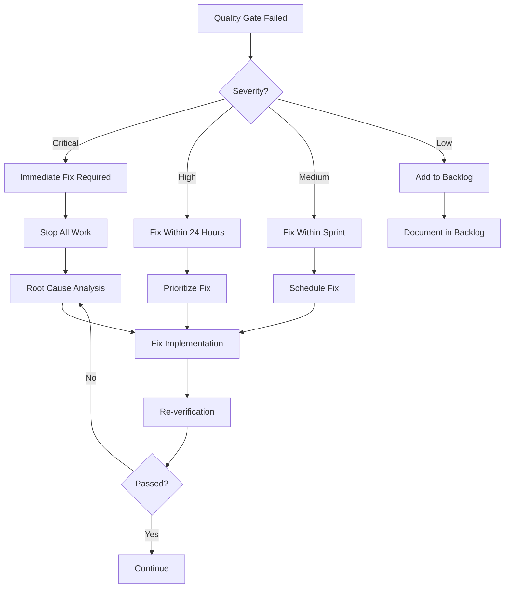

# Verification & Handoff Protocol

## Overview

This document establishes the quality gates, verification procedures, and
handoff requirements for the TDD-first development of the Okaeri Resort
Management System. Every phase transition and agent handoff must meet these
verification standards.

## Quality Gates

### Gate 1: Test Definition (RED Phase)

**Owner**: `typescript-react-quality-expert`

#### Entry Criteria

- [ ] Requirements clearly defined
- [ ] Acceptance criteria documented
- [ ] Test scenarios identified
- [ ] Edge cases enumerated

#### Verification Checklist

```typescript
// Test Coverage Requirements
- [ ] Happy path scenarios (minimum 3)
- [ ] Error scenarios (minimum 3)
- [ ] Edge cases (minimum 2)
- [ ] Security scenarios (minimum 1)
- [ ] Accessibility scenarios (minimum 1)
- [ ] Performance scenarios (minimum 1)
```

#### Exit Criteria

- [ ] All tests written and committed
- [ ] Tests are failing (RED state confirmed)
- [ ] Test documentation complete
- [ ] Peer review completed

#### Deliverables

```markdown
## Test Definition Report

- Total tests written: X
- Categories covered: [list]
- Coverage estimation: X%
- Review status: Approved by [agent]
```

### Gate 2: Implementation (GREEN Phase)

**Owner**: Implementation Agent (varies by component)

#### Entry Criteria

- [ ] All tests from Gate 1 available
- [ ] No modifications to tests
- [ ] Implementation plan reviewed
- [ ] Dependencies identified

#### Verification Checklist

- [ ] All tests passing
- [ ] No test modifications made
- [ ] Code follows project patterns
- [ ] TypeScript strict mode clean
- [ ] No console errors/warnings
- [ ] Documentation updated

#### Exit Criteria

- [ ] 100% of tests passing
- [ ] Code review completed
- [ ] Performance baseline met
- [ ] Security scan passed

#### Deliverables

```markdown
## Implementation Report

- Tests passing: X/X
- Code coverage: X%
- TypeScript errors: 0
- Performance metrics: [metrics]
- Security findings: None/[list]
```

### Gate 3: Refactoring (REFACTOR Phase)

**Owner**: Polish Agent (varies by component)

#### Entry Criteria

- [ ] Implementation complete
- [ ] All tests passing
- [ ] Performance baseline established
- [ ] Refactoring plan defined

#### Verification Checklist

- [ ] Tests still passing after each refactor
- [ ] Performance improved or maintained
- [ ] Code complexity reduced
- [ ] Documentation updated
- [ ] Accessibility validated
- [ ] Mobile responsiveness verified

#### Exit Criteria

- [ ] All quality metrics met or exceeded
- [ ] No regression in functionality
- [ ] Final review completed
- [ ] Handoff documentation ready

#### Deliverables

```markdown
## Refactoring Report

- Improvements made: [list]
- Performance gain: X%
- Bundle size change: -X KB
- Accessibility score: X/100
- Mobile score: X/100
```

### Gate 4: Security Review

**Owner**: `security-compliance-auditor`

#### Entry Criteria

- [ ] Component implementation complete
- [ ] All tests passing
- [ ] Documentation complete
- [ ] Security checklist available

#### Verification Checklist

##### Authentication & Authorization

- [ ] JWT tokens properly validated
- [ ] Session management secure
- [ ] Role-based access enforced
- [ ] Password policies implemented
- [ ] Multi-factor auth supported

##### Data Protection

- [ ] Input validation comprehensive
- [ ] XSS protection verified
- [ ] JWT authentication properly secured (CSRF-immune)
- [ ] SQL injection prevented
- [ ] Sensitive data encrypted

##### API Security

- [ ] Rate limiting active
- [ ] CORS properly configured
- [ ] API authentication required
- [ ] Error messages sanitized
- [ ] Audit logging enabled

#### Exit Criteria

- [ ] No critical vulnerabilities
- [ ] No high severity issues
- [ ] Security report generated
- [ ] Remediation complete
- [ ] Sign-off obtained

### Gate 5: Performance Validation

**Owner**: `pwa-performance-optimizer`

#### Entry Criteria

- [ ] Feature implementation complete
- [ ] Security review passed
- [ ] Performance budget defined
- [ ] Testing environment ready

#### Verification Metrics

##### Core Web Vitals

| Metric | Target | Actual | Pass/Fail |
| ------ | ------ | ------ | --------- |
| LCP    | <2.5s  | -      | -         |
| INP    | <200ms | -      | -         |
| CLS    | <0.1   | -      | -         |
| TTI    | <3.8s  | -      | -         |
| TBT    | <200ms | -      | -         |

##### Bundle Analysis

| Category    | Budget | Actual | Pass/Fail |
| ----------- | ------ | ------ | --------- |
| Initial JS  | <100KB | -      | -         |
| Initial CSS | <50KB  | -      | -         |
| Total Size  | <200KB | -      | -         |
| Lazy Loaded | <500KB | -      | -         |

##### Network Performance

| Condition | Target | Actual | Pass/Fail |
| --------- | ------ | ------ | --------- |
| 3G Load   | <5s    | -      | -         |
| Offline   | Works  | -      | -         |
| CDN Cache | >90%   | -      | -         |

#### Exit Criteria

- [ ] All Core Web Vitals green
- [ ] Bundle budgets met
- [ ] Lighthouse score >90
- [ ] Performance report generated

### Gate 6: Accessibility Compliance

**Owner**: `resort-ui-designer`

#### Entry Criteria

- [ ] UI implementation complete
- [ ] WCAG 2.1 AA compliance target
- [ ] Testing tools configured
- [ ] Manual testing planned

#### Verification Checklist

##### Automated Testing

- [ ] Lighthouse accessibility >95 (includes axe-core checks)
- [ ] No critical violations reported
- [ ] WAVE evaluation clear
- [ ] Color contrast validated
- [ ] Focus indicators visible

##### Manual Testing

- [ ] Keyboard navigation complete
- [ ] Screen reader compatible
- [ ] Touch targets adequate (48x48)
- [ ] Form labels present
- [ ] Error messages clear

##### Mobile Accessibility

- [ ] Zoom up to 200% works
- [ ] Landscape/portrait OK
- [ ] Touch gestures work
- [ ] Text readable at default

#### Exit Criteria

- [ ] WCAG 2.1 AA compliant
- [ ] Accessibility report generated
- [ ] Manual testing completed
- [ ] Issues remediated
- [ ] Sign-off obtained

## Handoff Procedures

### Standard Handoff Template

```markdown
# Handoff Report

## From: [Agent Name]

## To: [Agent Name]

## Date: [ISO Date]

## Phase: [Current Phase]

## Component: [Component Name]

### Summary

Brief description of work completed and current state.

### Completed Items

- [ ] Item 1 with evidence
- [ ] Item 2 with evidence
- [ ] Item 3 with evidence

### Test Results
```

Test Suites: X passed, X total Tests: X passed, X total Coverage: X% Time: Xs

```

### Quality Metrics
| Metric | Target | Actual | Status |
|--------|--------|--------|--------|
| Type Coverage | 100% | X% | ✅/❌ |
| Security Score | A+ | X | ✅/❌ |
| Performance | >90 | X | ✅/❌ |
| Accessibility | 100 | X | ✅/❌ |

### Known Issues
| ID | Description | Severity | Workaround |
|----|-------------|----------|------------|
| 1 | Issue description | Low/Medium/High | Solution if any |

### Next Steps
1. Specific task 1
2. Specific task 2
3. Specific task 3

### Resources
- **Code Location**: `/src/...`
- **Tests Location**: `/src/__tests__/...`
- **Documentation**: `/docs/...`
- **Related PRs**: #123, #124

### Dependencies
- Package: version
- Service: status
- API: endpoint

### Rollback Plan
Steps to revert if issues arise:
1. Revert commit [hash]
2. Restore database backup [id]
3. Clear cache [location]

### Acceptance
- [ ] Receiving agent acknowledges
- [ ] Questions addressed
- [ ] Handoff accepted

---
**Signed**: [Agent Name]
**Date**: [ISO Date]
```

### Emergency Handoff Procedure

For urgent situations requiring immediate handoff:

1. **Create Snapshot**

   ```bash
   git stash save "Emergency handoff - [description]"
   git checkout -b emergency-handoff-[date]
   git stash apply
   ```

2. **Document State**
   - Current task in progress
   - Blocking issues
   - Immediate next steps
   - Contact for questions

3. **Notify Team**
   - Post in team channel
   - Tag receiving agent
   - Set status to "Handoff in Progress"

## Iteration Procedures

### Iteration Decision Tree



### Iteration Tracking

```markdown
## Iteration Log

### Iteration 1

- **Date**: [ISO Date]
- **Issue**: [Description]
- **Root Cause**: [Analysis]
- **Fix Applied**: [Solution]
- **Result**: Pass/Fail
- **Time Spent**: Xh

### Iteration 2

- **Date**: [ISO Date]
- **Issue**: [Description]
- **Root Cause**: [Analysis]
- **Fix Applied**: [Solution]
- **Result**: Pass/Fail
- **Time Spent**: Xh

### Summary

- Total Iterations: X
- Total Time: Xh
- Success Rate: X%
- Lessons Learned: [Key takeaways]
```

## Verification Tools

### Automated Verification

```json
{
  "scripts": {
    "verify": "npm run verify:all",
    "verify:all": "npm run verify:tests && npm run verify:types && npm run verify:lint && npm run verify:security",
    "verify:tests": "vitest run --coverage",
    "verify:types": "tsc --noEmit",
    "verify:lint": "eslint . --max-warnings 0",
    "verify:security": "npm audit --audit-level=high",
    "verify:performance": "npm run build && npx lighthouse http://localhost:4173 --preset=desktop --output=json",
    "verify:accessibility": "npm run build && npx lighthouse http://localhost:4173 --only-categories=accessibility --output=json",
    "verify:bundle": "npm run build:analyze"
  }
}
```

### Manual Verification Checklist

```markdown
## Manual Verification Checklist

### Functional Testing

- [ ] Feature works as expected
- [ ] Edge cases handled
- [ ] Error states display correctly
- [ ] Loading states present
- [ ] Success feedback provided

### Visual Testing

- [ ] Desktop layout correct
- [ ] Tablet layout correct
- [ ] Mobile layout correct
- [ ] Dark mode supported
- [ ] Print styles work

### Integration Testing

- [ ] API calls successful
- [ ] Data persistence works
- [ ] Navigation flows correct
- [ ] State management stable
- [ ] Cache invalidation works

### User Experience

- [ ] Response time acceptable
- [ ] Animations smooth
- [ ] Feedback immediate
- [ ] Errors helpful
- [ ] Recovery possible
```

## Rollback Procedures

### Immediate Rollback

```bash
# 1. Stop deployment
vercel rollback

# 2. Revert code
git revert HEAD
git push origin main

# 3. Clear caches
npm run cache:clear

# 4. Notify team
echo "Rollback initiated for [component]"
```

### Database Rollback

```sql
-- 1. Check current version
SELECT version FROM migrations ORDER BY id DESC LIMIT 1;

-- 2. Run rollback migration
\i migrations/rollback/[version].down.sql

-- 3. Verify rollback
SELECT * FROM migration_log WHERE status = 'rolled_back';

-- 4. Update application
UPDATE config SET db_version = '[previous_version]';
```

### State Rollback

```typescript
// 1. Export current state
const currentState = store.getState();
localStorage.setItem("rollback_state", JSON.stringify(currentState));

// 2. Restore previous state
const previousState = JSON.parse(localStorage.getItem("last_known_good_state"));
store.setState(previousState);

// 3. Verify restoration
console.assert(store.getState() === previousState, "State rollback failed");
```

## Sign-off Requirements

### Component Sign-off

Each component requires multi-agent sign-off:

| Role               | Agent                             | Signature | Date   |
| ------------------ | --------------------------------- | --------- | ------ |
| Test Author        | `typescript-react-quality-expert` | ✓         | [date] |
| Implementer        | [varies]                          | ✓         | [date] |
| UI/UX Review       | `resort-ui-designer`              | ✓         | [date] |
| Security Review    | `security-compliance-auditor`     | ✓         | [date] |
| Performance Review | `pwa-performance-optimizer`       | ✓         | [date] |

### Phase Sign-off

Each phase requires leadership sign-off:

| Phase   | Lead Agent                          | Status | Date   |
| ------- | ----------------------------------- | ------ | ------ |
| Phase 0 | `context-manager`                   | ✓      | [date] |
| Phase 1 | `typescript-react-quality-expert`   | ⏳     | -      |
| Phase 2 | `zustand-tanstack-resort-architect` | ⏳     | -      |
| Phase 3 | `postgres-serverless-architect`     | ⏳     | -      |
| Phase 4 | `resort-finance-architect`          | ⏳     | -      |
| Phase 5 | `vercel-deployment-optimizer`       | ⏳     | -      |

## Metrics Dashboard

### Real-time Metrics

```typescript
interface VerificationMetrics {
  testCoverage: number; // Current: X%
  typesCoverage: number; // Current: X%
  performanceScore: number; // Current: X/100
  securityScore: string; // Current: A+
  accessibilityScore: number; // Current: X/100
  bundleSize: number; // Current: X KB
  buildTime: number; // Current: X seconds
  testsPassingRate: number; // Current: X%

  // Trends
  coverageTrend: "up" | "down" | "stable";
  performanceTrend: "improving" | "degrading" | "stable";
  bundleSizeTrend: "growing" | "shrinking" | "stable";
}
```

### Success Metrics

| Metric               | Target  | Current | Status   |
| -------------------- | ------- | ------- | -------- |
| First-time Pass Rate | >80%    | X%      | 🟢/🟡/🔴 |
| Average Iterations   | <3      | X       | 🟢/🟡/🔴 |
| Handoff Success Rate | >90%    | X%      | 🟢/🟡/🔴 |
| Defect Escape Rate   | <5%     | X%      | 🟢/🟡/🔴 |
| Time to Production   | <5 days | X days  | 🟢/🟡/🔴 |

## Conclusion

This verification protocol ensures consistent quality across all phases of
development. By enforcing strict quality gates and comprehensive handoff
procedures, we maintain high standards while enabling smooth collaboration
between specialized agents.

The combination of automated verification, manual testing, and multi-agent
review creates multiple safety nets that catch issues early and prevent defects
from reaching production. The detailed rollback procedures ensure we can quickly
recover from any issues that do arise.
