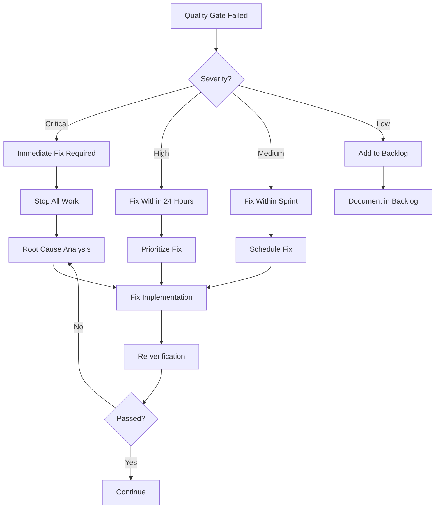

# Verification & Handoff Protocol

## Quick Start: Run Local Verification

```bash
# Run complete local verification suite
npm run verify

# This runs all quality checks:
# - Tests with coverage (verify:tests)
# - TypeScript type checking (verify:types)
# - ESLint with zero warnings (verify:lint)
# - Security audit for vulnerabilities (verify:security)
```

For specific verifications:

```bash
npm run verify:accessibility  # Check WCAG 2.1 AA compliance
npm run verify:performance    # Check Lighthouse scores
npm run verify:bundle        # Enforce bundle size limits (FAILS if exceeded)
```

## Overview

This document establishes the quality gates, verification procedures, and
handoff requirements for the TDD-first development of the Okaeri Resort
Management System. Every phase transition and agent handoff must meet these
verification standards.

## Quality Gates

### Gate 1: Test Definition (RED Phase)

**Owner**: `typescript-react-quality-expert`

#### Entry Criteria

- [ ] Requirements clearly defined
- [ ] Acceptance criteria documented
- [ ] Test scenarios identified
- [ ] Edge cases enumerated

#### Verification Checklist

```typescript
// Test Coverage Requirements
- [ ] Happy path scenarios (minimum 3)
- [ ] Error scenarios (minimum 3)
- [ ] Edge cases (minimum 2)
- [ ] Security scenarios (minimum 1)
- [ ] Accessibility scenarios (minimum 1)
- [ ] Performance scenarios (minimum 1)
```

#### Exit Criteria

- [ ] All tests written and committed
- [ ] Tests are failing (RED state confirmed)
- [ ] Test documentation complete
- [ ] Peer review completed

#### Deliverables

```markdown
## Test Definition Report

- Total tests written: X
- Categories covered: [list]
- Coverage estimation: X%
- Review status: Approved by [agent]
```

### Gate 2: Implementation (GREEN Phase)

**Owner**: Implementation Agent (varies by component)

#### Entry Criteria

- [ ] All tests from Gate 1 available
- [ ] No modifications to tests
- [ ] Implementation plan reviewed
- [ ] Dependencies identified

#### Verification Checklist

- [ ] All tests passing
- [ ] No test modifications made
- [ ] Code follows project patterns
- [ ] TypeScript strict mode clean
- [ ] No console errors/warnings
- [ ] Documentation updated

#### Exit Criteria

- [ ] 100% of tests passing
- [ ] Code review completed
- [ ] Performance baseline met
- [ ] Security scan passed

#### Deliverables

```markdown
## Implementation Report

- Tests passing: X/X
- Code coverage: X%
- TypeScript errors: 0
- Performance metrics: [metrics]
- Security findings: None/[list]
```

### Gate 3: Refactoring (REFACTOR Phase)

**Owner**: Polish Agent (varies by component)

#### Entry Criteria

- [ ] Implementation complete
- [ ] All tests passing
- [ ] Performance baseline established
- [ ] Refactoring plan defined

#### Verification Checklist

- [ ] Tests still passing after each refactor
- [ ] Performance improved or maintained
- [ ] Code complexity reduced
- [ ] Documentation updated
- [ ] Accessibility validated
- [ ] Mobile responsiveness verified

#### Exit Criteria

- [ ] All quality metrics met or exceeded
- [ ] No regression in functionality
- [ ] Final review completed
- [ ] Handoff documentation ready

#### Deliverables

```markdown
## Refactoring Report

- Improvements made: [list]
- Performance gain: X%
- Bundle size change: -X KB
- Accessibility score: X/100
- Mobile score: X/100
```

### Gate 4: Security Review

**Owner**: `security-compliance-auditor`

#### Entry Criteria

- [ ] Component implementation complete
- [ ] All tests passing
- [ ] Documentation complete
- [ ] Security checklist available

#### Verification Checklist

##### JWT Security Verification

- [ ] **Token Storage**: Verify NO tokens in cookies

  ```bash
  # Check for cookie usage in auth code
  grep -r "document.cookie" src/ | grep -i "token\|jwt\|auth"
  # Should return no results
  ```

- [ ] **Authorization Headers**: Verify Bearer token format

  ```typescript
  // All API calls must include:
  headers: { 'Authorization': `Bearer ${token}` }
  ```

- [ ] **Token Cleanup**: Verify logout clears all tokens

  ```typescript
  // After logout:
  localStorage.getItem("token") === null;
  sessionStorage.getItem("token") === null;
  document.cookie.includes("token") === false;
  ```

- [ ] **CSRF Immunity**: Verify no CSRF tokens needed
  ```typescript
  // No CSRF token generation or validation code should exist
  // Authorization header provides CSRF protection
  ```

##### Authentication & Authorization

- [ ] JWT tokens properly validated (signature, expiry, claims)
- [ ] Tokens transmitted ONLY via Authorization header
- [ ] NO tokens stored in cookies (security violation if found)
- [ ] Session management secure (token rotation, cleanup)
- [ ] Role-based access enforced (RBAC validation)
- [ ] Password policies implemented (12+ chars, complexity)
- [ ] Multi-factor auth supported (TOTP/SMS ready)

##### Data Protection

- [ ] Input validation comprehensive (all user inputs sanitized)
- [ ] XSS protection verified (CSP headers, output encoding)
- [ ] JWT authentication properly secured (CSRF-immune via Authorization header)
- [ ] Cookie authentication prohibited (must fail if tokens in cookies)
- [ ] SQL injection prevented (parameterized queries only)
- [ ] Sensitive data encrypted (AES-256 at rest, TLS 1.3 in transit)
- [ ] Token exposure prevented (no tokens in logs/URLs/errors)

##### API Security

- [ ] Rate limiting active (100 req/min per user)
- [ ] CORS properly configured (whitelist only)
- [ ] API authentication required (Bearer token validation)
- [ ] Authorization header validation (format: Bearer <JWT>)
- [ ] Error messages sanitized (no token/PII exposure)
- [ ] Audit logging enabled (all auth events tracked)
- [ ] Token refresh security (rotation, family tracking)

#### Exit Criteria

- [ ] No critical vulnerabilities
- [ ] No high severity issues
- [ ] Security report generated
- [ ] Remediation complete
- [ ] Sign-off obtained

### Gate 5: Performance Validation

**Owner**: `pwa-performance-optimizer`

#### Entry Criteria

- [ ] Feature implementation complete
- [ ] Security review passed
- [ ] Performance budget defined
- [ ] Testing environment ready

#### Verification Metrics

##### Core Web Vitals

| Metric | Target | Actual | Pass/Fail |
| ------ | ------ | ------ | --------- |
| LCP    | <2.5s  | -      | -         |
| INP    | <200ms | -      | -         |
| CLS    | <0.1   | -      | -         |
| TTI    | <3.8s  | -      | -         |
| TBT    | <200ms | -      | -         |

##### Bundle Analysis

| Category         | Budget | Actual | Pass/Fail |
| ---------------- | ------ | ------ | --------- |
| Main Application | <120KB | -      | -         |
| Main CSS         | <40KB  | -      | -         |
| React Vendor     | <42KB  | -      | -         |
| Total Initial    | <200KB | -      | -         |
| Global Threshold | <1.5MB | -      | -         |

##### Network Performance

| Condition | Target | Actual | Pass/Fail |
| --------- | ------ | ------ | --------- |
| 3G Load   | <5s    | -      | -         |
| Offline   | Works  | -      | -         |
| CDN Cache | >90%   | -      | -         |

#### Exit Criteria

- [ ] All Core Web Vitals green
- [ ] Bundle budgets enforced (not just visualized)
- [ ] Lighthouse score >90
- [ ] Performance report generated

### Gate 6: Accessibility Compliance

**Owner**: `resort-ui-designer`

#### Entry Criteria

- [ ] UI implementation complete
- [ ] WCAG 2.1 AA compliance target
- [ ] Testing tools configured
- [ ] Manual testing planned

#### Verification Checklist

##### Automated Testing

- [ ] Lighthouse accessibility >95 (includes axe-core checks)
- [ ] No critical violations reported
- [ ] WAVE evaluation clear
- [ ] Color contrast validated
- [ ] Focus indicators visible

##### Manual Testing

- [ ] Keyboard navigation complete
- [ ] Screen reader compatible
- [ ] Touch targets adequate (48x48)
- [ ] Form labels present
- [ ] Error messages clear

##### Mobile Accessibility

- [ ] Zoom up to 200% works
- [ ] Landscape/portrait OK
- [ ] Touch gestures work
- [ ] Text readable at default

#### Exit Criteria

- [ ] WCAG 2.1 AA compliant
- [ ] Accessibility report generated
- [ ] Manual testing completed
- [ ] Issues remediated
- [ ] Sign-off obtained

## Handoff Procedures

### Standard Handoff Template

```markdown
# Handoff Report

## From: [Agent Name]

## To: [Agent Name]

## Date: [ISO Date]

## Phase: [Current Phase]

## Component: [Component Name]

### Summary

Brief description of work completed and current state.

### Completed Items

- [ ] Item 1 with evidence
- [ ] Item 2 with evidence
- [ ] Item 3 with evidence

### Test Results
```

Test Suites: X passed, X total Tests: X passed, X total Coverage: X% Time: Xs

```

### Quality Metrics
| Metric | Target | Actual | Status |
|--------|--------|--------|--------|
| Type Coverage | 100% | X% | ✅/❌ |
| Security Score | A+ | X | ✅/❌ |
| Performance | >90 | X | ✅/❌ |
| Accessibility | 100 | X | ✅/❌ |

### Known Issues
| ID | Description | Severity | Workaround |
|----|-------------|----------|------------|
| 1 | Issue description | Low/Medium/High | Solution if any |

### Next Steps
1. Specific task 1
2. Specific task 2
3. Specific task 3

### Resources
- **Code Location**: `/src/...`
- **Tests Location**: `/src/__tests__/...`
- **Documentation**: `/docs/...`
- **Related PRs**: #123, #124

### Dependencies
- Package: version
- Service: status
- API: endpoint

### Rollback Plan
Steps to revert if issues arise:
1. Revert commit [hash]
2. Restore database backup [id]
3. Clear cache [location]

### Acceptance
- [ ] Receiving agent acknowledges
- [ ] Questions addressed
- [ ] Handoff accepted

---
**Signed**: [Agent Name]
**Date**: [ISO Date]
```

### Emergency Handoff Procedure

For urgent situations requiring immediate handoff:

1. **Create Snapshot**

   ```bash
   git stash save "Emergency handoff - [description]"
   git checkout -b emergency-handoff-[date]
   git stash apply
   ```

2. **Document State**
   - Current task in progress
   - Blocking issues
   - Immediate next steps
   - Contact for questions

3. **Notify Team**
   - Post in team channel
   - Tag receiving agent
   - Set status to "Handoff in Progress"

## Iteration Procedures

### Iteration Decision Tree



### Iteration Tracking

```markdown
## Iteration Log

### Iteration 1

- **Date**: [ISO Date]
- **Issue**: [Description]
- **Root Cause**: [Analysis]
- **Fix Applied**: [Solution]
- **Result**: Pass/Fail
- **Time Spent**: Xh

### Iteration 2

- **Date**: [ISO Date]
- **Issue**: [Description]
- **Root Cause**: [Analysis]
- **Fix Applied**: [Solution]
- **Result**: Pass/Fail
- **Time Spent**: Xh

### Summary

- Total Iterations: X
- Total Time: Xh
- Success Rate: X%
- Lessons Learned: [Key takeaways]
```

## Critical Server Lifecycle Management

### Lighthouse Testing Requirements

**Issue Addressed**: Lighthouse verification scripts must manage server
lifecycle to function properly. Previous implementations failed because they
assumed a running server without starting one.

#### Required Dependency

All Lighthouse testing requires the `start-server-and-test` package:

```bash
npm install --save-dev start-server-and-test
```

#### Server Lifecycle Process

1. **Build Phase**: `npm run build` creates production assets
2. **Server Start**: `start-server-and-test preview http://localhost:4173`
   starts preview server
3. **Health Check**: Waits for server to respond at `http://localhost:4173` (60s
   timeout)
4. **Test Execution**: Runs Lighthouse commands against live server
5. **Automatic Cleanup**: Terminates server process when tests complete

#### Troubleshooting Server Issues

**Port Already in Use**:

```bash
# Kill existing processes on port 4173
lsof -ti:4173 | xargs kill -9

# Or use alternative port
npm run preview -- --port 4174
```

**Server Won't Start**:

```bash
# Verify preview works independently
npm run build && npm run preview

# Check for build artifacts
ls -la dist/

# Test server health manually
curl -I http://localhost:4173
```

**Lighthouse Connection Refused**:

```bash
# Increase wait time or add explicit health check
start-server-and-test preview http://localhost:4173 --wait-on-timeout 120000
```

### Deterministic Environment Requirements

**Issue Addressed**: CI tests must use deterministic environment variables to
ensure consistent, reproducible results between local and CI environments.

#### Required Environment Variables

All testing environments (local and CI) must set these variables:

```bash
export FIXED_TIME="2024-01-01T00:00:00Z"
export RANDOM_SEED="test-seed-2024"
export TEST_SCENARIO="STABLE"
export MOCK_DELAY="0"
export TZ="Asia/Manila"
export VITEST_DETERMINISTIC="true"
export NODE_ENV="test"
export VITE_USE_MOCK_API="true"
```

#### Local Environment Setup

Create `.env.test`:

```env
NODE_ENV=test
FIXED_TIME=2024-01-01T00:00:00Z
RANDOM_SEED=test-seed-2024
TEST_SCENARIO=STABLE
MOCK_DELAY=0
TZ=Asia/Manila
VITE_USE_MOCK_API=true
VITEST_DETERMINISTIC=true
TEST_TIMEOUT=30000
```

#### CI Environment Validation

CI workflows must validate deterministic environment:

```bash
# Verify all required variables are set
[ -n "$FIXED_TIME" ] || { echo "❌ FIXED_TIME not set"; exit 1; }
[ -n "$RANDOM_SEED" ] || { echo "❌ RANDOM_SEED not set"; exit 1; }
[ -n "$TEST_SCENARIO" ] || { echo "❌ TEST_SCENARIO not set"; exit 1; }
[ -n "$MOCK_DELAY" ] || { echo "❌ MOCK_DELAY not set"; exit 1; }
[ -n "$TZ" ] || { echo "❌ TZ not set"; exit 1; }

echo "✅ All deterministic environment variables are set"
```

## Verification Tools

### Automated Verification

```json
{
  "scripts": {
    "verify": "npm run verify:all",
    "verify:all": "npm run verify:tests && npm run verify:types && npm run verify:lint && npm run verify:security && npm run verify:jwt",
    "verify:tests": "vitest run --coverage",
    "verify:types": "tsc --noEmit",
    "verify:lint": "eslint . --max-warnings 0",
    "verify:security": "npm audit --audit-level=high",
    "verify:jwt": "npm run test:jwt:security && npm run audit:jwt:cookies",
    "test:jwt:security": "vitest run src/__tests__/security/jwt.security.test.ts",
    "audit:jwt:cookies": "! grep -r 'document.cookie' src/ | grep -i 'token\\|jwt\\|auth' || echo 'JWT cookie check passed'",
    "verify:performance": "npm run build && start-server-and-test preview http://localhost:4173 'lighthouse http://localhost:4173 --preset=desktop --output=json --output-path=./lighthouse-performance.json'",
    "verify:accessibility": "npm run build && start-server-and-test preview http://localhost:4173 'lighthouse http://localhost:4173 --only-categories=accessibility --output=json --output-path=./lighthouse-accessibility.json'",
    "verify:bundle": "npm run perf:budget", // Bundle size ENFORCEMENT
    "perf:budget": "npm run build && bundlesize",
    "build:analyze": "ANALYZE=true npm run build" // Bundle VISUALIZATION only
  }
}
```

### Pre-commit and Pre-push Hooks

#### Installation

```bash
npx husky-init && npm install
```

#### Hook Configuration

```bash
# .husky/pre-commit
#!/usr/bin/env sh
. "$(dirname -- "$0")/_/husky.sh"

npm run verify:types && npm run verify:lint

# .husky/pre-push
#!/usr/bin/env sh
. "$(dirname -- "$0")/_/husky.sh"

npm run test:coverage:quick -- --changed
```

### Manual Verification Checklist

```markdown
## Manual Verification Checklist

### Functional Testing

- [ ] Feature works as expected
- [ ] Edge cases handled
- [ ] Error states display correctly
- [ ] Loading states present
- [ ] Success feedback provided

### Visual Testing

- [ ] Desktop layout correct
- [ ] Tablet layout correct
- [ ] Mobile layout correct
- [ ] Dark mode supported
- [ ] Print styles work

### Integration Testing

- [ ] API calls successful
- [ ] Data persistence works
- [ ] Navigation flows correct
- [ ] State management stable
- [ ] Cache invalidation works

### User Experience

- [ ] Response time acceptable
- [ ] Animations smooth
- [ ] Feedback immediate
- [ ] Errors helpful
- [ ] Recovery possible
```

## Rollback Procedures

### Immediate Rollback

```bash
# 1. Stop deployment
vercel rollback

# 2. Revert code
git revert HEAD
git push origin main

# 3. Clear caches
npm run cache:clear

# 4. Notify team
echo "Rollback initiated for [component]"
```

### Database Rollback

```sql
-- 1. Check current version
SELECT version FROM migrations ORDER BY id DESC LIMIT 1;

-- 2. Run rollback migration
\i migrations/rollback/[version].down.sql

-- 3. Verify rollback
SELECT * FROM migration_log WHERE status = 'rolled_back';

-- 4. Update application
UPDATE config SET db_version = '[previous_version]';
```

### State Rollback

```typescript
// 1. Export current state
const currentState = store.getState();
localStorage.setItem("rollback_state", JSON.stringify(currentState));

// 2. Restore previous state
const previousState = JSON.parse(localStorage.getItem("last_known_good_state"));
store.setState(previousState);

// 3. Verify restoration
console.assert(store.getState() === previousState, "State rollback failed");
```

## Sign-off Requirements

### Component Sign-off

Each component requires multi-agent sign-off:

| Role               | Agent                             | Signature | Date   |
| ------------------ | --------------------------------- | --------- | ------ |
| Test Author        | `typescript-react-quality-expert` | ✓         | [date] |
| Implementer        | [varies]                          | ✓         | [date] |
| UI/UX Review       | `resort-ui-designer`              | ✓         | [date] |
| Security Review    | `security-compliance-auditor`     | ✓         | [date] |
| Performance Review | `pwa-performance-optimizer`       | ✓         | [date] |

### Phase Sign-off

Each phase requires leadership sign-off:

| Phase   | Lead Agent                          | Status | Date   |
| ------- | ----------------------------------- | ------ | ------ |
| Phase 0 | `context-manager`                   | ✓      | [date] |
| Phase 1 | `typescript-react-quality-expert`   | ⏳     | -      |
| Phase 2 | `zustand-tanstack-resort-architect` | ⏳     | -      |
| Phase 3 | `postgres-serverless-architect`     | ⏳     | -      |
| Phase 4 | `resort-finance-architect`          | ⏳     | -      |
| Phase 5 | `vercel-deployment-optimizer`       | ⏳     | -      |

## Metrics Dashboard

### Real-time Metrics

```typescript
interface VerificationMetrics {
  testCoverage: number; // Current: X%
  typesCoverage: number; // Current: X%
  performanceScore: number; // Current: X/100
  securityScore: string; // Current: A+
  accessibilityScore: number; // Current: X/100
  bundleSize: number; // Current: X KB
  buildTime: number; // Current: X seconds
  testsPassingRate: number; // Current: X%

  // Trends
  coverageTrend: "up" | "down" | "stable";
  performanceTrend: "improving" | "degrading" | "stable";
  bundleSizeTrend: "growing" | "shrinking" | "stable";
}
```

### Success Metrics

| Metric               | Target  | Current | Status   |
| -------------------- | ------- | ------- | -------- |
| First-time Pass Rate | >80%    | X%      | 🟢/🟡/🔴 |
| Average Iterations   | <3      | X       | 🟢/🟡/🔴 |
| Handoff Success Rate | >90%    | X%      | 🟢/🟡/🔴 |
| Defect Escape Rate   | <5%     | X%      | 🟢/🟡/🔴 |
| Time to Production   | <5 days | X days  | 🟢/🟡/🔴 |

## Conclusion

This verification protocol ensures consistent quality across all phases of
development. By enforcing strict quality gates and comprehensive handoff
procedures, we maintain high standards while enabling smooth collaboration
between specialized agents.

The combination of automated verification, manual testing, and multi-agent
review creates multiple safety nets that catch issues early and prevent defects
from reaching production. The detailed rollback procedures ensure we can quickly
recover from any issues that do arise.
