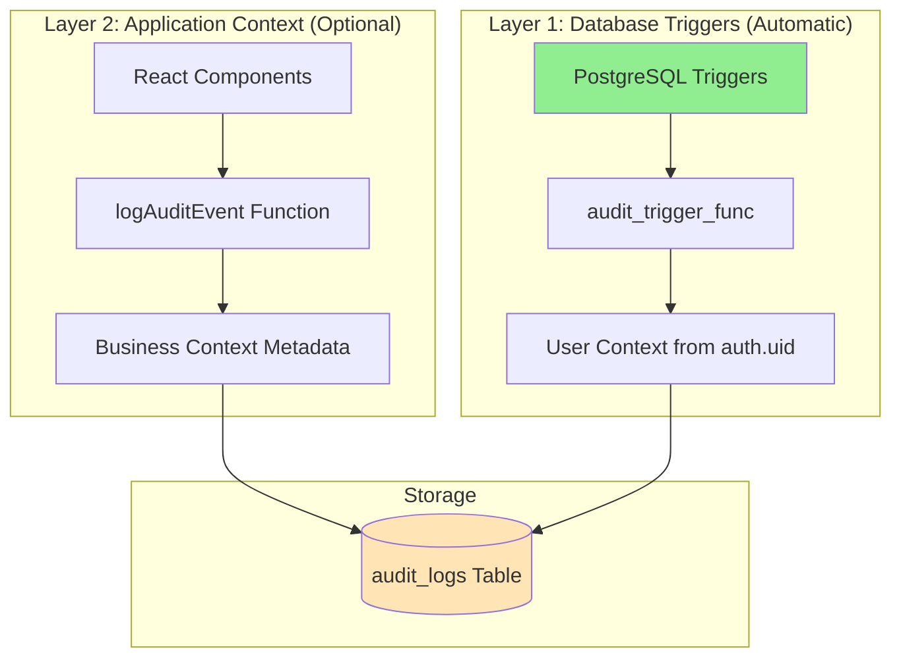
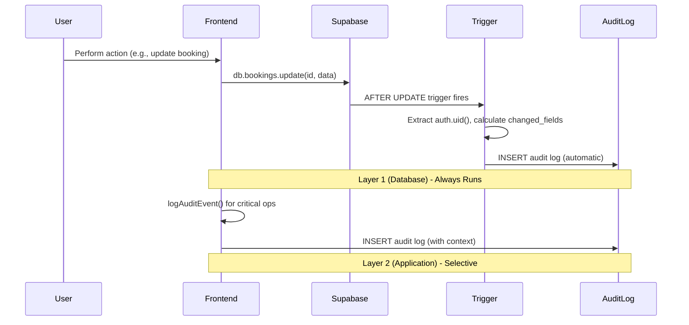

# Audit Trail System Documentation

## ✅ Documentation Status: COMPLETE (Updated with Security Fixes)

**Last Updated**: January 2, 2025
**Total Files**: 20 documentation files
**Total Lines**: ~5,200 lines
**Status**: All phases complete with comprehensive security fixes, scalability enhancements, and ready for implementation

### What's Included

- ✅ **Phase 1**: Database setup (schema, triggers, migrations, performance indexes)
- ✅ **Phase 2**: Application integration (types, helpers, logger, hooks, store)
- ✅ **Phase 3**: Audit viewer UI (routing, table, filters, diff viewer)
- ✅ **Phase 4**: Security policies (RLS, access control, data redaction)
- ✅ **Phase 5**: API reference (complete documentation of all APIs)
- ✅ **Phase 6**: Troubleshooting guide (diagnostics, common issues, FAQ)

### Documentation File Tree

```
docs/implementation/audit-trail/
├── README.md (this file)
├── 01-database-setup/
│   ├── 01a-schema-and-tables.md
│   ├── 01b-triggers-and-functions.md
│   ├── 01c-indexes-and-performance.md
│   ├── 01d-migration-workflow.md
│   └── 01e-partitioning.md ⭐ NEW - Scalability for 100K+ logs
├── 02-application-integration/
│   ├── 02a-types-and-constants.md
│   ├── 02b-database-helpers.md
│   ├── 02c-audit-logger.md
│   ├── 02d-react-hooks-and-store.md
│   └── 02e-ip-capture-workers.md ⭐ NEW
├── 03-audit-viewer-ui/
│   ├── 03a-page-and-routing.md
│   ├── 03b-table-component.md
│   ├── 03c-filters-and-queries.md
│   └── 03d-diff-viewer.md
├── 04-security-implementation/
│   ├── 04-security-policies.md
│   └── 04b-role-management.md ⭐ NEW
├── 05-api-reference.md
└── 06-troubleshooting.md
```

## Overview

This documentation covers the implementation of a comprehensive audit logging system that automatically tracks all database changes while allowing selective application-level context enrichment for critical business operations.

**🎯 Purpose**: Internal auditing for operational transparency and accountability in a 3-room resort operation.

**🔒 Scope**: This is an **internal tool** for owners/managers to track system changes. Not for compliance, not visible to guests, not for external audits.

## System Architecture

### Dual-Layer Design



### Data Flow



## Key Features

### Automatic Database-Level Tracking
- ✅ **All changes captured** - INSERT, UPDATE, DELETE operations on all 6 tables
- ✅ **No code changes required** - PostgreSQL triggers handle everything
- ✅ **Failsafe** - Cannot be bypassed by application code
- ✅ **User context captured** - Automatic extraction from Supabase Auth

### Selective Application-Level Logging
- ✅ **Business context** - Add descriptions, categories, severity levels
- ✅ **Critical operations** - Log cancellations, refunds, status changes
- ✅ **Metadata enrichment** - Attach business-relevant information
- ✅ **Flexible** - Only use when needed

### Admin Audit Viewer
- ✅ **Filter & search** - By user, table, action, date range
- ✅ **Diff visualization** - See before/after changes
- ✅ **Quick actions** - One-click views for common queries
- ✅ **CSV export** - Download audit data for analysis

### Security & Access Control
- ✅ **RLS policies** - Role-based access (owner/manager/staff)
- ✅ **Sensitive data redaction** - Automatic PII masking
- ✅ **Manual retention** - Archive when needed (no scheduled jobs)
- ✅ **Hard-coded owners** - Environment variable for admin access

## ⚠️ Critical Implementation Conventions

**Read this section carefully before implementing!** These conventions are essential for system consistency and must be followed exactly.

### Data Contract

#### 1. Column Names (Database)
- ✅ **Use `created_at`** for timestamp column (NOT `timestamp`)
- ✅ **Use `event_type`** for semantic business events (Layer 2 only)
- ✅ **Use `source`** to distinguish triggers ('db') from app events ('app')
- ✅ **Use `record_id` as TEXT** for flexibility with non-UUID primary keys

```sql
-- ✅ CORRECT
CREATE TABLE audit_logs (
    audit_id UUID PRIMARY KEY DEFAULT gen_random_uuid(),
    created_at TIMESTAMP WITH TIME ZONE DEFAULT NOW(),  -- NOT 'timestamp'
    event_type VARCHAR(50),                              -- Semantic event type
    source VARCHAR(10) DEFAULT 'db',                     -- 'db' or 'app'
    record_id TEXT,                                      -- TEXT, not UUID
    -- ...
);
```

#### 2. Layer 2 Convention (Application Logs)
- ✅ **Always use `action='INSERT'`** for app events (semantic meaning in `event_type`)
- ✅ **Always use `source='app'`** to mark application-generated logs
- ✅ **Use `event_type`** for semantic business events (login, cancel_booking, refund_payment, etc.)
- ✅ **Store description, category, severity in dedicated columns** (NOT in metadata)

```typescript
// ✅ CORRECT - Layer 2 logging pattern
await logAuditEvent({
    tableName: 'bookings',
    recordId: bookingId,
    eventType: AuditEventType.CANCEL_BOOKING,  // Semantic event type
    description: 'Booking cancelled by guest request',  // Dedicated column
    category: AuditCategory.BOOKING,           // Dedicated column
    severity: AuditSeverity.WARNING,           // Dedicated column
    metadata: {
        cancellationReason: 'Personal emergency',  // Extra context only
    },
});

// ❌ WRONG - Don't use action parameter
await logAuditEvent({
    tableName: 'bookings',
    action: 'UPDATE',  // ❌ Layer 2 always uses INSERT internally
    // ...
});
```

#### 3. Security Model
- ✅ **Use `app_roles` table** for runtime-reconfigurable role management
- ✅ **Use `SafeAuditText` component** for all user-generated content display
- ✅ **RLS policies use `app_roles`** (NOT GUC settings)
- ✅ **Manager role can see**: bookings, payments, guests, expenses, system, authentication
- ✅ **IP address will be NULL** from client-side logs (use Workers for accurate IP capture)

```typescript
// ✅ CORRECT - XSS protection
<SafeAuditText text={log.description} />

// ❌ WRONG - Vulnerable to XSS
<div>{log.description}</div>
```

#### 4. Event Type Usage
- ✅ **Database triggers (Layer 1)**: `source='db'`, `event_type=NULL`
- ✅ **Application events (Layer 2)**: `source='app'`, `event_type` set for business events
- ✅ **UI Display**: Use `getDisplayAction()` helper to show proper labels

```typescript
// Helper function for proper display
function getDisplayAction(log: AuditLog): string {
    // For app events, show event type if available
    if (log.source === 'app' && log.event_type) {
        return EVENT_TYPE_DISPLAY_NAMES[log.event_type] || log.event_type;
    }
    // For DB events, show database action
    return ACTION_DISPLAY_NAMES[log.action] || log.action;
}
```

### Type Safety
- ✅ **Use `AuditTableName` type** for all table name constants
- ✅ **Use `PHYSICAL_AUDIT_TABLES`** for tables with database triggers
- ✅ **Use `AUDIT_PSEUDO_TABLES`** for virtual tables (system, authentication)
- ✅ **Use `MANAGER_VISIBLE_TABLES`** in RLS policies
- ✅ **Validate with `isValidAuditTable()`** before logging

```typescript
// ✅ CORRECT - Type-safe table names
import { PHYSICAL_AUDIT_TABLES, MANAGER_VISIBLE_TABLES } from '@/lib/audit-constants';

// ❌ WRONG - Hard-coded strings
const tables = ['bookings', 'payments'];  // Not type-safe
```

### Common Mistakes to Avoid

❌ **DON'T**:
- Use `timestamp` column name (use `created_at`)
- Put description/category/severity in metadata (use dedicated columns)
- Pass `action` parameter to Layer 2 logging functions
- Use GUC settings for role management (use `app_roles` table)
- Render user content without `SafeAuditText` component
- Store PII in audit logs without redaction (use `redactSensitiveData()`)
- Use `auth.email()` in triggers (use JWT claims extraction)

✅ **DO**:
- Use `created_at` for all timestamp queries
- Store event type in `event_type` column (not metadata)
- Use `app_roles` table for all role management
- Sanitize user input with `SafeAuditText` before display
- Use TypeScript helpers (`grantRole()`, `revokeRole()`, `updateRole()`)
- Seed roles per environment (dev, staging, production)

---

## Why This Approach?

### For a 3-Room Resort

**Everything is critical** - With only 3 rooms:
- Every booking matters financially
- Every payment must be tracked
- Every unit change affects availability
- Every guest interaction is significant

**No non-critical tables** - Audit all 6 tables:
- `bookings` - Revenue tracking
- `payments` - Financial records
- `units` - Only 3 rooms, all changes matter
- `guests` - Customer relationships
- `expenses` - Cost tracking
- `maintenance_logs` - Property maintenance

### Internal Transparency

This system provides:
1. **Operational accountability** - Who changed what and when
2. **Error investigation** - Trace back incorrect data changes
3. **Training insights** - Understand common mistakes
4. **Conflict resolution** - Evidence for disputed changes
5. **Business intelligence** - Analyze operational patterns

**Not for**:
- ❌ Regulatory compliance (no legal requirement)
- ❌ Guest visibility (internal tool only)
- ❌ External audits (not designed for auditors)
- ❌ Security incident response (basic needs only)

## Implementation Checklist

### Phase 1: Database Setup (Day 1-2)

**Prerequisites**:
- [ ] Supabase CLI installed (`npm install -g supabase`)
- [ ] Local Supabase instance running (`supabase start`)
- [ ] PostgreSQL command-line tools available (`psql`, `pg_dump`)
- [ ] Environment variables configured (see `.env.local.example`)

**Database Schema**:
- [ ] Create `audit_logs` table with JSONB columns → [01a-schema-and-tables.md](./01-database-setup/01a-schema-and-tables.md)
- [ ] Add table and column comments for documentation
- [ ] Verify table structure with provided queries

**Triggers & Functions**:
- [ ] Create `audit_trigger_func()` function → [01b-triggers-and-functions.md](./01-database-setup/01b-triggers-and-functions.md)
- [ ] Attach triggers to all 6 tables (units, guests, bookings, payments, expenses, maintenance_logs)
- [ ] Create helper functions (`attach_audit_trigger`, `detach_audit_trigger`)
- [ ] Test triggers with INSERT/UPDATE/DELETE operations
- [ ] Verify user context captured from `auth.uid()`

**Indexes & Performance**:
- [ ] Create 8 performance indexes (incl. keyset pagination) → [01c-indexes-and-performance.md](./01-database-setup/01c-indexes-and-performance.md)
- [ ] Add `idx_audit_logs_keyset` for efficient cursor-based pagination
- [ ] Run ANALYZE to update statistics
- [ ] Verify index usage with EXPLAIN queries

**Scalability Enhancements** (Optional - for 100K+ logs):
- [ ] Add `record_pk` JSONB column for composite primary key support
- [ ] Implement keyset pagination helper in `db.auditLogs.keysetPage()` → [02b-database-helpers.md](./02-application-integration/02b-database-helpers.md)
- [ ] Review monthly partitioning strategy → [01e-partitioning.md](./01-database-setup/01e-partitioning.md)
- [ ] Implement partitioning if dataset exceeds 50K logs (optional)

**Migration Workflow**:
- [ ] Set up migration scripts directory → [01d-migration-workflow.md](./01-database-setup/01d-migration-workflow.md)
- [ ] Run `migrate-audit-system.sh` (creates automatic backup)
- [ ] Verify migration with `verify-audit-system.sh`
- [ ] Regenerate TypeScript types (`supabase gen types typescript --local > database.types.ts`)
- [ ] Test rollback procedure (optional, for confidence)

### Phase 2: Application Integration (Day 2-3)

**Prerequisites**:
- [ ] Phase 1 complete and verified
- [ ] TypeScript types regenerated
- [ ] Existing `src/lib/supabase.ts` reviewed

**Types & Constants**:
- [ ] Create TypeScript type definitions → [02a-types-and-constants.md](./02-application-integration/02a-types-and-constants.md)
- [ ] Define `AuditAction` enum for business operations
- [ ] Define `AuditCategory` and `AuditSeverity` enums
- [ ] Create filter and query result types
- [ ] Export from `src/lib/audit-types.ts`

**Database Helpers**:
- [ ] Extend existing `db` object → [02b-database-helpers.md](./02-application-integration/02b-database-helpers.md)
- [ ] Add `db.auditLogs.create()` helper
- [ ] Add `db.auditLogs.query()` with filters
- [ ] Add `db.auditLogs.byRecord()` for specific records
- [ ] Add `db.auditLogs.stats()` for summaries
- [ ] Test helpers with sample queries

**Audit Logger**:
- [ ] Create core logging functions → [02c-audit-logger.md](./02-application-integration/02c-audit-logger.md)
- [ ] Implement `logAuditEvent()` main function
- [ ] Implement sensitive data redaction
- [ ] Create specialized helpers (`logAuthEvent`, `logBookingEvent`, etc.)
- [ ] Add error handling (non-blocking)
- [ ] Test with sample audit events

**IP Capture with Cloudflare Workers** (Hybrid Approach):
- [ ] Review hybrid IP capture strategy → [02e-ip-capture-workers.md](./02-application-integration/02e-ip-capture-workers.md)
- [ ] Create Cloudflare Workers function for critical events
- [ ] Set up Workers environment variables (SUPABASE_URL, SUPABASE_ANON_KEY)
- [ ] Create `logAuditEventWithIP()` client helper
- [ ] Update authentication handlers to use Workers logging
- [ ] Update refund/critical financial handlers to use Workers
- [ ] Test IP capture (verify real IP captured, not VPN/proxy)

**React Hooks & Store**:
- [ ] Create TanStack Query hooks → [02d-react-hooks-and-store.md](./02-application-integration/02d-react-hooks-and-store.md)
- [ ] Implement `useAuditLogs()` query hook
- [ ] Implement `useAuditTrail()` for specific records
- [ ] Implement `useExportAuditLogs()` mutation
- [ ] Create Zustand store for UI state (`useAuditStore`)
- [ ] Test hooks with React Query DevTools

### Phase 3: Audit Viewer UI (Day 3-4)

**Prerequisites**:
- [ ] Phase 2 complete
- [ ] shadcn/ui components available
- [ ] TanStack Router configured

**Page & Routing**:
- [ ] Create audit logs route → [03a-page-and-routing.md](./03-audit-viewer-ui/03a-page-and-routing.md)
- [ ] Add route to TanStack Router configuration
- [ ] Create page component with layout
- [ ] Add navigation link (owner/manager only)
- [ ] Test route access control

**Table Component**:
- [ ] Build `AuditLogViewer` component → [03b-table-component.md](./03-audit-viewer-ui/03b-table-component.md)
- [ ] Implement table with shadcn/ui Table
- [ ] Add pagination controls
- [ ] Add row expansion for details
- [ ] Add loading and empty states
- [ ] Test with sample data

**Filters & Queries**:
- [ ] Create filter UI component → [03c-filters-and-queries.md](./03-audit-viewer-ui/03c-filters-and-queries.md)
- [ ] Implement date range picker
- [ ] Implement user, table, action filters
- [ ] Add quick action buttons (failed logins, deletions, critical actions)
- [ ] Add CSV export button
- [ ] Test filter combinations

**Diff Viewer**:
- [ ] Build diff visualization component → [03d-diff-viewer.md](./03-audit-viewer-ui/03d-diff-viewer.md)
- [ ] Implement before/after comparison
- [ ] Highlight changed fields
- [ ] Handle different data types (text, numbers, dates, booleans)
- [ ] Add dialog for detailed view
- [ ] Test with various change types

**Safe Components (XSS Protection)**:
- [x] Create SafeAuditText component → [03e-safe-components.md](./03-audit-viewer-ui/03e-safe-components.md)
- [x] Install DOMPurify and types
- [x] Implement XSS protection for log descriptions
- [x] Implement XSS protection for ValueDisplay (database field values)
- [x] Add JSON.stringify safety documentation
- [x] Unit tests written (28 tests, all passing)
- [x] Code review completed (all user content protected)
- [x] Verification report created → [See verification reports](../../verification/audit-trail/)

### Phase 4: Security & Policies (Day 4)

**Prerequisites**:
- [ ] Phase 3 complete
- [ ] Owner email addresses determined
- [ ] Sensitive field list reviewed

**Role Management** (Recommended Approach):
- [ ] Create `app_roles` table → [04b-role-management.md](./04-security-implementation/04b-role-management.md)
- [ ] Define roles: admin, owner, manager, staff
- [ ] Set up RLS policies for `app_roles` table
- [ ] Create helper functions (`get_user_role()`, `has_role()`)
- [ ] Seed initial admin role
- [ ] Update audit_logs RLS policies to use `app_roles`
- [ ] Test role-based access with different users

**RLS Policies**:
- [ ] Review RLS policy options → [04-security-policies.md](./04-security-implementation/04-security-policies.md)
- [ ] Choose between GUC (legacy) or app_roles (recommended) approach
- [ ] Implement chosen RLS policies (owner sees all, manager sees business ops, staff sees own)
- [ ] Implement append-only policies (prevent modifications)
- [ ] Add BEFORE INSERT trigger for identity enforcement
- [ ] Test policies with different user roles

**Data Redaction**:
- [ ] Define SENSITIVE_FIELDS list
- [ ] Add guest PII fields (phone, email, address)
- [ ] Add payment fields (account numbers)
- [ ] Test redaction in audit logs
- [ ] Verify redacted data in UI

**Manual Retention**:
- [ ] Create manual archival function
- [ ] Document quarterly archival procedure
- [ ] Test archival on sample data
- [ ] Calculate storage estimates

### Phase 5: Testing & Verification (Day 5)

**Manual Testing**:
- [ ] Test complete audit flow (create booking → view audit log)
- [ ] Test user context capture (verify `user_id` populated)
- [ ] Test RLS policies (login as different roles)
- [ ] Test filter combinations in UI
- [ ] Test diff viewer with various change types
- [ ] Test CSV export functionality
- [ ] Test manual archival function

**Performance Verification**:
- [ ] Measure trigger overhead (<20ms target)
- [ ] Test query performance (<100ms target)
- [ ] Verify index usage with EXPLAIN
- [ ] Monitor database size growth

**Security Verification**:
- [ ] Verify sensitive data redacted
- [ ] Verify unauthorized users cannot access audit logs
- [ ] Verify audit logs cannot be modified/deleted by users
- [ ] Test owner access controls

**Documentation Review**:
- [ ] Review all phase documentation
- [ ] Verify all code examples work
- [ ] Check troubleshooting guide
- [ ] Update API reference if needed

### Phase 6: Deployment

**Preparation**:
- [ ] Backup production database
- [ ] Review migration scripts
- [ ] Prepare rollback plan
- [ ] Schedule deployment window (low traffic)

**Deployment Steps**:
- [ ] Run migration on production (`migrate-audit-system.sh`)
- [ ] Verify triggers active (`verify-audit-system.sh`)
- [ ] Deploy application code (big bang)
- [ ] Monitor error logs for 24 hours
- [ ] Test audit viewer on production

**Post-Deployment**:
- [ ] Verify audit logs being created
- [ ] Check database size and performance
- [ ] Monitor for any errors
- [ ] Document any issues in troubleshooting guide

## Quick Start

### Minimal 5-Step Setup

```bash
# 1. Navigate to project root
cd /path/to/okaeri-resort

# 2. Run migration (creates automatic backup)
./scripts/audit-migrations/migrate-audit-system.sh

# 3. Verify everything works
./scripts/audit-migrations/verify-audit-system.sh

# 4. Regenerate types (already done by migration script, but verify)
supabase gen types typescript --local > database.types.ts

# 5. Proceed with application integration (Phase 2)
# See: 02-application-integration/02a-types-and-constants.md
```

### If Something Goes Wrong

```bash
# Rollback to pre-migration state
./scripts/audit-migrations/rollback-audit-system.sh \
  ./scripts/audit-migrations/backups/audit_backup_YYYYMMDD_HHMMSS.sql
```

## Requirements

### Technical Requirements
- **Database**: PostgreSQL 14+ (Supabase compatible)
- **Runtime**: Node.js 18+ for CLI tools
- **Frontend**: React 19, TypeScript, TanStack Router, TanStack Query, Zustand
- **UI**: shadcn/ui components, Tailwind CSS v4

### Existing Tables
The audit system monitors these 6 tables:
- `bookings` - Guest reservations
- `payments` - Payment records
- `units` - Property units (3 rooms)
- `guests` - Guest information
- `expenses` - Business expenses
- `maintenance_logs` - Property maintenance

### Access Control
- **Owners**: Hard-coded emails in `OWNER_EMAILS` environment variable
- **Managers**: Defined by role in user_metadata
- **Staff**: Limited access to own auth logs

## Storage & Performance

### Storage Estimates (3-Room Resort)

**Monthly Activity** (conservative):
- 50 bookings × 3 changes = 150 audit logs
- 30 expenses × 2 changes = 60 audit logs
- 10 unit updates = 10 audit logs
- 500 auth events = 500 audit logs
- **Total**: ~720 audit logs/month

**Storage Calculation**:
- Average audit log: 3KB (with JSONB old_data + new_data)
- Monthly: 720 × 3KB = 2.16MB/month
- Annual: 2.16MB × 12 = ~26MB/year
- **Verdict**: Safe within Supabase 500MB free tier for 19+ years ✅

### Performance Targets
- **Trigger overhead**: <20ms per operation
- **Audit page load**: <500ms (50 logs)
- **Query response**: <100ms (filtered queries)
- **Storage growth**: <30MB/year

## Benefits

### Operational Transparency
1. **Accountability** - Every change tracked with user ID
2. **Error tracing** - Investigate data inconsistencies
3. **Training insights** - Identify common mistakes
4. **Pattern analysis** - Understand operational workflows

### Minimal Maintenance
1. **Automatic tracking** - Database triggers require no code changes
2. **Manual archival** - Run quarterly or as needed
3. **Simple UI** - Desktop-focused, no mobile optimization needed
4. **No scheduled jobs** - No cron, no background workers

### Future-Proof
1. **Complete history** - Never lose track of changes
2. **Extensible** - Add new tables easily
3. **Query flexibility** - SQL access for custom analysis
4. **Integration ready** - Can add external reporting tools

## Important Considerations

### What This System Does
- ✅ Tracks all database changes automatically
- ✅ Captures user context (who made changes)
- ✅ Stores before/after data for all updates
- ✅ Provides searchable audit log viewer
- ✅ Supports role-based access control
- ✅ Redacts sensitive information

### What This System Doesn't Do
- ❌ **No real-time updates** - Refresh page to see new logs
- ❌ **No automatic archival** - Manual quarterly cleanup recommended
- ❌ **No email alerts** - Check UI when needed
- ❌ **No mobile optimization** - Desktop focus (future work)
- ❌ **No external compliance** - Internal tool only
- ❌ **No anomaly detection** - Use simple query buttons

### Design Decisions

#### Dual-Layer Audit Design
- **Layer 1 (Database Triggers)**: Automatic, failsafe tracking of all DB changes
  - `source='db'`, action reflects actual DB operation, always has `record_id`
- **Layer 2 (Application Logging)**: Selective business context enrichment
  - `source='app'`, action is always `'INSERT'` by convention, nullable `record_id`
  - Uses special table names: `'system'`, `'authentication'` for non-table events

#### Single Table Approach
- **One `audit_logs` table** for both layers (simpler than two tables)
- **`source` column** distinguishes DB triggers (`'db'`) from app events (`'app'`)
- **Conventions prevent conflicts**:
  - Layer 2 always uses `action='INSERT'` to avoid constraint violations
  - Dedicated columns (`description`, `category`, `severity`) NOT in metadata
  - `record_id` nullable for system-wide events

#### Field Naming Consistency
- **Database**: `created_at` (created_attz column)
- **TypeScript**: `created_at` (matches DB exactly)
- **Severity**: Uppercase enums ('INFO', 'WARNING', 'CRITICAL', 'DEBUG') match DB CHECK constraint

#### Operational Choices
- **All tables audited** - 3 rooms = everything is critical
- **Hard-coded owners** - Environment variable for simplicity
- **Manual operations** - No scheduled jobs (Cloudflare serverless)
- **Pragmatic testing** - Manual verification, not unit tests
- **Big bang deployment** - No backward compatibility needed (no users yet)

## Development Timeline

| Phase | Duration | Focus |
|-------|----------|-------|
| Phase 1 | Day 1-2 | Database setup + migration workflow |
| Phase 2 | Day 2-3 | Application integration (types, helpers, hooks) |
| Phase 3 | Day 3-4 | Audit viewer UI |
| Phase 4 | Day 4 | Security policies + RLS |
| Phase 5 | Day 5 | Testing + verification |
| Phase 6 | Day 5 | Deployment |
| **Total** | **5 days** | **Complete implementation** |

## Documentation Structure

### Reading Order

1. **Start here**: README.md (you are here)
2. **Phase 1**: Database Setup
   - [01a: Schema & Tables](./01-database-setup/01a-schema-and-tables.md)
   - [01b: Triggers & Functions](./01-database-setup/01b-triggers-and-functions.md)
   - [01c: Indexes & Performance](./01-database-setup/01c-indexes-and-performance.md)
   - [01d: Migration Workflow](./01-database-setup/01d-migration-workflow.md) ⚠️ **Critical**
   - [01e: Partitioning](./01-database-setup/01e-partitioning.md) ⭐ NEW - Optional for 100K+ logs
3. **Phase 2**: Application Integration
   - [02a: Types & Constants](./02-application-integration/02a-types-and-constants.md)
   - [02b: Database Helpers](./02-application-integration/02b-database-helpers.md)
   - [02c: Audit Logger](./02-application-integration/02c-audit-logger.md)
   - [02d: React Hooks & Store](./02-application-integration/02d-react-hooks-and-store.md)
   - [02e: IP Capture with Workers](./02-application-integration/02e-ip-capture-workers.md) ⭐ NEW - Hybrid approach
4. **Phase 3**: Audit Viewer UI
   - [03a: Page & Routing](./03-audit-viewer-ui/03a-page-and-routing.md)
   - [03b: Table Component](./03-audit-viewer-ui/03b-table-component.md)
   - [03c: Filters & Queries](./03-audit-viewer-ui/03c-filters-and-queries.md)
   - [03d: Diff Viewer](./03-audit-viewer-ui/03d-diff-viewer.md)
5. **Phase 4-6**: Security & Deployment
   - [04: Security Policies](./04-security-implementation/04-security-policies.md)
   - [04b: Role Management](./04-security-implementation/04b-role-management.md) ⭐ NEW - app_roles table approach
   - [05: API Reference](./05-api-reference.md)
   - [06: Troubleshooting](./06-troubleshooting.md)

### Prerequisites by Phase

- **Phase 1**: Supabase CLI, PostgreSQL tools
- **Phase 2**: Phase 1 complete, types regenerated
- **Phase 3**: Phase 2 complete, shadcn/ui available
- **Phase 4**: Phase 3 complete, owner emails defined
- **Phase 5**: All phases complete
- **Phase 6**: Production backup ready

## Support

### For Implementation Questions
- Review phase-specific documentation in order
- Check [API Reference](./05-api-reference.md) for function details
- Consult [Troubleshooting Guide](./06-troubleshooting.md) for common issues

### For Security Concerns
- Review [Security Policies](./04-security-policies.md)
- Check RLS policy definitions
- Verify sensitive data redaction

### For Migration Issues
- Check [Migration Workflow](./01-database-setup/01d-migration-workflow.md)
- Review backup files in `scripts/audit-migrations/backups/`
- Use rollback script if needed

---

**Last Updated**: January 2025
**Version**: 1.0.0
**Status**: Ready for Implementation

*This audit system provides complete change tracking for a 3-room resort operation with minimal maintenance overhead.*
