# Guest Booking System Documentation

## Overview

This documentation covers the implementation of a secure guest booking system that allows unauthenticated users to submit booking requests with payment proofs using Supabase's signed URL functionality.

**🎯 Optimized for Cloudflare Pages Free Tier** - This implementation uses Cloudflare Pages Functions, Cloudflare KV for rate limiting, and Cloudflare Turnstile for CAPTCHA, resulting in **$0/month infrastructure costs**.

## 📚 Documentation Structure

1. **[Master Plan](./01-master-plan.md)** - System architecture and high-level design
2. **[Backend Implementation](./02-backend-implementation.md)** - Cloudflare Functions API and signed URL generation
3. **[Frontend Implementation](./03-frontend-implementation.md)** - Guest booking forms and upload flow
4. **[Security Implementation](./04-security-implementation.md)** - Security measures and validation
5. **[API Reference](./05-api-reference.md)** - Complete API endpoint documentation
6. **[Paid Features Roadmap](./06-paid-features-roadmap.md)** - Premium features for future integration

## 🎯 Key Features

- **No Authentication Required**: Guests can book without creating accounts
- **Secure File Uploads**: Payment proofs uploaded via time-limited signed URLs
- **Private Storage**: Files remain secure in private Supabase buckets
- **Email Confirmation**: Automatic booking confirmations with receipt links
- **Status Tracking**: Guests can check booking status with reference number

## 🚀 Quick Start

### Prerequisites

- Supabase project with storage enabled
- Cloudflare Pages deployment
- Node.js 18+ and npm/pnpm
- Cloudflare account (free tier)
- Environment variables configured

### Implementation Checklist

**Database & Schema**:
- [ ] Enable `btree_gist` extension for exclusion constraints
- [ ] Add `is_guest_booking` column to `bookings` table
- [ ] Add `upload_expires_at` and `upload_status` columns for cleanup tracking
- [ ] Create status-based exclusion constraint (prevents double-booking)
- [ ] Create index on `(email, is_guest_booking)` for guest lookups
- [ ] Create index on `(upload_expires_at, upload_status)` for cleanup queries
- [ ] Create optional index on `(booking_status, is_guest_booking, created_at)` for admin dashboard
- [ ] Regenerate `database.types.ts` after migration

**Backend (Cloudflare Functions)**:
- [ ] Set up Cloudflare Pages environment variables (Wrangler/Dashboard)
- [ ] Create Cloudflare KV namespace for rate limiting (`wrangler kv:namespace create RATE_LIMIT_KV`)
- [ ] Configure scheduled triggers for cleanup job (hourly)
- [ ] Create `functions/api/guest-booking.ts` with idempotency support
- [ ] Create `functions/api/guest-booking/status.ts` with fingerprint-based rate limiting
- [ ] Create `functions/api/guest-booking/confirm.ts` with magic byte validation
- [ ] Create `functions/cron/cleanup-guest-bookings.ts` for orphaned upload cleanup
- [ ] Create `functions/_middleware.ts` with CORS + security headers
- [ ] Implement KV coarse-window rate limiting helper
- [ ] Implement enhanced Turnstile verification (hostname + action validation)
- [ ] Implement token-based signed URL generation (Supabase)
- [ ] Implement file magic byte validation helper
- [ ] Implement ULID-based booking reference generation
- [ ] Implement idempotency pattern with KV storage
- [ ] Add atomic availability checking before booking creation

**Frontend**:
- [ ] Install dependencies: `npm install ulid browser-image-compression heic2any @marsidev/react-turnstile`
- [ ] Build guest booking form with Turnstile widget
- [ ] Add Web Worker-based file compression (prevents UI jank)
- [ ] Add lazy loading for `heic2any` (~300KB bundle savings)
- [ ] Implement HEIC/HEIF to JPEG conversion with lazy loading
- [ ] Create schema transformation utilities (`transformToAPIFormat`)
- [ ] Add file upload with token-based `uploadToSignedUrl()`
- [ ] Add idempotency key generation (optional `X-Idempotency-Key` header)
- [ ] Create guest status check portal with progressive CAPTCHA
- [ ] Add 2MB file size limit enforcement
- [ ] Configure Vite manual chunks for file-processing libraries

**Security & Configuration**:
- [ ] Configure Supabase Storage CORS (production + development configs)
- [ ] Configure Cloudflare Functions CORS middleware (environment-aware)
- [ ] Set up Turnstile CAPTCHA with action-specific validation
- [ ] Configure KV-based rate limiting (5 bookings/hour, 20 status checks/hour)
- [ ] Implement fingerprint-based rate limiting (IP + UA + headers)
- [ ] Implement dual-factor status check (reference + email required)
- [ ] Add comprehensive security headers (CSP, HSTS, X-Frame-Options, etc.)
- [ ] Add input validation with Zod + DOMPurify
- [ ] Configure A+ security headers (test with securityheaders.com)

**Email & Resend DNS Setup**:
- [ ] Set up Resend account and API key (100 emails/day free)
- [ ] Add SPF record: `v=spf1 include:_spf.resend.com ~all`
- [ ] Add 3 DKIM CNAME records from Resend dashboard
- [ ] Add DMARC TXT record for email authentication
- [ ] Verify domain in Resend dashboard
- [ ] Test email deliverability with mail-tester.com
- [ ] Create booking confirmation email templates (no verification flow)

**Monitoring & Maintenance**:
- [ ] Set up Supabase bandwidth monitoring (2GB/month limit)
- [ ] Configure alerts for 80% bandwidth usage threshold
- [ ] Set up KV write quota monitoring (1,000 writes/day limit)
- [ ] Configure Resend email quota alerts (100 emails/day limit)
- [ ] Test cleanup cron job execution (hourly)
- [ ] Monitor orphaned upload cleanup logs

**Testing & Deployment**:
- [ ] Test end-to-end guest booking flow with idempotency
- [ ] Test file compression and lazy loading (check bundle size)
- [ ] Test HEIC conversion on iOS devices
- [ ] Test availability conflict handling (concurrent requests)
- [ ] Test rate limiting behavior (booking + status endpoints)
- [ ] Test progressive CAPTCHA on status endpoint (after 20 attempts)
- [ ] Test schema alignment (Date → ISO string transformation)
- [ ] Test magic byte validation (upload malicious file)
- [ ] Test CORS configuration (from different origins)
- [ ] Test security headers (securityheaders.com should show A+)
- [ ] Deploy to Cloudflare Pages with `wrangler pages deploy dist`
- [ ] Verify scheduled cleanup trigger is running

## 🏗️ Architecture Overview

```mermaid
graph LR
    A[Guest User] --> B[Booking Form with Turnstile]
    B --> C[Cloudflare Function]
    C --> D[Validate & Create Booking]
    D --> E[Generate Signed URL]
    E --> F[Return to Frontend]
    F --> G[Direct Upload to Supabase]
    G --> H[Confirm Upload]
    H --> I[Send Email via Resend]
```

## 📋 Requirements

### Technical Requirements
- Supabase project with private storage bucket (free tier)
- Service role key for backend operations
- Cloudflare Pages deployment (free tier)
- Cloudflare KV namespace for rate limiting (free tier)
- Cloudflare Turnstile for CAPTCHA (free tier)
- Email service: Resend (100 emails/day free)

### Security Requirements
- Rate limiting (5 bookings/hour per IP via KV)
- Turnstile CAPTCHA verification
- File size limits (2MB - optimized for Supabase bandwidth)
- Allowed file types (JPG, PNG, WebP, PDF)

## 🔗 Integration Points

### Existing Systems
- Integrates with current booking database schema
- Uses existing payment status tracking
- Compatible with authenticated user uploads
- Maintains separation between guest and user bookings

### New Components
- Cloudflare Functions for guest booking endpoints
- KV-based rate limiting system
- Turnstile CAPTCHA integration
- Signed URL generation service (Supabase)
- Guest portal pages
- Email notification templates (Resend)

## 📈 Benefits

1. **$0/month Infrastructure**: Complete free-tier implementation
2. **Improved Conversion**: No account friction for bookings
3. **Enhanced Security**: Temporary, controlled file access
4. **Better Performance**: Cloudflare edge network + direct Supabase uploads
5. **Unlimited Scale**: No quota limits on Turnstile or Cloudflare Functions
6. **Global Performance**: Automatic edge deployment worldwide

## ⚠️ Important Considerations

- Signed URLs bypass RLS policies (time-limited, path-specific)
- Service role key must never be exposed to frontend (use `context.env` in Workers)
- Cloudflare KV rate limiting essential to prevent abuse (coarse-window strategy)
- Monitor Supabase bandwidth (2GB/month free tier limit)
- Email sending limited to 100/day on Resend free tier
- File uploads limited to 2MB (vs 5MB) to optimize bandwidth usage
- **No email verification needed** - admin communication happens before guest form submission
- **Timezone handling**: Dates selected in Asia/Manila, stored in UTC, displayed in Asia/Manila
- Regular monitoring of guest uploads recommended

## 🔮 Future Enhancements

### Planned (Documented in Roadmap)
- **Audit Logging System**: Full audit trail for all guest booking events
  - Planned as part of whole-application audit system
  - Will track: booking creation, upload confirmation, status checks, rate limiting events
  - Storage: Dedicated `guest_booking_audits` table

- **Email Receipt Display**: Send payment receipts directly in email body
  - Not as downloadable links (security concern)
  - Improved user experience with embedded receipt images
  - Reduces support burden for receipt access

- **Advanced Payment Reconciliation**: Structured reference ID validation
  - GCash reference number validation
  - Maya transaction ID verification
  - Automatic payment amount reconciliation
  - Admin review queue for mismatches

### Additional Features (Optional)
- Payment gateway integration for direct processing
- Multi-file uploads per booking
- SMS notifications via Twilio/similar
- QR code-based mobile upload
- AI-powered receipt validation
- Webhook notifications for staff alerts

## 🛠️ Development Timeline

| Phase | Duration | Focus |
|-------|----------|-------|
| Phase 1 | 1-2 days | Cloudflare Functions setup & KV configuration |
| Phase 2 | 1-2 days | Frontend form with Turnstile integration |
| Phase 3 | 1-2 days | Security, validation, and KV rate limiting |
| Phase 4 | 1-2 days | Testing, deployment, and monitoring |
| **Total** | **5-8 days** | **Complete free-tier implementation** |

## 📞 Support

For questions or issues related to this implementation:
- Review the [Security Guide](./04-security-implementation.md) for security concerns
- Check the [API Reference](./05-api-reference.md) for endpoint details
- Consult the [Master Plan](./01-master-plan.md) for architecture questions

---

*Last Updated: January 2025*
*Version: 1.0.0*