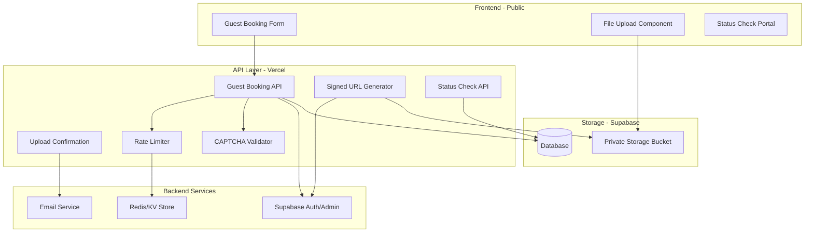
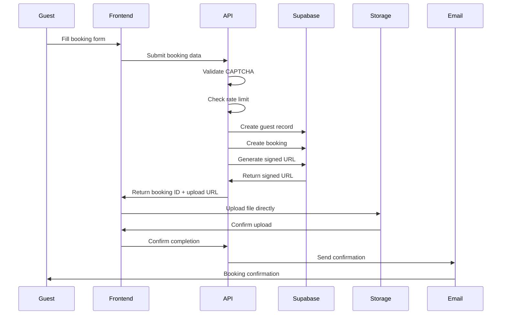
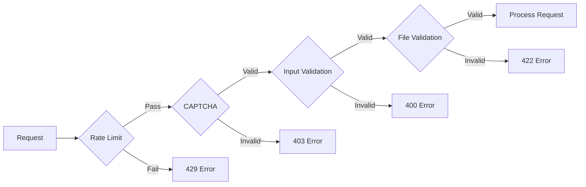

# Master Plan: Guest Booking System with Signed URLs

## Executive Summary

This document outlines the architecture and implementation strategy for enabling unauthenticated guests to submit booking requests with payment proofs using Supabase's signed URL functionality. The system maintains security while providing a frictionless booking experience.

## System Architecture

### High-Level Overview



### Data Flow



## Core Components

### 1. Guest Booking API

**Purpose**: Handle guest booking submissions without authentication

**Key Features**:

- Guest validation and deduplication
- Booking creation with pending status
- Signed URL generation for file uploads
- Integration with rate limiting and CAPTCHA

### 2. Signed URL System

**Purpose**: Enable secure, temporary file uploads without authentication

**Key Features**:

- Time-limited URLs (1-hour expiry)
- Path-specific permissions
- No exposure of storage credentials
- Direct browser-to-storage uploads

### 3. Storage Architecture

```
payment-proofs/
├── guest-bookings/          # Guest submissions
│   ├── {booking_id}/
│   │   └── {timestamp}_{random}.{ext}
│   └── ...
├── bookings/               # Authenticated user uploads
│   ├── {booking_id}/
│   │   └── {timestamp}_{random}.{ext}
│   └── ...
└── receipts/              # Other receipts
```

### 4. Security Layers



## Implementation Phases

### Phase 1: Backend Infrastructure (Day 1)

**Objectives**:

- Set up service role authentication
- Create guest booking API endpoint
- Implement signed URL generation
- Configure database operations

**Deliverables**:

- `/api/guest-booking` endpoint
- `/api/storage/generate-upload-url` endpoint
- Database helper functions
- Environment configuration

### Phase 2: Frontend Development (Day 2)

**Objectives**:

- Build guest booking form
- Implement file upload with preview
- Create upload progress tracking
- Design success/error states

**Deliverables**:

- `GuestBookingForm` component
- File upload functionality
- Guest booking route
- Mobile-responsive design

### Phase 3: Security Implementation (Day 3)

**Objectives**:

- Integrate rate limiting
- Add CAPTCHA protection
- Implement comprehensive validation
- Set up monitoring and logging

**Deliverables**:

- Rate limiting middleware
- CAPTCHA integration
- Input sanitization
- Audit logging

### Phase 4: Polish & Testing (Day 4)

**Objectives**:

- End-to-end testing
- Email template design
- Guest portal development
- Documentation completion

**Deliverables**:

- Test suite
- Email templates
- Status check portal
- User documentation

## Technical Specifications

### API Endpoints

| Endpoint                           | Method | Purpose                         |
| ---------------------------------- | ------ | ------------------------------- |
| `/api/guest-booking`               | POST   | Create booking & get upload URL |
| `/api/guest-booking/confirm`       | POST   | Confirm upload completion       |
| `/api/guest-booking/status`        | GET    | Check booking status            |
| `/api/storage/generate-upload-url` | POST   | Generate signed upload URL      |

### Environment Variables

```env
# Required for implementation
SUPABASE_SERVICE_ROLE_KEY=     # Backend only - never expose
RECAPTCHA_SECRET_KEY=           # Google reCAPTCHA
RESEND_API_KEY=                 # Email service
REDIS_URL=                      # Rate limiting store
```

### Database Schema Extensions

```sql
-- Add guest booking fields
ALTER TABLE bookings ADD COLUMN IF NOT EXISTS
    is_guest_booking BOOLEAN DEFAULT false;

ALTER TABLE bookings ADD COLUMN IF NOT EXISTS
    guest_verification_token VARCHAR(255);

ALTER TABLE bookings ADD COLUMN IF NOT EXISTS
    email_verified_at TIMESTAMP;

-- Index for guest lookups
CREATE INDEX IF NOT EXISTS idx_bookings_guest_email
ON bookings(email, is_guest_booking)
WHERE is_guest_booking = true;
```

## Success Metrics

### Performance Targets

- API response time: < 500ms
- Upload initiation: < 2s
- File upload: Dependent on file size and connection
- End-to-end completion: < 30s

### Security Targets

- Zero unauthorized uploads
- 100% CAPTCHA verification
- Rate limit effectiveness > 95%
- No exposed credentials

### Business Metrics

- Increased booking conversion rate
- Reduced support tickets
- Higher guest satisfaction
- Lower abandonment rate

## Risk Analysis

### Technical Risks

| Risk                            | Impact   | Mitigation                               |
| ------------------------------- | -------- | ---------------------------------------- |
| Service role key exposure       | Critical | Environment isolation, secret management |
| Storage bucket misconfiguration | High     | Regular audits, automated testing        |
| Rate limit bypass               | Medium   | IP tracking, fingerprinting              |
| Large file uploads              | Low      | Size limits, progress indication         |

### Business Risks

| Risk                   | Impact | Mitigation                                 |
| ---------------------- | ------ | ------------------------------------------ |
| Spam bookings          | High   | CAPTCHA, rate limiting, email verification |
| Invalid payment proofs | Medium | Manual review process, validation          |
| Storage costs          | Low    | Retention policies, compression            |
| Support burden         | Medium | Clear documentation, status portal         |

## Migration Strategy

### From Current System

1. **Parallel Operation**: Run both systems simultaneously
2. **Gradual Migration**: Start with low-season testing
3. **Feature Flags**: Enable/disable per property
4. **Data Migration**: Import existing guest bookings
5. **Rollback Plan**: Maintain backward compatibility

### Future Enhancements

- **Payment Gateway Integration**: Direct payment processing
- **Multi-file Uploads**: Multiple receipts per booking
- **SMS Notifications**: Text message confirmations
- **QR Code Upload**: Mobile-friendly upload via QR
- **AI Validation**: Automatic receipt verification
- **Webhook Notifications**: Real-time staff alerts

## Cost Analysis

### Development Costs

- Initial implementation: 4 developer days
- Testing and QA: 2 days
- Documentation: 1 day
- **Total**: 7 days

### Operational Costs

| Service       | Monthly Cost | Notes                |
| ------------- | ------------ | -------------------- |
| Storage       | $5-25        | Based on volume      |
| API Calls     | $0-10        | Serverless functions |
| Email         | $10-50       | Based on volume      |
| Rate Limiting | $5-10        | Redis/KV store       |
| **Total**     | **$30-95**   | Scales with usage    |

## Compliance Considerations

### Data Privacy

- GDPR compliance for EU guests
- Data retention policies
- Right to deletion
- Privacy policy updates

### Financial Regulations

- Payment proof retention requirements
- Audit trail maintenance
- Tax documentation
- Anti-fraud measures

## Monitoring & Maintenance

### Key Metrics to Track

- Upload success rate
- Average upload time
- API response times
- Error rates by type
- Storage usage trends

### Maintenance Schedule

- Weekly: Review error logs
- Monthly: Analyze usage patterns
- Quarterly: Security audit
- Yearly: Full system review

## Success Criteria

The implementation will be considered successful when:

1. ✅ Guests can book without authentication
2. ✅ Payment proofs upload successfully
3. ✅ Confirmation emails are sent
4. ✅ No security vulnerabilities
5. ✅ Performance targets are met
6. ✅ Support tickets decrease
7. ✅ Booking conversion improves

## Conclusion

This signed URL approach provides a secure, scalable, and user-friendly solution for guest bookings. It leverages Supabase's native capabilities while maintaining security through temporary access tokens and comprehensive validation layers.

The system can be implemented incrementally, tested thoroughly, and scaled based on demand. The architecture supports future enhancements while maintaining backward compatibility with existing systems.

---

_Document Version: 1.0.0_
_Last Updated: January 2025_
_Next Review: April 2025_
