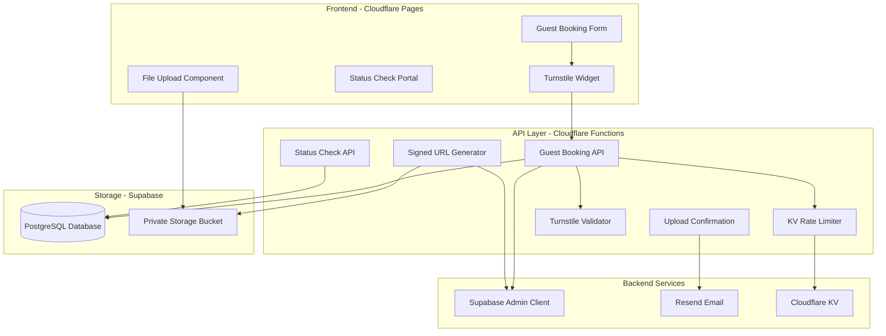
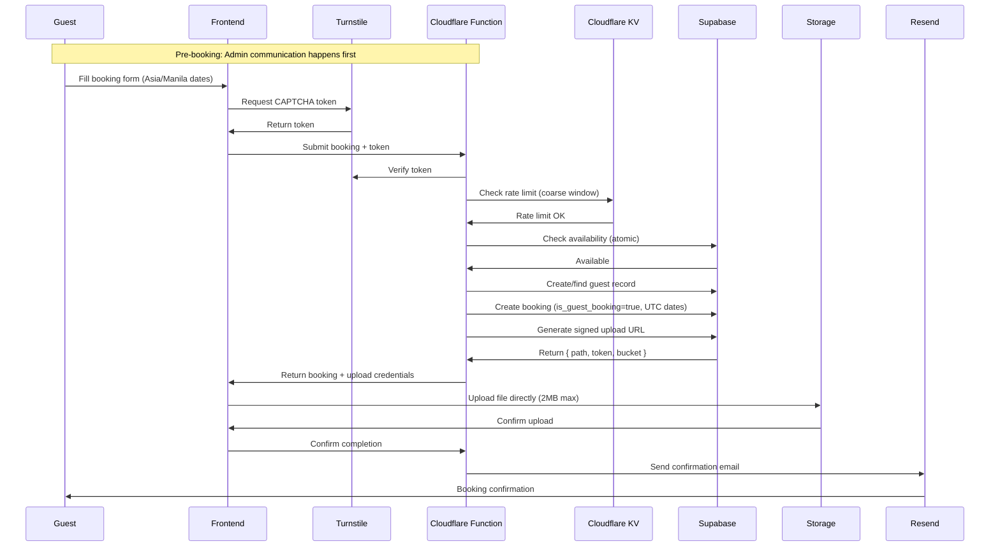
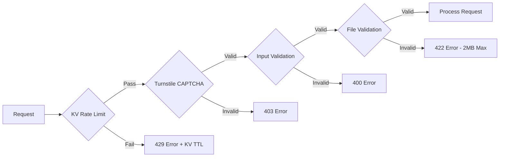
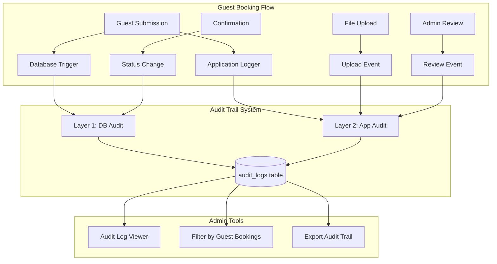

# Master Plan: Guest Booking System with Signed URLs

## Executive Summary

This document outlines the architecture and implementation strategy for enabling unauthenticated guests to submit booking requests with payment proofs using Supabase's signed URL functionality. The system maintains security while providing a frictionless booking experience.

**🎯 Free-Tier Optimized**: This implementation leverages Cloudflare Pages (free), Cloudflare KV (free), Cloudflare Turnstile (free), and Supabase (free tier) for a complete **$0/month infrastructure cost**.

## System Architecture

### High-Level Overview



### Data Flow



## Core Components

### 1. Guest Booking API (Cloudflare Function)

**Purpose**: Handle guest booking submissions without authentication

**Key Features**:

- Guest validation and deduplication
- **Atomic availability checking** before booking creation
- Booking creation with pending status (`is_guest_booking: true`)
- Signed URL generation for file uploads (Supabase token-based)
- Integration with Cloudflare KV rate limiting
- Turnstile CAPTCHA verification
- Timezone conversion (Asia/Manila → UTC storage)

**Runtime**: Cloudflare Workers runtime (Web standard APIs only - no Node.js)

### 2. Signed URL System (Supabase Storage)

**Purpose**: Enable secure, temporary file uploads without authentication

**Key Features**:

- Time-limited URLs (1-hour expiry)
- Path-specific permissions
- No exposure of storage credentials
- Direct browser-to-Supabase uploads
- Compatible with Cloudflare Functions

### 3. Storage Architecture

```
payment-proofs/
├── guest-bookings/          # Guest submissions
│   ├── {booking_id}/
│   │   └── {timestamp}_{random}.{ext}
│   └── ...
├── bookings/               # Authenticated user uploads
│   ├── {booking_id}/
│   │   └── {timestamp}_{random}.{ext}
│   └── ...
└── receipts/              # Other receipts
```

### 4. Security Layers (Cloudflare-Optimized)



## Implementation Phases

### Phase 1: Backend Infrastructure (Day 1-2)

**Objectives**:

- Set up Cloudflare Functions directory structure
- Configure Cloudflare KV namespace for rate limiting
- Create guest booking API endpoint
- Implement signed URL generation (Supabase)
- Configure Wrangler environment variables

**Deliverables**:

- `functions/api/guest-booking.ts` endpoint
- `functions/api/guest-booking/confirm.ts` endpoint
- `functions/api/guest-booking/status.ts` endpoint
- Cloudflare KV rate limiting implementation
- Database helper functions (Supabase)
- `wrangler.toml` configuration

### Phase 2: Frontend Development (Day 2-3)

**Objectives**:

- Build guest booking form with Turnstile widget
- Implement file upload with preview (2MB max)
- Create upload progress tracking
- Design success/error states
- Integrate @marsidev/react-turnstile

**Deliverables**:

- `GuestBookingForm` component with Turnstile
- File upload functionality with compression
- Guest booking route (TanStack Router)
- Mobile-responsive design
- Turnstile widget configuration

### Phase 3: Security Implementation (Day 3-4)

**Objectives**:

- Implement Cloudflare KV rate limiting
- Add Turnstile CAPTCHA protection
- Implement comprehensive validation (Zod + DOMPurify)
- Set up basic monitoring
- Configure security headers

**Deliverables**:

- KV-based rate limiting with TTL
- Turnstile verification in API functions
- Input sanitization (DOMPurify)
- Basic audit logging (Supabase table)
- Cloudflare Workers security headers

### Phase 4: Polish & Testing (Day 4-5)

**Objectives**:

- End-to-end testing
- Email template design (Resend)
- Guest portal development
- Cloudflare Pages deployment
- Documentation completion

**Deliverables**:

- Test suite (Vitest + Playwright)
- Resend email templates
- Status check portal
- Wrangler deployment configuration
- User documentation

## Technical Specifications

### API Endpoints

| Endpoint                     | Method | Purpose                         | Runtime             |
| ---------------------------- | ------ | ------------------------------- | ------------------- |
| `/api/guest-booking`         | POST   | Create booking & get upload URL | Cloudflare Function |
| `/api/guest-booking/confirm` | POST   | Confirm upload completion       | Cloudflare Function |
| `/api/guest-booking/status`  | GET    | Check booking status            | Cloudflare Function |

### Environment Variables

```env
# Cloudflare Pages environment variables (via Wrangler)
SUPABASE_SERVICE_ROLE_KEY=     # Supabase admin key - never expose to frontend
VITE_SUPABASE_URL=             # Public Supabase URL
VITE_SUPABASE_ANON_KEY=        # Public anon key
TURNSTILE_SECRET_KEY=          # Cloudflare Turnstile secret (backend only)
VITE_TURNSTILE_SITE_KEY=       # Cloudflare Turnstile site key (frontend)
RESEND_API_KEY=                # Resend email API key (100/day free)
```

### Cloudflare KV Namespaces

```toml
# wrangler.toml
[[kv_namespaces]]
binding = "RATE_LIMIT_KV"
id = "your-kv-namespace-id"
```

### Database Schema Extensions

**Recommended Approach**: Extend existing `bookings` table

**Rationale**:

- Simpler architecture with single source of truth for all bookings
- Easier reporting without cross-table joins
- Consistent business logic - existing availability checks work without modification
- Unified status tracking using existing `booking_status` and `payment_status` enums
- Less complexity - no data synchronization needed

**Migration SQL**:

```sql
-- Step 1: Enable btree_gist extension for range exclusion constraints
CREATE EXTENSION IF NOT EXISTS btree_gist;

-- Step 2: Add guest booking identification field
ALTER TABLE bookings ADD COLUMN IF NOT EXISTS
    is_guest_booking BOOLEAN DEFAULT false;

-- Step 3: Add upload tracking fields (cleanup strategy)
ALTER TABLE bookings ADD COLUMN IF NOT EXISTS
    upload_expires_at TIMESTAMPTZ;
ALTER TABLE bookings ADD COLUMN IF NOT EXISTS
    upload_status TEXT DEFAULT 'pending';

-- Step 4: Add atomic availability constraint with status-based exclusion
-- This prevents double-booking while allowing flexible dates for pending guest bookings
ALTER TABLE bookings
ADD CONSTRAINT no_overlapping_bookings
EXCLUDE USING gist (
  unit_id WITH =,
  tsrange(check_in_date, check_out_date, '[)') WITH &&
) WHERE (
  is_guest_booking = false OR
  (is_guest_booking = true AND booking_status IN ('Confirmed', 'CheckedIn', 'CheckedOut'))
);

-- Step 5: Index for efficient guest booking queries
CREATE INDEX IF NOT EXISTS idx_bookings_guest_email
ON bookings(email, is_guest_booking)
WHERE is_guest_booking = true;

-- Step 6: Index for cleanup queries (expired uploads)
CREATE INDEX IF NOT EXISTS idx_bookings_upload_expiry
ON bookings(upload_expires_at, upload_status)
WHERE is_guest_booking = true AND upload_status = 'pending';
```

**Constraint Explanation**:

- `tsrange(check_in_date, check_out_date, '[)')`: Creates a half-open interval (check-in inclusive, check-out exclusive)
- `WITH &&`: Range overlap operator - prevents any two bookings from having overlapping date ranges for the same unit
- `WHERE` clause: Constraint only applies to:
  - All authenticated bookings (`is_guest_booking = false`)
  - Guest bookings that are confirmed or later in workflow
  - **Excludes pending guest bookings**, allowing admin to adjust dates before confirmation
- `EXCLUDE USING gist`: Database-level atomic protection - prevents race conditions even under high concurrency

**Guest Booking Workflow** (Two-Phase Approach):

**Phase 1: Tentative Booking** (Flexible, No Constraints)

1. Admin pre-screens guest via communication channels (phone, social media, etc.)
2. Guest submits booking form with tentative dates
3. System creates booking: `booking_status: 'Pending'`, `is_guest_booking: true`, `upload_status: 'pending'`
4. **Exclusion constraint does NOT apply** - admin can freely adjust dates if needed
5. Guest uploads payment proof within 1 hour
6. Admin reviews:
   - Payment amount and proof validity
   - Date availability and adjustments if needed
   - Guest information accuracy

**Phase 2: Confirmed Booking** (Constraints Enforced) 7. Admin confirms booking → changes `booking_status` to `'Confirmed'` 8. **Exclusion constraint NOW applies** - prevents overlaps with other confirmed bookings 9. Standard check-in/check-out workflow continues using existing booking state machine

**Key Benefits of This Approach**:

- Admin has flexibility to adjust dates during verification without constraint errors
- Once confirmed, atomic database-level protection prevents double-booking
- Single `bookings` table maintains simplicity
- Leverages existing booking status workflow

**Note**: Admin communication with guest happens before form submission. No email verification needed in the booking flow.

**Timezone Handling**: All dates are selected in Asia/Manila timezone (application's `RESORT_TIMEZONE`), converted and stored in UTC, then displayed in Asia/Manila. This follows the existing application pattern in `src/config/settings.ts` and `src/utils/date-helpers.ts`.

### Booking Reference Generation (Security)

**Challenge**: Sequential booking references (e.g., `BK-2025-001234`, `BK-2025-001235`) are easily guessable, enabling:

- Enumeration attacks on status check endpoint
- Unauthorized booking information disclosure
- Data scraping attempts

**Solution**: ULID-Based References with Random Suffix

**Implementation**:

```typescript
import { ulid } from "ulid";

function generateBookingReference(): string {
  // Generate ULID (Universally Unique Lexicographically Sortable Identifier)
  const id = ulid(); // e.g., "01HN4GZ7YQVZK8EJMR6F9KTZV8"

  // Extract random suffix (last 6 characters, base32)
  const randomSuffix = id.slice(-6).toUpperCase(); // e.g., "KTZV8"

  // Format: BK-YYYY-SUFFIX
  const year = new Date().getFullYear();
  return `BK-${year}-${randomSuffix}`;
}

// Examples: BK-2025-X7K9M2, BK-2025-P4QW8N, BK-2025-ZN3T5R
```

**Properties**:

- **Human-friendly**: Short format (`BK-2025-X7K9M2`) easy to communicate over phone/email
- **Non-sequential**: Random appearance prevents enumeration
- **High entropy**: ~1 billion possible values per year (32^6 combinations)
- **Collision-resistant**: ULID timestamp + randomness makes duplicates extremely unlikely
- **Sortable**: Can still sort by year for admin convenience

**Additional Security Layer**: Dual-factor status check requires BOTH `booking_reference` + `email`, making enumeration impractical even with guessable references.

### Admin UX Integration Points

**Purpose**: Ensure back-office staff can efficiently manage guest bookings alongside authenticated user bookings.

**Required Admin Interface Updates**:

#### 1. Booking List Enhancements

```typescript
// Filter Options
const filters = {
  bookingType: 'all' | 'authenticated' | 'guest', // New filter
  status: 'all' | 'Pending' | 'Confirmed' | ...,
  // existing filters
};

// Visual Indicators
<Badge variant="secondary">Guest Booking</Badge> // Show when is_guest_booking = true
```

**Implementation Details**:

- Add "Booking Type" filter dropdown
- Display `is_guest_booking` badge in booking list rows
- Separate queue view for "Guest Bookings - Pending Review"
- Quick action: "View Payment Proof" button (opens modal with image)

#### 2. Booking Detail Page Additions

```typescript
// New Section: Upload Information
{
  label: 'Upload Status',
  value: upload_status, // 'pending', 'uploaded', 'confirmed', 'expired'
  badge: <StatusBadge status={upload_status} />
},
{
  label: 'Upload Expires At',
  value: upload_expires_at,
  visible: upload_status === 'pending'
},
{
  label: 'Payment Proof',
  value: <ImagePreview path={payment_proof_path} />, // Inline display
  actions: [
    <Button onClick={downloadProof}>Download</Button>,
    <Button onClick={openFullSize}>View Full Size</Button>
  ]
}
```

#### 3. Status Timeline Widget (New Component)

```typescript
// Visual Timeline for Guest Bookings
<Timeline>
  <TimelineItem
    timestamp={created_at}
    status="completed"
    title="Booking Submitted"
    description={`By ${guest_name} (${email})`}
  />
  <TimelineItem
    timestamp={upload_confirmed_at}
    status={upload_status === 'confirmed' ? 'completed' : 'pending'}
    title="Payment Proof Uploaded"
    description={upload_status === 'confirmed' ? 'File verified' : 'Awaiting upload'}
  />
  <TimelineItem
    timestamp={confirmed_at}
    status={booking_status === 'Confirmed' ? 'completed' : 'pending'}
    title="Booking Confirmed"
    description={booking_status === 'Confirmed' ? 'Admin verified' : 'Awaiting admin review'}
  />
  <TimelineItem
    timestamp={check_in_date}
    status="pending"
    title="Check-in"
  />
</Timeline>
```

#### 4. Quick Actions Panel

```typescript
// Admin Quick Actions (Guest Bookings Only)
<QuickActions>
  <ActionButton
    icon={<CheckIcon />}
    label="Confirm Booking"
    onClick={confirmGuestBooking}
    disabled={booking_status !== 'Pending'}
  />
  <ActionButton
    icon={<EditIcon />}
    label="Adjust Dates"
    onClick={openDateAdjustment}
    disabled={booking_status !== 'Pending'}
    tooltip="Can only adjust before confirming"
  />
  <ActionButton
    icon={<ImageIcon />}
    label="View Receipt"
    onClick={viewPaymentProof}
  />
  <ActionButton
    icon={<EmailIcon />}
    label="Resend Confirmation"
    onClick={resendEmail}
  />
</QuickActions>
```

#### 5. Dashboard Widgets

```typescript
// Admin Dashboard - Guest Booking KPIs
<DashboardCard title="Guest Bookings - Pending Review">
  <Stat
    label="Awaiting Verification"
    value={pendingGuestBookings.length}
    trend={+2} // vs. yesterday
  />
  <List>
    {pendingGuestBookings.slice(0, 5).map(booking => (
      <ListItem key={booking.id}>
        <Link to={`/bookings/${booking.id}`}>
          {booking.booking_reference} - {booking.guest_name}
        </Link>
        <TimeSince timestamp={booking.created_at} />
      </ListItem>
    ))}
  </List>
  <Button onClick={viewAllPending}>View All ({pendingGuestBookings.length})</Button>
</DashboardCard>
```

**Database Query for Pending Queue**:

```sql
-- Efficient query for admin dashboard
SELECT
  id,
  booking_reference,
  email,
  check_in_date,
  check_out_date,
  total_amount,
  upload_status,
  created_at,
  EXTRACT(EPOCH FROM (NOW() - created_at)) / 3600 AS hours_since_submission
FROM bookings
WHERE
  is_guest_booking = true
  AND booking_status = 'Pending'
  AND upload_status IN ('uploaded', 'confirmed')
ORDER BY created_at ASC; -- FIFO queue
```

**Performance Consideration**: The `idx_bookings_guest_email` index enables fast filtering by `is_guest_booking`. Consider additional composite index if admin dashboard becomes slow:

```sql
CREATE INDEX IF NOT EXISTS idx_bookings_admin_pending_queue
ON bookings(booking_status, is_guest_booking, created_at)
WHERE is_guest_booking = true AND booking_status = 'Pending';
```

## Success Metrics

### Performance Targets

- API response time: < 500ms
- Upload initiation: < 2s
- File upload: Dependent on file size and connection
- End-to-end completion: < 30s

### Security Targets

- Zero unauthorized uploads
- 100% CAPTCHA verification
- Rate limit effectiveness > 95%
- No exposed credentials

### Business Metrics

- Increased booking conversion rate
- Reduced support tickets
- Higher guest satisfaction
- Lower abandonment rate

## Risk Analysis

### Technical Risks

| Risk                            | Impact   | Mitigation                               |
| ------------------------------- | -------- | ---------------------------------------- |
| Service role key exposure       | Critical | Environment isolation, secret management |
| Storage bucket misconfiguration | High     | Regular audits, automated testing        |
| Rate limit bypass               | Medium   | IP tracking, fingerprinting              |
| Large file uploads              | Low      | Size limits, progress indication         |

### Business Risks

| Risk                   | Impact | Mitigation                                     |
| ---------------------- | ------ | ---------------------------------------------- |
| Spam bookings          | High   | CAPTCHA, KV rate limiting, admin pre-screening |
| Invalid payment proofs | Medium | Manual review process, validation              |
| Double-booking         | High   | Atomic availability checks before creation     |
| Storage costs          | Low    | 2MB limit, retention policies, compression     |
| Support burden         | Medium | Clear documentation, status portal             |

## Migration Strategy

### From Current System

1. **Parallel Operation**: Run both systems simultaneously
2. **Gradual Migration**: Start with low-season testing
3. **Feature Flags**: Enable/disable per property
4. **Data Migration**: Import existing guest bookings
5. **Rollback Plan**: Maintain backward compatibility

### Audit Trail Integration

The guest booking system integrates seamlessly with the implemented **Audit Trail System** (Phases 1-3C completed), providing comprehensive tracking of all guest booking events with both automatic database-level logging and enriched application-level context.

#### Integration Architecture



#### Automatic Database-Level Auditing (Layer 1)

All guest booking database operations are **automatically captured** by existing audit triggers:

- **Guest Creation**: New entries in `guests` table logged with full record
- **Booking Creation**: `bookings` table inserts captured with `is_guest_booking = true` flag
- **Status Updates**: All booking status transitions automatically logged
- **Payment Records**: Payment proof metadata captured in audit trail

**Key Benefits**:
- Zero additional code required - triggers already active
- Atomic capture - never miss a database change
- Tamper-proof - database-level logging can't be bypassed

#### Application-Level Enrichment (Layer 2)

Guest booking API endpoints provide **rich contextual logging** using the audit system:

```typescript
// Example: Guest booking submission with audit context
import { logAuditEvent, AuditCategory, AuditSeverity } from "@/lib/audit-logger";

// In guest booking API endpoint
await logAuditEvent({
  action: "guest_booking_submitted",
  category: AuditCategory.BOOKING,
  severity: AuditSeverity.INFO,
  description: `Guest booking submitted for ${unitName} (${checkIn} - ${checkOut})`,
  metadata: {
    booking_reference: bookingRef,
    unit_id: unitId,
    guest_email: email, // Will be redacted in logs
    ip_address: request.ip,
    user_agent: request.headers.get("user-agent"),
    turnstile_verified: true,
    source: "guest_portal"
  }
});
```

#### Guest Booking Audit Events

| Event Type | Layer | Trigger | Data Captured |
|------------|-------|---------|---------------|
| `guest_submission` | App | API call | IP, email, unit, dates, Turnstile status |
| `booking_created` | DB | INSERT | Full booking record with `is_guest_booking` |
| `upload_initiated` | App | Signed URL request | File metadata, expiry time |
| `upload_completed` | App | Confirmation API | File size, upload duration |
| `admin_review_started` | App | Admin opens booking | Admin email, review timestamp |
| `dates_adjusted` | DB | UPDATE | Old dates, new dates, admin ID |
| `booking_confirmed` | Both | Status change | Status transition, admin approval |
| `email_sent` | App | Email service | Recipient, template, send status |

#### Admin Benefits

Administrators can leverage the audit trail for guest bookings:

1. **Lifecycle Tracking**: Complete visibility from submission to check-out
2. **Accountability**: See which admin reviewed/approved each booking
3. **Pattern Detection**: Identify suspicious submission patterns
4. **Compliance**: Export audit trails for regulatory requirements
5. **Troubleshooting**: Debug issues with detailed event history

**Admin Query Examples**:

```sql
-- View all guest bookings pending review
SELECT * FROM audit_logs
WHERE table_name = 'bookings'
  AND new_data->>'is_guest_booking' = 'true'
  AND new_data->>'booking_status' = 'Pending'
ORDER BY created_at DESC;

-- Track admin actions on guest bookings
SELECT * FROM audit_logs
WHERE metadata->>'category' = 'booking'
  AND metadata->>'source' = 'guest_portal'
  AND user_email IS NOT NULL  -- Admin action
ORDER BY created_at DESC;
```

#### Security & Privacy

The audit system handles sensitive guest data appropriately:

- **Automatic Redaction**: Guest PII (phone, email, address) replaced with `[REDACTED]`
- **Configurable Fields**: `SENSITIVE_FIELDS` in `audit-constants.ts` controls redaction
- **Role-Based Access**: Only owners/managers can view audit logs
- **Retention Policies**: Old audit logs archived/purged per compliance needs

#### Integration with Audit UI

Guest booking audit logs integrate with the Phase 3 UI components:

- **Filtering**: Use "Bookings" table filter + custom metadata filters
- **Quick Filters**: "Today's Guest Bookings" preset available
- **Diff Viewer**: See before/after for date adjustments
- **Export**: Include guest booking audit trail in CSV exports

### Future Enhancements

#### Short-term Enhancements (Leveraging Audit System)

- **Audit-Based Analytics**: Guest booking conversion funnel from audit data
- **Automated Alerts**: Trigger on suspicious patterns in audit logs
- **Guest Portal**: Show guests their booking history from audit trail

#### Long-term Potential Features

- **Payment Gateway Integration**: Direct payment processing with full audit trail
- **Multi-file Uploads**: Multiple receipts per booking, each audit-logged
- **SMS Notifications**: Text message confirmations with delivery audit
- **AI Validation**: Automatic receipt verification with ML audit events
- **Webhook Notifications**: Real-time staff alerts based on audit events

## Cost Analysis

### Development Costs

- Initial implementation: 5-8 developer days (Cloudflare adaptation)
- Testing and QA: 2 days
- Documentation: 1 day
- **Total**: 8-11 days

### Operational Costs (Free Tier)

| Service              | Monthly Cost | Free Tier Limits                     | Notes                        |
| -------------------- | ------------ | ------------------------------------ | ---------------------------- |
| Cloudflare Pages     | **$0**       | Unlimited requests, 500 builds/month | Frontend hosting             |
| Cloudflare Functions | **$0**       | 100,000 requests/day                 | API endpoints                |
| Cloudflare KV        | **$0**       | 100k reads/day, 1k writes/day        | Rate limiting storage        |
| Cloudflare Turnstile | **$0**       | Unlimited verifications              | CAPTCHA replacement          |
| Supabase Database    | **$0**       | 500 MB storage, 2 GB bandwidth/month | PostgreSQL database          |
| Supabase Storage     | **$0**       | 1 GB storage, 2 GB bandwidth/month   | File uploads                 |
| Resend Email         | **$0**       | 100 emails/day, 3,000/month          | Booking confirmations        |
| **Total**            | **$0**       | -                                    | **Complete free-tier stack** |

### Free Tier Constraints

**Critical Limits to Monitor:**

- **Supabase Bandwidth**: 2 GB/month (file uploads + database queries)
- **Email Sending**: 100/day, 3,000/month (Resend)
- **KV Writes**: 1,000/day (sufficient for rate limiting ~200 unique IPs/day)
- **File Upload Size**: Limited to 2MB (vs 5MB) to conserve bandwidth

**Estimated Capacity:**

- ~500-1,000 bookings/month (assuming 1-2MB uploads + email confirmations)
- ~100 guest bookings/day (email limit)
- ~5,000+ status checks/day (KV read limit)

### Upgrade Path (Optional)

If exceeding free tier limits:

| Upgrade            | Cost/Month | Benefit                        |
| ------------------ | ---------- | ------------------------------ |
| Supabase Pro       | $25        | 8 GB database, 50 GB bandwidth |
| Resend Pro         | $20        | 50,000 emails/month            |
| Cloudflare Workers | $5         | Additional compute if needed   |
| **Minimum Paid**   | **$50**    | Handles ~10x more traffic      |

## Compliance Considerations

### Data Privacy

- GDPR compliance for EU guests
- Data retention policies
- Right to deletion
- Privacy policy updates

### Financial Regulations

- Payment proof retention requirements
- Audit trail maintenance
- Tax documentation
- Anti-fraud measures

## Monitoring & Maintenance

### Key Metrics to Track

- Upload success rate
- Average upload time
- API response times
- Error rates by type
- Storage usage trends

### Maintenance Schedule

- Weekly: Review error logs
- Monthly: Analyze usage patterns
- Quarterly: Security audit
- Yearly: Full system review

## Success Criteria

The implementation will be considered successful when:

1. ✅ Guests can book without authentication
2. ✅ Payment proofs upload successfully
3. ✅ Confirmation emails are sent
4. ✅ No security vulnerabilities
5. ✅ Performance targets are met
6. ✅ Support tickets decrease
7. ✅ Booking conversion improves

## Conclusion

This Cloudflare-optimized signed URL approach provides a secure, scalable, and user-friendly solution for guest bookings at **$0/month infrastructure cost**. It leverages:

- **Cloudflare Pages Functions** for serverless API endpoints
- **Cloudflare KV** for efficient rate limiting
- **Cloudflare Turnstile** for unlimited CAPTCHA protection
- **Supabase** for database and secure file storage with signed URLs

The system can be implemented incrementally, tested thoroughly, and scaled based on demand within free tier limits. The architecture supports future enhancements (see [Paid Features Roadmap](./06-paid-features-roadmap.md)) while maintaining backward compatibility with existing systems.

**Free Tier Sustainability**: This stack can handle 500-1,000 bookings/month comfortably before needing to consider paid upgrades, making it ideal for small to medium resort operations.

---

_Document Version: 2.0.0 (Cloudflare Free-Tier Adaptation)_
_Last Updated: January 2025_
_Next Review: April 2025_
_Platform: Cloudflare Pages + Supabase Free Tier_
