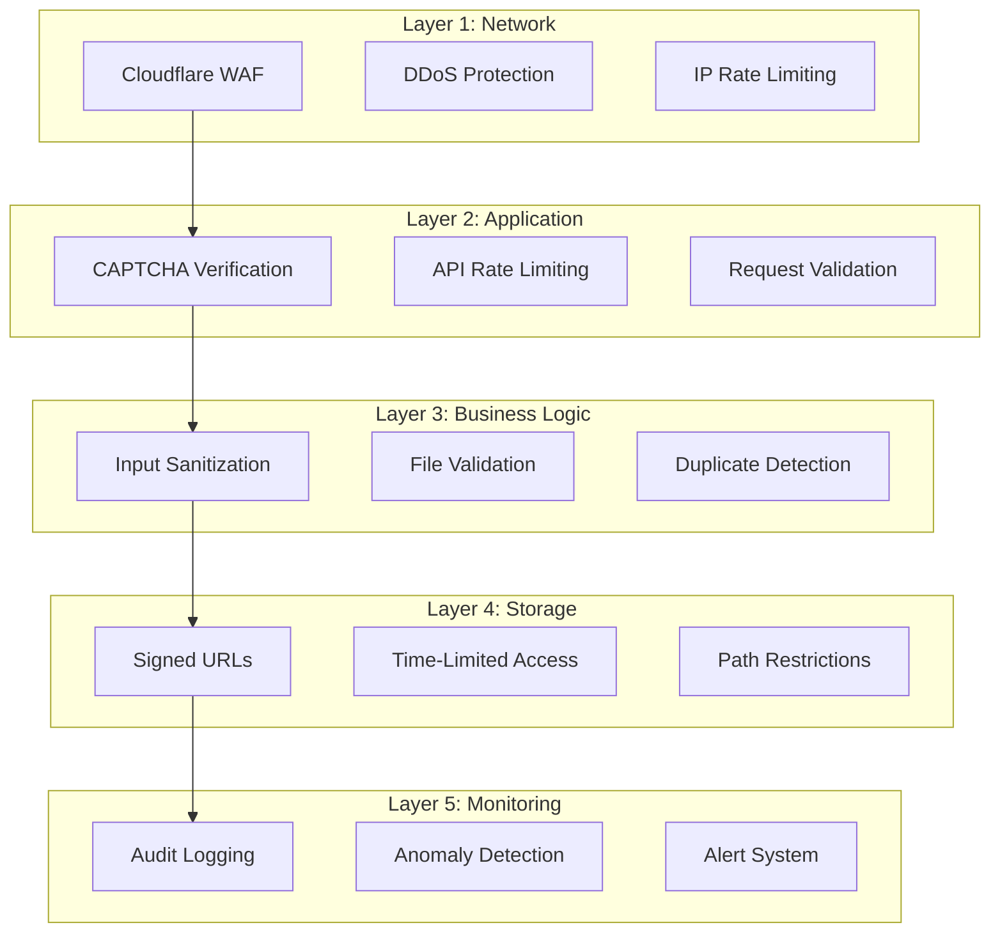

# Security Implementation Guide (Cloudflare Free Tier)

## Overview

This document provides comprehensive security measures for the guest booking system with signed URLs optimized for **Cloudflare free tier**. It covers KV-based rate limiting, Turnstile CAPTCHA integration, input validation, CORS configuration, and basic monitoring strategies to protect against common vulnerabilities.

**Platform**: Cloudflare Pages + Cloudflare KV + Turnstile
**Cost**: $0/month

**⚠️ Critical**: All code examples in this document are **Cloudflare Workers-compatible** using Web standard APIs only. No Node.js, Next.js, or Upstash dependencies.

## Security Architecture

### Defense in Depth Strategy



## Rate Limiting Implementation

### KV-Based Rate Limiting (Workers-Native)

**Strategy**: Coarse-window approach to minimize KV writes (free tier: 1,000 writes/day).

```typescript
// lib/kv-rate-limit.ts
/**
 * Cloudflare Workers KV rate limiting
 * Free tier: 100k reads/day, 1k writes/day
 *
 * Uses hourly windows: ~24 writes/day per IP instead of N writes/day
 */

interface RateLimitOptions {
  limit: number;
  windowSeconds: number;
}

interface RateLimitResult {
  allowed: boolean;
  remaining: number;
  retryAfter: number;
}

export async function checkKVRateLimit(
  kv: KVNamespace,
  identifier: string,
  options: RateLimitOptions
): Promise<RateLimitResult> {
  const { limit, windowSeconds } = options;
  const now = Math.floor(Date.now() / 1000);
  const windowKey = Math.floor(now / windowSeconds);
  const key = `rate-limit:${identifier}:${windowKey}`;

  const current = await kv.get(key);
  const count = current ? parseInt(current) : 0;

  if (count >= limit) {
    const windowEnd = (windowKey + 1) * windowSeconds;
    const retryAfter = windowEnd - now;

    return {
      allowed: false,
      remaining: 0,
      retryAfter: Math.max(retryAfter, 1),
    };
  }

  await kv.put(key, String(count + 1), {
    expirationTtl: windowSeconds + 60,
  });

  return {
    allowed: true,
    remaining: limit - (count + 1),
    retryAfter: 0,
  };
}

// Get IP from Workers request
export function getClientIp(request: Request): string {
  // Cloudflare provides the real client IP in this header
  return (
    request.headers.get("cf-connecting-ip") ||
    request.headers.get("x-forwarded-for")?.split(",")[0] ||
    "unknown"
  );
}

// Advanced fingerprinting (Workers-compatible)
export async function getFingerprint(request: Request): Promise<string> {
  const ip = getClientIp(request);
  const headers = request.headers;

  const factors = [
    ip,
    headers.get("user-agent") || "",
    headers.get("accept-language") || "",
    headers.get("accept-encoding") || "",
  ];

  const encoder = new TextEncoder();
  const data = encoder.encode(factors.join("|"));
  const hashBuffer = await crypto.subtle.digest("SHA-256", data);
  const hashArray = Array.from(new Uint8Array(hashBuffer));
  return hashArray.map((b) => b.toString(16).padStart(2, "0")).join("");
}
```

### API Endpoint Protection (Workers Pattern)

```typescript
// functions/api/guest-booking.ts (Cloudflare Function)
import { checkKVRateLimit, getClientIp } from "@/lib/kv-rate-limit";

interface Env {
  RATE_LIMIT_KV: KVNamespace;
  // ... other bindings
}

export async function onRequest(context: EventContext<Env, any, Record<string, unknown>>) {
  const { request, env } = context;

  try {
    const clientIp = getClientIp(request);

    // Check rate limit (5 bookings per hour per IP)
    const rateLimitResult = await checkKVRateLimit(env.RATE_LIMIT_KV, clientIp, {
      limit: 5,
      windowSeconds: 3600, // 1 hour
    });

    if (!rateLimitResult.allowed) {
      return new Response(
        JSON.stringify({
          error: "RATE_LIMITED",
          message: "Too many requests. Please try again later.",
          retryAfter: rateLimitResult.retryAfter,
        }),
        {
          status: 429,
          headers: {
            "Content-Type": "application/json",
            "X-RateLimit-Limit": "5",
            "X-RateLimit-Remaining": "0",
            "Retry-After": String(rateLimitResult.retryAfter),
          },
        }
      );
    }

    // Continue with request processing...
  } catch (error) {
    console.error("Rate limit error:", error);
    // Continue without rate limiting if KV is unavailable
  }
}
```

## CAPTCHA Integration

### Cloudflare Turnstile Setup (Workers-Native)

**Why Turnstile over reCAPTCHA**:

- ✅ Free, unlimited verifications (vs reCAPTCHA's 1M/month limit)
- ✅ No quota tracking needed
- ✅ Better privacy (no Google tracking)
- ✅ Native Cloudflare integration
- ✅ Workers-compatible verification

```typescript
// lib/turnstile.ts (Workers-compatible)
export interface TurnstileResponse {
  success: boolean;
  challenge_ts?: string;
  hostname?: string;
  "error-codes"?: string[];
  action?: string;
  cdata?: string;
}

export async function verifyTurnstile(
  token: string,
  secretKey: string,
  remoteip?: string
): Promise<boolean> {
  if (!secretKey) {
    console.warn("TURNSTILE_SECRET_KEY not configured");
    return true; // Skip in development
  }

  try {
    // CRITICAL: Use URLSearchParams (not FormData) for Workers
    const formData = new URLSearchParams({
      secret: secretKey,
      response: token,
      ...(remoteip ? { remoteip } : {}),
    });

    const response = await fetch("https://challenges.cloudflare.com/turnstile/v0/siteverify", {
      method: "POST",
      body: formData,
      headers: {
        "content-type": "application/x-www-form-urlencoded",
      },
    });

    const data: TurnstileResponse = await response.json();

    // Optional: Verify hostname matches your domain
    if (data.hostname && !data.hostname.includes("your-domain.pages.dev")) {
      console.warn("Hostname mismatch:", data.hostname);
      return false;
    }

    return data.success === true;
  } catch (error) {
    console.error("Turnstile verification error:", error);
    return false;
  }
}
```

### Frontend Turnstile Integration

```tsx
// components/guest-booking/TurnstileProtectedForm.tsx
import { Turnstile } from "@marsidev/react-turnstile";
import { useState } from "react";

export function TurnstileProtectedForm({ children, onSubmit }: Props) {
  const [turnstileToken, setTurnstileToken] = useState<string>("");
  const [isVerifying, setIsVerifying] = useState(false);

  const handleSubmit = async (data: any) => {
    if (!turnstileToken) {
      alert("Please complete the security check");
      return;
    }

    setIsVerifying(true);

    try {
      const submitData = {
        ...data,
        turnstile_token: turnstileToken,
      };

      await onSubmit(submitData);
    } catch (error) {
      console.error("Submission error:", error);
    } finally {
      setIsVerifying(false);
    }
  };

  return (
    <form onSubmit={handleSubmit}>
      {children}

      <Turnstile
        siteKey={import.meta.env.VITE_TURNSTILE_SITE_KEY}
        onSuccess={setTurnstileToken}
        onError={() => setTurnstileToken("")}
        onExpire={() => setTurnstileToken("")}
      />

      {isVerifying && <div className="text-sm text-muted-foreground">Processing...</div>}
    </form>
  );
}
```

## Input Validation & Sanitization

### Comprehensive Validation Schema

```typescript
// lib/validation/guest-booking.ts
import { z } from "zod";
import DOMPurify from "isomorphic-dompurify";
import validator from "validator";

// Philippine phone number regex
const phPhoneRegex = /^(\+63|0)?9\d{9}$/;

// Custom validators
const sanitizeString = (val: string) => {
  return DOMPurify.sanitize(val, {
    ALLOWED_TAGS: [],
    ALLOWED_ATTR: [],
  });
};

const validatePhoneNumber = (phone: string) => {
  // Remove spaces and dashes
  const cleaned = phone.replace(/[\s-]/g, "");
  return phPhoneRegex.test(cleaned) || validator.isMobilePhone(cleaned);
};

// Guest information schema
export const guestInfoSchema = z.object({
  first_name: z
    .string()
    .min(2, "First name must be at least 2 characters")
    .max(50, "First name must be less than 50 characters")
    .transform(sanitizeString)
    .refine((val) => /^[a-zA-Z\s'-]+$/.test(val), "First name contains invalid characters"),

  last_name: z
    .string()
    .min(2, "Last name must be at least 2 characters")
    .max(50, "Last name must be less than 50 characters")
    .transform(sanitizeString)
    .refine((val) => /^[a-zA-Z\s'-]+$/.test(val), "Last name contains invalid characters"),

  email: z
    .string()
    .email("Invalid email address")
    .toLowerCase()
    .refine((email) => !email.includes("+"), "Email addresses with + are not allowed")
    .refine(async (email) => {
      // Check against disposable email domains
      const domain = email.split("@")[1];
      const disposableDomains = await getDisposableDomains();
      return !disposableDomains.includes(domain);
    }, "Disposable email addresses are not allowed"),

  phone: z
    .string()
    .transform((val) => val.replace(/[\s-]/g, ""))
    .refine(validatePhoneNumber, "Invalid phone number"),

  notes: z
    .string()
    .max(500, "Notes must be less than 500 characters")
    .transform(sanitizeString)
    .optional(),
});

// Booking details schema
export const bookingDetailsSchema = z.object({
  unit_id: z.string().uuid("Invalid unit ID"),

  check_in_date: z
    .string()
    .datetime()
    .refine((date) => new Date(date) >= new Date(), "Check-in date must be in the future"),

  check_out_date: z.string().datetime(),

  guest_count: z
    .number()
    .int()
    .min(1, "At least 1 guest required")
    .max(20, "Maximum 20 guests allowed"),

  payment_amount: z
    .number()
    .positive("Payment amount must be positive")
    .max(1000000, "Payment amount exceeds maximum"),

  payment_method: z.enum(["gcash", "bank_transfer", "credit_card", "cash", "maya", "paypal"]),
});

// Combined schema for guest booking
export const guestBookingSchema = z
  .object({
    guest: guestInfoSchema,
    booking: bookingDetailsSchema,
    captchaToken: z.string(),
    termsAccepted: z.literal(true, {
      errorMap: () => ({ message: "You must accept the terms and conditions" }),
    }),
  })
  .refine(
    (data) => {
      const checkIn = new Date(data.booking.check_in_date);
      const checkOut = new Date(data.booking.check_out_date);
      return checkOut > checkIn;
    },
    {
      message: "Check-out date must be after check-in date",
      path: ["booking", "check_out_date"],
    }
  );

// File validation schema
export const fileUploadSchema = z.object({
  file: z
    .instanceof(File)
    .refine((file) => file.size <= 5 * 1024 * 1024, "File size must be less than 5MB")
    .refine((file) => {
      const allowedTypes = [
        "image/jpeg",
        "image/jpg",
        "image/png",
        "image/webp",
        "application/pdf",
      ];
      return allowedTypes.includes(file.type);
    }, "File must be an image (JPEG, PNG, WebP) or PDF"),
});
```

### SQL Injection Prevention

```typescript
// lib/database/secure-queries.ts
import { createClient } from "@supabase/supabase-js";

// NEVER do this - vulnerable to SQL injection
// const query = `SELECT * FROM bookings WHERE email = '${userInput}'`

// ALWAYS use parameterized queries
export async function findGuestBookings(supabase: ReturnType<typeof createClient>, email: string) {
  // Supabase client automatically parameterizes queries
  const { data, error } = await supabase
    .from("bookings")
    .select("*")
    .eq("email", email) // Safe - parameter is escaped
    .eq("is_guest_booking", true);

  return { data, error };
}

// For raw SQL, use parameterized queries
export async function searchBookings(
  supabase: ReturnType<typeof createClient>,
  searchTerm: string
) {
  // Use RPC with parameters for complex queries
  const { data, error } = await supabase.rpc("search_bookings", {
    search_term: searchTerm, // Parameter is safely escaped
  });

  return { data, error };
}
```

## CORS Configuration (Cross-Origin Resource Sharing)

### 1. Supabase Storage CORS Configuration

**Critical**: Direct browser uploads to Supabase Storage require proper CORS configuration for the token-based `uploadToSignedUrl()` method.

**Navigate to**: Supabase Dashboard → Storage → `payment-proofs` bucket → Configuration → CORS

**Production Configuration** (strict):

```json
[
  {
    "allowedOrigins": ["https://your-domain.pages.dev", "https://www.your-domain.com"],
    "allowedMethods": ["GET", "PUT", "POST"],
    "allowedHeaders": ["authorization", "content-type", "x-client-info", "apikey"],
    "exposedHeaders": ["ETag"],
    "maxAge": 3600
  }
]
```

**Development Configuration** (includes localhost):

```json
[
  {
    "allowedOrigins": [
      "https://your-domain.pages.dev",
      "https://*.pages.dev",
      "http://localhost:8788",
      "http://localhost:5173",
      "http://127.0.0.1:5173"
    ],
    "allowedMethods": ["GET", "PUT", "POST", "DELETE"],
    "allowedHeaders": ["*"],
    "exposedHeaders": ["ETag", "X-Supabase-Api-Version"],
    "maxAge": 3600
  }
]
```

**Configuration Explanation**:

- **`allowedOrigins`**:
  - Production: Explicit domain list (no wildcards for security)
  - Development: Includes `localhost` and `*.pages.dev` preview deployments
- **`allowedMethods`**:
  - `PUT`: Required for `uploadToSignedUrl()` file uploads
  - `POST`: Fallback upload method
  - `GET`: Download signed URLs for admin review
- **`allowedHeaders`**:
  - Production: Explicit list prevents header injection
  - Development: `*` for easier testing
- **`exposedHeaders`**:
  - `ETag`: Required for upload verification
- **`maxAge`**: 3600 seconds (1 hour) - caches preflight requests

**⚠️ Security Warning**: Never use `"allowedOrigins": ["*"]` in production - this exposes your storage to any website.

### 2. Cloudflare Functions CORS Headers

**File**: `functions/_middleware.ts` (applies to all `/api/*` routes)

```typescript
/**
 * Global middleware for Cloudflare Functions
 * Handles CORS, security headers, and rate limiting
 */

interface Env {
  RATE_LIMIT_KV: KVNamespace;
  ENVIRONMENT: "production" | "development";
}

export const onRequest: PagesFunction<Env> = async (context) => {
  const { request, env, next } = context;

  // Environment-specific CORS configuration
  const allowedOrigins =
    env.ENVIRONMENT === "production"
      ? ["https://your-domain.pages.dev", "https://www.your-domain.com"]
      : [
          "https://your-domain.pages.dev",
          "https://*.pages.dev",
          "http://localhost:8788",
          "http://localhost:5173",
          "http://127.0.0.1:5173",
        ];

  const origin = request.headers.get("Origin");
  const isAllowedOrigin = allowedOrigins.some((allowed) => {
    if (allowed.includes("*")) {
      const pattern = new RegExp(allowed.replace("*", ".*"));
      return pattern.test(origin || "");
    }
    return allowed === origin;
  });

  // Handle preflight requests
  if (request.method === "OPTIONS") {
    return new Response(null, {
      status: 204,
      headers: {
        "Access-Control-Allow-Origin": isAllowedOrigin ? origin! : allowedOrigins[0],
        "Access-Control-Allow-Methods": "GET, POST, PUT, DELETE, OPTIONS",
        "Access-Control-Allow-Headers": "Content-Type, Authorization, X-Idempotency-Key",
        "Access-Control-Max-Age": "86400", // 24 hours
        "Access-Control-Allow-Credentials": "false",
      },
    });
  }

  // Process request
  const response = await next();

  // Add CORS headers to response
  if (isAllowedOrigin) {
    response.headers.set("Access-Control-Allow-Origin", origin!);
    response.headers.set("Access-Control-Allow-Credentials", "false");
    response.headers.set("Vary", "Origin");
  }

  return response;
};
```

**Key Security Features**:

- **Dynamic origin validation**: Checks against allowlist, not blanket `*`
- **Environment-aware**: Strict in production, flexible in development
- **Preflight caching**: 24-hour cache reduces preflight overhead
- **No credentials**: `Access-Control-Allow-Credentials: false` prevents cookie attacks
- **Vary header**: Ensures proper caching by CDN

### Verifying CORS Configuration

```typescript
// Test CORS from browser console on your domain
const testCORS = async () => {
  try {
    const response = await fetch(
      "https://your-project.supabase.co/storage/v1/object/payment-proofs/test.txt",
      {
        method: "OPTIONS",
        headers: {
          "Access-Control-Request-Method": "PUT",
          "Access-Control-Request-Headers": "content-type",
          Origin: window.location.origin,
        },
      }
    );
    console.log("CORS Status:", response.status);
    console.log("CORS Headers:", Object.fromEntries(response.headers));
  } catch (error) {
    console.error("CORS Test Failed:", error);
  }
};
```

## Security Headers (Comprehensive Protection)

### HTTP Security Headers Implementation

**File**: `functions/_middleware.ts` (add to existing middleware)

```typescript
/**
 * Comprehensive security headers for all API responses
 * Protects against XSS, clickjacking, MIME sniffing, and other attacks
 */

function getSecurityHeaders(env: Env): HeadersInit {
  const isProd = env.ENVIRONMENT === "production";

  return {
    // XSS Protection
    "X-XSS-Protection": "1; mode=block",

    // Prevent MIME type sniffing
    "X-Content-Type-Options": "nosniff",

    // Clickjacking protection
    "X-Frame-Options": "DENY",

    // Content Security Policy (strict)
    "Content-Security-Policy": [
      "default-src 'self'",
      "script-src 'self' challenges.cloudflare.com", // Turnstile widget
      "style-src 'self' 'unsafe-inline'", // Allow inline styles for UI libraries
      "img-src 'self' data: https:", // Allow images from any HTTPS source
      "connect-src 'self' https://*.supabase.co https://challenges.cloudflare.com",
      "font-src 'self'",
      "object-src 'none'",
      "base-uri 'self'",
      "form-action 'self'",
      "frame-ancestors 'none'", // Equivalent to X-Frame-Options: DENY
      "upgrade-insecure-requests", // Upgrade HTTP to HTTPS
    ].join("; "),

    // Referrer Policy (privacy-friendly)
    "Referrer-Policy": "strict-origin-when-cross-origin",

    // Permissions Policy (disable unnecessary browser features)
    "Permissions-Policy": [
      "camera=()",
      "microphone=()",
      "geolocation=()",
      "payment=()",
      "usb=()",
      "magnetometer=()",
      "gyroscope=()",
      "accelerometer=()",
    ].join(", "),

    // HSTS (HTTPS enforcement) - only in production
    ...(isProd
      ? {
          "Strict-Transport-Security": "max-age=31536000; includeSubDomains; preload",
        }
      : {}),

    // Additional security headers
    "X-Permitted-Cross-Domain-Policies": "none",
    "X-Download-Options": "noopen",
  };
}

export const onRequest: PagesFunction<Env> = async (context) => {
  const { request, env, next } = context;

  // ... existing CORS logic ...

  // Process request
  const response = await next();

  // Add security headers
  const securityHeaders = getSecurityHeaders(env);
  Object.entries(securityHeaders).forEach(([key, value]) => {
    response.headers.set(key, value);
  });

  // ... existing CORS response headers ...

  return response;
};
```

**Security Headers Explanation**:

| Header                      | Value                             | Protection                                           |
| --------------------------- | --------------------------------- | ---------------------------------------------------- |
| `Content-Security-Policy`   | Strict directives                 | Prevents XSS by controlling resource loading sources |
| `X-Frame-Options`           | `DENY`                            | Prevents clickjacking attacks                        |
| `X-Content-Type-Options`    | `nosniff`                         | Prevents MIME type sniffing attacks                  |
| `Referrer-Policy`           | `strict-origin-when-cross-origin` | Limits referrer info leakage                         |
| `Permissions-Policy`        | Disabled features                 | Blocks camera, microphone, geolocation access        |
| `Strict-Transport-Security` | 1 year max-age                    | Forces HTTPS, prevents downgrade attacks             |
| `X-XSS-Protection`          | `1; mode=block`                   | Legacy XSS filter (defense-in-depth)                 |

**Testing Security Headers**:

```bash
# Test with curl
curl -I https://your-domain.pages.dev/api/guest-booking

# Test with SecurityHeaders.com
open https://securityheaders.com/?q=https://your-domain.pages.dev

# Expected Security Grade: A+
```

**CSP Violation Reporting** (optional):

```typescript
// Add to CSP directive in production
("report-uri https://your-domain.pages.dev/api/csp-report", "report-to csp-endpoint");

// Create reporting endpoint
// functions/api/csp-report.ts
export async function onRequest(context: EventContext<Env, any, Record<string, unknown>>) {
  const { request } = context;
  const report = await request.json();

  console.warn("CSP Violation:", JSON.stringify(report, null, 2));

  // Optionally send to monitoring service
  // await sendToSentry(report);

  return new Response("Reported", { status: 204 });
}
```

## Status Check Security (Dual-Factor Authentication + Rate Limiting)

**Security Risks**:

1. **Enumeration attacks**: Guessing booking references to discover bookings
2. **Brute force**: Automated scraping of booking data
3. **DDoS**: Overwhelming status endpoint with requests

**Mitigations**:

1. **Dual-factor auth**: Require BOTH `booking_reference` AND `email`
2. **Rate limiting**: 20 requests/hour per IP
3. **Optional Turnstile**: CAPTCHA for suspicious patterns
4. **Generic errors**: Don't reveal which parameter was wrong

### Secure Status Check Implementation

```typescript
// functions/api/guest-booking/status.ts
import { checkKVRateLimit, getClientIp } from "@/lib/kv-rate-limit";
import { createSupabaseAdmin } from "@/lib/supabase-admin";

interface Env {
  RATE_LIMIT_KV: KVNamespace;
  SUPABASE_SERVICE_ROLE_KEY: string;
  VITE_SUPABASE_URL: string;
}

export async function onRequest(context: EventContext<Env, any, Record<string, unknown>>) {
  const { request, env } = context;

  // Only allow GET requests
  if (request.method !== "GET") {
    return new Response("Method not allowed", { status: 405 });
  }

  const url = new URL(request.url);
  const reference = url.searchParams.get("reference");
  const email = url.searchParams.get("email");

  // BOTH parameters required
  if (!reference || !email) {
    return new Response(
      JSON.stringify({
        error: "MISSING_PARAMETERS",
        message: "Both booking reference and email are required",
      }),
      { status: 400, headers: { "Content-Type": "application/json" } }
    );
  }

  // Enhanced rate limiting with fingerprinting
  const clientIp = getClientIp(request);
  const fingerprint = await getFingerprint(request); // IP + UA + headers

  const rateLimitResult = await checkKVRateLimit(
    env.RATE_LIMIT_KV,
    `status:${fingerprint.substring(0, 16)}`, // Use fingerprint instead of just IP
    {
      limit: 20,
      windowSeconds: 3600,
    }
  );

  if (!rateLimitResult.allowed) {
    // Check if we should require Turnstile CAPTCHA
    const requiresCaptcha = rateLimitResult.remaining === 0 && env.ENVIRONMENT === "production";

    return new Response(
      JSON.stringify({
        error: "RATE_LIMITED",
        message: "Too many status checks. Please try again later.",
        retryAfter: rateLimitResult.retryAfter,
        requiresCaptcha, // Signal to frontend to show Turnstile
      }),
      {
        status: 429,
        headers: {
          "Content-Type": "application/json",
          "Retry-After": String(rateLimitResult.retryAfter),
          "X-RateLimit-Remaining": "0",
        },
      }
    );
  }

  // Optional: Verify Turnstile if provided (for high-volume users)
  const turnstileToken = url.searchParams.get("turnstile_token");
  if (turnstileToken && env.TURNSTILE_SECRET_KEY) {
    const { verifyTurnstile } = await import("@/lib/turnstile");
    const isValid = await verifyTurnstile(turnstileToken, env.TURNSTILE_SECRET_KEY, {
      remoteip: clientIp,
      expectedHostname: new URL(request.url).hostname,
      expectedAction: "status-check",
    });

    if (!isValid) {
      return new Response(
        JSON.stringify({
          error: "CAPTCHA_FAILED",
          message: "CAPTCHA verification failed. Please try again.",
        }),
        { status: 403, headers: { "Content-Type": "application/json" } }
      );
    }

    // Reset rate limit on successful CAPTCHA (give them more attempts)
    await env.RATE_LIMIT_KV.delete(`status:${fingerprint.substring(0, 16)}`);
  }

  // Query booking with BOTH conditions
  const supabaseAdmin = createSupabaseAdmin(env);
  const { data, error } = await supabaseAdmin
    .from("bookings")
    .select("booking_reference, booking_status, check_in, check_out, total_amount, payment_status")
    .eq("booking_reference", reference)
    .eq("email", email.toLowerCase())
    .eq("is_guest_booking", true)
    .single();

  if (error || !data) {
    // GENERIC response - don't reveal which parameter was wrong
    return new Response(
      JSON.stringify({
        error: "NOT_FOUND",
        message: "No booking found with the provided information",
      }),
      { status: 404, headers: { "Content-Type": "application/json" } }
    );
  }

  return new Response(
    JSON.stringify({
      success: true,
      data: {
        reference: data.booking_reference,
        status: data.booking_status,
        checkIn: data.check_in,
        checkOut: data.check_out,
        totalAmount: data.total_amount,
        paymentStatus: data.payment_status,
      },
    }),
    { status: 200, headers: { "Content-Type": "application/json" } }
  );
}
```

**Security Benefits**:

- ✅ **Dual-factor authentication**: Requires BOTH reference AND email
- ✅ **Fingerprinting**: Uses IP + User-Agent + headers for better tracking
- ✅ **Progressive rate limiting**: 20 checks/hour, then optional CAPTCHA
- ✅ **CAPTCHA bypass**: Successful Turnstile resets rate limit
- ✅ **Generic errors**: Don't reveal which parameter was incorrect
- ✅ **Enumeration prevention**: Impossible to discover bookings without both factors

**Rate Limit Strategy**:

```
Attempt 1-20:  Normal access
Attempt 21+:   Rate limited (429 response with requiresCaptcha: true)
With CAPTCHA:  Rate limit reset, access restored
```

**Frontend Integration** (showing Turnstile on rate limit):

```typescript
// src/components/BookingStatusCheck.tsx
const [showCaptcha, setShowCaptcha] = useState(false);
const [turnstileToken, setTurnstileToken] = useState<string | null>(null);

const checkStatus = async () => {
  const params = new URLSearchParams({
    reference: bookingRef,
    email: email,
    ...(turnstileToken ? { turnstile_token: turnstileToken } : {})
  });

  const response = await fetch(`/api/guest-booking/status?${params}`);

  if (response.status === 429) {
    const error = await response.json();
    if (error.requiresCaptcha) {
      setShowCaptcha(true); // Show Turnstile widget
      toast.error('Too many attempts. Please complete the CAPTCHA.');
    }
    return;
  }

  // ... handle success
};

return (
  <div>
    {/* ... form fields ... */}

    {showCaptcha && (
      <Turnstile
        siteKey={import.meta.env.VITE_TURNSTILE_SITE_KEY}
        action="status-check"
        onSuccess={setTurnstileToken}
      />
    )}

    <Button onClick={checkStatus} disabled={showCaptcha && !turnstileToken}>
      Check Status
    </Button>
  </div>
);
```

- ✅ Only returns minimal, safe data

## File Upload Security

### File Validation & Scanning

```typescript
// lib/file-security.ts
import { createHash } from "crypto";
import sharp from "sharp";
import pdf from "pdf-parse";

export interface FileValidationResult {
  valid: boolean;
  errors: string[];
  metadata?: {
    size: number;
    type: string;
    hash: string;
    dimensions?: { width: number; height: number };
  };
}

export async function validateUploadedFile(file: File): Promise<FileValidationResult> {
  const errors: string[] = [];

  // Size validation
  const maxSize = 5 * 1024 * 1024; // 5MB
  if (file.size > maxSize) {
    errors.push(`File size (${file.size} bytes) exceeds maximum of ${maxSize} bytes`);
  }

  // Type validation
  const allowedMimeTypes = [
    "image/jpeg",
    "image/jpg",
    "image/png",
    "image/webp",
    "application/pdf",
  ];

  if (!allowedMimeTypes.includes(file.type)) {
    errors.push(`File type ${file.type} is not allowed`);
  }

  // Read file buffer
  const buffer = await file.arrayBuffer();
  const bytes = new Uint8Array(buffer);

  // Verify file signature (magic numbers)
  const signatures = {
    jpeg: [0xff, 0xd8, 0xff],
    png: [0x89, 0x50, 0x4e, 0x47],
    pdf: [0x25, 0x50, 0x44, 0x46],
    webp: [0x52, 0x49, 0x46, 0x46],
  };

  let validSignature = false;
  for (const [format, signature] of Object.entries(signatures)) {
    if (signature.every((byte, index) => bytes[index] === byte)) {
      validSignature = true;
      break;
    }
  }

  if (!validSignature) {
    errors.push("File signature does not match declared type");
  }

  // Calculate file hash
  const hash = createHash("sha256").update(Buffer.from(buffer)).digest("hex");

  // Additional validation for images
  let dimensions: { width: number; height: number } | undefined;

  if (file.type.startsWith("image/") && file.type !== "image/webp") {
    try {
      const image = sharp(Buffer.from(buffer));
      const metadata = await image.metadata();

      if (metadata.width && metadata.height) {
        dimensions = { width: metadata.width, height: metadata.height };

        // Check for reasonable dimensions
        if (metadata.width > 10000 || metadata.height > 10000) {
          errors.push("Image dimensions are too large");
        }

        if (metadata.width < 10 || metadata.height < 10) {
          errors.push("Image dimensions are too small");
        }
      }

      // Check for potentially malicious content
      if (metadata.exif) {
        // Strip EXIF data for security
        await image.rotate().toBuffer();
      }
    } catch (error) {
      errors.push("Failed to process image file");
    }
  }

  // Additional validation for PDFs
  if (file.type === "application/pdf") {
    try {
      const pdfData = await pdf(Buffer.from(buffer));

      // Check for reasonable page count
      if (pdfData.numpages > 10) {
        errors.push("PDF has too many pages");
      }

      // Check for embedded JavaScript (potential security risk)
      if (pdfData.text.includes("/JavaScript") || pdfData.text.includes("/JS")) {
        errors.push("PDF contains potentially dangerous content");
      }
    } catch (error) {
      errors.push("Failed to process PDF file");
    }
  }

  return {
    valid: errors.length === 0,
    errors,
    metadata: {
      size: file.size,
      type: file.type,
      hash,
      dimensions,
    },
  };
}

// Virus scanning integration (optional)
export async function scanFileForVirus(file: File): Promise<{ safe: boolean; threats?: string[] }> {
  // Integration with VirusTotal or similar service
  // This is a placeholder - implement based on your chosen service

  if (process.env.VIRUSTOTAL_API_KEY) {
    try {
      const formData = new FormData();
      formData.append("file", file);

      const response = await fetch("https://www.virustotal.com/api/v3/files", {
        method: "POST",
        headers: {
          "x-apikey": process.env.VIRUSTOTAL_API_KEY,
        },
        body: formData,
      });

      if (response.ok) {
        const data = await response.json();
        // Parse and return scan results
        return { safe: true };
      }
    } catch (error) {
      console.error("Virus scan failed:", error);
    }
  }

  // If scanning is not available, proceed with caution
  return { safe: true };
}
```

## Monitoring & Logging

### Comprehensive Audit Trail System

The guest booking system leverages the **implemented audit trail system** (Phases 1-3C) providing enterprise-grade security monitoring with dual-layer logging (database triggers + application events).

#### Security Benefits of Integrated Audit Trail

1. **Tamper-Proof Logging**: Database triggers (Layer 1) ensure all operations are logged even if application layer is compromised
2. **Automatic PII Redaction**: Sensitive guest data automatically redacted using `SENSITIVE_FIELDS` configuration
3. **Real-time Threat Detection**: Query audit logs to detect suspicious patterns
4. **Forensic Analysis**: Complete event history for security investigations
5. **Compliance Ready**: Audit trail meets regulatory requirements (GDPR, data protection laws)

#### Guest Booking Security Events

```typescript
// Using the implemented audit system from Phase 2
import { logAuditEventWithIp } from "@/lib/audit-logger-workers";
import { AuditCategory, AuditSeverity, EventType } from "@/database.types";

// Security-focused audit events for guest bookings
export async function logSecurityEvent(
  event: {
    type: 'rate_limit_exceeded' | 'captcha_failed' | 'suspicious_pattern' | 'file_validation_failed';
    ip: string;
    userAgent: string;
    metadata?: Record<string, any>;
  }
) {
  await logAuditEventWithIp(
    {
      action: `security_${event.type}` as EventType,
      category: AuditCategory.SYSTEM,
      severity: event.type === 'suspicious_pattern' ? AuditSeverity.CRITICAL : AuditSeverity.WARNING,
      description: `Security event: ${event.type.replace(/_/g, ' ')}`,
      metadata: {
        ...event.metadata,
        threat_level: calculateThreatLevel(event.type),
        blocked: true,
        timestamp: new Date().toISOString()
      }
    },
    event.ip,
    event.userAgent
  );
}
```

#### Anomaly Detection Using Audit Logs

```typescript
import { supabase } from "@/lib/supabase";

export async function detectAnomalies(ip: string): Promise<{
  isAnomaly: boolean;
  patterns: string[];
  threatScore: number;
}> {
  // Query audit logs for suspicious patterns
  const { data: recentLogs } = await supabase
    .from("audit_logs")
    .select("*")
    .or(`ip_address.eq.${ip},metadata->ip_address.eq.${ip}`)
    .gte("created_at", new Date(Date.now() - 3600000).toISOString()) // Last hour
    .order("created_at", { ascending: false });

  if (!recentLogs || recentLogs.length === 0) {
    return { isAnomaly: false, patterns: [], threatScore: 0 };
  }

  const patterns: string[] = [];
  let threatScore = 0;

  // Pattern 1: Multiple failed booking attempts
  const failedBookings = recentLogs.filter(log =>
    log.action?.includes('guest_booking_failed') ||
    log.metadata?.action === 'guest_booking_failed'
  );
  if (failedBookings.length > 3) {
    patterns.push('multiple_failed_bookings');
    threatScore += 30;
  }

  // Pattern 2: Rate limit violations
  const rateLimitHits = recentLogs.filter(log =>
    log.action?.includes('rate_limit') ||
    log.metadata?.ip_blocked === true
  );
  if (rateLimitHits.length > 0) {
    patterns.push('rate_limit_violation');
    threatScore += 40;
  }

  // Pattern 3: CAPTCHA failures
  const captchaFailures = recentLogs.filter(log =>
    log.action?.includes('captcha_failed') ||
    log.metadata?.turnstile_verified === false
  );
  if (captchaFailures.length > 2) {
    patterns.push('captcha_failures');
    threatScore += 25;
  }

  // Pattern 4: Multiple different emails from same IP
  const uniqueEmails = new Set(
    recentLogs
      .filter(log => log.metadata?.guest_email)
      .map(log => log.metadata.guest_email)
  );
  if (uniqueEmails.size > 3) {
    patterns.push('email_enumeration');
    threatScore += 35;
  }

  // Pattern 5: Rapid-fire requests
  if (recentLogs.length > 50) {
    patterns.push('rapid_requests');
    threatScore += 20;
  }

  // Pattern 6: File upload anomalies
  const uploadFailures = recentLogs.filter(log =>
    log.action?.includes('file_validation_failed') ||
    log.metadata?.file_validation === false
  );
  if (uploadFailures.length > 0) {
    patterns.push('suspicious_uploads');
    threatScore += 45;
  }

  return {
    isAnomaly: threatScore >= 50,
    patterns,
    threatScore: Math.min(threatScore, 100)
  };
}
```

#### Real-time Security Monitoring Dashboard

```typescript
// Admin dashboard component for security monitoring
import { useAuditLogs } from "@/lib/audit-hooks";
import { AuditFilters } from "@/components/audit/AuditFilters";

export function SecurityMonitoringDashboard() {
  // Real-time security events
  const { data: securityLogs } = useAuditLogs({
    filters: {
      severity: ['WARNING', 'CRITICAL'],
      dateFrom: new Date(Date.now() - 86400000).toISOString(), // Last 24 hours
      source: 'app'
    },
    refreshInterval: 30000 // Refresh every 30 seconds
  });

  // Group by threat type
  const threatGroups = useMemo(() => {
    return securityLogs?.reduce((acc, log) => {
      const threatType = log.metadata?.threat_type || 'unknown';
      if (!acc[threatType]) acc[threatType] = [];
      acc[threatType].push(log);
      return acc;
    }, {} as Record<string, AuditLog[]>);
  }, [securityLogs]);

  return (
    <div className="grid gap-4">
      <Card>
        <CardHeader>
          <CardTitle>Security Threats (Last 24 Hours)</CardTitle>
        </CardHeader>
        <CardContent>
          <div className="space-y-4">
            {Object.entries(threatGroups || {}).map(([type, logs]) => (
              <Alert key={type} variant={logs.length > 10 ? "destructive" : "warning"}>
                <AlertTitle>{type.replace(/_/g, ' ').toUpperCase()}</AlertTitle>
                <AlertDescription>
                  {logs.length} incidents detected
                  <Button
                    size="sm"
                    variant="link"
                    onClick={() => viewDetails(logs)}
                  >
                    View Details
                  </Button>
                </AlertDescription>
              </Alert>
            ))}
          </div>
        </CardContent>
      </Card>

      {/* IP-based threat analysis */}
      <Card>
        <CardHeader>
          <CardTitle>Top Threat Sources</CardTitle>
        </CardHeader>
        <CardContent>
          <ThreatSourceTable logs={securityLogs} />
        </CardContent>
      </Card>
    </div>
  );
}
```

#### Automated Security Responses

```typescript
// Automatic blocking based on audit trail patterns
export async function autoBlockThreats(ip: string): Promise<boolean> {
  const { isAnomaly, threatScore, patterns } = await detectAnomalies(ip);

  if (threatScore >= 75) {
    // Log the automatic blocking
    await logAuditEventWithIp(
      {
        action: EventType.security_auto_blocked,
        category: AuditCategory.SYSTEM,
        severity: AuditSeverity.CRITICAL,
        description: `Auto-blocked IP due to threat score: ${threatScore}`,
        metadata: {
          threat_score: threatScore,
          patterns: patterns,
          block_duration: '24h',
          auto_blocked: true
        }
      },
      ip,
      'System'
    );

    // Add to Cloudflare KV blocklist
    await blockInKV(ip, 86400); // 24 hour block

    return true;
  }

  return false;
}
```

#### Security Audit Queries

Common security queries using the audit trail:

```sql
-- Find all security events in last hour
SELECT * FROM audit_logs
WHERE severity IN ('WARNING', 'CRITICAL')
  AND created_at > NOW() - INTERVAL '1 hour'
  AND (
    action LIKE 'security_%' OR
    action LIKE '%_failed' OR
    metadata->>'threat_level' IS NOT NULL
  )
ORDER BY created_at DESC;

-- Identify potential attackers
SELECT
  ip_address,
  COUNT(*) as event_count,
  ARRAY_AGG(DISTINCT action) as actions,
  MAX(severity) as max_severity,
  MIN(created_at) as first_seen,
  MAX(created_at) as last_seen
FROM audit_logs
WHERE created_at > NOW() - INTERVAL '24 hours'
  AND severity IN ('WARNING', 'CRITICAL')
GROUP BY ip_address
HAVING COUNT(*) > 5
ORDER BY event_count DESC;

-- Track guest booking fraud attempts
SELECT
  metadata->>'guest_email' as email,
  COUNT(*) as attempts,
  COUNT(DISTINCT ip_address) as unique_ips,
  ARRAY_AGG(DISTINCT metadata->>'error_type') as errors
FROM audit_logs
WHERE table_name = 'bookings'
  AND action = 'guest_booking_failed'
  AND created_at > NOW() - INTERVAL '7 days'
GROUP BY metadata->>'guest_email'
HAVING COUNT(*) > 3
ORDER BY attempts DESC;
```

#### Compliance & Forensics Benefits

1. **Data Protection Compliance**
   - Automatic PII redaction in logs
   - Configurable retention policies
   - Right to audit access logs

2. **Forensic Investigation**
   - Complete timeline reconstruction
   - IP and user agent tracking
   - Correlated event analysis

3. **Security Incident Response**
   - Real-time threat detection
   - Automated blocking capabilities
   - Evidence preservation
```

## Security Headers

```typescript
// middleware.ts
import { NextResponse } from "next/server";
import type { NextRequest } from "next/server";

export function middleware(request: NextRequest) {
  const response = NextResponse.next();

  // Security headers
  response.headers.set("X-Content-Type-Options", "nosniff");
  response.headers.set("X-Frame-Options", "DENY");
  response.headers.set("X-XSS-Protection", "1; mode=block");
  response.headers.set("Referrer-Policy", "strict-origin-when-cross-origin");

  // Content Security Policy
  const csp = [
    "default-src 'self'",
    "script-src 'self' 'unsafe-inline' 'unsafe-eval' https://www.google.com https://www.gstatic.com",
    "style-src 'self' 'unsafe-inline'",
    "img-src 'self' data: https: blob:",
    "font-src 'self'",
    "connect-src 'self' https://*.supabase.co wss://*.supabase.co",
    "frame-src https://www.google.com",
  ].join("; ");

  response.headers.set("Content-Security-Policy", csp);

  // CORS headers for API routes
  if (request.nextUrl.pathname.startsWith("/api/")) {
    response.headers.set("Access-Control-Allow-Origin", process.env.NEXT_PUBLIC_APP_URL || "*");
    response.headers.set("Access-Control-Allow-Methods", "GET, POST, OPTIONS");
    response.headers.set("Access-Control-Allow-Headers", "Content-Type, Authorization");
  }

  return response;
}

export const config = {
  matcher: ["/((?!_next/static|_next/image|favicon.ico).*)"],
};
```

## Security Testing

### Penetration Testing Checklist

```bash
# 1. Rate Limiting Tests
curl -X POST http://localhost:3000/api/guest-booking \
  -H "Content-Type: application/json" \
  -d '{"test": "data"}' \
  --verbose \
  --repeat 10

# 2. File Upload Tests
# Test oversized file
dd if=/dev/zero of=large.jpg bs=1M count=10
curl -X POST http://localhost:3000/api/upload \
  -F "file=@large.jpg"

# Test wrong file type
echo "malicious code" > test.exe
curl -X POST http://localhost:3000/api/upload \
  -F "file=@test.exe"

# 3. SQL Injection Tests
curl -X GET "http://localhost:3000/api/guest-booking/status?email='; DROP TABLE bookings; --"

# 4. XSS Tests
curl -X POST http://localhost:3000/api/guest-booking \
  -H "Content-Type: application/json" \
  -d '{"notes": "<script>alert('XSS')</script>"}'

# 5. CAPTCHA Bypass Tests
curl -X POST http://localhost:3000/api/guest-booking \
  -H "Content-Type: application/json" \
  -d '{"captchaToken": "invalid_token"}'
```

### Security Monitoring Dashboard

```sql
-- Create views for security monitoring
CREATE OR REPLACE VIEW security_metrics AS
SELECT
  DATE_TRUNC('hour', created_at) as hour,
  action,
  severity,
  COUNT(*) as event_count,
  COUNT(DISTINCT actor_ip) as unique_ips
FROM audit_logs
WHERE created_at >= NOW() - INTERVAL '24 hours'
GROUP BY hour, action, severity
ORDER BY hour DESC, severity DESC;

-- Suspicious activity detection
CREATE OR REPLACE VIEW suspicious_activity AS
SELECT
  actor_ip,
  COUNT(*) as total_events,
  COUNT(DISTINCT action) as different_actions,
  COUNT(CASE WHEN severity IN ('error', 'critical') THEN 1 END) as error_count,
  MAX(created_at) as last_activity
FROM audit_logs
WHERE created_at >= NOW() - INTERVAL '1 hour'
GROUP BY actor_ip
HAVING
  COUNT(*) > 20 OR
  COUNT(CASE WHEN severity IN ('error', 'critical') THEN 1 END) > 5
ORDER BY total_events DESC;
```

## Security Incident Response

### Response Plan

1. **Detection**
   - Monitor audit logs for suspicious patterns
   - Set up alerts for critical events
   - Regular security scans

2. **Containment**
   - Automatic IP blocking for severe violations
   - Temporary increase in rate limits
   - Disable affected features if necessary

3. **Investigation**
   - Review audit logs
   - Analyze attack patterns
   - Identify affected data

4. **Recovery**
   - Patch vulnerabilities
   - Reset affected user sessions
   - Notify affected users if required

5. **Post-Incident**
   - Document lessons learned
   - Update security measures
   - Improve detection rules

## Security Compliance Checklist

- [ ] GDPR compliance for EU guests
- [ ] PCI compliance for payment data (if storing card details)
- [ ] Data retention policies implemented
- [ ] Privacy policy updated
- [ ] Cookie consent implemented
- [ ] Right to deletion process
- [ ] Data breach notification process
- [ ] Regular security audits scheduled
- [ ] Penetration testing completed
- [ ] Security training for staff

## Conclusion

This comprehensive security implementation provides multiple layers of protection for the guest booking system. Regular monitoring, testing, and updates are essential to maintain security effectiveness.

---

_Document Version: 1.0.0_
_Last Updated: January 2025_
_Next Security Review: April 2025_
