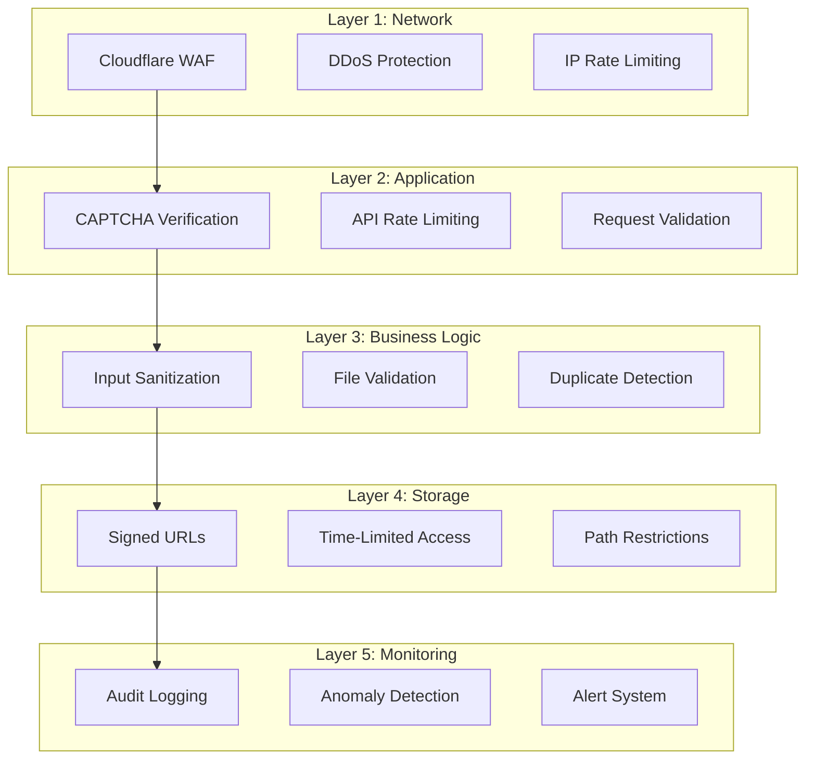

# Security Implementation Guide

## Overview

This document provides comprehensive security measures for the guest booking system with signed URLs. It covers rate limiting, CAPTCHA integration, input validation, and monitoring strategies to protect against common vulnerabilities.

## Security Architecture

### Defense in Depth Strategy



## Rate Limiting Implementation

### Redis-Based Rate Limiting

```typescript
// lib/rate-limit.ts
import { Redis } from "@upstash/redis";
import { Ratelimit } from "@upstash/ratelimit";
import { headers } from "next/headers";

const redis = new Redis({
  url: process.env.UPSTASH_REDIS_REST_URL!,
  token: process.env.UPSTASH_REDIS_REST_TOKEN!,
});

// Create rate limiters with different configurations
export const rateLimiters = {
  // Guest booking: 5 requests per hour
  guestBooking: new Ratelimit({
    redis,
    limiter: Ratelimit.slidingWindow(5, "1 h"),
    analytics: true,
    prefix: "guest-booking",
  }),

  // File upload: 10 uploads per hour
  fileUpload: new Ratelimit({
    redis,
    limiter: Ratelimit.slidingWindow(10, "1 h"),
    analytics: true,
    prefix: "file-upload",
  }),

  // Status check: 20 requests per hour
  statusCheck: new Ratelimit({
    redis,
    limiter: Ratelimit.slidingWindow(20, "1 h"),
    analytics: true,
    prefix: "status-check",
  }),

  // Email verification: 3 requests per hour
  emailVerification: new Ratelimit({
    redis,
    limiter: Ratelimit.slidingWindow(3, "1 h"),
    analytics: true,
    prefix: "email-verify",
  }),
};

// Get identifier from request
export async function getIdentifier(): Promise<string> {
  const headersList = headers();

  // Try to get real IP from various headers
  const forwardedFor = headersList.get("x-forwarded-for");
  const realIp = headersList.get("x-real-ip");
  const cfConnectingIp = headersList.get("cf-connecting-ip");

  // Priority: CF > X-Real-IP > X-Forwarded-For > fallback
  const ip = cfConnectingIp || realIp || forwardedFor?.split(",")[0] || "anonymous";

  return ip;
}

// Rate limit middleware
export async function checkRateLimit(
  limiter: keyof typeof rateLimiters,
  identifier?: string
): Promise<{ success: boolean; limit: number; remaining: number; reset: Date }> {
  const id = identifier || (await getIdentifier());
  const { success, limit, remaining, reset } = await rateLimiters[limiter].limit(id);

  return {
    success,
    limit,
    remaining,
    reset: new Date(reset),
  };
}

// Advanced fingerprinting for better identification
export async function getAdvancedFingerprint(req: Request): Promise<string> {
  const headers = req.headers;
  const ip = await getIdentifier();

  // Combine multiple factors for fingerprinting
  const factors = [
    ip,
    headers.get("user-agent") || "",
    headers.get("accept-language") || "",
    headers.get("accept-encoding") || "",
  ];

  // Create a hash of the factors
  const encoder = new TextEncoder();
  const data = encoder.encode(factors.join("|"));
  const hashBuffer = await crypto.subtle.digest("SHA-256", data);
  const hashArray = Array.from(new Uint8Array(hashBuffer));
  const hashHex = hashArray.map((b) => b.toString(16).padStart(2, "0")).join("");

  return hashHex;
}
```

### API Endpoint Protection

```typescript
// app/api/guest-booking/route.ts (partial)
import { checkRateLimit } from "@/lib/rate-limit";

export async function POST(req: Request) {
  try {
    // Check rate limit
    const rateLimitResult = await checkRateLimit("guestBooking");

    if (!rateLimitResult.success) {
      return NextResponse.json(
        {
          error: "Too many requests",
          retryAfter: rateLimitResult.reset,
          limit: rateLimitResult.limit,
          remaining: 0,
        },
        {
          status: 429,
          headers: {
            "X-RateLimit-Limit": rateLimitResult.limit.toString(),
            "X-RateLimit-Remaining": "0",
            "X-RateLimit-Reset": rateLimitResult.reset.toISOString(),
            "Retry-After": Math.ceil(
              (rateLimitResult.reset.getTime() - Date.now()) / 1000
            ).toString(),
          },
        }
      );
    }

    // Continue with request processing...
  } catch (error) {
    console.error("Rate limit error:", error);
    // Continue without rate limiting if Redis is down
  }
}
```

## CAPTCHA Integration

### Google reCAPTCHA v3 Setup

```typescript
// lib/captcha.ts
export interface CaptchaVerificationResult {
  success: boolean;
  score?: number;
  action?: string;
  challenge_ts?: string;
  hostname?: string;
  "error-codes"?: string[];
}

export async function verifyCaptcha(
  token: string,
  action: string = "guest_booking"
): Promise<CaptchaVerificationResult> {
  const secret = process.env.RECAPTCHA_SECRET_KEY;

  if (!secret) {
    console.error("RECAPTCHA_SECRET_KEY not configured");
    return { success: false, "error-codes": ["missing-secret"] };
  }

  try {
    const response = await fetch("https://www.google.com/recaptcha/api/siteverify", {
      method: "POST",
      headers: {
        "Content-Type": "application/x-www-form-urlencoded",
      },
      body: new URLSearchParams({
        secret,
        response: token,
      }),
    });

    const data: CaptchaVerificationResult = await response.json();

    // For reCAPTCHA v3, check score threshold
    if (data.success && data.score !== undefined) {
      // Adjust threshold based on your needs (0.5 is moderate)
      const threshold = parseFloat(process.env.RECAPTCHA_SCORE_THRESHOLD || "0.5");
      data.success = data.score >= threshold;
    }

    // Verify action matches
    if (data.success && data.action !== action) {
      data.success = false;
      data["error-codes"] = ["action-mismatch"];
    }

    return data;
  } catch (error) {
    console.error("CAPTCHA verification error:", error);
    return {
      success: false,
      "error-codes": ["network-error"],
    };
  }
}

// Alternative: hCaptcha implementation
export async function verifyHCaptcha(token: string): Promise<boolean> {
  const secret = process.env.HCAPTCHA_SECRET_KEY;

  if (!secret) {
    console.error("HCAPTCHA_SECRET_KEY not configured");
    return false;
  }

  try {
    const response = await fetch("https://hcaptcha.com/siteverify", {
      method: "POST",
      headers: {
        "Content-Type": "application/x-www-form-urlencoded",
      },
      body: new URLSearchParams({
        secret,
        response: token,
      }),
    });

    const data = await response.json();
    return data.success === true;
  } catch (error) {
    console.error("hCaptcha verification error:", error);
    return false;
  }
}
```

### Frontend CAPTCHA Integration

```tsx
// components/guest-booking/CaptchaProtectedForm.tsx
import { useGoogleReCaptcha } from "react-google-recaptcha-v3";

export function CaptchaProtectedForm({ children, onSubmit }: Props) {
  const { executeRecaptcha } = useGoogleReCaptcha();
  const [isVerifying, setIsVerifying] = useState(false);

  const handleSubmit = async (data: any) => {
    if (!executeRecaptcha) {
      console.error("reCAPTCHA not loaded");
      return;
    }

    setIsVerifying(true);

    try {
      // Get CAPTCHA token
      const captchaToken = await executeRecaptcha("guest_booking");

      // Include token with form submission
      const submitData = {
        ...data,
        captchaToken,
      };

      await onSubmit(submitData);
    } catch (error) {
      console.error("CAPTCHA error:", error);
    } finally {
      setIsVerifying(false);
    }
  };

  return (
    <form onSubmit={handleSubmit}>
      {children}
      {isVerifying && (
        <div className="text-sm text-muted-foreground">Verifying security check...</div>
      )}
    </form>
  );
}
```

## Input Validation & Sanitization

### Comprehensive Validation Schema

```typescript
// lib/validation/guest-booking.ts
import { z } from "zod";
import DOMPurify from "isomorphic-dompurify";
import validator from "validator";

// Philippine phone number regex
const phPhoneRegex = /^(\+63|0)?9\d{9}$/;

// Custom validators
const sanitizeString = (val: string) => {
  return DOMPurify.sanitize(val, {
    ALLOWED_TAGS: [],
    ALLOWED_ATTR: [],
  });
};

const validatePhoneNumber = (phone: string) => {
  // Remove spaces and dashes
  const cleaned = phone.replace(/[\s-]/g, "");
  return phPhoneRegex.test(cleaned) || validator.isMobilePhone(cleaned);
};

// Guest information schema
export const guestInfoSchema = z.object({
  first_name: z
    .string()
    .min(2, "First name must be at least 2 characters")
    .max(50, "First name must be less than 50 characters")
    .transform(sanitizeString)
    .refine((val) => /^[a-zA-Z\s'-]+$/.test(val), "First name contains invalid characters"),

  last_name: z
    .string()
    .min(2, "Last name must be at least 2 characters")
    .max(50, "Last name must be less than 50 characters")
    .transform(sanitizeString)
    .refine((val) => /^[a-zA-Z\s'-]+$/.test(val), "Last name contains invalid characters"),

  email: z
    .string()
    .email("Invalid email address")
    .toLowerCase()
    .refine((email) => !email.includes("+"), "Email addresses with + are not allowed")
    .refine(async (email) => {
      // Check against disposable email domains
      const domain = email.split("@")[1];
      const disposableDomains = await getDisposableDomains();
      return !disposableDomains.includes(domain);
    }, "Disposable email addresses are not allowed"),

  phone: z
    .string()
    .transform((val) => val.replace(/[\s-]/g, ""))
    .refine(validatePhoneNumber, "Invalid phone number"),

  notes: z
    .string()
    .max(500, "Notes must be less than 500 characters")
    .transform(sanitizeString)
    .optional(),
});

// Booking details schema
export const bookingDetailsSchema = z.object({
  unit_id: z.string().uuid("Invalid unit ID"),

  check_in_date: z
    .string()
    .datetime()
    .refine((date) => new Date(date) >= new Date(), "Check-in date must be in the future"),

  check_out_date: z.string().datetime(),

  guest_count: z
    .number()
    .int()
    .min(1, "At least 1 guest required")
    .max(20, "Maximum 20 guests allowed"),

  payment_amount: z
    .number()
    .positive("Payment amount must be positive")
    .max(1000000, "Payment amount exceeds maximum"),

  payment_method: z.enum(["gcash", "bank_transfer", "credit_card", "cash", "maya", "paypal"]),
});

// Combined schema for guest booking
export const guestBookingSchema = z
  .object({
    guest: guestInfoSchema,
    booking: bookingDetailsSchema,
    captchaToken: z.string(),
    termsAccepted: z.literal(true, {
      errorMap: () => ({ message: "You must accept the terms and conditions" }),
    }),
  })
  .refine(
    (data) => {
      const checkIn = new Date(data.booking.check_in_date);
      const checkOut = new Date(data.booking.check_out_date);
      return checkOut > checkIn;
    },
    {
      message: "Check-out date must be after check-in date",
      path: ["booking", "check_out_date"],
    }
  );

// File validation schema
export const fileUploadSchema = z.object({
  file: z
    .instanceof(File)
    .refine((file) => file.size <= 5 * 1024 * 1024, "File size must be less than 5MB")
    .refine((file) => {
      const allowedTypes = [
        "image/jpeg",
        "image/jpg",
        "image/png",
        "image/webp",
        "application/pdf",
      ];
      return allowedTypes.includes(file.type);
    }, "File must be an image (JPEG, PNG, WebP) or PDF"),
});
```

### SQL Injection Prevention

```typescript
// lib/database/secure-queries.ts
import { createClient } from "@supabase/supabase-js";

// NEVER do this - vulnerable to SQL injection
// const query = `SELECT * FROM bookings WHERE email = '${userInput}'`

// ALWAYS use parameterized queries
export async function findGuestBookings(supabase: ReturnType<typeof createClient>, email: string) {
  // Supabase client automatically parameterizes queries
  const { data, error } = await supabase
    .from("bookings")
    .select("*")
    .eq("email", email) // Safe - parameter is escaped
    .eq("is_guest_booking", true);

  return { data, error };
}

// For raw SQL, use parameterized queries
export async function searchBookings(
  supabase: ReturnType<typeof createClient>,
  searchTerm: string
) {
  // Use RPC with parameters for complex queries
  const { data, error } = await supabase.rpc("search_bookings", {
    search_term: searchTerm, // Parameter is safely escaped
  });

  return { data, error };
}
```

## File Upload Security

### File Validation & Scanning

```typescript
// lib/file-security.ts
import { createHash } from "crypto";
import sharp from "sharp";
import pdf from "pdf-parse";

export interface FileValidationResult {
  valid: boolean;
  errors: string[];
  metadata?: {
    size: number;
    type: string;
    hash: string;
    dimensions?: { width: number; height: number };
  };
}

export async function validateUploadedFile(file: File): Promise<FileValidationResult> {
  const errors: string[] = [];

  // Size validation
  const maxSize = 5 * 1024 * 1024; // 5MB
  if (file.size > maxSize) {
    errors.push(`File size (${file.size} bytes) exceeds maximum of ${maxSize} bytes`);
  }

  // Type validation
  const allowedMimeTypes = [
    "image/jpeg",
    "image/jpg",
    "image/png",
    "image/webp",
    "application/pdf",
  ];

  if (!allowedMimeTypes.includes(file.type)) {
    errors.push(`File type ${file.type} is not allowed`);
  }

  // Read file buffer
  const buffer = await file.arrayBuffer();
  const bytes = new Uint8Array(buffer);

  // Verify file signature (magic numbers)
  const signatures = {
    jpeg: [0xff, 0xd8, 0xff],
    png: [0x89, 0x50, 0x4e, 0x47],
    pdf: [0x25, 0x50, 0x44, 0x46],
    webp: [0x52, 0x49, 0x46, 0x46],
  };

  let validSignature = false;
  for (const [format, signature] of Object.entries(signatures)) {
    if (signature.every((byte, index) => bytes[index] === byte)) {
      validSignature = true;
      break;
    }
  }

  if (!validSignature) {
    errors.push("File signature does not match declared type");
  }

  // Calculate file hash
  const hash = createHash("sha256").update(Buffer.from(buffer)).digest("hex");

  // Additional validation for images
  let dimensions: { width: number; height: number } | undefined;

  if (file.type.startsWith("image/") && file.type !== "image/webp") {
    try {
      const image = sharp(Buffer.from(buffer));
      const metadata = await image.metadata();

      if (metadata.width && metadata.height) {
        dimensions = { width: metadata.width, height: metadata.height };

        // Check for reasonable dimensions
        if (metadata.width > 10000 || metadata.height > 10000) {
          errors.push("Image dimensions are too large");
        }

        if (metadata.width < 10 || metadata.height < 10) {
          errors.push("Image dimensions are too small");
        }
      }

      // Check for potentially malicious content
      if (metadata.exif) {
        // Strip EXIF data for security
        await image.rotate().toBuffer();
      }
    } catch (error) {
      errors.push("Failed to process image file");
    }
  }

  // Additional validation for PDFs
  if (file.type === "application/pdf") {
    try {
      const pdfData = await pdf(Buffer.from(buffer));

      // Check for reasonable page count
      if (pdfData.numpages > 10) {
        errors.push("PDF has too many pages");
      }

      // Check for embedded JavaScript (potential security risk)
      if (pdfData.text.includes("/JavaScript") || pdfData.text.includes("/JS")) {
        errors.push("PDF contains potentially dangerous content");
      }
    } catch (error) {
      errors.push("Failed to process PDF file");
    }
  }

  return {
    valid: errors.length === 0,
    errors,
    metadata: {
      size: file.size,
      type: file.type,
      hash,
      dimensions,
    },
  };
}

// Virus scanning integration (optional)
export async function scanFileForVirus(file: File): Promise<{ safe: boolean; threats?: string[] }> {
  // Integration with VirusTotal or similar service
  // This is a placeholder - implement based on your chosen service

  if (process.env.VIRUSTOTAL_API_KEY) {
    try {
      const formData = new FormData();
      formData.append("file", file);

      const response = await fetch("https://www.virustotal.com/api/v3/files", {
        method: "POST",
        headers: {
          "x-apikey": process.env.VIRUSTOTAL_API_KEY,
        },
        body: formData,
      });

      if (response.ok) {
        const data = await response.json();
        // Parse and return scan results
        return { safe: true };
      }
    } catch (error) {
      console.error("Virus scan failed:", error);
    }
  }

  // If scanning is not available, proceed with caution
  return { safe: true };
}
```

## Monitoring & Logging

### Audit Logging System

```typescript
// lib/audit-log.ts
import { createClient } from "@supabase/supabase-js";

export enum AuditAction {
  GUEST_BOOKING_CREATED = "guest_booking_created",
  FILE_UPLOADED = "file_uploaded",
  RATE_LIMIT_EXCEEDED = "rate_limit_exceeded",
  CAPTCHA_FAILED = "captcha_failed",
  VALIDATION_FAILED = "validation_failed",
  SUSPICIOUS_ACTIVITY = "suspicious_activity",
}

export interface AuditLogEntry {
  action: AuditAction;
  actor_type: "guest" | "user" | "system";
  actor_id?: string;
  actor_ip: string;
  resource_type?: string;
  resource_id?: string;
  metadata?: Record<string, any>;
  user_agent?: string;
  severity: "info" | "warning" | "error" | "critical";
}

export async function logAuditEvent(
  supabase: ReturnType<typeof createClient>,
  entry: AuditLogEntry
): Promise<void> {
  try {
    const { error } = await supabase.from("audit_logs").insert({
      ...entry,
      created_at: new Date().toISOString(),
    });

    if (error) {
      console.error("Failed to write audit log:", error);
    }

    // For critical events, also send to external monitoring
    if (entry.severity === "critical") {
      await sendToMonitoring(entry);
    }
  } catch (error) {
    console.error("Audit logging error:", error);
  }
}

// Integration with monitoring service
async function sendToMonitoring(entry: AuditLogEntry): Promise<void> {
  // Send to Sentry, DataDog, or other monitoring service
  if (process.env.SENTRY_DSN) {
    const Sentry = await import("@sentry/node");
    Sentry.captureMessage(`Critical audit event: ${entry.action}`, {
      level: "error",
      extra: entry,
    });
  }
}

// Anomaly detection
export async function checkForAnomalies(
  supabase: ReturnType<typeof createClient>,
  ip: string
): Promise<boolean> {
  // Check for suspicious patterns
  const recentLogs = await supabase
    .from("audit_logs")
    .select("*")
    .eq("actor_ip", ip)
    .gte("created_at", new Date(Date.now() - 3600000).toISOString()) // Last hour
    .order("created_at", { ascending: false });

  if (!recentLogs.data) return false;

  // Detection rules
  const suspiciousPatterns = [
    // Multiple failed attempts
    recentLogs.data.filter(
      (log) =>
        log.action === AuditAction.CAPTCHA_FAILED || log.action === AuditAction.VALIDATION_FAILED
    ).length > 5,

    // Rapid requests
    recentLogs.data.length > 50,

    // Multiple different emails from same IP
    new Set(recentLogs.data.filter((log) => log.metadata?.email).map((log) => log.metadata.email))
      .size > 3,
  ];

  return suspiciousPatterns.some((pattern) => pattern === true);
}
```

## Security Headers

```typescript
// middleware.ts
import { NextResponse } from "next/server";
import type { NextRequest } from "next/server";

export function middleware(request: NextRequest) {
  const response = NextResponse.next();

  // Security headers
  response.headers.set("X-Content-Type-Options", "nosniff");
  response.headers.set("X-Frame-Options", "DENY");
  response.headers.set("X-XSS-Protection", "1; mode=block");
  response.headers.set("Referrer-Policy", "strict-origin-when-cross-origin");

  // Content Security Policy
  const csp = [
    "default-src 'self'",
    "script-src 'self' 'unsafe-inline' 'unsafe-eval' https://www.google.com https://www.gstatic.com",
    "style-src 'self' 'unsafe-inline'",
    "img-src 'self' data: https: blob:",
    "font-src 'self'",
    "connect-src 'self' https://*.supabase.co wss://*.supabase.co",
    "frame-src https://www.google.com",
  ].join("; ");

  response.headers.set("Content-Security-Policy", csp);

  // CORS headers for API routes
  if (request.nextUrl.pathname.startsWith("/api/")) {
    response.headers.set("Access-Control-Allow-Origin", process.env.NEXT_PUBLIC_APP_URL || "*");
    response.headers.set("Access-Control-Allow-Methods", "GET, POST, OPTIONS");
    response.headers.set("Access-Control-Allow-Headers", "Content-Type, Authorization");
  }

  return response;
}

export const config = {
  matcher: ["/((?!_next/static|_next/image|favicon.ico).*)"],
};
```

## Security Testing

### Penetration Testing Checklist

```bash
# 1. Rate Limiting Tests
curl -X POST http://localhost:3000/api/guest-booking \
  -H "Content-Type: application/json" \
  -d '{"test": "data"}' \
  --verbose \
  --repeat 10

# 2. File Upload Tests
# Test oversized file
dd if=/dev/zero of=large.jpg bs=1M count=10
curl -X POST http://localhost:3000/api/upload \
  -F "file=@large.jpg"

# Test wrong file type
echo "malicious code" > test.exe
curl -X POST http://localhost:3000/api/upload \
  -F "file=@test.exe"

# 3. SQL Injection Tests
curl -X GET "http://localhost:3000/api/guest-booking/status?email='; DROP TABLE bookings; --"

# 4. XSS Tests
curl -X POST http://localhost:3000/api/guest-booking \
  -H "Content-Type: application/json" \
  -d '{"notes": "<script>alert('XSS')</script>"}'

# 5. CAPTCHA Bypass Tests
curl -X POST http://localhost:3000/api/guest-booking \
  -H "Content-Type: application/json" \
  -d '{"captchaToken": "invalid_token"}'
```

### Security Monitoring Dashboard

```sql
-- Create views for security monitoring
CREATE OR REPLACE VIEW security_metrics AS
SELECT
  DATE_TRUNC('hour', created_at) as hour,
  action,
  severity,
  COUNT(*) as event_count,
  COUNT(DISTINCT actor_ip) as unique_ips
FROM audit_logs
WHERE created_at >= NOW() - INTERVAL '24 hours'
GROUP BY hour, action, severity
ORDER BY hour DESC, severity DESC;

-- Suspicious activity detection
CREATE OR REPLACE VIEW suspicious_activity AS
SELECT
  actor_ip,
  COUNT(*) as total_events,
  COUNT(DISTINCT action) as different_actions,
  COUNT(CASE WHEN severity IN ('error', 'critical') THEN 1 END) as error_count,
  MAX(created_at) as last_activity
FROM audit_logs
WHERE created_at >= NOW() - INTERVAL '1 hour'
GROUP BY actor_ip
HAVING
  COUNT(*) > 20 OR
  COUNT(CASE WHEN severity IN ('error', 'critical') THEN 1 END) > 5
ORDER BY total_events DESC;
```

## Security Incident Response

### Response Plan

1. **Detection**
   - Monitor audit logs for suspicious patterns
   - Set up alerts for critical events
   - Regular security scans

2. **Containment**
   - Automatic IP blocking for severe violations
   - Temporary increase in rate limits
   - Disable affected features if necessary

3. **Investigation**
   - Review audit logs
   - Analyze attack patterns
   - Identify affected data

4. **Recovery**
   - Patch vulnerabilities
   - Reset affected user sessions
   - Notify affected users if required

5. **Post-Incident**
   - Document lessons learned
   - Update security measures
   - Improve detection rules

## Security Compliance Checklist

- [ ] GDPR compliance for EU guests
- [ ] PCI compliance for payment data (if storing card details)
- [ ] Data retention policies implemented
- [ ] Privacy policy updated
- [ ] Cookie consent implemented
- [ ] Right to deletion process
- [ ] Data breach notification process
- [ ] Regular security audits scheduled
- [ ] Penetration testing completed
- [ ] Security training for staff

## Conclusion

This comprehensive security implementation provides multiple layers of protection for the guest booking system. Regular monitoring, testing, and updates are essential to maintain security effectiveness.

---

_Document Version: 1.0.0_
_Last Updated: January 2025_
_Next Security Review: April 2025_
