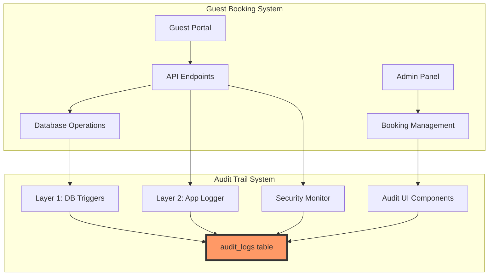
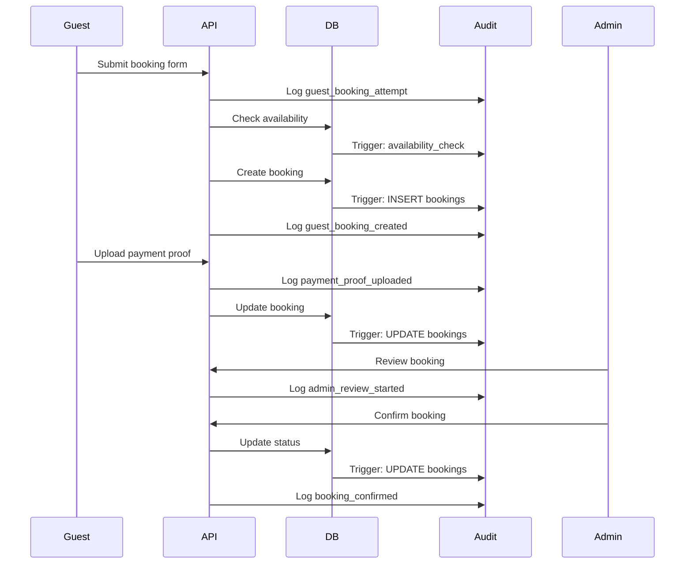

# Guest Booking System - Audit Trail Integration Guide

## Overview

This guide provides a comprehensive overview of how the guest booking system integrates with the implemented audit trail system (Phases 1-3C). The integration provides complete visibility into guest booking workflows, security monitoring, and compliance tracking.

## Integration Architecture



## Key Integration Points

### 1. Database-Level Integration

All guest booking database operations are **automatically captured** by audit triggers:

```sql
-- These operations are automatically logged:
INSERT INTO guests (...) -- New guest registration
INSERT INTO bookings (...) -- Guest booking creation
UPDATE bookings SET booking_status = 'Confirmed' -- Status changes
UPDATE bookings SET check_in_date = '...' -- Date adjustments
INSERT INTO payments (...) -- Payment records
```

**No additional code required** - triggers are already installed and active.

### 2. Application-Level Integration

Guest booking API endpoints use the audit logger for enriched context:

```typescript
// In Cloudflare Worker functions
import { logAuditEventWithIp } from "@/lib/audit-logger-workers";

// Log guest booking with context
await logAuditEventWithIp(
  {
    action: EventType.guest_booking_created,
    category: AuditCategory.BOOKING,
    severity: AuditSeverity.INFO,
    description: `Guest booking created: ${bookingReference}`,
    metadata: {
      booking_id: booking.booking_id,
      is_guest_booking: true,
      source: "guest_portal",
      // Sensitive data will be automatically redacted
      guest_email: email
    }
  },
  request.headers.get("CF-Connecting-IP"),
  request.headers.get("User-Agent")
);
```

### 3. UI Integration

Admin interfaces leverage audit components for viewing guest booking history:

```typescript
// View audit trail for a specific booking
import { AuditLogViewer } from "@/components/audit/AuditLogViewer";
import { useAuditStore } from "@/stores/useAuditStore";

export function GuestBookingAuditTab({ bookingId }: { bookingId: string }) {
  const { setFilters } = useAuditStore();

  useEffect(() => {
    setFilters({
      table: 'bookings',
      recordId: bookingId
    });
  }, [bookingId]);

  return <AuditLogViewer />;
}
```

## Guest Booking Workflow with Audit Points

### Complete Workflow Timeline



### Audit Events at Each Step

| Step | Database Audit | Application Audit | Metadata Captured |
|------|----------------|-------------------|-------------------|
| 1. Guest submits form | - | `guest_booking_attempt` | IP, dates, unit |
| 2. Availability check | - | `availability_check` | Unit, dates, result |
| 3. Booking created | `INSERT bookings` | `guest_booking_created` | Full booking record |
| 4. Upload initiated | - | `signed_url_generated` | Expiry, path |
| 5. Payment uploaded | - | `payment_proof_uploaded` | File metadata |
| 6. Booking updated | `UPDATE bookings` | - | Changed fields |
| 7. Admin reviews | - | `admin_review_started` | Admin ID, timestamp |
| 8. Admin confirms | `UPDATE bookings` | `booking_confirmed` | Status change |

## Security Monitoring Integration

### Threat Detection

The audit trail enables real-time threat detection for guest bookings:

```typescript
// Detect suspicious patterns
export async function monitorGuestBookingThreats(ip: string) {
  const { data: auditLogs } = await supabase
    .from("audit_logs")
    .select("*")
    .eq("ip_address", ip)
    .gte("created_at", new Date(Date.now() - 3600000).toISOString());

  const threats = detectPatterns(auditLogs);

  if (threats.score > 75) {
    await logAuditEvent({
      action: EventType.security_threat_detected,
      category: AuditCategory.SYSTEM,
      severity: AuditSeverity.CRITICAL,
      metadata: { ip, threats }
    });

    await blockIP(ip);
  }
}
```

### Security Dashboard

```typescript
// Security monitoring for guest bookings
export function GuestBookingSecurityDashboard() {
  const { data: securityEvents } = useAuditLogs({
    filters: {
      metadata: { source: 'guest_portal' },
      severity: ['WARNING', 'CRITICAL'],
      dateFrom: new Date(Date.now() - 86400000) // Last 24h
    }
  });

  return (
    <Dashboard>
      <MetricCard
        title="Failed Guest Bookings"
        value={countFailures(securityEvents)}
        trend={calculateTrend(securityEvents)}
      />
      <ThreatMap events={securityEvents} />
      <AlertList events={filterCritical(securityEvents)} />
    </Dashboard>
  );
}
```

## Admin Features

### 1. Guest Booking Audit Viewer

```typescript
// Complete audit trail for guest bookings
export function GuestBookingAuditViewer() {
  const { data: auditLogs } = useAuditLogs({
    filters: {
      table: 'bookings',
      metadata: { is_guest_booking: true }
    }
  });

  return (
    <div>
      <AuditFilters />
      <AuditLogViewer />
      <AuditExporter filename="guest-bookings-audit.csv" />
    </div>
  );
}
```

### 2. Quick Filters for Guest Bookings

```typescript
const guestBookingFilters = [
  {
    label: "Today's Guest Submissions",
    filter: {
      table: 'bookings',
      metadata: { source: 'guest_portal' },
      dateFrom: today()
    }
  },
  {
    label: "Pending Guest Reviews",
    filter: {
      table: 'bookings',
      metadata: {
        is_guest_booking: true,
        booking_status: 'Pending'
      }
    }
  },
  {
    label: "Failed Guest Bookings",
    filter: {
      action: 'guest_booking_failed',
      severity: 'WARNING'
    }
  }
];
```

### 3. Timeline Visualization

```typescript
// Visual timeline for guest booking lifecycle
export function GuestBookingTimeline({ bookingId }: { bookingId: string }) {
  const { data: events } = useAuditLogs({
    filters: { recordId: bookingId }
  });

  return (
    <Timeline>
      {events?.map(event => (
        <TimelineItem
          key={event.audit_id}
          timestamp={event.created_at}
          action={event.action}
          description={event.description}
          severity={event.severity}
          user={event.user_email || 'Guest'}
          icon={getEventIcon(event.action)}
        />
      ))}
    </Timeline>
  );
}
```

## Common Queries

### Find Guest Booking History

```sql
-- All events for a specific guest booking
SELECT
  created_at,
  action,
  description,
  user_email,
  metadata
FROM audit_logs
WHERE
  (table_name = 'bookings' AND record_id = '<booking_id>') OR
  (metadata->>'booking_id' = '<booking_id>')
ORDER BY created_at ASC;
```

### Track Guest Activity

```sql
-- All bookings from a specific guest email
SELECT DISTINCT
  metadata->>'booking_reference' as booking_ref,
  MIN(created_at) as first_action,
  MAX(created_at) as last_action,
  COUNT(*) as event_count
FROM audit_logs
WHERE
  metadata->>'guest_email' = '<email>' OR
  new_data->>'email' = '<email>'
GROUP BY metadata->>'booking_reference'
ORDER BY MIN(created_at) DESC;
```

### Identify Problem Patterns

```sql
-- Failed bookings by IP address
SELECT
  ip_address,
  COUNT(*) as failure_count,
  ARRAY_AGG(DISTINCT metadata->>'error_type') as error_types,
  MIN(created_at) as first_failure,
  MAX(created_at) as last_failure
FROM audit_logs
WHERE
  action IN ('guest_booking_failed', 'rate_limit_exceeded', 'captcha_failed')
  AND created_at > NOW() - INTERVAL '24 hours'
GROUP BY ip_address
HAVING COUNT(*) > 3
ORDER BY failure_count DESC;
```

### Admin Actions on Guest Bookings

```sql
-- Track which admin reviewed/approved guest bookings
SELECT
  user_email as admin,
  action,
  metadata->>'booking_reference' as booking,
  description,
  created_at
FROM audit_logs
WHERE
  metadata->>'is_guest_booking' = 'true' AND
  user_email IS NOT NULL
ORDER BY created_at DESC;
```

## Performance Optimization

### 1. Efficient Querying

```typescript
// Use indexed fields for fast queries
const efficientQuery = {
  // Good - uses indexes
  table: 'bookings',
  created_at: { gte: yesterday },

  // Avoid - requires full scan
  metadata: {
    complex_nested_field: value // Slower
  }
};
```

### 2. Batch Operations

```typescript
// Batch audit log writes for bulk operations
const batchAuditLogs = async (events: AuditEvent[]) => {
  // Group events by type for efficient processing
  const grouped = groupBy(events, 'action');

  // Write in parallel with controlled concurrency
  await Promise.all(
    Object.entries(grouped).map(([action, events]) =>
      logBatchEvents(action, events)
    )
  );
};
```

### 3. Caching Strategy

```typescript
// Cache audit queries with React Query
export function useGuestBookingAudit(bookingId: string) {
  return useQuery({
    queryKey: ['guest-booking-audit', bookingId],
    queryFn: () => fetchAuditLogs({ recordId: bookingId }),
    staleTime: 5 * 60 * 1000, // 5 minutes
    cacheTime: 30 * 60 * 1000, // 30 minutes
  });
}
```

## Compliance & Reporting

### GDPR Compliance

```typescript
// Export guest data for GDPR requests
export async function exportGuestAuditData(email: string) {
  const { data } = await supabase
    .from("audit_logs")
    .select("*")
    .or(`metadata->>'guest_email'.eq.${email},new_data->>'email'.eq.${email}`)
    .csv();

  return sanitizeForExport(data);
}

// Delete guest data for right to erasure
export async function deleteGuestAuditData(email: string) {
  // Soft delete - mark as redacted
  await supabase
    .from("audit_logs")
    .update({
      metadata: { ...metadata, guest_email: '[DELETED]' },
      old_data: redactPII(old_data),
      new_data: redactPII(new_data)
    })
    .or(`metadata->>'guest_email'.eq.${email}`);
}
```

### Compliance Reports

```typescript
// Generate compliance report for auditors
export async function generateComplianceReport(dateRange: DateRange) {
  const report = {
    guestBookings: await countGuestBookings(dateRange),
    securityEvents: await countSecurityEvents(dateRange),
    adminActions: await countAdminActions(dateRange),
    dataRetention: await checkRetentionCompliance(dateRange),
    piiRedaction: await verifyPIIRedaction(dateRange)
  };

  return formatReport(report);
}
```

## Troubleshooting

### Common Issues

**Issue: Audit logs not appearing for guest bookings**
- Verify database triggers are installed: `SELECT * FROM information_schema.triggers`
- Check application logger is imported correctly
- Ensure Supabase service role key has INSERT permission on audit_logs

**Issue: PII visible in audit logs**
- Review `SENSITIVE_FIELDS` configuration in `audit-constants.ts`
- Ensure redaction function is applied before logging
- Check database trigger redaction logic

**Issue: Performance degradation with audit queries**
- Check indexes on audit_logs table
- Use date range filters to limit result set
- Consider partitioning for high-volume environments

**Issue: Audit logs growing too large**
- Implement retention policy (90 days standard)
- Archive old logs to cold storage
- Use database partitioning by month

## Best Practices

### 1. Consistent Event Naming

```typescript
// Use consistent naming convention
const eventNames = {
  // Pattern: entity_action_result
  guest_booking_created: 'guest_booking_created',
  guest_booking_failed: 'guest_booking_failed',
  payment_proof_uploaded: 'payment_proof_uploaded',
  payment_proof_rejected: 'payment_proof_rejected'
};
```

### 2. Meaningful Descriptions

```typescript
// Provide clear, actionable descriptions
await logAuditEvent({
  action: 'guest_booking_failed',
  description: `Guest booking failed: Unit ${unitId} unavailable for dates ${checkIn} to ${checkOut}`,
  // Not just: "Booking failed"
});
```

### 3. Structured Metadata

```typescript
// Use consistent metadata structure
const metadata = {
  // Always include these for guest bookings
  booking_id: string,
  booking_reference: string,
  is_guest_booking: true,
  source: 'guest_portal',

  // Optional contextual data
  unit_id?: string,
  error_type?: string,
  ip_address?: string
};
```

### 4. Security-First Logging

```typescript
// Always redact sensitive data
const safeMetadata = {
  guest_email: '[REDACTED]',
  guest_phone: '[REDACTED]',
  payment_details: '[REDACTED]',
  // But keep non-sensitive identifiers
  booking_id: booking.id,
  booking_reference: booking.reference
};
```

## Migration from Existing System

If migrating from a system without audit trails:

### 1. Historical Data Import

```sql
-- Create historical audit entries for existing bookings
INSERT INTO audit_logs (
  table_name,
  record_id,
  action,
  new_data,
  created_at,
  description,
  metadata
)
SELECT
  'bookings' as table_name,
  booking_id as record_id,
  'historical_import' as action,
  row_to_json(bookings.*) as new_data,
  created_at,
  'Historical booking imported' as description,
  jsonb_build_object(
    'is_guest_booking', is_guest_booking,
    'import_date', NOW(),
    'import_source', 'migration'
  ) as metadata
FROM bookings
WHERE is_guest_booking = true;
```

### 2. Gradual Rollout

```typescript
// Feature flag for audit logging
const AUDIT_ENABLED = process.env.ENABLE_AUDIT_LOGGING === 'true';

export async function logGuestBookingEvent(event: AuditEvent) {
  if (!AUDIT_ENABLED) return;

  await logAuditEvent(event);
}
```

## Summary

The guest booking system's integration with the audit trail provides:

1. **Complete Visibility**: Every action from submission to checkout is tracked
2. **Security Monitoring**: Real-time threat detection and automated responses
3. **Compliance Ready**: GDPR-compliant with PII redaction and retention policies
4. **Debugging Power**: Complete timeline for troubleshooting issues
5. **Admin Insights**: Comprehensive dashboards and reporting tools
6. **Zero Additional Cost**: Leverages existing audit infrastructure

The integration requires minimal code changes while providing enterprise-grade audit capabilities for the guest booking workflow.

---

_Document Version: 1.0.0_
_Last Updated: January 2025_
_Related: [Audit Trail Documentation](../audit-trail/README.md) | [Guest Booking System](./01-master-plan.md)_