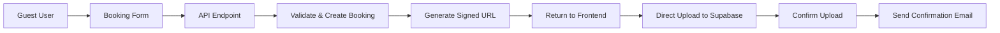

# Guest Booking System Documentation

## Overview

This documentation covers the implementation of a secure guest booking system that allows unauthenticated users to submit booking requests with payment proofs using Supabase's signed URL functionality.

## 📚 Documentation Structure

1. **[Master Plan](./01-master-plan.md)** - System architecture and high-level design
2. **[Backend Implementation](./02-backend-implementation.md)** - Server-side API and signed URL generation
3. **[Frontend Implementation](./03-frontend-implementation.md)** - Guest booking forms and upload flow
4. **[Security Implementation](./04-security-implementation.md)** - Security measures and validation
5. **[API Reference](./05-api-reference.md)** - Complete API endpoint documentation

## 🎯 Key Features

- **No Authentication Required**: Guests can book without creating accounts
- **Secure File Uploads**: Payment proofs uploaded via time-limited signed URLs
- **Private Storage**: Files remain secure in private Supabase buckets
- **Email Confirmation**: Automatic booking confirmations with receipt links
- **Status Tracking**: Guests can check booking status with reference number

## 🚀 Quick Start

### Prerequisites

- Supabase project with storage enabled
- Vercel account for serverless functions
- Node.js 18+ and npm/yarn
- Environment variables configured

### Implementation Checklist

- [ ] Set up environment variables including service role key
- [ ] Create API endpoints for guest bookings
- [ ] Implement signed URL generation
- [ ] Build guest booking form
- [ ] Add file upload functionality
- [ ] Configure rate limiting
- [ ] Set up CAPTCHA protection
- [ ] Implement email notifications
- [ ] Create guest status check portal
- [ ] Test end-to-end flow

## 🏗️ Architecture Overview

## 📋 Requirements

### Technical Requirements
- Supabase project with private storage bucket
- Service role key for backend operations
- Vercel or similar serverless platform
- Email service (Resend, SendGrid, etc.)

### Security Requirements
- Rate limiting (5 requests/hour per IP)
- CAPTCHA verification
- File size limits (5MB)
- Allowed file types (JPG, PNG, PDF)

## 🔗 Integration Points

### Existing Systems
- Integrates with current booking database schema
- Uses existing payment status tracking
- Compatible with authenticated user uploads
- Maintains separation between guest and user bookings

### New Components
- Guest booking API endpoints
- Signed URL generation service
- Guest portal pages
- Email notification templates

## 📈 Benefits

1. **Improved Conversion**: No account friction for bookings
2. **Enhanced Security**: Temporary, controlled file access
3. **Better Performance**: Direct uploads to Supabase
4. **Cost Effective**: No bandwidth through your servers
5. **Scalable**: Handles high volume without server load

## ⚠️ Important Considerations

- Signed URLs bypass RLS policies
- Service role key must never be exposed to frontend
- Rate limiting essential to prevent abuse
- Regular monitoring of guest uploads recommended

## 🛠️ Development Timeline

| Phase | Duration | Focus |
|-------|----------|-------|
| Phase 1 | 1 day | Backend API setup |
| Phase 2 | 1 day | Frontend form implementation |
| Phase 3 | 1 day | Security and validation |
| Phase 4 | 1 day | Testing and polish |
| **Total** | **4 days** | **Complete implementation** |

## 📞 Support

For questions or issues related to this implementation:
- Review the [Security Guide](./04-security-implementation.md) for security concerns
- Check the [API Reference](./05-api-reference.md) for endpoint details
- Consult the [Master Plan](./01-master-plan.md) for architecture questions

---

*Last Updated: January 2025*
*Version: 1.0.0*