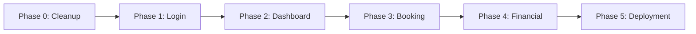

# Master Verification Index - TDD Implementation

## Overview

This master index tracks the progress of all phases in the TDD-first rewrite of
the Okaeri Resort Management System. Each phase follows the RED-GREEN-REFACTOR
cycle with strict verification gates.

## Implementation Status Dashboard

### Overall Progress

```
Phase 0: ████████████████████ 100% ✅ Complete
Phase 1: ░░░░░░░░░░░░░░░░░░░░ 0%   ⏳ Pending
Phase 2: ░░░░░░░░░░░░░░░░░░░░ 0%   ⏳ Pending
Phase 3: ░░░░░░░░░░░░░░░░░░░░ 0%   ⏳ Pending
Phase 4: ░░░░░░░░░░░░░░░░░░░░ 0%   ⏳ Pending
Phase 5: ░░░░░░░░░░░░░░░░░░░░ 0%   ⏳ Pending

Overall: ████░░░░░░░░░░░░░░░░ 16.7%
```

## Phase Status Matrix

| Phase                   | Lead Agent                          | Status      | Tests | Coverage | Quality | Security | Performance | Handoff |
| ----------------------- | ----------------------------------- | ----------- | ----- | -------- | ------- | -------- | ----------- | ------- |
| **Phase 0: Cleanup**    | `context-manager`                   | ✅ Complete | N/A   | N/A      | ✅      | ✅       | N/A         | ✅      |
| **Phase 1: Login**      | `typescript-react-quality-expert`   | ⏳ Pending  | 0/150 | 0%       | ⏳      | ⏳       | ⏳          | ⏳      |
| **Phase 2: Dashboard**  | `zustand-tanstack-resort-architect` | ⏳ Pending  | 0/200 | 0%       | ⏳      | ⏳       | ⏳          | ⏳      |
| **Phase 3: Booking**    | `postgres-serverless-architect`     | ⏳ Pending  | 0/250 | 0%       | ⏳      | ⏳       | ⏳          | ⏳      |
| **Phase 4: Financial**  | `resort-finance-architect`          | ⏳ Pending  | 0/300 | 0%       | ⏳      | ⏳       | ⏳          | ⏳      |
| **Phase 5: Deployment** | `vercel-deployment-optimizer`       | ⏳ Pending  | 0/100 | 0%       | ⏳      | ⏳       | ⏳          | ⏳      |

## TDD Cycle Progress

### Phase 1: Login System

| Sub-Phase                | Stage    | Status         | Completion |
| ------------------------ | -------- | -------------- | ---------- |
| 1.1 Test Auth Flow       | RED      | ⏳ Not Started | 0%         |
| 1.2 Test Form Validation | RED      | ⏳ Not Started | 0%         |
| 1.3 Implement Login      | GREEN    | ⏳ Not Started | 0%         |
| 1.4 Security Review      | REFACTOR | ⏳ Not Started | 0%         |
| 1.5 UI Polish            | REFACTOR | ⏳ Not Started | 0%         |

### Phase 2: Dashboard

| Sub-Phase                    | Stage    | Status         | Completion |
| ---------------------------- | -------- | -------------- | ---------- |
| 2.1 Test Metrics Display     | RED      | ⏳ Not Started | 0%         |
| 2.2 Test Real-time Updates   | RED      | ⏳ Not Started | 0%         |
| 2.3 Implement Dashboard      | GREEN    | ⏳ Not Started | 0%         |
| 2.4 Performance Optimization | REFACTOR | ⏳ Not Started | 0%         |
| 2.5 Verification & Handoff   | VERIFY   | ⏳ Not Started | 0%         |

### Phase 3: Booking System

| Sub-Phase                   | Stage    | Status         | Completion |
| --------------------------- | -------- | -------------- | ---------- |
| 3.1 Test Calendar Component | RED      | ⏳ Not Started | 0%         |
| 3.2 Test Availability Logic | RED      | ⏳ Not Started | 0%         |
| 3.3 Implement Booking       | GREEN    | ⏳ Not Started | 0%         |
| 3.4 Database Integration    | REFACTOR | ⏳ Not Started | 0%         |
| 3.5 Verification & Handoff  | VERIFY   | ⏳ Not Started | 0%         |

### Phase 4: Financial Features

| Sub-Phase                  | Stage    | Status         | Completion |
| -------------------------- | -------- | -------------- | ---------- |
| 4.1 Test Expense Tracking  | RED      | ⏳ Not Started | 0%         |
| 4.2 Test Income Management | RED      | ⏳ Not Started | 0%         |
| 4.3 Implement Financial    | GREEN    | ⏳ Not Started | 0%         |
| 4.4 Reporting & Compliance | REFACTOR | ⏳ Not Started | 0%         |
| 4.5 Verification & Handoff | VERIFY   | ⏳ Not Started | 0%         |

### Phase 5: Production Deployment

| Sub-Phase                    | Stage    | Status         | Completion |
| ---------------------------- | -------- | -------------- | ---------- |
| 5.1 Test Deployment Pipeline | RED      | ⏳ Not Started | 0%         |
| 5.2 Security Hardening       | GREEN    | ⏳ Not Started | 0%         |
| 5.3 Performance Optimization | REFACTOR | ⏳ Not Started | 0%         |
| 5.4 Monitoring Setup         | REFACTOR | ⏳ Not Started | 0%         |
| 5.5 Go-Live Checklist        | VERIFY   | ⏳ Not Started | 0%         |

## Quality Metrics Summary

### Code Quality

| Metric              | Target | Current | Status |
| ------------------- | ------ | ------- | ------ |
| Test Coverage       | >90%   | 0%      | 🔴     |
| TypeScript Coverage | 100%   | 85%     | 🟡     |
| ESLint Issues       | 0      | 0       | 🟢     |
| Tech Debt Ratio     | <5%    | 2%      | 🟢     |

### Performance Metrics

| Metric                 | Target | Current | Status |
| ---------------------- | ------ | ------- | ------ |
| Lighthouse Score       | >90    | -       | ⏳     |
| Bundle Size            | <500KB | -       | ⏳     |
| First Contentful Paint | <1.8s  | -       | ⏳     |
| Time to Interactive    | <3.8s  | -       | ⏳     |

### Security Metrics

| Metric                     | Target | Current | Status |
| -------------------------- | ------ | ------- | ------ |
| OWASP Compliance           | 100%   | -       | ⏳     |
| Dependency Vulnerabilities | 0      | 0       | 🟢     |
| Security Headers           | A+     | -       | ⏳     |
| SSL Rating                 | A+     | -       | ⏳     |

### Business Metrics

| Metric                | Target | Current | Status |
| --------------------- | ------ | ------- | ------ |
| Philippine Compliance | 100%   | -       | ⏳     |
| Accessibility (WCAG)  | AA     | -       | ⏳     |
| Mobile Performance    | >90    | -       | ⏳     |
| 3G Load Time          | <5s    | -       | ⏳     |

## Verification Gates Status

### Gate 1: Test Definition (RED)

- [ ] Phase 1: Login Tests Written
- [ ] Phase 2: Dashboard Tests Written
- [ ] Phase 3: Booking Tests Written
- [ ] Phase 4: Financial Tests Written
- [ ] Phase 5: Deployment Tests Written

### Gate 2: Implementation (GREEN)

- [ ] Phase 1: Login Functional
- [ ] Phase 2: Dashboard Working
- [ ] Phase 3: Booking Operational
- [ ] Phase 4: Financial Complete
- [ ] Phase 5: Deployment Ready

### Gate 3: Refactoring (REFACTOR)

- [ ] Phase 1: Security Hardened
- [ ] Phase 2: Performance Optimized
- [ ] Phase 3: Database Optimized
- [ ] Phase 4: Compliance Verified
- [ ] Phase 5: Production Optimized

### Gate 4: Security Review

- [ ] Phase 1: Auth Security Verified
- [ ] Phase 2: Data Security Checked
- [ ] Phase 3: Transaction Security Confirmed
- [ ] Phase 4: Financial Security Audited
- [ ] Phase 5: Infrastructure Security Complete

### Gate 5: Performance Validation

- [ ] Phase 1: Login Performance Met
- [ ] Phase 2: Dashboard Performance Optimized
- [ ] Phase 3: Query Performance Verified
- [ ] Phase 4: Report Generation Optimized
- [ ] Phase 5: Production Performance Validated

### Gate 6: Accessibility Compliance

- [ ] Phase 1: Auth Accessibility Complete
- [ ] Phase 2: Dashboard Accessible
- [ ] Phase 3: Calendar Accessible
- [ ] Phase 4: Forms Accessible
- [ ] Phase 5: Full Site Accessible

## Agent Performance Tracking

| Agent                               | Phases Led | Tasks Completed | Handoffs | Success Rate |
| ----------------------------------- | ---------- | --------------- | -------- | ------------ |
| `context-manager`                   | 1          | 5/5             | 1        | 100%         |
| `typescript-react-quality-expert`   | 1          | 0/10            | 0        | 0%           |
| `zustand-tanstack-resort-architect` | 1          | 0/8             | 0        | 0%           |
| `postgres-serverless-architect`     | 1          | 0/10            | 0        | 0%           |
| `resort-finance-architect`          | 1          | 0/12            | 0        | 0%           |
| `vercel-deployment-optimizer`       | 1          | 0/15            | 0        | 0%           |
| `modern-form-validation-expert`     | 0          | 0/5             | 0        | 0%           |
| `resort-ui-designer`                | 0          | 0/15            | 0        | 0%           |
| `security-compliance-auditor`       | 0          | 0/20            | 0        | 0%           |
| `pwa-performance-optimizer`         | 0          | 0/10            | 0        | 0%           |

## Critical Path Items

### Immediate Blockers

1. ⚠️ Phase 1 tests need to be written before any implementation
2. ⚠️ Mock API services need completion for testing
3. ⚠️ Test utilities need setup for consistent testing

### Dependencies



### Risk Register

| Risk                     | Impact   | Probability | Mitigation                  | Owner                             |
| ------------------------ | -------- | ----------- | --------------------------- | --------------------------------- |
| Test gaps                | High     | Medium      | Mandatory coverage reports  | `typescript-react-quality-expert` |
| Performance regression   | High     | Low         | Automated performance tests | `pwa-performance-optimizer`       |
| Security vulnerabilities | Critical | Low         | Multiple security reviews   | `security-compliance-auditor`     |
| Database issues          | High     | Medium      | Thorough testing, backups   | `postgres-serverless-architect`   |
| Deployment failures      | High     | Low         | Rollback procedures ready   | `vercel-deployment-optimizer`     |

## Timeline Tracking

### Week 1 (Current)

- [x] Monday-Tuesday: Phase 0 Cleanup ✅
- [ ] Wednesday-Friday: Phase 1 Login ⏳

### Week 2

- [ ] Monday-Friday: Phase 2 Dashboard

### Week 3

- [ ] Monday-Friday: Phase 3 Booking

### Week 4

- [ ] Monday-Friday: Phase 4 Financial

### Week 5

- [ ] Monday-Friday: Phase 5 Deployment

### Milestone Dates

- **Phase 0 Complete**: ✅ Done
- **Phase 1 Target**: [Date]
- **Phase 2 Target**: [Date]
- **Phase 3 Target**: [Date]
- **Phase 4 Target**: [Date]
- **Go-Live Target**: [Date]

## Success Criteria Tracking

### Must Have (MVP)

- [ ] User authentication working
- [ ] Dashboard displaying metrics
- [ ] Booking creation functional
- [ ] Basic expense tracking
- [ ] Production deployment

### Should Have

- [ ] Real-time updates
- [ ] Advanced reporting
- [ ] Payment processing
- [ ] Email notifications
- [ ] PWA features

### Nice to Have

- [ ] Advanced analytics
- [ ] AI predictions
- [ ] Multi-language support
- [ ] Advanced integrations
- [ ] Mobile app

## Notes

- This index is updated daily during active development
- All phases must complete verification before proceeding
- Any RED status in security/compliance blocks deployment
- Performance can be optimized post-launch if needed
- Accessibility is non-negotiable for all phases

---

_Last Updated: August 2025_ _Next Review: [Daily during development]_ _Master
Coordinator: `context-manager`_
