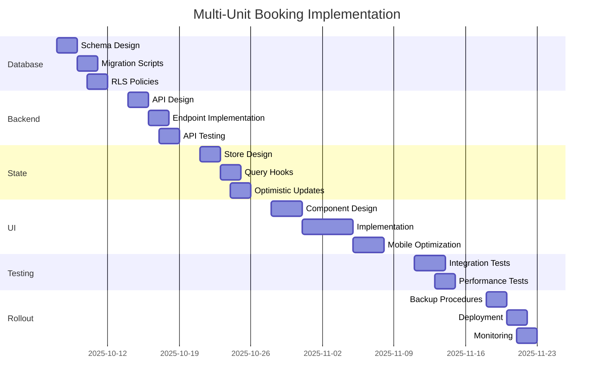

# Multi-Unit Booking: Master Implementation Plan

**Document Version:** 2.0 (Gap Resolutions Applied)
**Created:** October 7, 2025
**Last Updated:** October 7, 2025
**Status:** Planning Phase
**Schema Reference:** See `SCHEMA-REFERENCE.md` for canonical column names and types

---

## Executive Summary

### Objective

Transform the Okaeri Resort System from single-unit bookings (1:1 relationship) to multi-unit bookings (1:N relationship) with unified payment processing for multiple units.

**Critical Context:** No existing users, so we can make breaking changes and wipe existing test data for a clean implementation.

### Gap Resolutions Applied (Updated October 2025)

This plan incorporates resolutions for 8 critical feedback gaps plus 14 original architectural gaps:

#### Feedback-Driven Decisions (8 Gaps)

1. ✅ **Infrastructure:** Cloudflare Pages + Workers only (no Vercel)
2. ✅ **Documentation:** Complete file structure with API-STANDARDS.md, migrations/
3. ✅ **Payment Endpoints:** `/payments/record` (manual payment recording semantics)
4. ✅ **Availability Policy:** Aggressive (Pending doesn't block, manager is gatekeeper)
5. ✅ **Backwards Compatibility:** Junction-only, `unit_id = NULL` for new bookings
6. ✅ **Pricing:** Recalculate on submit, peak season via date ranges
7. ✅ **Monitoring:** Deferred to post-launch (basic logging only initially)
8. ✅ **Emergency Controls:** YOLO (no kill switches, database rollback only)

#### Original Architecture Decisions (14 Gaps)

1. ✅ **Schema Constraint:** Any `booking_units` rows → `is_multi_unit = TRUE` (even for 1 unit)
2. ✅ **Column Names:** Standardized on `check_in`, `check_out`, `booking_status`, `payment_status`
3. ✅ **RLS + guest_id:** Both authenticated and anonymous bookings create guest records
4. ✅ **Availability Lifecycle:** Complete triggers for INSERT, UPDATE, DELETE on `booking_units`
5. ✅ **Payments Unification:** Full payment model with adjustments and refunds
6. ✅ **No Feature Flags:** Direct deployment (no gradual rollout needed)
7. ✅ **Centralized Pricing:** Server-side `/api/pricing/quote` as single source of truth
8. ✅ **Auth Middleware:** Free-tier Cloudflare Workers middleware for all endpoints
9. ✅ **Availability API:** Includes `next_available_date` computation
10. ✅ **Public RLS:** Sanitized `public_unit_availability` view without `booking_id`
11. ✅ **No API Versioning:** Single `/api/` namespace (no users to maintain compatibility for)
12. ✅ **Timezone Handling:** TIMESTAMPTZ stored as UTC, displayed as Asia/Manila
13. ✅ **Testing Targets:** ≥95% accessibility, zero critical violations (pragmatic)
14. ✅ **No Legacy Adapter:** Idealized implementation (app can break during development)

See `SCHEMA-REFERENCE.md` for canonical data types and column names.

### Business Value

- **Primary Problem Solved**: Guests can book multiple units (e.g., 2 cabins) in a single transaction with one payment, eliminating the need for separate bookings and payments
- **Revenue Impact**: Reduced transaction fees, potential for bulk discounts to drive larger bookings
- **Customer Experience**: Simplified booking process for families and groups
- **Operational Efficiency**: Single booking reference for multiple units reduces management overhead

### Success Metrics

| Metric                     | Target                               | Measurement                          |
| -------------------------- | ------------------------------------ | ------------------------------------ |
| Multi-Unit Booking Support | 2-10 units per booking               | System capacity test                 |
| Performance                | <200ms API response, <100ms DB query | Performance benchmarks               |
| Payment Processing         | 50% reduction in transaction fees    | Unified payment vs separate payments |
| Data Integrity             | Zero corruption incidents            | Post-deployment monitoring (30 days) |
| User Satisfaction          | ≥4.5/5 stars                         | Early user feedback                  |
| System Availability        | 99% uptime                           | Uptime monitoring                    |
| Test Coverage              | ≥90%                                 | Code coverage reports                |
| Accessibility Score        | ≥95% Lighthouse, 0 critical issues   | Automated accessibility testing      |

---

## Current State Analysis

### Existing Architecture

**Database Layer:**

```sql
-- Current: Direct 1:1 relationship
CREATE TABLE bookings (
    booking_id UUID PRIMARY KEY,
    unit_id UUID NOT NULL REFERENCES units(unit_id),  -- Single unit
    total_amount DECIMAL(10,2),
    -- ...
);
```

**Application Layer:**

- Booking form: Single unit dropdown selector
- State: `booking.unit_id` (single string)
- Pricing: Single unit calculation
- Payment: One transaction per booking/unit

**Key Limitations:**

1. ❌ Cannot book multiple units in one transaction
2. ❌ Separate payments required for each unit
3. ❌ No bulk discount capability
4. ❌ Poor UX for group bookings
5. ❌ Higher transaction fees for multiple units

### Impact Analysis

**Affected Systems:**

- Database: Schema changes (junction tables)
- Backend: API endpoints, business logic
- Frontend: UI components, forms, state management
- Payments: Consolidated payment processing
- Reports: Multi-unit booking analytics
- Audit: Logging for unit-level operations

**Affected Features:**

- **High Impact**: Booking creation, availability checking, pricing, payments
- **Medium Impact**: Dashboard metrics, reports, guest management
- **Low Impact**: Audit logs, search filters

---

## Target State Architecture

### Database Layer

**New Junction Table Pattern:**

```sql
-- Multi-unit support via junction table
CREATE TABLE booking_units (
    booking_unit_id UUID PRIMARY KEY,
    booking_id UUID REFERENCES bookings(booking_id),
    unit_id UUID REFERENCES units(unit_id),
    unit_price DECIMAL(10,2),
    assigned_guests INTEGER,
    -- ...
    UNIQUE(booking_id, unit_id)
);

-- Simplified schema (no legacy compatibility needed)
ALTER TABLE bookings
    ALTER COLUMN check_in TYPE TIMESTAMPTZ,  -- Upgrade to timestamptz
    ALTER COLUMN check_out TYPE TIMESTAMPTZ,
    ALTER COLUMN unit_id DROP NOT NULL,  -- Nullable for multi-unit
    ADD COLUMN is_multi_unit BOOLEAN DEFAULT FALSE,
    ADD COLUMN unit_count INTEGER DEFAULT 1;
```

**Key Design Decisions:**

1. ✅ Junction table (`booking_units`) enables 1:N relationship
2. ✅ Any rows in `booking_units` → `is_multi_unit = TRUE` (even for 1 unit)
3. ✅ Denormalized availability table for fast queries with exclusion constraints
4. ✅ Triggers maintain complete data integrity (including DELETE/UPDATE lifecycle)
5. ✅ Guest records created for both authenticated and anonymous bookings
6. ✅ Unified payment design from day 1 (payments reference `booking_id` not `unit_id`)
7. ✅ Server-side pricing calculation as single source of truth

### Application Layer

**State Management:**

```typescript
interface MultiUnitBooking {
  booking_id: string;
  booking_units: Array<{
    unit_id: string;
    unit_price: number;
    assigned_guests: number;
    pricing: PricingBreakdown;
  }>;
  total_amount: number;
  is_multi_unit: boolean;
  // ...
}
```

**User Flow:**

1. User selects dates → Check-in/Check-out
2. System shows available units
3. User adds multiple units to booking (1-10 units)
4. Optional: Assign specific guests to units
5. System calculates combined pricing (with bulk discounts)
6. User makes single payment for all units
7. System creates booking with multiple unit associations

---

## Implementation Roadmap

### Timeline Overview

```
Week 1: Database Foundation (postgres-serverless-architect)
Week 2: Backend API (cloudflare-resort-api-architect)
Week 3: State Management (zustand-tanstack-resort-architect)
Week 4-5: UI Components (resort-ui-designer)
Week 6: Integration & Testing (code-quality-reviewer)
Week 7: Migration & Rollout (cloudflare-deployment-optimizer)
```

**Total Duration:** 7 weeks (35 working days)
**Target Completion:** November 25, 2025

### Phase Breakdown

| Phase                              | Dates                | Lead Agent                          | Key Deliverables                       |
| ---------------------------------- | -------------------- | ----------------------------------- | -------------------------------------- |
| **Phase 1: Database Foundation**   | Oct 7-11, 2025       | `postgres-serverless-architect`     | Schema DDL, migrations, RLS policies   |
| **Phase 2: Backend API**           | Oct 14-18, 2025      | `cloudflare-resort-api-architect`   | API endpoints, serverless functions    |
| **Phase 3: State Management**      | Oct 21-25, 2025      | `zustand-tanstack-resort-architect` | Zustand stores, TanStack Query hooks   |
| **Phase 4: UI Components**         | Oct 28 - Nov 8, 2025 | `resort-ui-designer`                | React components, forms, UX flows      |
| **Phase 5: Integration & Testing** | Nov 11-15, 2025      | `code-quality-reviewer`             | E2E tests, performance benchmarks      |
| **Phase 6: Migration & Rollout**   | Nov 18-22, 2025      | `cloudflare-deployment-optimizer`   | Direct deployment, rollback procedures |

### Critical Path Dependencies



---

## Risk Analysis & Mitigation

### High-Risk Items

#### 1. Database Migration Failure

**Risk Level:** 🔴 HIGH
**Impact:** Data loss, system downtime
**Probability:** Medium

**Mitigation:**

- ✅ Full database backup before migration
- ✅ Test migration on staging with production data clone
- ✅ Rollback script tested and ready
- ✅ Migration run during low-traffic window
- ✅ Database administrator on standby

**Contingency:**

- Execute rollback script within 5 minutes
- Revert to backup if rollback fails
- Estimated recovery time: <15 minutes

#### 2. Performance Degradation

**Risk Level:** 🟡 MEDIUM
**Impact:** Slow booking process, poor UX
**Probability:** Medium

**Mitigation:**

- ✅ Load testing with 10+ units per booking
- ✅ Database query optimization (indexes, prepared statements)
- ✅ Denormalized availability table for fast lookups
- ✅ Connection pooling optimization for Neon
- ✅ Performance benchmarks before rollout

**Contingency:**

- Immediate rollback via database restore if critical performance issues
- Revert Cloudflare Workers to previous version
- Estimated rollback time: <15 minutes

#### 3. Data Inconsistency

**Risk Level:** 🟡 MEDIUM
**Impact:** Booking/payment mismatches
**Probability:** Low

**Mitigation:**

- ✅ Atomic transactions for all multi-unit operations
- ✅ Database constraints (foreign keys, exclusion, triggers)
- ✅ Comprehensive validation at API layer
- ✅ Consistency checks in cron jobs
- ✅ Audit trail for all changes

**Contingency:**

- Manual data reconciliation procedures
- Database consistency repair scripts
- Audit log analysis for root cause

#### 4. Poor User Experience

**Risk Level:** 🟢 LOW
**Impact:** User confusion, abandoned bookings
**Probability:** Medium

**Mitigation:**

- ✅ User testing with target audience
- ✅ Progressive disclosure (simple → complex)
- ✅ Clear error messages and validation
- ✅ Tutorial/onboarding for new feature
- ✅ Mobile-first responsive design

**Contingency:**

- Quick UX iteration based on feedback
- Optional fallback to single-unit mode
- In-app help and tooltips

### Medium-Risk Items

- **Payment Processing Issues**: Tested in sandbox, gradual rollout
- **Mobile Experience**: Early mobile testing, responsive design review
- **Security Vulnerabilities**: Security audit at each phase gate
- **Availability Checking Accuracy**: Comprehensive test scenarios

### Low-Risk Items

- Documentation gaps: Continuous documentation updates
- Team knowledge transfer: Pair programming, code reviews
- Monitoring blind spots: Comprehensive logging and alerts

---

## Technical Architecture

### Database Schema Changes

**New Tables:**

```sql
-- Junction table for multi-unit relationships
CREATE TABLE booking_units (
    booking_unit_id UUID PRIMARY KEY DEFAULT gen_random_uuid(),
    booking_id UUID NOT NULL REFERENCES bookings(booking_id) ON DELETE CASCADE,
    unit_id UUID NOT NULL REFERENCES units(unit_id) ON DELETE RESTRICT,
    unit_price DECIMAL(10,2) NOT NULL,
    weekend_surcharge DECIMAL(10,2) DEFAULT 0,
    extra_person_charge DECIMAL(10,2) DEFAULT 0,
    subtotal DECIMAL(10,2) NOT NULL,
    assigned_guests INTEGER,
    guest_names TEXT[],
    unit_notes TEXT,
    created_at TIMESTAMPTZ DEFAULT NOW(),
    updated_at TIMESTAMPTZ DEFAULT NOW(),
    UNIQUE(booking_id, unit_id)
);

-- Denormalized availability for performance
CREATE TABLE booking_unit_availability (
    availability_id UUID PRIMARY KEY DEFAULT gen_random_uuid(),
    unit_id UUID NOT NULL REFERENCES units(unit_id) ON DELETE CASCADE,
    booking_id UUID NOT NULL REFERENCES bookings(booking_id) ON DELETE CASCADE,
    check_in TIMESTAMPTZ NOT NULL,
    check_out TIMESTAMPTZ NOT NULL,
    booking_status VARCHAR(20) NOT NULL,
    -- Aggressive blocking: Only Confirmed and CheckedIn bookings block availability
    EXCLUDE USING gist (
        unit_id WITH =,
        tstzrange(check_in, check_out, '[)') WITH &&
    ) WHERE (booking_status IN ('Confirmed', 'CheckedIn'))
);
```

**Modified Tables:**

```sql
ALTER TABLE bookings
    ALTER COLUMN unit_id DROP NOT NULL,  -- Nullable for multi-unit
    ADD COLUMN is_multi_unit BOOLEAN DEFAULT FALSE,
    ADD COLUMN unit_count INTEGER DEFAULT 1 CHECK (unit_count > 0),
    ADD COLUMN base_amount DECIMAL(10,2),
    ADD COLUMN total_surcharges DECIMAL(10,2) DEFAULT 0,
    ADD COLUMN discount_amount DECIMAL(10,2) DEFAULT 0;
```

### API Endpoints

**New Endpoints:**

```
POST   /api/bookings/multi-unit          # Create multi-unit booking
POST   /api/bookings/:id/units           # Add unit to booking
DELETE /api/bookings/:id/units/:unitId   # Remove unit from booking
GET    /api/availability/multi-unit      # Check multiple units
PUT    /api/bookings/:id/guests/assign   # Assign guests to units
```

**Modified Endpoints:**

```
GET    /api/bookings/:id                 # Return units array
PUT    /api/bookings/:id                 # Support unit updates
```

### State Management Architecture

**New Stores:**

- `useMultiUnitBookingStore`: Complex multi-unit state with optimistic updates
- Offline queue for resilience
- Conflict resolution for concurrent edits

**TanStack Query Hooks:**

- `useMultiUnitBookings`: Fetch bookings with unit relationships
- `useMultiUnitAvailability`: Batch availability checking
- `useCreateMultiUnitBooking`: Optimistic creation with rollback
- `useAddUnitToBooking`: Optimistic unit addition
- `useRemoveUnitFromBooking`: Optimistic unit removal

---

## Implementation Strategy

### Backwards Compatibility Approach

**Dual-Mode Operation:**

```typescript
// Support both modes
interface Booking {
  // Legacy single-unit
  unit_id?: string;

  // New multi-unit
  is_multi_unit: boolean;
  booking_units?: BookingUnit[];
}

// Compatibility adapter
function getBookingUnits(booking: Booking): BookingUnit[] {
  if (booking.is_multi_unit) {
    return booking.booking_units || [];
  }
  // Convert legacy single-unit to array
  return booking.unit_id ? [legacyUnitToBookingUnit(booking)] : [];
}
```

### Migration Strategy

**Deployment Strategy (Simplified - No Users Yet):**

1. **Wipe & Migrate:** Delete all test bookings, run full schema migration
2. **Deploy All At Once:** Backend API + Frontend + Database in single deployment
3. **Monitor:** Track errors and performance for 48 hours
4. **Iterate:** Fix bugs quickly (no rollback concerns since no real users)

**No Feature Flags Needed:**

- ❌ No gradual rollout (no users to protect)
- ❌ No A/B testing (no traffic to split)
- ❌ No beta users (everyone gets new version)
- ✅ Simple rollback: redeploy previous version + restore database backup

---

## Testing Strategy

### Test Coverage Requirements

| Layer            | Coverage Target     | Test Types                                  |
| ---------------- | ------------------- | ------------------------------------------- |
| Database         | 100%                | Migration scripts, RLS policies, triggers   |
| API              | 95%                 | Unit, integration, contract tests           |
| State Management | 95%                 | Unit, integration tests                     |
| UI Components    | 90%                 | Component, integration, accessibility tests |
| E2E Flows        | 100% critical paths | Playwright E2E tests                        |

### Critical Test Scenarios

**1. Multi-Unit Booking Creation**

- ✅ Create booking with 2 units
- ✅ Create booking with 10 units (max)
- ✅ Validate pricing calculation
- ✅ Verify payment processing
- ✅ Check availability for all units

**2. Availability Checking**

- ✅ All units available → proceed
- ✅ Some units unavailable → show error
- ✅ Unit becomes unavailable during booking → handle gracefully
- ✅ Concurrent bookings for same unit → prevent double-booking

**3. Guest Assignment**

- ✅ Assign guests to specific units
- ✅ Update guest assignments
- ✅ Validate guest count per unit

**4. Payment Processing (Unified Design)**

- ✅ Unified payment for multiple units
- ✅ Payment adjustments when units added/removed
- ✅ Payment failure handling
- ✅ Partial/full refund scenarios

**5. Guest Management**

- ✅ Authenticated user creates guest record
- ✅ Anonymous booking creates guest record (user_id NULL)
- ✅ Guest can claim bookings after registration

**6. Performance**

- ✅ Load test with 10 units per booking
- ✅ Concurrent multi-unit bookings
- ✅ Database query performance under load (<100ms)
- ✅ API response times (<200ms)

**7. Edge Cases**

- ✅ Remove last unit from booking (should fail)
- ✅ Add unit after payment (triggers payment adjustment)
- ✅ Timezone edge cases (Manila → UTC → Manila)
- ✅ Booking with continuous date ranges
- ✅ Add duplicate unit (should fail)
- ✅ Exceed max units limit
- ✅ Offline booking creation and sync

---

## Success Criteria & Acceptance

### Phase Gate Criteria

Each phase must meet these criteria before proceeding:

**Phase 1 (Database):**

- [ ] Migration successful on staging
- [ ] All existing bookings migrated
- [ ] Performance benchmarks met (<100ms queries)
- [ ] RLS policies tested
- [ ] Rollback script verified

**Phase 2 (Backend):**

- [ ] All API endpoints implemented
- [ ] API tests achieve 95% coverage
- [ ] Response times <200ms
- [ ] Error handling comprehensive
- [ ] Backwards compatibility verified

**Phase 3 (State):**

- [ ] Stores implemented and tested
- [ ] Optimistic updates working
- [ ] Offline support functional
- [ ] 95% test coverage
- [ ] Type safety validated

**Phase 4 (UI):**

- [ ] All components implemented
- [ ] Mobile responsive
- [ ] WCAG 2.1 AA compliant
- [ ] User testing positive feedback
- [ ] Visual regression tests passing

**Phase 5 (Testing):**

- [ ] All E2E tests passing
- [ ] 90% overall code coverage
- [ ] Performance benchmarks met
- [ ] No critical/high bugs
- [ ] Security audit approved

**Phase 6 (Rollout):**

- [ ] Rollback procedures tested
- [ ] Monitoring in place
- [ ] Rollback tested
- [ ] Zero-downtime deployment
- [ ] User satisfaction maintained

### Launch Readiness Checklist

**Technical Readiness:**

- [ ] All code merged to main branch
- [ ] All tests passing (unit, integration, E2E)
- [ ] Performance benchmarks achieved
- [ ] Security audit completed and approved
- [ ] Database backups verified
- [ ] Rollback procedures tested

**Operational Readiness:**

- [ ] Monitoring and alerts configured
- [ ] Runbooks created for common issues
- [ ] Support team trained
- [ ] User documentation published
- [ ] FAQ and help articles ready

**Business Readiness:**

- [ ] Stakeholder approval obtained
- [ ] Marketing materials prepared (if applicable)
- [ ] Customer communication plan ready
- [ ] Rollback decision criteria defined

---

## Post-Launch Plan

### Monitoring & Observability

**Key Metrics to Monitor:**

```typescript
// Performance metrics
- API response time (p50, p95, p99)
- Database query time
- Availability check latency
- Payment processing time

// Business metrics
- Multi-unit booking adoption rate
- Average units per booking
- Bulk discount redemption rate
- Transaction fee savings

// Error metrics
- API error rates
- Database errors
- Payment failures
- Availability check failures

// User experience metrics
- Booking completion rate
- Abandonment rate
- Time to complete booking
- User satisfaction scores
```

**Alert Thresholds:**

- 🔴 Critical: API errors >1%, response time >1s, downtime >1min
- 🟡 Warning: Response time >500ms, error rate >0.5%
- 🟢 Info: New feature usage milestones

### Rollback Triggers

**Immediate Rollback Criteria:**

1. Data corruption detected
2. Payment processing failures >5%
3. System downtime >5 minutes
4. Critical security vulnerability
5. Database performance degradation >50%

**Gradual Rollback Criteria:**

1. User satisfaction drops below 4.0/5
2. Booking completion rate drops >10%
3. Support tickets increase >200%
4. Non-critical bugs accumulate >20

### Continuous Improvement

**Week 1-2 Post-Launch:**

- Daily monitoring of all metrics
- Quick bug fixes and hotfixes
- User feedback collection
- Performance tuning

**Week 3-4 Post-Launch:**

- Analyze usage patterns
- Identify UX improvements
- Optimize based on real data
- Monitor system stability

**Month 2-3 Post-Launch:**

- Feature enhancements based on feedback
- Performance optimizations
- Documentation updates
- Team retrospective

---

## Resources & Dependencies

### Required Infrastructure

- Neon PostgreSQL: Existing (no additional cost)
- Cloudflare Workers: Existing (within free tier)
- Supabase: Existing (within free tier)

### External Dependencies

- btree_gist extension: Required for exclusion constraints
- Database migration tool: Existing
- Backup/restore procedures: To be documented

### Team Allocation

- Backend: 1 developer (postgres-serverless-architect, cloudflare-resort-api-architect)
- Frontend: 1 developer (resort-ui-designer, zustand-tanstack-resort-architect)
- QA/Testing: 1 developer (code-quality-reviewer)
- DevOps: 0.5 developer (cloudflare-deployment-optimizer)

---

## Appendices

### Glossary

- **Junction Table**: A database table that creates many-to-many relationships
- **Optimistic Update**: UI update before server confirmation
- **RLS**: Row Level Security (PostgreSQL security feature)
- **Denormalization**: Duplicating data for performance
- **Exclusion Constraint**: Database constraint preventing overlapping ranges

### References

- Database Schema: `database/schema.sql`
- Current Booking Flow: `docs/booking-flow.md`
- API Documentation: `docs/api/`
- Agent Assignments: `AGENT-ASSIGNMENTS.md`

### Version History

| Version | Date            | Author           | Changes             |
| ------- | --------------- | ---------------- | ------------------- |
| 1.0     | October 7, 2025 | System Architect | Initial master plan |

---

**Next Steps:**

1. Review and approve this master plan
2. Begin Phase 1 with `postgres-serverless-architect`
3. Set up project tracking board
4. Schedule weekly progress reviews
