# Architecture Diagrams

> **Visual system architecture for public availability calendar**

This document provides comprehensive visual diagrams of the public availability calendar system architecture, data flows, component hierarchy, and caching strategy.

---

## System Architecture Overview

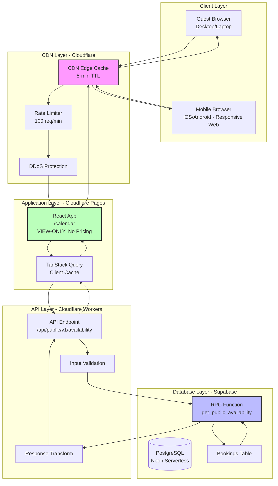

---

## Data Flow Diagram

### Request Flow (Happy Path)

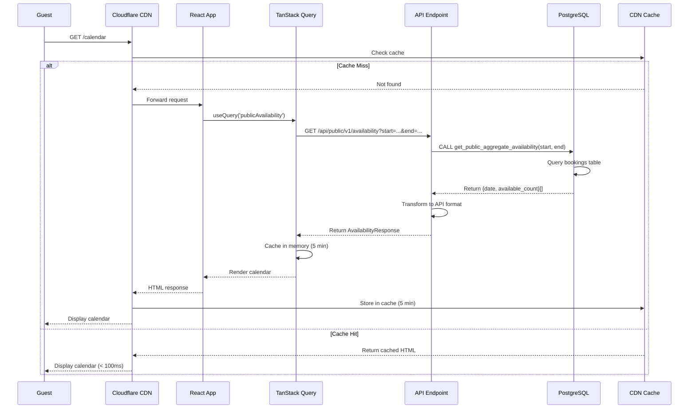

### Stale-While-Revalidate Flow

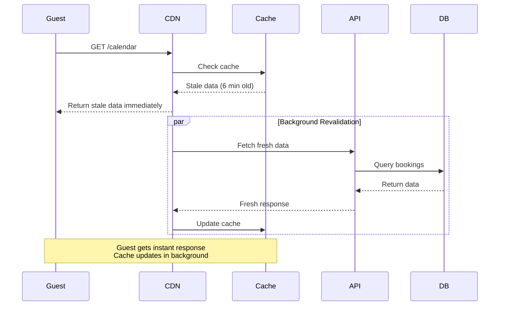

---

## Component Hierarchy

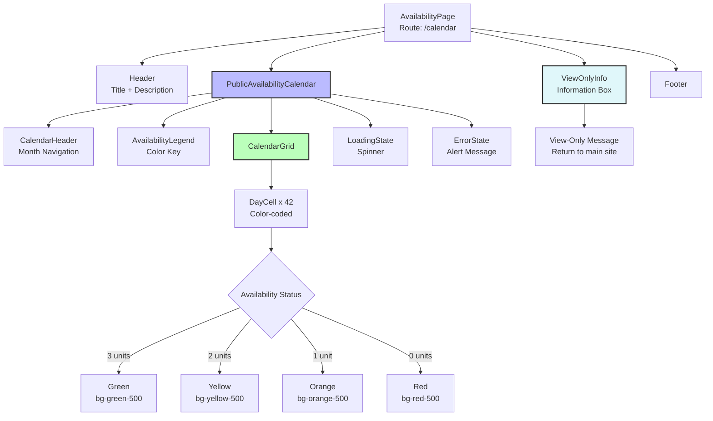

---

## Database Query Flow

```mermaid
graph LR
    subgraph "API Layer"
        A[API Request<br/>start=2025-01-01<br/>end=2025-01-31]
    end

    subgraph "PostgreSQL Function"
        B[get_public_availability]
        C[Generate Date Series<br/>Jan 1 - Jan 31]
        D[LEFT JOIN bookings]
        E[WHERE status IN<br/>'Confirmed', 'CheckedIn']
        F[GROUP BY date<br/>COUNT DISTINCT unit_id]
        G[Calculate:<br/>3 - occupied_count]
    end

    subgraph "Database Tables"
        H[(bookings table<br/>3 confirmed bookings)]
        I[Index:<br/>idx_bookings_status_dates]
    end

    A --> B
    B --> C
    C --> D
    D --> E
    E --> F
    F --> G
    D --> H
    H --> I
    I --> D

    G --> J[Return:<br/>{date, available_count}[]]
    J --> A

    style B fill:#bbf,stroke:#333,stroke-width:2px
    style H fill:#fbb,stroke:#333,stroke-width:2px
```

### SQL Query Breakdown

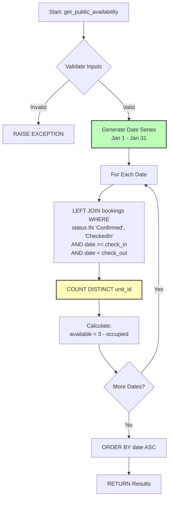

---

## Caching Strategy Layers

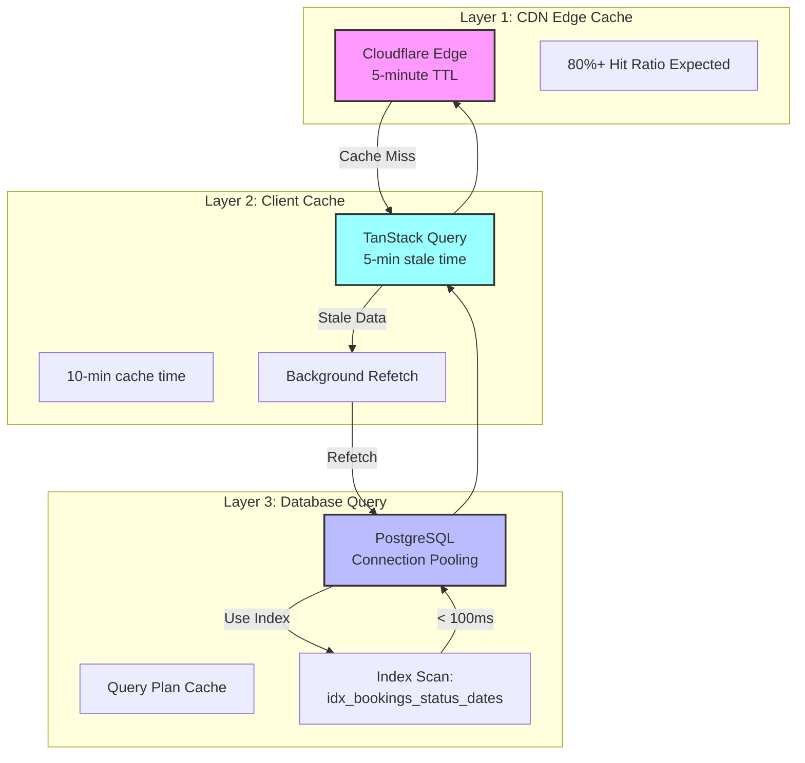

---

## State Management Flow

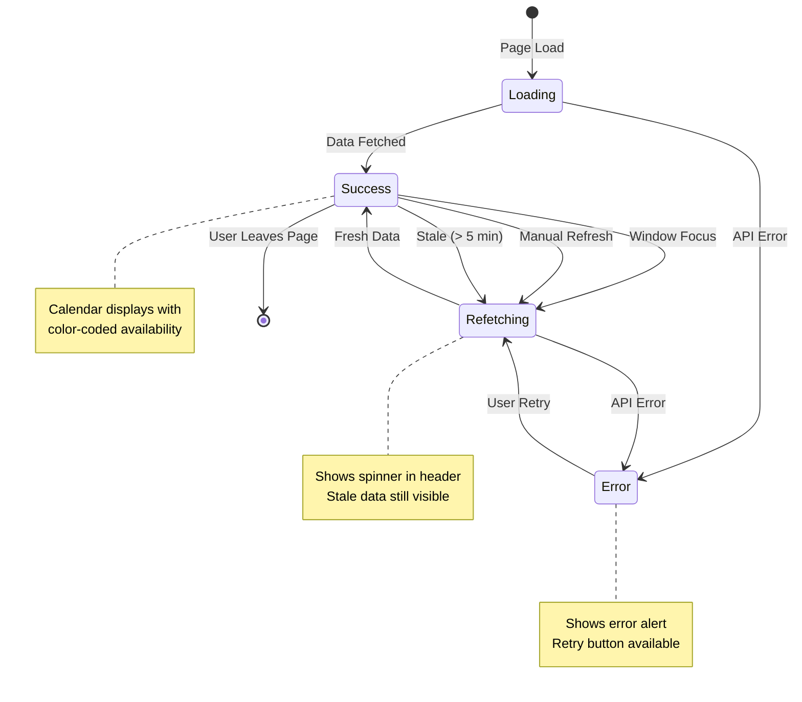

---

## Security Model

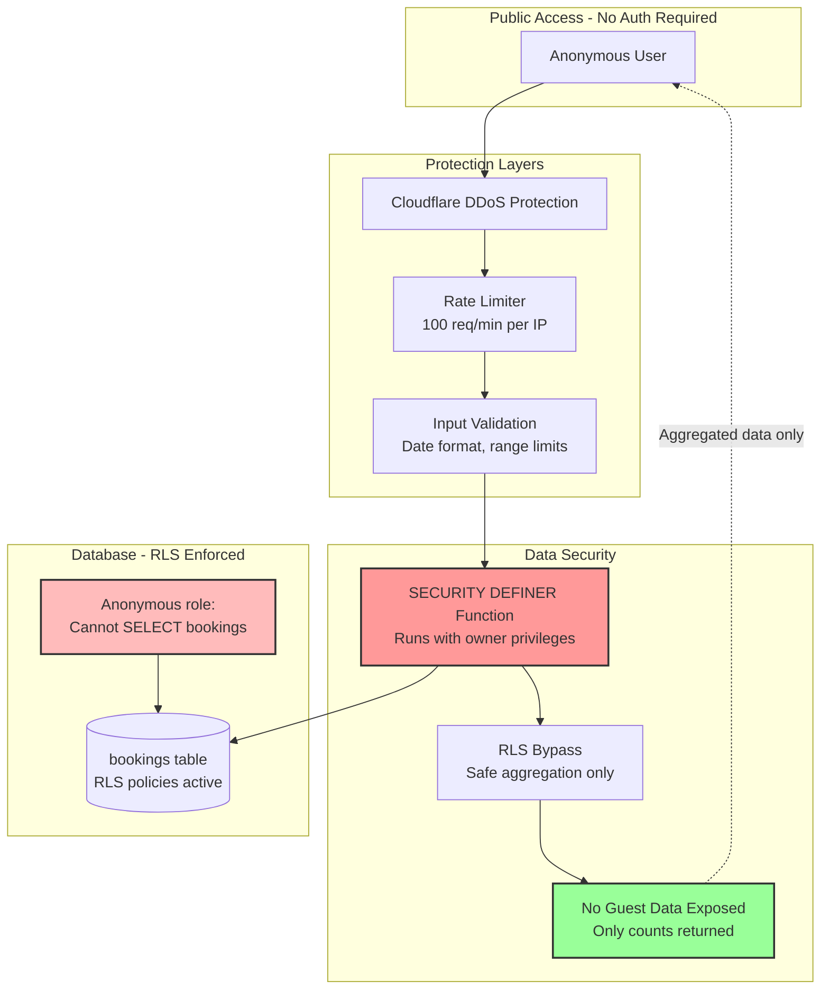

### Data Privacy Flow

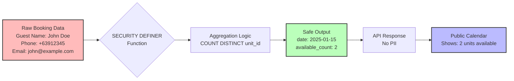

---

## Performance Optimization Flow

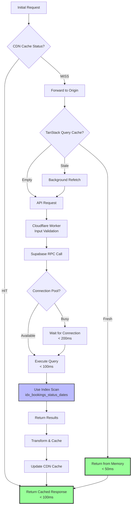

---

## Error Handling Flow

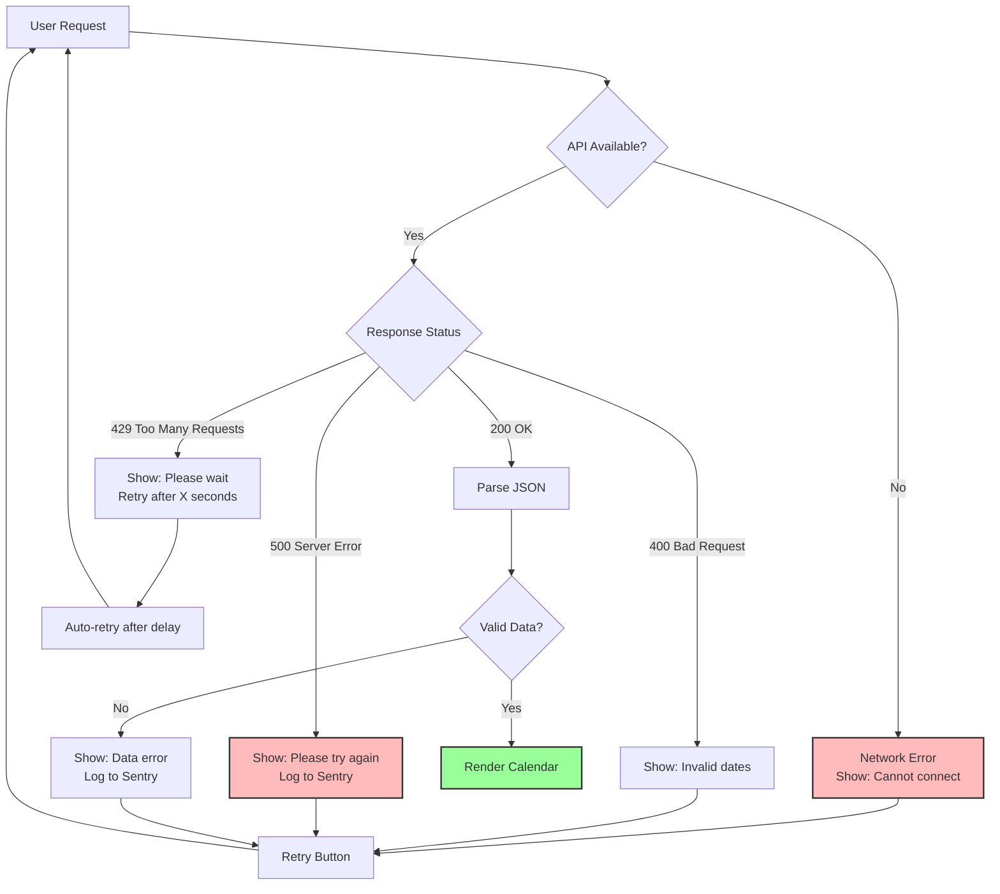

---

## Mobile User Flow

> **📌 Note**: Calendar is VIEW-ONLY. Guests return to main website to contact resort for booking.

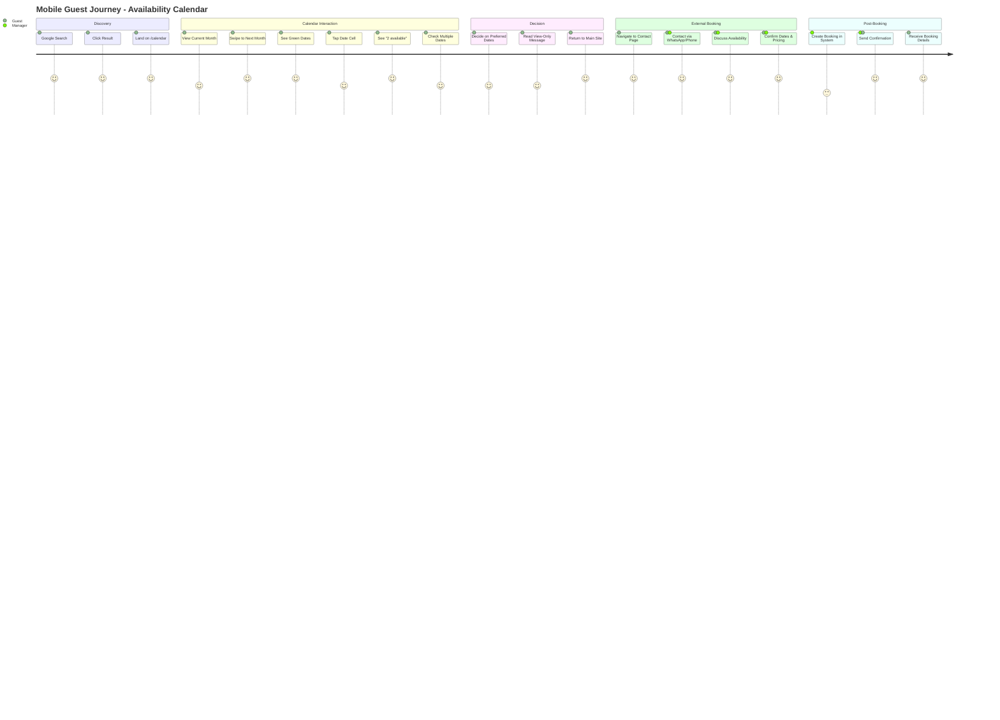

---

## Deployment Pipeline

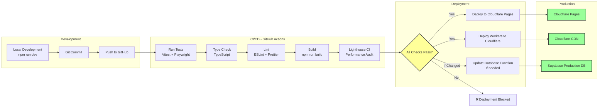

---

## Monitoring & Alerting

```mermaid
graph TB
    subgraph "Data Sources"
        A[Cloudflare Analytics<br/>API metrics]
        B[Cloudflare Web Analytics<br/>Page performance]
        C[Sentry (Recommended)<br/>Error tracking]
        D[TanStack Query DevTools<br/>Cache inspection]
    end

    subgraph "Metrics Collection"
        E[Request Count<br/>50-100 req/hour]
        F[Error Rate<br/>Target: < 1%]
        G[Response Time<br/>P95: < 500ms]
        H[Cache Hit Ratio<br/>Target: > 80%]
        I[Page Load Time<br/>P95: < 2s]
        J[Date Interaction Rate<br/>Target: > 15%]
    end

    subgraph "Alerting"
        K{Threshold Exceeded?}
        L[Slack Alert]
        M[Email Alert]
        N[SMS Alert<br/>Critical only]
    end

    A --> E
    A --> F
    A --> G
    A --> H
    B --> I
    B --> J
    C --> F

    E --> K
    F --> K
    G --> K
    H --> K
    I --> K

    K -->|Warning| L
    K -->|Critical| M
    K -->|Emergency| N

    style K fill:#ff9,stroke:#333,stroke-width:2px
    style N fill:#f99,stroke:#333,stroke-width:2px
```

---

## Rollback Strategy

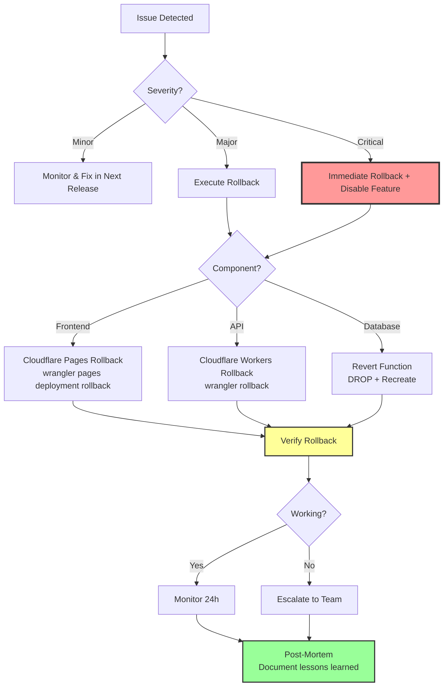

---

## Future Enhancements Roadmap

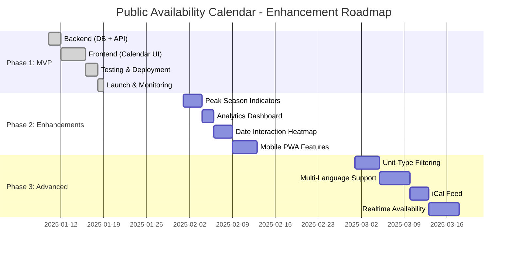

---

## Diagram Legend

### Colors

- **Pink (#f9f)**: CDN/Caching layer
- **Light Blue (#bbf)**: Database/Backend
- **Light Green (#bfb)**: Frontend/UI
- **Yellow (#ff9)**: Decision points
- **Red (#f99)**: Errors/Critical paths
- **Light Red (#fbb)**: Security boundaries
- **Cyan (#9ff)**: Cache layers

### Symbols

- **Rectangle**: Process/Component
- **Diamond**: Decision point
- **Cylinder**: Database
- **Circle**: Start/End point
- **Dotted Arrow**: Async/Background operation
- **Solid Arrow**: Synchronous flow

---

## Additional Resources

- [Master Plan](./00-master-plan.md) - Complete strategy
- [Phase 1: Backend](./01-phase-1-backend.md) - Database and API
- [Phase 2: Frontend](./02-phase-2-frontend.md) - React components
- [Phase 3: Deployment](./03-phase-3-deployment.md) - Testing and launch

---

**Document Version**: 1.0
**Last Updated**: 2025-01-10
**Maintained By**: Engineering Team
