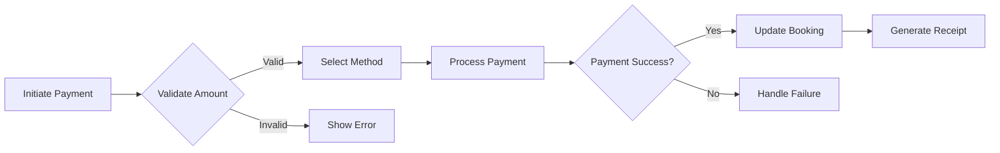

# 💳 Payment Processing Components

## Overview

The Payment Processing module manages all financial transactions within the resort system, including payment collection, receipt management, refunds, and financial reporting. It supports multiple payment methods with a focus on Philippine payment systems.

## 📁 Component Structure

```
payments/
├── PaymentForm.tsx      # Payment collection form (11KB)
├── PaymentsTable.tsx    # Payment history table (18.6KB)
└── components/
    ├── PaymentStatus.tsx
    ├── ReceiptUpload.tsx
    └── PaymentSummary.tsx
```

## 📦 Component Documentation

### `PaymentForm` - Payment Collection
**Purpose**: Comprehensive payment collection with multiple payment methods

**Features**:
- Multiple payment method support
- Real-time validation
- Receipt upload
- Partial payment handling
- Auto-calculation of balance

**Props**:
```typescript
interface PaymentFormProps {
  bookingId: string
  totalAmount: number
  paidAmount?: number
  onSuccess?: (payment: Payment) => void
  onCancel?: () => void
  allowPartial?: boolean
  defaultMethod?: PaymentMethod
}
```

**Usage**:
```tsx
import { PaymentForm } from '@/components/payments'

function BookingPayment({ booking }) {
  const handlePaymentSuccess = (payment: Payment) => {
    toast.success(`Payment of ${formatCurrency(payment.amount)} received`)
    updateBookingStatus(booking.id, 'confirmed')
  }

  return (
    <PaymentForm
      bookingId={booking.booking_id}
      totalAmount={booking.total_amount}
      paidAmount={booking.paid_amount}
      onSuccess={handlePaymentSuccess}
      allowPartial={true}
      defaultMethod="gcash"
    />
  )
}
```

**Payment Methods**:
```typescript
const paymentMethods = [
  { value: 'cash', label: 'Cash', icon: '💵' },
  { value: 'gcash', label: 'GCash', icon: '📱' },
  { value: 'credit_card', label: 'Credit Card', icon: '💳' },
  { value: 'debit_card', label: 'Debit Card', icon: '💳' },
  { value: 'bank_transfer', label: 'Bank Transfer', icon: '🏦' },
  { value: 'paypal', label: 'PayPal', icon: '🅿️' }
]
```

**Form Fields**:
- Payment Amount* (with balance calculation)
- Payment Method* (dropdown)
- Reference Number (for digital payments)
- Receipt Upload (image/PDF)
- Payment Notes
- Payment Date (defaults to today)

### `PaymentsTable` - Payment History
**Purpose**: Comprehensive payment tracking and management

**Features**:
- Payment history timeline
- Filter by status/method
- Receipt viewing
- Refund processing
- Export to CSV
- Real-time status updates

**Props**:
```typescript
interface PaymentsTableProps {
  bookingId?: string  // Filter by booking
  guestId?: string    // Filter by guest
  dateRange?: DateRange
  onPaymentSelect?: (payment: Payment) => void
  showActions?: boolean
  compactView?: boolean
}
```

**Column Configuration**:
```typescript
const columns = [
  { key: 'reference', label: 'Reference #', sortable: true },
  { key: 'booking', label: 'Booking', link: true },
  { key: 'amount', label: 'Amount', sortable: true, format: 'currency' },
  { key: 'method', label: 'Method', filterable: true },
  { key: 'status', label: 'Status', filterable: true, badge: true },
  { key: 'date', label: 'Date', sortable: true, format: 'date' },
  { key: 'receipt', label: 'Receipt', type: 'action' }
]
```

**Status Badges**:
```tsx
const statusConfig = {
  pending: { color: 'yellow', icon: '⏳' },
  completed: { color: 'green', icon: '✅' },
  failed: { color: 'red', icon: '❌' },
  refunded: { color: 'blue', icon: '↩️' },
  partially_paid: { color: 'orange', icon: '⚠️' }
}
```

## 🏗️ Payment Processing Flow

### Payment Lifecycle


### State Management
```typescript
// Payment store integration
import { usePaymentStore } from '@/stores/usePaymentStore'

function PaymentManager() {
  const {
    payments,
    processPayment,
    validatePayment,
    generateReceipt
  } = usePaymentStore()

  const handlePayment = async (data: PaymentData) => {
    // Validate
    const validation = await validatePayment(data)
    if (!validation.valid) return

    // Process
    const result = await processPayment(data)

    // Generate receipt
    if (result.success) {
      await generateReceipt(result.paymentId)
    }
  }
}
```

## 💰 Payment Method Integrations

### GCash Integration
```typescript
interface GCashPayment {
  mobileNumber: string
  referenceNumber: string
  amount: number
  screenshot?: File  // Receipt screenshot
}

// Validation
const validateGCashNumber = (number: string) => {
  return /^(\+63|0)9\d{9}$/.test(number)
}
```

### Bank Transfer
```typescript
interface BankTransferPayment {
  bankName: string
  accountNumber: string
  referenceNumber: string
  transferDate: Date
  proofOfTransfer: File
}

const supportedBanks = [
  'BDO', 'BPI', 'Metrobank', 'UnionBank',
  'Security Bank', 'RCBC', 'PNB'
]
```

### Credit/Debit Card
```typescript
interface CardPayment {
  last4Digits: string
  authorizationCode: string
  cardType: 'visa' | 'mastercard' | 'jcb'
  processedBy: string
}
```

## 🧾 Receipt Management

### Receipt Upload
```typescript
const receiptUploadConfig = {
  maxSize: 5 * 1024 * 1024, // 5MB
  acceptedFormats: [
    'image/jpeg',
    'image/png',
    'application/pdf'
  ],
  compression: true,
  ocrEnabled: false // Phase 3 feature
}
```

### Receipt Generation
```typescript
interface ReceiptData {
  paymentId: string
  bookingReference: string
  guestName: string
  amount: number
  method: PaymentMethod
  date: Date
  items: ReceiptLineItem[]
}

// Generate PDF receipt
const generateReceipt = async (data: ReceiptData) => {
  const pdf = await createPDF(data)
  return pdf.download(`receipt-${data.paymentId}.pdf`)
}
```

## 🔒 Security Features

### Payment Validation
- Amount validation (positive, within limits)
- Reference number format validation
- Duplicate payment detection
- Fraud detection patterns

### Data Security
- PCI compliance for card data
- Encrypted storage for sensitive data
- Audit logging for all transactions
- Role-based access control

## 📊 Financial Reporting

### Payment Analytics
```typescript
interface PaymentMetrics {
  totalCollected: number
  pendingPayments: number
  averagePaymentTime: number
  paymentMethodBreakdown: Record<PaymentMethod, number>
  dailyCollections: DailyCollection[]
}
```

### Export Formats
```typescript
const exportPayments = (payments: Payment[], format: ExportFormat) => {
  switch(format) {
    case 'csv':
      return generateCSV(payments)
    case 'excel':
      return generateExcel(payments)
    case 'pdf':
      return generatePDFReport(payments)
  }
}
```

## 🎨 UI Components

### Payment Status Indicator
```tsx
<PaymentStatus
  status={payment.status}
  amount={payment.amount}
  showIcon
  size="large"
/>
```

### Payment Summary Card
```tsx
<PaymentSummary
  totalAmount={booking.total_amount}
  paidAmount={booking.paid_amount}
  balance={booking.balance}
  nextDueDate={booking.next_payment_date}
  showActions
/>
```

## 🧪 Testing

### Unit Tests
```typescript
describe('PaymentForm', () => {
  it('calculates balance correctly', () => {
    const { getByTestId } = render(
      <PaymentForm totalAmount={10000} paidAmount={3000} />
    )

    expect(getByTestId('balance')).toHaveTextContent('₱7,000')
  })

  it('validates GCash number format', () => {
    // Test Philippine mobile number format
  })
})
```

## 🚀 Performance

- Optimistic UI updates for instant feedback
- Debounced validation (200ms)
- Lazy loading of receipt images
- Virtualized payment list for large datasets
- Cached payment calculations

## 📚 Related Documentation

- [Booking Components](/src/components/bookings/README.md)
- [Payment Store](/src/stores/usePaymentStore.ts)
- [Financial Reports](/src/utils/reports.ts)
- [Database Schema](/database/SCHEMA.md#payments-table)

## 🔧 Configuration

```typescript
// Payment settings
export const paymentConfig = {
  minPaymentAmount: 100,
  maxPaymentAmount: 1000000,
  partialPaymentMinPercentage: 30,
  receiptRetentionDays: 365,
  allowedCurrencies: ['PHP', 'USD'],
  defaultCurrency: 'PHP'
}
```